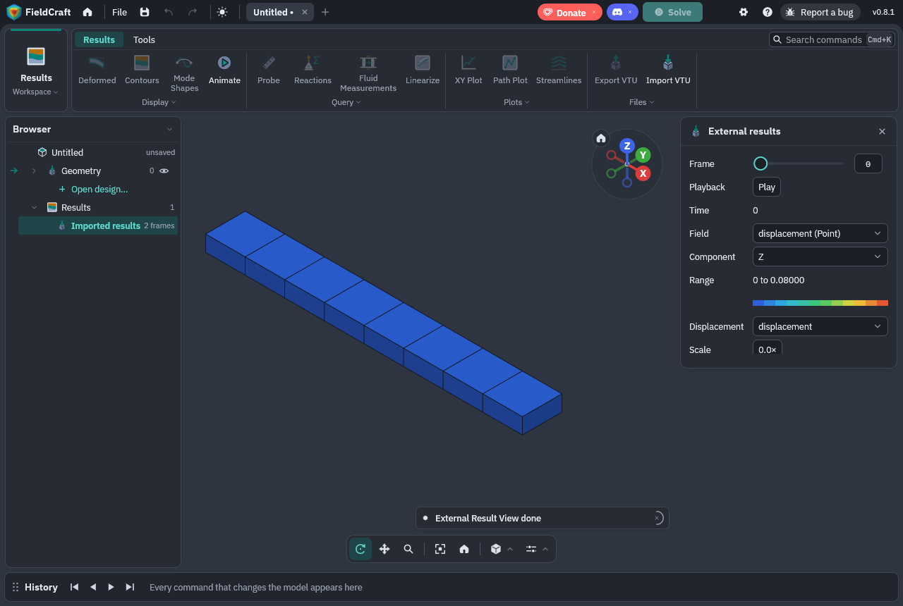
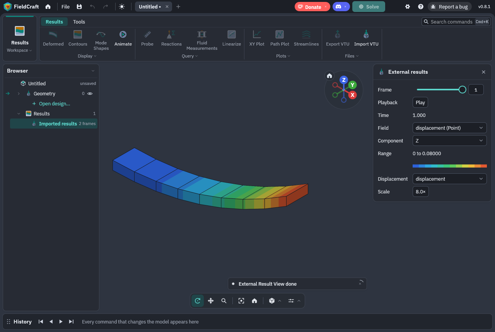

# Import external solver results

Open a `.vtu` grid, a single-piece `.pvtu` index, or a `.pvd` time collection with **Results → Files → Import VTU**. You can also drop the file on the desktop window. A project can hold one imported series alongside its editable mesh and its native solver results. A successful import replaces the previous imported series.

## From a solver to a FieldCraft project

1. Write the solution as a serial VTK unstructured grid. VTU files carry no length unit. Choose the source length unit when importing, or use the default of meters. FieldCraft converts grid coordinates to SI and applies the same conversion to any point vector you select as displacement. Contour arrays retain their original sample values and units. Each field needs a name and a tuple for every point or every cell, according to its association.
2. For a transient analysis, write one grid per output time and a PVD that lists the grids in strictly increasing time order, in seconds. Opening the PVD uses those times. Opening a standalone grid gives one frame at time zero. Use the frame slider to inspect a time step. Playback starts at the selected frame and stops at the last. The selected arrays must exist in each frame that playback will visit. The color scale for a selected field and component spans the series.
3. Choose a field in the results panel. For a vector, choose its magnitude or a Cartesian component. To show deformation, choose a two- or three-component **point** field under **Displacement**. A scale of 1 shows the physical displacement, 0 shows the reference shape, and 10 magnifies displacement tenfold. Color and displacement can come from different arrays.
4. Save the project as a `.fieldcraft` file. All frames, their meshes, their arrays and the selected view travel with it. You can move the project or reopen it after deleting the solver output. Saving with `"results": false` omits saved result data.

For example, an NGSolve script that already has a solved displacement `u` and a scalar field `temperature` can create a writer with `VTKOutput(ma=mesh, coefs=[u, temperature], names=["u", "temperature"], filename="solution", subdivision=1)`. Call its `Do(time=t)` after each solve. Subdivision can add visualization points, and neighboring cells can sample different values at coincident points. FieldCraft preserves those samples and each frame's coordinates. The same workflow works with other programs that produce the supported VTU layout. [NGSolve VTK output](https://docu.ngsolve.org/latest/i-tutorials/appendix-vtk/vtk.html)

For DOLFINx output from `dolfinx.io.VTKFile`, use one of the cell shapes and orders listed below. Open the `.pvd` for the time series, the `.pvtu` for a single time step if it lists one piece, or the serial `.vtu` itself. Keep the PVD, PVTU indexes, and VTU pieces in the directory layout the writer produced. Distributed PVTU output with several rank files requires a single-piece export. [DOLFINx VTK output example](https://fenicsproject.discourse.group/t/time-dependent-mesh-output-with-higher-order-elements/19788)

This script selects the second frame and saves the project.

```json
[
  {"command":"results.import.vtu","params":{"path":"solution.pvd","unit":"m"}},
  {"command":"results.external.view","params":{"frame":1,"association":"point","field":"temperature","displacement":"u","scale":10}},
  {"command":"file.save_as","params":{"path":"solution.fieldcraft"}}
]
```

## Try the included time series

Open `docs/recipes/vtu-bending-strip/bending.pvd`. Select frame 1 and choose `displacement` for both the contour and the displacement. At the free end of the two-meter strip, the prescribed vertical displacement is 0.08 m. At a scale of 8 the tip moves 0.64 m on screen. Returning to frame 0 restores the straight strip. [Bending strip collection](../recipes/vtu-bending-strip/bending.pvd)

| Reference frame at 0 s | Displaced frame at 1 s, scale 8 |
| --- | --- |
|  |  |

## Supported files

- One `UnstructuredGrid` piece per VTU. ASCII and binary numeric arrays are supported, including inline Base64, appended raw or Base64, and VTK zlib compression. Binary headers can be UInt32 or UInt64 in either byte order.
- Point and cell arrays keep their names, locations, component counts and numeric values. The viewer colors scalars and two- or three-component vectors. Wider arrays with up to nine components are stored. General field values retain their source units. The importer uses point indices within each frame, so discontinuous fields and moving or refined grids work without matching solver IDs to model nodes.
- Supported cells include vertices, lines, triangles, quads, tetrahedra, pyramids, wedges, and hexahedra, plus quadratic edges, triangles, quads, tetrahedra and hexahedra.
- First-degree VTK Lagrange curves, triangles, quadrilaterals, tetrahedra, hexahedra, and wedges (types 68–73) are stored as their fixed-size linear equivalents. Second-degree curves (3 points), triangles (6), and tetrahedra (10) are stored as their quadratic equivalents. Both representations use the same point ordering, so the conversion preserves every coordinate and field sample. Other Lagrange layouts, including 9-point quadrilaterals, 27-point hexahedra, and 18-point wedges, require an export on a supported visualization grid. [Kitware's Lagrange cell ordering](https://www.kitware.com/modeling-arbitrary-order-lagrange-finite-elements-in-the-visualization-toolkit/) and [VTK wedge ordering](https://docs.vtk.org/en/v9.7.1/release_details/9.7/fix-wedge-point-ordering.html)
- A PVD can contain up to 4,096 frames in one group, one serial VTU per time. Each time step can name the VTU directly or through a single-piece PVTU. A reference must resolve within the directory of its own index. Each frame is limited to two million points, two million cells, and 256 arrays. A single frame can use up to 256 MiB. Each PVD or PVTU index is limited to 4 MiB. The cumulative source bytes, including indexes, and estimated decoded storage each have a 512 MiB limit. If an import fails, the current model and its previous results stay available.
- Surface extraction and the drawn scene each have a 128 MiB working budget. If the grid or its contours exceed that budget, the viewport reports the display limit and the project keeps all imported fields.

The data layout follows the public VTK XML specification. [VTK XML file formats](https://docs.vtk.org/en/latest/vtk_file_formats/vtkxml_file_format.html)
