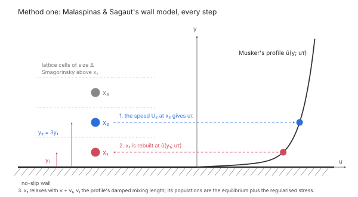
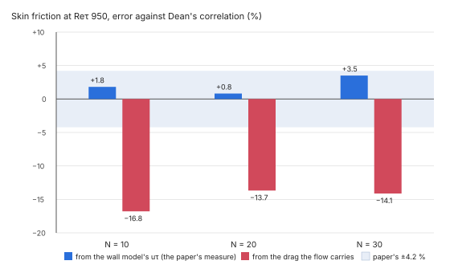
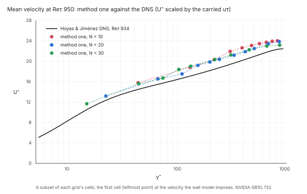

# Wall-modelled large-eddy simulation

A fluid step with Smagorinsky's model can model the wall instead of resolving it. Each fluid cell
next to a no-slip wall is rebuilt from a law of the wall, so a grid whose first cell lies in the log
layer still carries the wall's shear stress. Without a wall model such a grid has too little
resolution for the bounce-back wall to carry it.

The wall treatments are numbered in the order they are verified. Each one is first reproduced
against its paper's own case, then documented here with its measurements.

| Method | Wall treatment | Status |
|---|---|---|
| One | Malaspinas & Sagaut (2014): the first cell rebuilt from Musker's profile | Reproduces the paper at Re_τ 950. The drag the flow carries is 14–16 % below Dean's correlation. |

Method one runs with the multiple-relaxation-time collision, on the CPU and the GPU.

## Synopsis

```json
{"name": "Flow", "procedure": {
  "type": "fluid", "domain": "Channel", "end_time": 2.0,
  "collision": "mrt",
  "turbulence": {"type": "smagorinsky", "constant": 0.1, "wall_model": "musker"}
}}
```

`model.step.create` takes these fields. `solve.fluid` runs the step with `"backend": "cpu"` or
`"backend": "gpu"`.

## Parameters

| Field | Value | Meaning |
|---|---|---|
| `collision` | `"mrt"` | Multiple relaxation times (d'Humières et al. 2002). The wall model is validated with this collision only. |
| `turbulence.type` | `"smagorinsky"` | Required: the wall model is part of Smagorinsky's model. |
| `turbulence.constant` | 0.08–0.1 | Smagorinsky's C. The validation used 0.08 at Re_τ 1000 and 0.1 at Re_τ 2000. |
| `turbulence.wall_model` | `"musker"` | Rebuild the cells next to no-slip walls from Musker's profile. Omitted: the bounce-back alone. |
| `turbulence.van_driest` | omit | Van Driest damping is for wall-resolved grids. Don't combine it with a wall model. |

With the wall model, the fluid's own relaxation time may go down to τ = 0.5001. A grid that needs
a lower τ is refused with the value it needs.

## When to use it

- **Use it** when the first fluid cell's centre lies in the log layer, y⁺ ≈ 30–100. Typical
  cases are internal flows at Re_τ 10³ and above: ducts, heat-sink channels and fin passages.
- **Don't use it** for a wall-resolved grid, with the first cell at y⁺ ≲ 2. Use Van Driest damping
  or no wall treatment there.
- **Don't use it in the buffer layer** (y⁺ 5–30). The method is not designed or validated for a
  first cell there.

y⁺ = y u_τ / ν, where y is the distance of the cell centre from the wall, half a cell for a plane
wall on the grid.

## Method one: Malaspinas & Sagaut (2014)



Before each collision, for every wall cell x₁ (a fluid cell with a no-slip bounce-back link) and the
cell x₂ one link further along the wall normal:

1. **Friction velocity.** The velocity at x₂, relative to the wall, gives the direction e parallel
   to the wall and the speed U₂. u_τ is the root of U₂ = ũ(y₂; u_τ), where ũ is Musker's profile
   and y₂ = 3 y₁. The profile covers the viscous sublayer, the buffer layer and the log law in one
   expression. Each root is solved by Newton's method, guarded by bisection.
2. **Velocity.** x₁'s velocity is set to ũ(y₁; u_τ) e.
3. **Density.** x₁'s density is the one its known populations give with that velocity, by the
   Zou–He relation.
4. **Stress.** x₁'s non-equilibrium stress is the one its known populations carry. The unknown
   populations, those streaming in from the wall, are taken from their opposites.
5. **Reconstruction.** All of x₁'s populations are rebuilt as the equilibrium at that density and
   velocity, plus the regularised non-equilibrium part of that stress.
6. **Relaxation.** x₁ relaxes with ν + ν_t, where ν_t is a damped mixing-length viscosity from the
   profile's shear at y₁: (κ y₁ (1 − e^(−y₁⁺/A⁺)))² |∂ũ/∂y|, with κ = 0.384 and A⁺ = 26. Smagorinsky's
   viscosity applies everywhere else.

**Collision.** The D3Q19 multiple-relaxation-time operator maps the populations to 19 orthogonal
moments, each relaxed at its own rate:

| Moments | Rate |
|---|---|
| energy | 1.19 |
| energy square, quartic modes | 1.4 |
| energy flux | 1.2 |
| cubic modes | 1.98 |
| the five stresses | 1 / (3 (ν + ν_t) + ½), per cell |

Guo's forcing enters through the moments. The rates are those Malaspinas & Sagaut use, from
d'Humières et al.'s stability analysis.

**Walls.** The wall distance and normal come from each wall cell's bounce-back links: exact for
plane walls, and within a fraction of a cell for curved ones. A moving wall is taken relative to its
own velocity. A wall cell whose x₂ is not a fluid cell inside the domain keeps the bounce-back.

**Reported wall force.** The wall force that `solve.fluid` reports is the momentum the flow
transfers to the wall, the drag the simulation actually carries. It is not the stress the wall
model infers at x₂. The two differ on coarse grids, as the validation below shows.

The force has two parts:
- the bounce-back's momentum exchange on the wall cell's links, after the rebuilt cell's
  collision;
- the momentum the reconstruction (step 5) takes from the cell: the momentum of its streamed
  populations less that of its rebuilt ones.

Together they close the fluid's momentum budget every step, so at steady state the walls carry
the body force exactly. A wall cell on an edge or corner, with links into more than one wall,
puts all of the reconstruction's share into the wall of its nearest link.

**Reported velocity at x₁.** The velocity field that `solve.fluid` reports gives each modelled
wall cell the velocity its reconstruction imposed in the last step, ũ(y₁; u_τ) e (step 2). The
cell's populations between steps are the streamed state that the next reconstruction overwrites;
in a channel their velocity is a quarter below ũ. The density reported is that of those
populations, so the reported mass stays the populations' sum. Before the first step nothing is
imposed yet, and x₁ reports its initial state.

The density the reconstruction sets (step 3) does not conserve mass exactly. In a coarse
channel the total mass drifts by 1e-7 to 1e-5 over the first 40 steps.

**Implementation.** `crates/lbm/src/wall.rs` and `crates/lbm/src/mrt.rs` (CPU, f64), and
`crates/lbm-gpu/src/lbm.wgsl` (GPU, f32). Both are written from the papers.

## Verification of method one

### Reproduction of the paper at Re_τ 950

Method one was run exactly as Malaspinas & Sagaut set up their channel (§5 of the paper), and
compared on the paper's own measures.

| Item | Setting (as printed in the paper) |
|---|---|
| Case | Periodic channel, half-height δ, domain 2πδ × 2δ × 2πδ (rounded to whole cells) |
| Reynolds number | Re_τ 950; bulk Re_m 37 042 from Dean's correlation |
| Grids | N = 10, 20 and 30 cells per δ (first cell at y⁺ 47.5, 23.8 and 15.8) |
| Model | Smagorinsky C 0.08, D3Q19 MRT, Musker's profile |
| Forcing | Body force updated every step to hold the bulk velocity (their eq. 67); u_m = 0.1 in lattice units |
| Reference | Hoyas & Jiménez's DNS mean profile (the `Re950.prof` file, Re_τ 934), as in the paper |
| Precision | f32 on the GPU (NVIDIA GB10) |
| Averaging | From 20 δ/u_τ, at least 50 δ/u_τ, until the wall force's 95 % half-width is below 1 % |

**Pass criteria**, fixed before the runs: C_f by the wall model's u_τ within the paper's 4.22 % of
Dean, and the profile error E within 15 % of the paper's Table 1 on every grid.

| N | E | E, paper | C_f by the model's u_τ vs Dean | C_f by the carried drag vs Dean | model u_τ / carried u_τ |
|---|---|---|---|---|---|
| 10 | 2.04 | 2.11 (−3.3 %) | +2.0 % | −16.5 % | 1.105 |
| 20 | 1.04 | 1.07 (−2.5 %) | +0.9 % | −14.3 % | 1.085 |
| 30 | 0.89 | 0.83 (+7.7 %) | +3.5 % | −14.3 % | 1.099 |

**The reproduction passes:** E within 8 % of the paper on every grid, and C_f by the model's u_τ
within its 4.22 %.





**Readings where the paper is silent.** The paper doesn't state these; each was chosen as below,
and only this combination matches its Table 1 on all three grids.

| Question | Reading used | The other readings |
|---|---|---|
| Which u_τ scales U⁺ and y⁺ in E | The carried u_τ (from the force balance), the DNS convention | The model's u_τ gives E 2–5 × below the paper's |
| Which points E sums over | Every cell centre of the whole channel, M = 2N | The half channel gives E √2 higher (+37 to +52 %) |
| x₁'s velocity | The velocity the wall model imposes on it | — |
| Which u_τ the paper's C_f (their eq. 70) uses | The wall model's | The carried drag is reported beside it |

E is the paper's eq. 69: 100/M times the root of the summed squared relative errors of U⁺ against
the DNS.

### The drag the flow carries

The paper reports C_f from the friction velocity the wall model infers at x₂. The flow carries less:
the body force that holds the bulk velocity, which equals the drag on the walls at steady state,
gives a C_f 14–16 % below Dean's correlation on every grid. The model's u_τ is 8.5–10.5 % above the
carried one.

This is a property of the method, not of our implementation. Method one imposes a velocity on x₁,
not a stress on the wall. The stress the flow then carries comes from the rebuilt populations and
the bounce-back on x₁'s wall links, and nothing makes it equal ρ u_τ². In the velocity profile the
gap shows as the whole curve lying about 1–2 U⁺ above the DNS once it is scaled by the carried u_τ.

What users get: `solve.fluid` reports the carried drag, so expect skin friction and pressure drop
about 15 % low with method one on these grids.

### Reported velocity of the wall cells

Method one rebuilds x₁ at the start of each step. Before this change the velocity field the solver
reported came from x₁'s populations as streamed, before the rebuild: 0.72–0.79 of the velocity the
wall model imposes in this channel. The reported field now gives each rebuilt cell the velocity its
last reconstruction imposed, on the CPU and the GPU (see *Reported velocity at x₁* above). The
reported density stays the populations' sum, and the flow itself is unchanged.

### Earlier study against Lee & Moser (#749)

Before the reproduction, method one ran at Re_τ 1000 and 2000 against Lee & Moser's DNS
(Lee & Moser 2015), with the bulk held at Dean's correlation, Smagorinsky's C 0.08 at Re_τ 1000 and
0.1 at Re_τ 2000, and the same averaging. Its E values used x₁'s pre-rebuild velocity (above), so
they are not comparable with the paper's; its C_f values are unaffected.

| Re_τ | N | first cell y⁺ | C_f, carried drag: vs Lee & Moser / vs Dean | C_f, wall-model u_τ: vs Dean |
|---|---|---|---|---|
| 1000 | 10 | 46 | −11.4 % / −14.5 % | +1.3 % |
| 1000 | 20 | 23 | −8.9 % / −12.1 % | −0.9 % |
| 1000 | 30 | 16 | −8.7 % / −11.9 % | +1.4 % |
| 2000 | 10 | 100 | refused: needs τ = 0.50007 | — |
| 2000 | 20 | 52 | +10.2 % / +8.9 % | −3.1 % |
| 2000 | 30 | 33 | −0.7 % / −1.8 % | −1.8 % |

At Re_τ 1000 the 20- and 30-cell grids put the first cell below y⁺ 30, outside the method's range.
Re_τ 2000 at N = 30 is the one grid where the carried drag lands within 5 %; across the rest it is
9–15 % off, with a sign that depends on Re_τ and N.

### Reproduce

```sh
FIELDCRAFT_PAPER_CHANNEL=950 cargo test --release -p fieldcraft-lbm-gpu --test verification \
  -- --ignored study_malaspinas_and_sagaut_s_channel_against_lee_and_moser --nocapture
```

`FIELDCRAFT_PAPER_CHANNEL=950:20` runs one grid; `1` runs the earlier Re_τ 1000 and 2000 study.
The runs take 2 minutes (N = 10) to an hour (N = 30) each on a GB10.

## Limitations

- **The drag is off by 9–16 %.** Method one carries 14–16 % less wall drag than Dean's correlation
  at Re_τ 950 on 10 to 30 cells per δ. At Re_τ 1000 and 2000 it is 9–15 % off either way, except
  at Re_τ 2000 with 30 cells per δ (within 2 %). Plan skin friction and pressure drop with that margin.
- **Equilibrium boundary layers.** The profile assumes an attached, equilibrium boundary layer.
  Separation, reattachment and strong pressure gradients are not validated.
- **Smooth walls only.** No roughness.
- **No wall heat flux model.** The thermal lattice keeps its bounce-back walls, so wall heat transfer
  on a wall-modelled grid is not validated.
- **Validated with `"mrt"` only.** Other collisions accept the wall model but are not validated
  with it.

## References

- O. Malaspinas, P. Sagaut. *Wall model for large-eddy simulation based on the lattice Boltzmann
  method.* J. Comput. Phys. 275:25–40, 2014.
  doi:[10.1016/j.jcp.2014.06.020](https://doi.org/10.1016/j.jcp.2014.06.020)
- D. d'Humières, I. Ginzburg, M. Krafczyk, P. Lallemand, L.-S. Luo. *Multiple-relaxation-time
  lattice Boltzmann models in three dimensions.* Phil. Trans. R. Soc. Lond. A 360:437–451, 2002.
  doi:[10.1098/rsta.2001.0955](https://doi.org/10.1098/rsta.2001.0955)
- A. J. Musker. *Explicit expression for the smooth wall velocity distribution in a turbulent
  boundary layer.* AIAA J. 17(6):655–657, 1979.
  doi:[10.2514/3.61193](https://doi.org/10.2514/3.61193)
- M. Lee, R. D. Moser. *Direct numerical simulation of turbulent channel flow up to Re_τ ≈ 5200.*
  J. Fluid Mech. 774:395–415, 2015.
  doi:[10.1017/jfm.2015.268](https://doi.org/10.1017/jfm.2015.268)
- S. Hoyas, J. Jiménez. *Reynolds number effects on the Reynolds-stress budgets in turbulent
  channels.* Phys. Fluids 20:101511, 2008.
  doi:[10.1063/1.3005862](https://doi.org/10.1063/1.3005862). Mean profiles from
  [torroja.dmt.upm.es](https://torroja.dmt.upm.es/ftp/channels/data/statistics/).
- J. C. del Álamo, J. Jiménez. *Spectra of the very large anisotropic scales in turbulent
  channels.* Phys. Fluids 15:L41–L44, 2003.
  doi:[10.1063/1.1570830](https://doi.org/10.1063/1.1570830). The Re_τ 934 simulation behind
  `Re950.prof`.
- R. B. Dean. *Reynolds number dependence of skin friction and other bulk flow variables in
  two-dimensional rectangular duct flow.* J. Fluids Eng. 100(2):215–223, 1978.
  doi:[10.1115/1.3448633](https://doi.org/10.1115/1.3448633)
- S. Kawai, J. Larsson. *Wall-modeling in large eddy simulation: length scales, grid resolution,
  and accuracy.* Phys. Fluids 24:015105, 2012.
  doi:[10.1063/1.3678331](https://doi.org/10.1063/1.3678331)
- U. Piomelli, E. Balaras. *Wall-layer models for large-eddy simulations.* Annu. Rev. Fluid Mech.
  34:349–374, 2002.
  doi:[10.1146/annurev.fluid.34.082901.144919](https://doi.org/10.1146/annurev.fluid.34.082901.144919)

See also [the collision operators](manual/fluid/collision.md), [verification and validation](verification.md)
and [the solver literature](solvers/literature.md), entries C5.1–C5.5.
