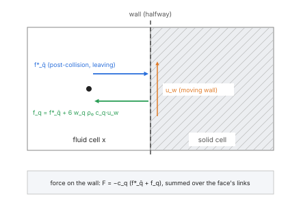
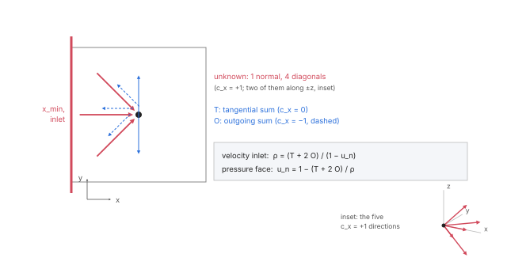
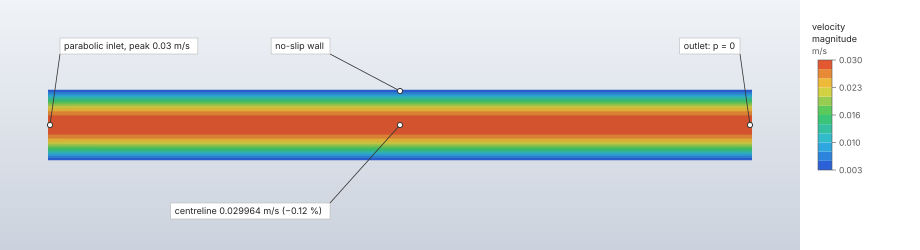

# Fluid boundary conditions

Each of the six faces of a fluid domain's box carries a condition: a no-slip wall, a moving or slip
wall, a velocity inlet, a pressure outlet, or one of a periodic pair. Obstacle faces are no-slip
walls, at rest or moving tangentially. Walls are halfway bounce-back, or, on obstacles and when the
step asks for it, interpolated bounce-back where the surface crosses each link; velocity inlets use Zou–He,
with a convective outflow for outlets that a wake reaches, and the force the fluid exerts on every
wall is measured by momentum exchange.

| | |
|---|---|
| **Commands** | `model.fluid_domain.create` (`faces`, `surfaces`), `model.fluid_domain.edit`, `model.fluid_domain.boundary` |
| **Step procedure** | `"fluid"` |
| **Solver** | `crates/lbm` (CPU, f64); `crates/lbm-gpu` (f32), every condition, interpolated walls included |
| **Method** | Halfway bounce-back with Ladd's moving-wall term (Ladd 1994); interpolated bounce-back at obstacles (Bouzidi, Firdaouss & Lallemand 2001); Zou & He (1997) with Hecht & Harting's D3Q19 transverse correction; convective outflow (Orlanski 1976); momentum exchange (Ladd 1994; Mei et al. 2002) |
| **Verified by** | `crates/lbm/tests/verification.rs`, `outlets.rs`, `interpolated.rs`, `interpolated_couette.rs`; `crates/lbm-gpu/tests/verification.rs` |

## Synopsis

```json
{"command": "model.fluid_domain.boundary", "params": {"domain": "Flow", "at": "x_min",
  "condition": {"type": "velocity", "velocity": [0.3, 0, 0], "profile": "parabolic"}}}
```

```json
{"command": "model.fluid_domain.boundary", "params": {"domain": "Flow", "at": "x_max",
  "condition": {"type": "pressure", "pressure": 0, "outflow": "convective"}}}
```

```json
{"command": "model.fluid_domain.boundary", "params": {"domain": "Flow",
  "at": {"body": "Drum", "face": "F2:side"},
  "condition": {"type": "moving_wall", "velocity": [0, 0.1, 0]}}}
```

## Parameters

`model.fluid_domain.boundary` sets one boundary's condition: `domain`, `at` (a box face `x_min`,
`x_max`, `y_min`, `y_max`, `z_min`, `z_max`, or an obstacle face `{"body", "face"}`) and
`condition`. The same conditions go in `faces` (box) and `surfaces` (obstacles) of
`model.fluid_domain.create` and `.edit`.

| `condition.type` | Fields | Where | Meaning |
|---|---|---|---|
| `wall` | — | box, obstacle | No-slip wall at rest. Every box face and every obstacle face is one unless given. |
| `moving_wall` | `velocity: [u, v, w]` | box, obstacle | No-slip wall sliding with this velocity. On a box face the normal component must be 0. On an obstacle face it is the tangential motion of a rotating or sliding surface; the body does not move. |
| `slip` | — | box | Frictionless wall: no flow through it, no shear. |
| `velocity` | `velocity: [u, v, w]`, `profile: "uniform" \| "parabolic"` (default uniform) | box | Velocity inlet, or outlet if the velocity points out of the box. `parabolic` multiplies the velocity by 4 s (1 − s) across each direction of the face that ends at walls (not periodic), s from 0 to 1 across the box: fully developed flow between plates (one such direction), or in a rectangular duct approximated by the product (two). The given velocity is the peak. |
| `pressure` | `pressure: p` (gauge), `outflow: "uniform" \| "convective"` (default uniform) | box | Pressure outlet (or inlet). `uniform`: the face at the pressure, the flow crossing it normally. `convective`: each cell at the pressure, the flow leaving as it arrives; for outlets a wake or vortices reach. |
| `periodic` | — | box | What leaves through this face enters through the opposite one, which must be periodic too. |

Obstacle faces take only `wall` and `moving_wall`; setting `wall` removes the face's entry, walls
being the default. A face is named as in sets: `F2:top` also selects its split pieces `F2:top#0`, …;
each obstacle face has at most one condition. A box face that is an inlet or outlet needs at least
2 cells across it.

Where the obstacle walls lie is set on the fluid step, beside the collision: `walls` in the
`"fluid"` procedure of `model.step.create` is `"halfway"` (the default) or `"interpolated"`.

```json
{"command": "model.step.create", "params": {"name": "Run", "procedure": {"type": "fluid",
  "domain": "Flow", "end_time": 2, "walls": "interpolated"}}}
```

| `walls` | Obstacle walls | Use it for |
|---|---|---|
| `"halfway"` | Halfway between the fluid cell and the solid one: a staircase of cell faces. Mass conservative. | Bodies whose faces lie on cell faces (boxes aligned with the grid), and flows where a fraction of a cell in wall position does not matter. |
| `"interpolated"` | Where the obstacle's surface crosses each link (below). Not mass conservative. | Curved bodies (cylinders, spheres, pipes, fins) and bodies that do not sit on the grid, when drag, pressure drop or the velocity near the wall matter on a grid you can afford. Keep τ⁺ at 1 or below (the automatic time step does). |

The box's own faces are halfway with either setting: they lie halfway along their links already.
Interpolated walls are refused with a wall model (`turbulence.wall_model`) and with a free surface,
which rebuild or reflect the wall populations their own way.

## Theory

### Walls: halfway bounce-back

At every link from a fluid cell x to a solid cell, or across a wall face of the box, the population
leaving x towards the wall returns into x in the opposite direction one step later:

```text
f_q(x, t + Δt) = f*_q̄(x, t) + 6 w_q ρ₀ c_q·u_w
```

with q̄ the opposite of q and u_w the wall velocity (Ladd's moving-wall term; zero for a wall at
rest). The wall lies halfway between the fluid cell and the solid one. With the two-relaxation-time
collision and Λ = 3/16 that position is exact for the Poiseuille parabola; with the other
collisions it is second-order accurate ([Collision operators](collision.md)). With halfway walls
obstacle walls are staircase: they follow the cell faces, and curved walls are first order in
position. Interpolated walls (below) put them where the surface is.

A link into a fluid cell from an obstacle cell belongs to the obstacle face of the triangle nearest
the link's midpoint, and takes that face's wall velocity.



### Obstacle walls: interpolated bounce-back

With `walls: "interpolated"`, each link from a fluid cell x_f to an obstacle cell bounces back
where the obstacle's surface crosses it, at the fraction q ∈ (0, 1] of the link from x_f
(Bouzidi, Firdaouss & Lallemand 2001, linear interpolation). With x_ff = x_f + c_q the next cell
away from the wall and f* the post-collision populations:

```text
q < ½:  f_q(x_f, t + Δt) = 2q f*_q̄(x_f) + (1 − 2q) f*_q̄(x_ff) + δ
q ≥ ½:  f_q(x_f, t + Δt) = [f*_q̄(x_f) + (2q − 1) f*_q(x_f) + δ] / (2q)
```

δ = 6 w_q ρ₀ c_q·u_w is Ladd's moving-wall term, as for halfway walls (Lallemand & Luo 2003 write
the moving wall into Bouzidi et al.'s scheme this way). At q = ½ both lines are halfway
bounce-back.

**Where the surface crosses.** q comes from the obstacle's triangles: the nearest crossing of the
segment from the fluid cell's centre to the solid cell's, decided with exact `orient3d` tests
(an edge or a vertex hit counts) and constructed from the plane distances. Where the face has an
exact curved surface (a cylinder, sphere, cone or torus of the design), the crossing is taken on
that surface instead of on its triangles' chords, as the voxeliser decides the cells near it. q is
held at 0.01 or above, where curved-boundary schemes' small-q trouble starts (Mei, Luo & Shyy
1999): the linear interpolation's weights are convex for every q, and the floor keeps the q ≥ ½
line's 1/(2q) and the crossing of a centre lying on the surface bounded. It moves the wall by less
than a hundredth of a link.

**Links that keep halfway bounce-back.** A link with q < ½ needs the second fluid cell x_ff
(across a periodic face if the link leaves the box there). Where x_ff is solid (a gap a cell or
two wide) or outside a box face that is not periodic, the link has nothing to interpolate from and
keeps halfway bounce-back; so does a link on which no crossing is found. The solve counts both and
warns: "interpolated walls: N of M wall links kept halfway bounce-back (…)". Refine the spacing
where obstacles nearly touch.

**Mass.** The populations an interpolated wall sends back no longer sum to those it received, so
the fluid's mass drifts. In the verification cases below the drift is 10⁻¹⁰ to 10⁻⁷ of the mass
over a run; `mass.relative_change` in the reply shows it for yours.

**The wall depends on τ.** The linear interpolation's effective wall position carries an error
that depends on the relaxation rates (Ginzburg & d'Humières 2003), so its drag moves with τ. On
the 3-cell sphere array below the drag error is +0.72 % at τ⁺ = 0.6, −1.6 % at 1, −6.2 % at 2
and −9.7 % at 3, while halfway walls (Λ = 3/16) read +11.7 % at every τ. Interpolated walls are
accurate for τ⁺ ≤ 1: keep the relaxation time near or below 1 (the automatic time step does; a
`time_step` you give raises τ⁺ as it grows), or refine the grid.

**Heat.** The temperature lattice keeps its walls halfway on every link (anti-bounce-back for a
held temperature, bounce-back for an adiabatic wall), and conducting solids keep their staircase
interface ([Heat transfer](heat-transfer.md)).

### Slip walls

A slip face reflects populations specularly: the population entering x across the face in direction
q comes from the cell in the same layer, shifted tangentially, in the mirrored direction (the normal
component of c_q reversed). Where a link crosses more than one face (an edge or a corner), or the
mirror source is not a fluid cell, the slip face bounces back instead. A slip face takes normal
momentum only.

### Periodic faces

A link that leaves through a periodic face pulls from the periodic image on the opposite face.
Periodic faces come in opposite pairs; a domain whose face is periodic and whose opposite face is
not is refused.

### Velocity inlets and pressure faces

On the first layer of a velocity inlet, the five unknown populations (those
entering from outside: one along the normal, four diagonals) are set after streaming (Zou & He
1997):

1. The tangential sum T (populations with c_n = 0) and the outgoing sum O (c_n pointing out) of the
   known populations.
2. A velocity inlet with normal velocity u_n gives the density ρ = (T + 2 O)/(1 − u_n); a pressure
   face with density ρ gives the normal velocity u_n = 1 − (T + 2 O)/ρ, the tangential velocity 0.
   The prescribed velocity is the one with Guo's half force, so the bare velocity the populations
   carry is the target less F/(2ρ).
3. Each unknown is its opposite plus the equilibrium difference (bounce-back of the
   non-equilibrium part): f_q = f_q̄ + 6 w_q ρ c_q·u.
4. The transverse momentum is corrected on the two diagonal unknowns of each tangential axis, as
   Hecht & Harting (2010) do for D3Q19.

A uniform pressure face uses non-equilibrium extrapolation (Guo, Zheng & Shi 2002):
its density is prescribed, physical tangential velocity is zero, and normal velocity is taken
from the fluid cell one layer inside. All populations are rebuilt as the boundary equilibrium
plus that inner cell's non-equilibrium populations. This retains viscous stress and avoids
feeding the local normal-stress mode back into the outlet velocity (#819). The inner cell is
read after streaming, before any boundary writes, including at intersections of open faces.
This closure is the same for TRT, MRT, RR and HRR.

If the inner cell is solid, the local Zou–He pressure balance above remains the fallback;
RR/HRR then hold its equilibrium. Convective backflow also retains that local fallback.

A gauge pressure p becomes the lattice density 1 + p/(c_s² ρ₀ Δx²/Δt²).

A cell on the edge of two open faces, or the corner of three, belongs to one of them only: a
velocity face before a pressure face, otherwise the first in the order `x_min`, `x_max`, `y_min`,
`y_max`, `z_min`, `z_max`. Its populations from outside the other faces keep the placeholder, the
bounce-back of its own. Where a link crosses a wall face and an open face at once, the wall face's
bounce-back applies.



### Convective outlets

A uniform pressure outlet holds its cell at the face's density with no tangential velocity. Where an
unrecovered wake reaches it, that balance puts a step into the velocity of the last layer. A
convective outlet updates the five unknown populations of each outlet cell N by the convective
outflow equation ∂f/∂t + U ∂f/∂n = 0, upwind and implicit in time (Orlanski 1976, with the local
flow speed as the phase speed):

```text
f_q(N, t+1) = (f_q(N, t) + λ f_q(N−1, t+1)) / (1 + λ),   λ = U Δt/Δx
```

with f_q(N−1, t+1) the population of the cell one layer in after streaming and f_q(N, t) the outlet
cell's own after the last step. U is the cell's own outward velocity after the last step, clamped to
[0, 0.5]. The update is a convex blend, stable for every λ ≥ 0. The known populations stream as
everywhere else. Every population then gains w_q (ρ_out − ρ), which sets the cell's density to the
face's without changing its momentum: the face holds its pressure cell by cell while the velocity,
normal and tangential, comes from the flow.

**Backflow guard.** A cell whose convected flow points into the box takes the legacy local
fallback: Zou–He at the face's density, no tangential velocity, which stays stable with reversed
outlet cells. The rule changes only the outlet cells' streamed populations, so it does not depend
on the collision operator.

### Wall forces: momentum exchange

Each wall link transfers momentum to the wall: the population f* leaving the fluid cell towards
the wall and the one f′ coming back give c_out f* − c_in f′ (Ladd 1994; Mei et al. 2002). For a
bounce-back link of direction q (into the fluid), c_out = −c_q, so the wall receives
−c_q (f*_q̄ + f′_q). On an interpolated link the exchange is taken in the wall's frame,
(c_out − u_w) f* − (c_in − u_w) f′ with f′ the interpolated population (Wen et al. 2014), which
keeps the force Galilean invariant when the populations sent back no longer balance those
received; at rest it is the same sum. A slip link gives c_q′ f* − c_q f*, its normal momentum. The forces are summed
per force group (each box face, then each obstacle face) in link order, every time step, in lattice
units and scaled by ρ₀ Δx⁴/Δt². They are the force of the fluid on the wall, including pressure and
shear. The pressure in them is absolute: each face's force carries the lattice's rest pressure
c_s² ρ₀ (Δx/Δt)² over its area, which depends on Δt and cancels only in the sum over a body closed
in that direction, while probes and slices report the gauge pressure. Under the wall model a wall also takes the momentum each reconstruction of its wall cells
removes, so its force is the drag the flow carries ([Large-eddy simulation](les.md)).

### Heat at the boundaries

With thermal settings, the temperature lattice follows the same links: a wall held at a temperature
is anti-bounce-back (g_q = −g*_q̄ + 2 w_q T_w, the temperature halfway between the cells), an
adiabatic wall bounces back, a heat flux through a wall face adds the flux to the
bounced population, an inlet holds its temperature (the equilibrium at the cell's velocity; the
initial temperature unless the face holds one), and an outlet takes its neighbour's. A heat flux
goes on a wall only, never on an inlet, outlet or periodic face. Thermal conditions are set with
`model.fluid_domain.thermal_boundary` ([Heat transfer](heat-transfer.md)).

## Algorithm

1. **Links** (`Flow::new`): for every fluid cell and direction q, the source cell x − c_q. A source
   inside the box and fluid streams normally (no link). A source across a periodic face becomes a
   `Pull` from its image; a solid source a `Bounce` of the obstacle face nearest the link's midpoint,
   or with interpolated walls an `Interpolated` link carrying q, x_ff and the moving-wall term
   (a `Bounce` where it has no x_ff or no crossing);
   a source across a box face a `Bounce` (a wall or moving wall among the crossed faces), a
   `Reflect` (a slip face) or an `Open` placeholder (inlet or outlet).
2. **Open cells**: the fluid cells of each open face's layer with their target (a velocity, with the
   parabolic profile applied; a density; a convective density), each cell to one face.
3. **Each step**, after the collision: stream (one shifted copy per direction, then the links'
   rules: `Bounce` takes f*_q̄ of the cell plus the moving-wall term, `Interpolated` Bouzidi et
   al.'s value from the post-collision populations, `Reflect` the mirrored
   population, `Open` a placeholder); sum the momentum exchange of every `Bounce`, `Interpolated`
   and `Reflect` link; then the open boundaries: the convective cells' actions from the streamed populations
   (read before any open cell changes), then every open cell's velocity, extrapolated-pressure or convective update, in
   parallel, stored in cell order.

## Output

`solve.fluid` reports, per wall with a non-zero force, its `name` (`x_min` … for box faces, the
face's persistent name for obstacle faces), `body`, `final` force and `mean` over the last quarter
of the history. `solve.probe` with `{"forces": ["x_min", "F2:top", "Body1/F2:top"]}` returns those
walls' complete histories ([Fluid results](fluid-results.md)). Forces are in the display units; the
sign is the force of the fluid on the wall.

With interpolated walls the reply's `wall_links` counts the obstacle links: `interpolated`,
`halfway_no_second_node` (q < ½ with no fluid cell behind) and `halfway_no_crossing`; it is
`null` with halfway walls.

## Worked example

Plane Poiseuille flow between two no-slip walls: a parabolic velocity inlet, a pressure outlet and
a periodic pair across the span, a model of our own built from commands. The centreline velocity,
the pressure gradient and the wall shear are compared with the closed form, at the automatic time
step and at a quarter of it.

| | |
|---|---|
| **Domain** | box (0, 0, 0) to (0.1, 0.002, 0.01) m: length L = 100 mm along x, gap H = 10 mm along z, 2 mm span along y; Δx = 0.5 mm, 200 × 4 × 20 = 16 000 cells |
| **Fluid** | air, ρ₀ = 1.2 kg/m³, μ = 1.8 × 10⁻⁵ Pa s; initial velocity 0.02 m/s |
| **Boundaries** | `x_min` velocity 0.03 m/s, `profile: "parabolic"` (peak U = 0.03 m/s, Re = U H/ν = 20); `x_max` pressure 0; `y_min`, `y_max` periodic; `z_min`, `z_max` walls |
| **Steps** | `Flow`: 6 s, automatic Δt; `Fine`: 6 s, `time_step` 2.0833 × 10⁻⁴ s (a quarter) |
| **Units** | m, kg, s, N, Pa |

```json
[
  {"command": "model.units", "params": {"system": "m-kg-s-N-Pa"}},
  {"command": "model.material.create", "params": {"name": "Air", "density": 1.2,
    "fluid": {"type": "newtonian", "viscosity": 1.8e-5}}},
  {"command": "model.fluid_domain.create", "params": {"name": "Channel", "material": "Air",
    "min": [0, 0, 0], "max": [0.1, 0.002, 0.01], "spacing": 0.0005,
    "faces": {"x_min": {"type": "velocity", "velocity": [0.03, 0, 0], "profile": "parabolic"},
              "x_max": {"type": "pressure", "pressure": 0},
              "y_min": {"type": "periodic"}, "y_max": {"type": "periodic"},
              "z_min": {"type": "wall"}, "z_max": {"type": "wall"}},
    "initial_velocity": [0.02, 0, 0]}},
  {"command": "model.step.create", "params": {"name": "Flow", "procedure": {"type": "fluid",
    "domain": "Channel", "end_time": 6, "frames": 6}}},
  {"command": "model.step.create", "params": {"name": "Fine", "procedure": {"type": "fluid",
    "domain": "Channel", "end_time": 6, "frames": 6, "time_step": 0.000208333333333}}},
  {"command": "solve.fluid", "params": {"step": "Flow", "backend": "cpu"}},
  {"command": "solve.probe", "params": {"step": "Flow", "line": {"from": [0.07, 0.001, 0], "to": [0.07, 0.001, 0.01], "field": "velocity_x"}}},
  {"command": "solve.probe", "params": {"step": "Flow", "line": {"from": [0.02, 0.001, 0.005], "to": [0.08, 0.001, 0.005], "count": 7, "field": "pressure"}}},
  {"command": "solve.fluid", "params": {"step": "Fine", "backend": "cpu"}},
  {"command": "solve.probe", "params": {"step": "Fine", "line": {"from": [0.07, 0.001, 0], "to": [0.07, 0.001, 0.01], "field": "velocity_x"}}},
  {"command": "solve.probe", "params": {"step": "Fine", "line": {"from": [0.02, 0.001, 0.005], "to": [0.08, 0.001, 0.005], "count": 7, "field": "pressure"}}},
  {"command": "results.streamlines", "params": {"step": "Fine", "show": false}},
  {"command": "results.slice", "params": {"step": "Fine", "field": "velocity", "axis": "y", "position": "auto"}}
]
```

Closed form for the fully developed flow with peak U: u(z) = 4 U s (1 − s), s = z/H, so the
centreline speed is U, −dp/dx = 8 μ U/H² = 0.0432 Pa/m and each wall takes the shear force
μ (4 U/H) L W = 4.32 × 10⁻⁸ N along x (W = 2 mm the span). The centreline speed is the `max` of the
`velocity_x` line across the gap at x = 70 mm (the vertex of the parabola through the samples);
the gradient is the pressure difference between x = 20 and 80 mm on the centreline over 60 mm;
the wall force is the x component of `forces` `z_min` in the `solve.fluid` reply. Apple M4 Max,
CPU.

| Quantity | `Flow` (automatic Δt) | `Fine` (Δt/4) | Closed form | Difference (`Flow`, `Fine`) |
|---|---|---|---|---|
| `time_step`, `steps` | 8.333 × 10⁻⁴ s, 7200 | 2.083 × 10⁻⁴ s, 28 800 | | |
| `tau`, `mach` | 0.65, 0.0866 | 0.5375, 0.0217 | | |
| Centreline velocity at x = 70 mm | 0.030607 m/s | 0.029964 m/s | 0.03 m/s | +2.02 %, −0.12 % |
| −dp/dx, x = 20 → 80 mm | 0.044876 Pa/m | 0.043292 Pa/m | 0.0432 Pa/m | +3.88 %, +0.21 % |
| Wall force on `z_min`, x | 4.393 × 10⁻⁸ N | 4.270 × 10⁻⁸ N | 4.32 × 10⁻⁸ N | +1.69 %, −1.15 % |
| `mass.relative_change` | +1.55 × 10⁻² | +9.35 × 10⁻⁴ | 0 | |
| `warnings` | "the density varies by 3.1% at the end: …" | none | | |
| Wall-clock time | 2.5 s | 14.7 s | | |



**What to look at.** The parabolic inlet enters the flow already developed, so the slice's bands
run parallel from inlet to outlet and the profile across the gap is the parabola within 0.12 % at
the fine time step. The halfway bounce-back walls sit on the box faces: the profile's zero lies
at z = 0 and z = H, half a cell outside the first cell centres, whose speed (0.00293 m/s) is the
parabola's at s = 0.025. At the automatic time step the pressure drop along the channel
(4.46 × 10⁻³ Pa in the first cell, 0 at the outlet) is 3.1 % of the lattice's c_s² ρ₀ (Δx/Δt)² =
0.144 Pa: the density falls by that much towards the outlet, the velocity rises to keep the mass flow (0.0299
m/s at the inlet to 0.0310 m/s at the outlet on the centreline), and the gradient and the
centreline speed read 2–4 % high. A quarter of the time step raises that pressure scale 16 times (the
density warning, given above 1 %, no longer appears) and brings every quantity within 1.2 % of
the closed form.

## Verification

| Case | Reference | Measured | Tolerance | Test |
|---|---|---|---|---|
| Couette, moving wall, 16 cells | Linear profile; wall shear ±μU/H on both walls (theory) | Profile 1e-10; shear to 1e-6 | 10⁻⁶ relative | `couette_flow_is_linear_and_the_wall_shear_is_mu_u_over_h` |
| Pipe, staircase wall | Wall force = driving force (momentum balance) | | 10⁻⁶ relative | `pipe_poiseuille_on_a_staircase_wall_converges` (heavy) |
| Sphere array, periodic | Wall force = driving force at steady state | | 10⁻³ | `stokes_drag_of_a_sphere_array_matches_hasimoto` (heavy) |
| Pipe, 4/6/8/12/16 cells per radius, halfway and interpolated walls, τ = 1 | Hagen–Poiseuille (theory) | L2 halfway 4.5e-2 … 9.5e-3 (fitted order 1.01), interpolated 6.6e-3 … 6.9e-4 (order 1.65); wall force = driving force | interpolated order > 1.5, halfway < 1.3; interpolated below 0.3 × halfway on every grid | `a_coarse_pipe_is_closer_with_interpolated_walls` (8 cells); the order studies `pipe_poiseuille_converges_at_second_order_with_interpolated_walls` and, up to 32 cells, `pipe_poiseuille_orders_on_eight_grids` (both heavy) |
| Plane channel, walls 0, 0.2, 0.4, 0.6, 0.8 of a cell off the cell faces, 8/16/32 cells | The parabola (theory; Bouzidi et al.'s test) | Worst over the shifts: halfway 0.185, 0.096, 0.049 of the peak (order 0.95); interpolated 0.039, 0.0099, 0.0025 (order 1.99); both exact at shift 0 | interpolated orders > 1.8, halfway < 1.2 | `a_channel_with_walls_anywhere_in_a_cell_keeps_its_parabola` |
| Annular Couette: rod of radius ½ sliding along the axis of a pipe of radius 1, 6/8/12/16 cells per radius, τ = 1 | u = U ln(r/R₂)/ln(R₁/R₂); rod drag 2πμUL/ln(R₂/R₁) (theory) | L2 halfway 8.4e-2 … 3.4e-2 (order 1.02), interpolated 7.3e-3 … 1.1e-3 (order 1.98); rod drag halfway +1.5 … +14 %, interpolated within 0.11 %; the two walls' forces balance to 2e-7 | interpolated order > 1.6, halfway < 1.3; drag within 0.5 % | `a_sliding_rod_on_eight_cells_per_radius_is_closer_with_interpolated_walls`; the order studies `annular_couette_with_a_sliding_rod_converges_at_second_order_with_interpolated_walls` and, to 48 cells, `annular_couette_orders_on_seven_grids` (both heavy; 6–48 cells: orders 1.16 and 1.92) |
| Sphere array, R = 3 cells in 16³ (#798), τ = 1 | Hasimoto (1959) with Sangani & Acrivos (1982) (theory) | K halfway +11.66 %, interpolated −1.64 % | halfway > 11 %, interpolated within 2 % | `stokes_drag_of_a_coarse_sphere_array_with_interpolated_walls` (heavy) |
| Sphere array, R = 3, 6, 9 cells (16³, 32³, 48³), τ = 1 | The same | K halfway +11.7 %, +1.7 %, +2.3 % (not monotone); interpolated −1.64 %, −0.85 %, −0.32 % | interpolated within 2 % and closer at every refinement | `stokes_drag_of_a_sphere_array_with_interpolated_walls_over_radii_and_tau` (heavy, with the τ sweep above) |
| Round pipe from a SolidCraft design, interpolated walls, 8 and 16 cells per radius (oracle `pipe-poiseuille-interpolated-walls`) | u_max = a R²/(4ν) (theory) | −0.15 %, −0.04 % (halfway: −5.5 %, −2.1 %) | 0.5 %, 0.15 % | [Oracle results](../../oracle.md) |
| A one-cell gap, interpolated walls | The links with no second fluid cell keep halfway bounce-back and are reported | 10 of 10 | exact | `links_without_a_second_fluid_cell_keep_halfway_and_are_reported` |
| Interpolated walls with a wall model or a free surface | Refused | | | `interpolated_walls_refuse_wall_models_and_free_surfaces` |
| Parabolic inlet, uniform pressure outlet | Poiseuille profile and gradient | Profile 3.0e-4, gradient +0.07 % | 5 × 10⁻³, 1 % | `channel_with_a_parabolic_inlet_and_a_pressure_outlet_develops_poiseuille_flow` (heavy) |
| Pressure-driven channel, two uniform pressure faces | Parabola; each end at its pressure | | 3 % | `pressure_driven_poiseuille_holds_its_end_pressures` |
| The same, two convective faces | Parabola; ends at their pressures | | 3 %; ends to 10⁻³ | `pressure_driven_poiseuille_holds_its_end_pressures_with_convective_faces` |
| Edge of two pressure faces, every outflow combination | Edge cell at the outlet density; inlet corner at the inlet velocity | | 10⁻¹² | `an_edge_of_two_pressure_faces_holds_the_outlet_density` |
| Schäfer–Turek 2D-1 cut 1.5 D behind the cylinder, uniform outlet | The interior stays smooth | Outlet layer 9.2e-3 departure, interior 5.3e-3 | interior < 0.03 U (9 × 10⁻³) | `a_wake_at_a_pressure_outlet_distorts_only_the_last_layer` |
| The same, convective outlet | No step at the outlet | | inside and outlet layer < 2 × 10⁻³ | `a_wake_leaves_a_convective_outlet_without_a_step` |
| The same against a channel 1.6 long (outlet 13 D behind) | The long channel's velocity at the short one's outlet | | convective < 1 %, below half the uniform outlet's | `a_wake_at_a_convective_outlet_matches_a_long_channel` (heavy) |
| A vortex leaving through the outlet | A box 3 long the vortex never leaves | Convective reflects less | below 0.8 × the uniform outlet's | `a_vortex_leaves_a_convective_outlet_with_less_reflection` |
| A strong vortex (swirl 1.8 U) reversing the outlet flow | Stable run | Uniform outlet diverges, convective stable | | `a_strong_vortex_with_backflow_leaves_a_convective_outlet_stably` (heavy) |
| Re 100, outlet 1 D behind the cylinder, reversed outlet cells | Stable, mass conserved | | mass 1 % | `a_convective_outlet_survives_backflow_at_re_100` (and `…_with_the_regularized_collision`) |
| The same run 20 s (60 000 steps) | Stable, mass bounded | | | `a_convective_outlet_stays_stable_with_backflow_for_long` (heavy) |
| Schäfer–Turek 2D-2 (Re 100), convective outlet at 7.5 D and 21 D, D/Δx 20 | c_D,max 3.22–3.24, c_L,max 0.99–1.01, St 0.295–0.305 (benchmark) | 7.5 D: 3.356, 1.072, 0.2989; 21 D: 3.446, 1.102, 0.2984 | the two within 4 %; c_D 8 %, c_L 12 %, St 2 % of the benchmark | `schafer_turek_2d2_does_not_depend_on_the_outlet_distance` (heavy) |
| Coarse 2D-2, D/Δx 10, τ = 0.51 | Uniform outlet diverges (step 6699), convective runs 24 000 steps | St within 2 % of 0.30 | 2 % | `a_coarse_cylinder_at_re_100_runs_with_a_convective_outlet_where_the_uniform_one_diverges` (heavy) |
| Every condition on the GPU | The CPU | | [GPU backend](gpu.md) | `zou_he_channel_matches_the_cpu`, `convective_outlet_matches_the_cpu_with_a_vortex_and_backflow`, `edges_of_two_pressure_faces_match_the_cpu`, `couette_wall_forces_match_the_cpu` |
| Interpolated walls on the GPU: a radius-6 sphere in a periodic 24³ box, 300 steps, every collision, at rest and moving | The CPU | velocity ≤ 6.5e-6 of the peak, density ≤ 1.1e-7, skin force ≤ 4.7e-6 at rest and ≤ 1.3e-5 moving (Apple M4 Max) | 2e-5, 1e-6, 5e-5 | `interpolated_walls_match_the_cpu_fields_and_forces`, `halfway_walls_stay_halfway_on_the_gpu` |

The 20-cell staircase cylinder puts c_D,max 4–7 % and c_L,max 7–10 % above the 2D-2 benchmark (2D-1 at
this resolution: c_D 3.4 % above).

## Limitations

- Halfway walls (the default) are staircase. Interpolated walls are linear interpolation only
  (no quadratic variant), not mass conservative, their position moves with τ (keep τ⁺ ≤ 1),
  links with q < ½ and no second fluid cell keep halfway bounce-back, and they are refused with a
  wall model or a free surface. They apply to any collision, on the CPU and the GPU; the
  verification cases run the two-relaxation-time one.
- The temperature lattice and conducting solids keep halfway walls with either setting.
- Obstacles do not move: a moving wall is tangential motion of a fixed surface.
- Slip faces are box faces only; obstacle faces take walls and moving walls.
- A uniform pressure outlet distorts the last cell layer where an unrecovered wake reaches it. The
  reported speed extremes (`max_speed`, slice ranges) leave every inlet and outlet layer out for
  this reason, convective outlets included.
- Inlets and outlets reflect pressure waves; there are no absorbing layers.
- Fans and porous zones must stay at least one cell inside the inlet and outlet layers.

## Implementation

| File | Contents |
|---|---|
| `crates/model/src/fluids.rs` | `FaceCondition`, `Profile`, `Outflow`, `SurfaceCondition`, `FluidDomain::set_boundary`, validation. |
| `crates/lbm/src/lattice.rs` | `moving_wall`: Ladd's term. |
| `crates/lbm/src/flow.rs` | `Rule`, `Link`, `Interpolation`, `bouzidi`, `WallLinks`, `OpenCell`, `Target`; `Flow::new` (links and open cells), `stream` (rules, momentum exchange), `open_boundaries`, `zou_he`, `hold_equilibrium`, `thermal_rule`. |
| `crates/lbm/src/outlet.rs` | `Outlets::convect`, `record`, `unknowns`, `backflow`. |
| `crates/model/src/steps.rs` | `WallTreatment` (`walls` on the fluid step). |
| `crates/lbm/src/voxel.rs` | `TriangleTree::nearest`: the face of each wall link; `link_fraction`, `TriangleTree::crossing`: where the surface crosses a link. |
| `crates/engine/src/cmd/define.rs` | `model.fluid_domain.boundary`. |

## References

- A. J. C. Ladd. *Numerical simulations of particulate suspensions via a discretized Boltzmann equation. Part 1.* J. Fluid Mech. 271:285–309, 1994. doi:[10.1017/S0022112094001771](https://doi.org/10.1017/S0022112094001771)
- M. Bouzidi, M. Firdaouss, P. Lallemand. *Momentum transfer of a Boltzmann-lattice fluid with boundaries.* Phys. Fluids 13(11):3452–3459, 2001. doi:[10.1063/1.1399290](https://doi.org/10.1063/1.1399290)
- R. Mei, L.-S. Luo, W. Shyy. *An accurate curved boundary treatment in the lattice Boltzmann method.* J. Comput. Phys. 155(2):307–330, 1999. doi:[10.1006/jcph.1999.6334](https://doi.org/10.1006/jcph.1999.6334)
- P. Lallemand, L.-S. Luo. *Lattice Boltzmann method for moving boundaries.* J. Comput. Phys. 184(2):406–421, 2003. doi:[10.1016/S0021-9991(02)00022-0](https://doi.org/10.1016/S0021-9991(02)00022-0)
- I. Ginzburg, D. d'Humières. *Multireflection boundary conditions for lattice Boltzmann models.* Phys. Rev. E 68:066614, 2003. doi:[10.1103/PhysRevE.68.066614](https://doi.org/10.1103/PhysRevE.68.066614)
- Y. Wen, Z. Zhou, C. Shu, H. Ho, J. Fan. *Galilean invariant fluid–solid interfacial dynamics in lattice Boltzmann simulations.* J. Comput. Phys. 266:161–170, 2014. doi:[10.1016/j.jcp.2014.02.018](https://doi.org/10.1016/j.jcp.2014.02.018)
- R. Mei, D. Yu, W. Shyy, L.-S. Luo. *Force evaluation in the lattice Boltzmann method involving curved geometry.* Phys. Rev. E 65:041203, 2002.
- Q. Zou, X. He. *On pressure and velocity boundary conditions for the lattice Boltzmann BGK model.* Phys. Fluids 9(6):1591–1598, 1997. doi:[10.1063/1.869307](https://doi.org/10.1063/1.869307)
- M. Hecht, J. Harting. *Implementation of on-site velocity boundary conditions for D3Q19 lattice Boltzmann simulations.* J. Stat. Mech. 2010, P01018.
- I. Orlanski. *A simple boundary condition for unbounded hyperbolic flows.* J. Comput. Phys. 21(3):251–269, 1976.
- Q. Lou, Z. Guo, B. Shi. *Evaluation of outflow boundary conditions for two-phase lattice Boltzmann equation.* Phys. Rev. E 87:063301, 2013.
- Z. Yang. *Lattice Boltzmann outflow treatments: convective conditions and others.* Comput. Math. Appl. 65(2):160–171, 2013.
- T. Krüger et al. *The Lattice Boltzmann Method: Principles and Practice.* Springer, 2017. doi:[10.1007/978-3-319-44649-3](https://doi.org/10.1007/978-3-319-44649-3)
- M. Schäfer, S. Turek. *Benchmark computations of laminar flow around a cylinder.* NNFM 52:547–566, 1996. doi:[10.1007/978-3-322-89849-4_39](https://doi.org/10.1007/978-3-322-89849-4_39)

- Z. Guo, C. Zheng, B. Shi. *Non-equilibrium extrapolation method for velocity and pressure boundary conditions in the lattice Boltzmann method.* Chinese Physics 11:366–374, 2002. doi:[10.1088/1009-1963/11/4/310](https://doi.org/10.1088/1009-1963/11/4/310)
