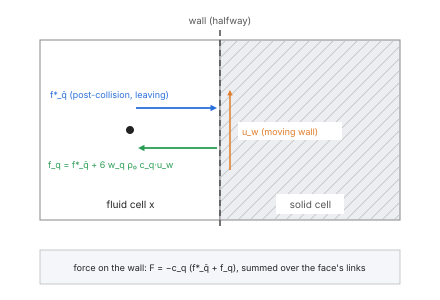
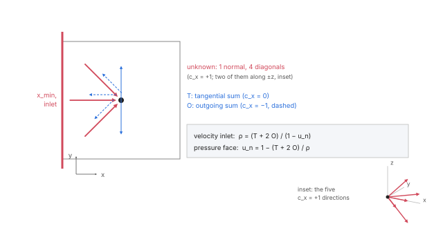
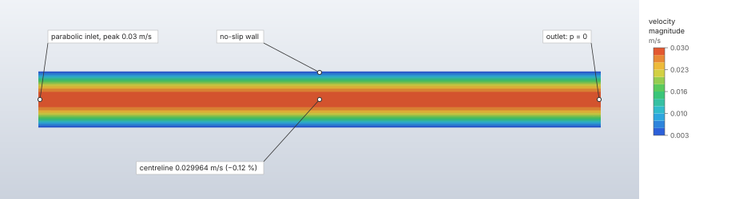

# Fluid boundary conditions

Each of the six faces of a fluid domain's box carries a condition: a no-slip wall, a moving or slip
wall, a velocity inlet, a pressure outlet, or one of a periodic pair. Obstacle faces are no-slip
walls, at rest or moving tangentially. Walls are halfway bounce-back, inlets and outlets Zou–He,
with a convective outflow for outlets that a wake reaches, and the force the fluid exerts on every
wall is measured by momentum exchange.

| | |
|---|---|
| **Commands** | `model.fluid_domain.create` (`faces`, `surfaces`), `model.fluid_domain.edit`, `model.fluid_domain.boundary` |
| **Step procedure** | `"fluid"` |
| **Solver** | `crates/lbm` (CPU, f64); `crates/lbm-gpu` (f32), every condition |
| **Method** | Halfway bounce-back with Ladd's moving-wall term (Ladd 1994); Zou & He (1997) with Hecht & Harting's D3Q19 transverse correction; convective outflow (Orlanski 1976); momentum exchange (Ladd 1994; Mei et al. 2002) |
| **Verified by** | `crates/lbm/tests/verification.rs`, `outlets.rs`; `crates/lbm-gpu/tests/verification.rs` |

## Synopsis

```json
{"command": "model.fluid_domain.boundary", "params": {"domain": "Flow", "at": "x_min",
  "condition": {"type": "velocity", "velocity": [0.3, 0, 0], "profile": "parabolic"}}}
```

```json
{"command": "model.fluid_domain.boundary", "params": {"domain": "Flow", "at": "x_max",
  "condition": {"type": "pressure", "pressure": 0, "outflow": "convective"}}}
```

```json
{"command": "model.fluid_domain.boundary", "params": {"domain": "Flow",
  "at": {"body": "Drum", "face": "F2:side"},
  "condition": {"type": "moving_wall", "velocity": [0, 0.1, 0]}}}
```

## Parameters

`model.fluid_domain.boundary` sets one boundary's condition: `domain`, `at` (a box face `x_min`,
`x_max`, `y_min`, `y_max`, `z_min`, `z_max`, or an obstacle face `{"body", "face"}`) and
`condition`. The same conditions go in `faces` (box) and `surfaces` (obstacles) of
`model.fluid_domain.create` and `.edit`.

| `condition.type` | Fields | Where | Meaning |
|---|---|---|---|
| `wall` | — | box, obstacle | No-slip wall at rest. Every box face and every obstacle face is one unless given. |
| `moving_wall` | `velocity: [u, v, w]` | box, obstacle | No-slip wall sliding with this velocity. On a box face the normal component must be 0. On an obstacle face it is the tangential motion of a rotating or sliding surface; the body does not move. |
| `slip` | — | box | Frictionless wall: no flow through it, no shear. |
| `velocity` | `velocity: [u, v, w]`, `profile: "uniform" \| "parabolic"` (default uniform) | box | Velocity inlet, or outlet if the velocity points out of the box. `parabolic` multiplies the velocity by 4 s (1 − s) across each direction of the face that ends at walls (not periodic), s from 0 to 1 across the box: fully developed flow between plates (one such direction), or in a rectangular duct approximated by the product (two). The given velocity is the peak. |
| `pressure` | `pressure: p` (gauge), `outflow: "uniform" \| "convective"` (default uniform) | box | Pressure outlet (or inlet). `uniform`: the face at the pressure, the flow crossing it normally. `convective`: each cell at the pressure, the flow leaving as it arrives; for outlets a wake or vortices reach. |
| `periodic` | — | box | What leaves through this face enters through the opposite one, which must be periodic too. |

Obstacle faces take only `wall` and `moving_wall`; setting `wall` removes the face's entry, walls
being the default. A face is named as in sets: `F2:top` also selects its split pieces `F2:top#0`, …;
each obstacle face has at most one condition. A box face that is an inlet or outlet needs at least
2 cells across it.

## Theory

### Walls: halfway bounce-back

At every link from a fluid cell x to a solid cell, or across a wall face of the box, the population
leaving x towards the wall returns into x in the opposite direction one step later:

```text
f_q(x, t + Δt) = f*_q̄(x, t) + 6 w_q ρ₀ c_q·u_w
```

with q̄ the opposite of q and u_w the wall velocity (Ladd's moving-wall term; zero for a wall at
rest). The wall lies halfway between the fluid cell and the solid one. With the two-relaxation-time
collision and Λ = 3/16 that position is exact for the Poiseuille parabola; with the other
collisions it is second-order accurate ([Collision operators](collision.md)). Obstacle walls are
staircase: they follow the cell faces, and curved walls are first order in position.

A link into a fluid cell from an obstacle cell belongs to the obstacle face of the triangle nearest
the link's midpoint, and takes that face's wall velocity.



### Slip walls

A slip face reflects populations specularly: the population entering x across the face in direction
q comes from the cell in the same layer, shifted tangentially, in the mirrored direction (the normal
component of c_q reversed). Where a link crosses more than one face (an edge or a corner), or the
mirror source is not a fluid cell, the slip face bounces back instead. A slip face takes normal
momentum only.

### Periodic faces

A link that leaves through a periodic face pulls from the periodic image on the opposite face.
Periodic faces come in opposite pairs; a domain whose face is periodic and whose opposite face is
not is refused.

### Inlets and outlets: Zou–He

On the first layer of cells of a velocity or pressure face, the five unknown populations (those
entering from outside: one along the normal, four diagonals) are set after streaming (Zou & He
1997):

1. The tangential sum T (populations with c_n = 0) and the outgoing sum O (c_n pointing out) of the
   known populations.
2. A velocity inlet with normal velocity u_n gives the density ρ = (T + 2 O)/(1 − u_n); a pressure
   face with density ρ gives the normal velocity u_n = 1 − (T + 2 O)/ρ, the tangential velocity 0.
   The prescribed velocity is the one with Guo's half force, so the bare velocity the populations
   carry is the target less F/(2ρ).
3. Each unknown is its opposite plus the equilibrium difference (bounce-back of the
   non-equilibrium part): f_q = f_q̄ + 6 w_q ρ c_q·u.
4. The transverse momentum is corrected on the two diagonal unknowns of each tangential axis, as
   Hecht & Harting (2010) do for D3Q19.

With the regularised collision a pressure outlet then holds the equilibrium of its density and
that normal velocity (Krüger et al. 2017, ch. 5): the stability and accuracy trade-off is in
[Collision operators](collision.md).

A gauge pressure p becomes the lattice density 1 + p/(c_s² ρ₀ Δx²/Δt²).

A cell on the edge of two open faces, or the corner of three, belongs to one of them only: a
velocity face before a pressure face, otherwise the first in the order `x_min`, `x_max`, `y_min`,
`y_max`, `z_min`, `z_max`. Its populations from outside the other faces keep the placeholder, the
bounce-back of its own. Where a link crosses a wall face and an open face at once, the wall face's
bounce-back applies.



### Convective outlets

A uniform pressure outlet holds its cell at the face's density with no tangential velocity. Where an
unrecovered wake reaches it, that balance puts a step into the velocity of the last layer. A
convective outlet updates the five unknown populations of each outlet cell N by the convective
outflow equation ∂f/∂t + U ∂f/∂n = 0, upwind and implicit in time (Orlanski 1976, with the local
flow speed as the phase speed):

```text
f_q(N, t+1) = (f_q(N, t) + λ f_q(N−1, t+1)) / (1 + λ),   λ = U Δt/Δx
```

with f_q(N−1, t+1) the population of the cell one layer in after streaming and f_q(N, t) the outlet
cell's own after the last step. U is the cell's own outward velocity after the last step, clamped to
[0, 0.5]. The update is a convex blend, stable for every λ ≥ 0. The known populations stream as
everywhere else. Every population then gains w_q (ρ_out − ρ), which sets the cell's density to the
face's without changing its momentum: the face holds its pressure cell by cell while the velocity,
normal and tangential, comes from the flow.

**Backflow guard.** A cell whose convected flow points into the box takes the uniform outlet's
closure: Zou–He at the face's density, no tangential velocity, which stays stable with reversed
outlet cells. The rule changes only the outlet cells' streamed populations, so it does not depend
on the collision operator.

### Wall forces: momentum exchange

Each wall link transfers momentum to the wall: the population f* leaving the fluid cell towards
the wall and the one f′ coming back give c_out f* − c_in f′ (Ladd 1994; Mei et al. 2002). For a
bounce-back link of direction q (into the fluid), c_out = −c_q, so the wall receives
−c_q (f*_q̄ + f′_q). A slip link gives c_q′ f* − c_q f*, its normal momentum. The forces are summed
per force group (each box face, then each obstacle face) in link order, every time step, in lattice
units and scaled by ρ₀ Δx⁴/Δt². They are the force of the fluid on the wall, including pressure and
shear. The pressure in them is absolute: each face's force carries the lattice's rest pressure
c_s² ρ₀ (Δx/Δt)² over its area, which depends on Δt and cancels only in the sum over a body closed
in that direction, while probes and slices report the gauge pressure. Under the wall model a wall also takes the momentum each reconstruction of its wall cells
removes, so its force is the drag the flow carries ([Large-eddy simulation](les.md)).

### Heat at the boundaries

With thermal settings, the temperature lattice follows the same links: a wall held at a temperature
is anti-bounce-back (g_q = −g*_q̄ + 2 w_q T_w, the temperature halfway between the cells), an
adiabatic wall bounces back, a heat flux through a wall face adds the flux to the
bounced population, an inlet holds its temperature (the equilibrium at the cell's velocity; the
initial temperature unless the face holds one), and an outlet takes its neighbour's. A heat flux
goes on a wall only, never on an inlet, outlet or periodic face. Thermal conditions are set with
`model.fluid_domain.thermal_boundary` ([Heat transfer](heat-transfer.md)).

## Algorithm

1. **Links** (`Flow::new`): for every fluid cell and direction q, the source cell x − c_q. A source
   inside the box and fluid streams normally (no link). A source across a periodic face becomes a
   `Pull` from its image; a solid source a `Bounce` of the obstacle face nearest the link's midpoint;
   a source across a box face a `Bounce` (a wall or moving wall among the crossed faces), a
   `Reflect` (a slip face) or an `Open` placeholder (inlet or outlet).
2. **Open cells**: the fluid cells of each open face's layer with their target (a velocity, with the
   parabolic profile applied; a density; a convective density), each cell to one face.
3. **Each step**, after the collision: stream (one shifted copy per direction, then the links'
   rules: `Bounce` takes f*_q̄ of the cell plus the moving-wall term, `Reflect` the mirrored
   population, `Open` a placeholder); sum the momentum exchange of every `Bounce` and `Reflect`
   link; then the open boundaries: the convective cells' actions from the streamed populations
   (read before any open cell changes), then every open cell's Zou–He or convective update, in
   parallel, stored in cell order.

## Output

`solve.fluid` reports, per wall with a non-zero force, its `name` (`x_min` … for box faces, the
face's persistent name for obstacle faces), `body`, `final` force and `mean` over the last quarter
of the history. `solve.probe` with `{"forces": ["x_min", "F2:top", "Body1/F2:top"]}` returns those
walls' complete histories ([Fluid results](fluid-results.md)). Forces are in the display units; the
sign is the force of the fluid on the wall.

## Worked example

Plane Poiseuille flow between two no-slip walls: a parabolic velocity inlet, a pressure outlet and
a periodic pair across the span, a model of our own built from commands. The centreline velocity,
the pressure gradient and the wall shear are compared with the closed form, at the automatic time
step and at a quarter of it.

| | |
|---|---|
| **Domain** | box (0, 0, 0) to (0.1, 0.002, 0.01) m: length L = 100 mm along x, gap H = 10 mm along z, 2 mm span along y; Δx = 0.5 mm, 200 × 4 × 20 = 16 000 cells |
| **Fluid** | air, ρ₀ = 1.2 kg/m³, μ = 1.8 × 10⁻⁵ Pa s; initial velocity 0.02 m/s |
| **Boundaries** | `x_min` velocity 0.03 m/s, `profile: "parabolic"` (peak U = 0.03 m/s, Re = U H/ν = 20); `x_max` pressure 0; `y_min`, `y_max` periodic; `z_min`, `z_max` walls |
| **Steps** | `Flow`: 6 s, automatic Δt; `Fine`: 6 s, `time_step` 2.0833 × 10⁻⁴ s (a quarter) |
| **Units** | m, kg, s, N, Pa |

```json
[
  {"command": "model.units", "params": {"system": "m-kg-s-N-Pa"}},
  {"command": "model.material.create", "params": {"name": "Air", "density": 1.2,
    "fluid": {"type": "newtonian", "viscosity": 1.8e-5}}},
  {"command": "model.fluid_domain.create", "params": {"name": "Channel", "material": "Air",
    "min": [0, 0, 0], "max": [0.1, 0.002, 0.01], "spacing": 0.0005,
    "faces": {"x_min": {"type": "velocity", "velocity": [0.03, 0, 0], "profile": "parabolic"},
              "x_max": {"type": "pressure", "pressure": 0},
              "y_min": {"type": "periodic"}, "y_max": {"type": "periodic"},
              "z_min": {"type": "wall"}, "z_max": {"type": "wall"}},
    "initial_velocity": [0.02, 0, 0]}},
  {"command": "model.step.create", "params": {"name": "Flow", "procedure": {"type": "fluid",
    "domain": "Channel", "end_time": 6, "frames": 6}}},
  {"command": "model.step.create", "params": {"name": "Fine", "procedure": {"type": "fluid",
    "domain": "Channel", "end_time": 6, "frames": 6, "time_step": 0.000208333333333}}},
  {"command": "solve.fluid", "params": {"step": "Flow", "backend": "cpu"}},
  {"command": "solve.probe", "params": {"step": "Flow", "line": {"from": [0.07, 0.001, 0], "to": [0.07, 0.001, 0.01], "field": "velocity_x"}}},
  {"command": "solve.probe", "params": {"step": "Flow", "line": {"from": [0.02, 0.001, 0.005], "to": [0.08, 0.001, 0.005], "count": 7, "field": "pressure"}}},
  {"command": "solve.fluid", "params": {"step": "Fine", "backend": "cpu"}},
  {"command": "solve.probe", "params": {"step": "Fine", "line": {"from": [0.07, 0.001, 0], "to": [0.07, 0.001, 0.01], "field": "velocity_x"}}},
  {"command": "solve.probe", "params": {"step": "Fine", "line": {"from": [0.02, 0.001, 0.005], "to": [0.08, 0.001, 0.005], "count": 7, "field": "pressure"}}},
  {"command": "results.streamlines", "params": {"step": "Fine", "show": false}},
  {"command": "results.slice", "params": {"step": "Fine", "field": "velocity", "axis": "y", "position": "auto"}}
]
```

Closed form for the fully developed flow with peak U: u(z) = 4 U s (1 − s), s = z/H, so the
centreline speed is U, −dp/dx = 8 μ U/H² = 0.0432 Pa/m and each wall takes the shear force
μ (4 U/H) L W = 4.32 × 10⁻⁸ N along x (W = 2 mm the span). The centreline speed is the `max` of the
`velocity_x` line across the gap at x = 70 mm (the vertex of the parabola through the samples);
the gradient is the pressure difference between x = 20 and 80 mm on the centreline over 60 mm;
the wall force is the x component of `forces` `z_min` in the `solve.fluid` reply. Apple M4 Max,
CPU.

| Quantity | `Flow` (automatic Δt) | `Fine` (Δt/4) | Closed form | Difference (`Flow`, `Fine`) |
|---|---|---|---|---|
| `time_step`, `steps` | 8.333 × 10⁻⁴ s, 7200 | 2.083 × 10⁻⁴ s, 28 800 | | |
| `tau`, `mach` | 0.65, 0.0866 | 0.5375, 0.0217 | | |
| Centreline velocity at x = 70 mm | 0.030607 m/s | 0.029964 m/s | 0.03 m/s | +2.02 %, −0.12 % |
| −dp/dx, x = 20 → 80 mm | 0.044876 Pa/m | 0.043292 Pa/m | 0.0432 Pa/m | +3.88 %, +0.21 % |
| Wall force on `z_min`, x | 4.393 × 10⁻⁸ N | 4.270 × 10⁻⁸ N | 4.32 × 10⁻⁸ N | +1.69 %, −1.15 % |
| `mass.relative_change` | +1.55 × 10⁻² | +9.35 × 10⁻⁴ | 0 | |
| `warnings` | "the density varies by 3.1% at the end: …" | none | | |
| Wall-clock time | 2.5 s | 14.7 s | | |



**What to look at.** The parabolic inlet enters the flow already developed, so the slice's bands
run parallel from inlet to outlet and the profile across the gap is the parabola within 0.12 % at
the fine time step. The halfway bounce-back walls sit on the box faces: the profile's zero lies
at z = 0 and z = H, half a cell outside the first cell centres, whose speed (0.00293 m/s) is the
parabola's at s = 0.025. At the automatic time step the pressure drop along the channel
(4.46 × 10⁻³ Pa in the first cell, 0 at the outlet) is 3.1 % of the lattice's c_s² ρ₀ (Δx/Δt)² =
0.144 Pa: the density falls by that much towards the outlet, the velocity rises to keep the mass flow (0.0299
m/s at the inlet to 0.0310 m/s at the outlet on the centreline), and the gradient and the
centreline speed read 2–4 % high. A quarter of the time step raises that pressure scale 16 times (the
density warning, given above 1 %, no longer appears) and brings every quantity within 1.2 % of
the closed form.

## Verification

| Case | Reference | Measured | Tolerance | Test |
|---|---|---|---|---|
| Couette, moving wall, 16 cells | Linear profile; wall shear ±μU/H on both walls (theory) | Profile 1e-10; shear to 1e-6 | 10⁻⁶ relative | `couette_flow_is_linear_and_the_wall_shear_is_mu_u_over_h` |
| Pipe, staircase wall | Wall force = driving force (momentum balance) | | 10⁻⁶ relative | `pipe_poiseuille_on_a_staircase_wall_converges` (heavy) |
| Sphere array, periodic | Wall force = driving force at steady state | | 10⁻³ | `stokes_drag_of_a_sphere_array_matches_hasimoto` (heavy) |
| Parabolic inlet, uniform pressure outlet | Poiseuille profile and gradient | Profile 3.0e-4, gradient +0.07 % | 5 × 10⁻³, 1 % | `channel_with_a_parabolic_inlet_and_a_pressure_outlet_develops_poiseuille_flow` (heavy) |
| Pressure-driven channel, two uniform pressure faces | Parabola; each end at its pressure | | 3 % | `pressure_driven_poiseuille_holds_its_end_pressures` |
| The same, two convective faces | Parabola; ends at their pressures | | 3 %; ends to 10⁻³ | `pressure_driven_poiseuille_holds_its_end_pressures_with_convective_faces` |
| Edge of two pressure faces, every outflow combination | Edge cell at the outlet density; inlet corner at the inlet velocity | | 10⁻¹² | `an_edge_of_two_pressure_faces_holds_the_outlet_density` |
| Schäfer–Turek 2D-1 cut 1.5 D behind the cylinder, uniform outlet | The interior stays smooth | Outlet layer 9.2e-3 departure, interior 5.3e-3 | interior < 0.03 U (9 × 10⁻³) | `a_wake_at_a_pressure_outlet_distorts_only_the_last_layer` |
| The same, convective outlet | No step at the outlet | | inside and outlet layer < 2 × 10⁻³ | `a_wake_leaves_a_convective_outlet_without_a_step` |
| The same against a channel 1.6 long (outlet 13 D behind) | The long channel's velocity at the short one's outlet | | convective < 1 %, below half the uniform outlet's | `a_wake_at_a_convective_outlet_matches_a_long_channel` (heavy) |
| A vortex leaving through the outlet | A box 3 long the vortex never leaves | Convective reflects less | below 0.8 × the uniform outlet's | `a_vortex_leaves_a_convective_outlet_with_less_reflection` |
| A strong vortex (swirl 1.8 U) reversing the outlet flow | Stable run | Uniform outlet diverges, convective stable | | `a_strong_vortex_with_backflow_leaves_a_convective_outlet_stably` (heavy) |
| Re 100, outlet 1 D behind the cylinder, reversed outlet cells | Stable, mass conserved | | mass 1 % | `a_convective_outlet_survives_backflow_at_re_100` (and `…_with_the_regularized_collision`) |
| The same run 20 s (60 000 steps) | Stable, mass bounded | | | `a_convective_outlet_stays_stable_with_backflow_for_long` (heavy) |
| Schäfer–Turek 2D-2 (Re 100), convective outlet at 7.5 D and 21 D, D/Δx 20 | c_D,max 3.22–3.24, c_L,max 0.99–1.01, St 0.295–0.305 (benchmark) | 7.5 D: 3.356, 1.072, 0.2989; 21 D: 3.446, 1.102, 0.2984 | the two within 4 %; c_D 8 %, c_L 12 %, St 2 % of the benchmark | `schafer_turek_2d2_does_not_depend_on_the_outlet_distance` (heavy) |
| Coarse 2D-2, D/Δx 10, τ = 0.51 | Uniform outlet diverges (step 6699), convective runs 24 000 steps | St within 2 % of 0.30 | 2 % | `a_coarse_cylinder_at_re_100_runs_with_a_convective_outlet_where_the_uniform_one_diverges` (heavy) |
| Every condition on the GPU | The CPU | | [GPU backend](gpu.md) | `zou_he_channel_matches_the_cpu`, `convective_outlet_matches_the_cpu_with_a_vortex_and_backflow`, `edges_of_two_pressure_faces_match_the_cpu`, `couette_wall_forces_match_the_cpu` |

The 20-cell staircase cylinder puts c_D,max 4–7 % and c_L,max 7–10 % above the 2D-2 benchmark (2D-1 at
this resolution: c_D 3.4 % above).

## Limitations

- Walls are staircase; there is no interpolated (curved) bounce-back.
- Obstacles do not move: a moving wall is tangential motion of a fixed surface.
- Slip faces are box faces only; obstacle faces take walls and moving walls.
- A uniform pressure outlet distorts the last cell layer where an unrecovered wake reaches it. The
  reported speed extremes (`max_speed`, slice ranges) leave every inlet and outlet layer out for
  this reason, convective outlets included.
- Inlets and outlets reflect pressure waves; there are no absorbing layers.
- Fans and porous zones must stay at least one cell inside the inlet and outlet layers.

## Implementation

| File | Contents |
|---|---|
| `crates/model/src/fluids.rs` | `FaceCondition`, `Profile`, `Outflow`, `SurfaceCondition`, `FluidDomain::set_boundary`, validation. |
| `crates/lbm/src/lattice.rs` | `moving_wall`: Ladd's term. |
| `crates/lbm/src/flow.rs` | `Rule`, `Link`, `OpenCell`, `Target`; `Flow::new` (links and open cells), `stream` (rules, momentum exchange), `open_boundaries`, `zou_he`, `hold_equilibrium`, `thermal_rule`. |
| `crates/lbm/src/outlet.rs` | `Outlets::convect`, `record`, `unknowns`, `backflow`. |
| `crates/lbm/src/voxel.rs` | `TriangleTree::nearest`: the face of each wall link. |
| `crates/engine/src/cmd/define.rs` | `model.fluid_domain.boundary`. |

## References

- A. J. C. Ladd. *Numerical simulations of particulate suspensions via a discretized Boltzmann equation. Part 1.* J. Fluid Mech. 271:285–309, 1994. doi:[10.1017/S0022112094001771](https://doi.org/10.1017/S0022112094001771)
- R. Mei, D. Yu, W. Shyy, L.-S. Luo. *Force evaluation in the lattice Boltzmann method involving curved geometry.* Phys. Rev. E 65:041203, 2002.
- Q. Zou, X. He. *On pressure and velocity boundary conditions for the lattice Boltzmann BGK model.* Phys. Fluids 9(6):1591–1598, 1997. doi:[10.1063/1.869307](https://doi.org/10.1063/1.869307)
- M. Hecht, J. Harting. *Implementation of on-site velocity boundary conditions for D3Q19 lattice Boltzmann simulations.* J. Stat. Mech. 2010, P01018.
- I. Orlanski. *A simple boundary condition for unbounded hyperbolic flows.* J. Comput. Phys. 21(3):251–269, 1976.
- Q. Lou, Z. Guo, B. Shi. *Evaluation of outflow boundary conditions for two-phase lattice Boltzmann equation.* Phys. Rev. E 87:063301, 2013.
- Z. Yang. *Lattice Boltzmann outflow treatments: convective conditions and others.* Comput. Math. Appl. 65(2):160–171, 2013.
- T. Krüger et al. *The Lattice Boltzmann Method: Principles and Practice.* Springer, 2017. doi:[10.1007/978-3-319-44649-3](https://doi.org/10.1007/978-3-319-44649-3)
- M. Schäfer, S. Turek. *Benchmark computations of laminar flow around a cylinder.* NNFM 52:547–566, 1996. doi:[10.1007/978-3-322-89849-4_39](https://doi.org/10.1007/978-3-322-89849-4_39)
