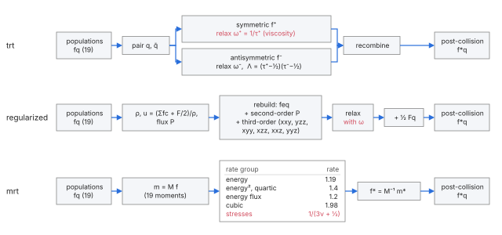
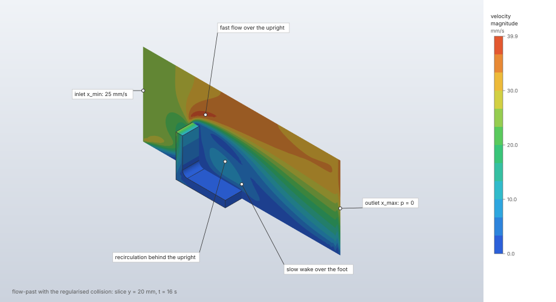
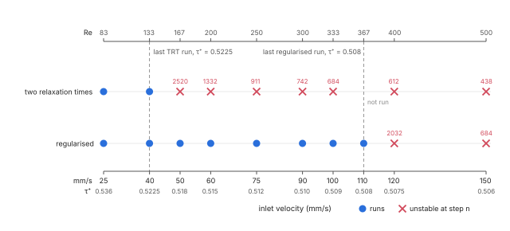

# Collision operators

The collision relaxes each cell's populations towards equilibrium; it sets the viscosity, the
position of bounce-back walls and how close to τ⁺ = ½ a grid can run. A fluid step chooses one of
four operators on D3Q19: two relaxation times (the default), the recursive regularised collision
for flows the default cannot hold on an affordable grid, multiple relaxation times, the
operator of the wall-modelled large-eddy simulation, and the hybrid recursive regularised
collision, which adds a hyperviscosity for large-eddy simulation (CPU only). The temperature
lattice of a flow with heat always collides with two relaxation times.

| | |
|---|---|
| **Commands** | `model.step.create` (procedure `fluid`: `collision`, `magic`, `sigma`), `solve.fluid` |
| **Step procedure** | `"fluid"` |
| **Solver** | `crates/lbm` (CPU, f64); `crates/lbm-gpu` (f32), every operator |
| **Method** | TRT (Ginzburg, Verhaeghe & d'Humières 2008); recursive regularised (Latt & Chopard 2006; Coreixas et al. 2017); MRT (d'Humières et al. 2002, rates of Malaspinas & Sagaut 2014); hybrid recursive regularised (Jacob, Malaspinas & Sagaut 2018) |
| **Verified by** | `crates/lbm/tests/verification.rs`, `regularized.rs`, `mrt.rs`, `hrr.rs`, `thermal.rs`; `crates/lbm-gpu/tests/verification.rs` (every operator, both layouts) |

## Synopsis

```json
{"name": "Run", "procedure": {"type": "fluid", "domain": "Flow", "end_time": 16,
  "collision": "regularized"}}
```

## Parameters

| Field | Value | Default | Meaning |
|---|---|---|---|
| `collision` | `"trt"` | default | Two relaxation times. Most flows: bounce-back walls sit exactly halfway between cells, so it is the most accurate of the three on a given grid. |
| | `"regularized"` | | Recursive regularised. Flows the two-relaxation-time scheme cannot hold on the grid you can afford: τ⁺ below about 0.52, fast inlets and fans, sharp corners. It costs 15–35 % more per step, its staircase walls are less accurate and its pressure outlets cost 3–8 % near the outlet (Theory). |
| | `"mrt"` | | Multiple relaxation times. The collision the wall model is validated with ([Large-eddy simulation](les.md)). |
| | `"hrr"` | | Hybrid recursive regularised. The regularised collision with its stress blended with the one the finite-difference strain rate gives (`sigma`), which damps the shortest waves: for large-eddy simulation. |
| `magic` | above 0, at most 1 | 3/16 | The two-relaxation-time parameter Λ. With `regularized`, `mrt` or `hrr` it has no effect, and the solve warns. |
| `sigma` | above 0, at most 1 | 0.99 | The hybrid collision's σ: its share of the populations' own stress. 1 is `regularized` exactly; lower adds more hyperviscosity. `"dynamic"`: σ per cell and step from the turbulence model's eddy viscosity, which then stays out of τ (needs `turbulence`; Theory). With another collision it has no effect, and the solve warns. |

The same choice runs on the CPU and on the GPU (`backend: "gpu"`), with buoyancy, heat and the
turbulence model ([GPU backend](gpu.md) for `hrr`'s finite-difference gradient there). `solve.fluid` reports it as `collision`, with `tau`, `tau_minus` and `magic`.

Warnings: with two relaxation times below τ⁺ = 0.51 the solve warns and suggests the regularised
collision; with the regularised collision it warns below τ⁺ = 0.508, its measured limit on the
flow-past sample, where the reflecting inlet and outlet still fail.

## Theory

### Two relaxation times

Each pair of opposite populations (q, q̄) splits into a symmetric and an antisymmetric part,
f_q⁺ = (f_q + f_q̄)/2 and f_q⁻ = (f_q − f_q̄)/2, which relax at their own rates:

```text
f*_q = f_q − ω⁺ (f_q⁺ − f_q^eq⁺) − ω⁻ (f_q⁻ − f_q^eq⁻) + S_q⁺ + S_q⁻
f_q^eq⁺ = w_q ρ (1 + 9/2 (c_q·u)² − 3/2 u²),   f_q^eq⁻ = 3 w_q ρ c_q·u
ω⁺ = 1/τ⁺,   ω⁻ = 1/τ⁻,   Λ = (τ⁺ − ½)(τ⁻ − ½)
```

τ⁺ sets the viscosity, ν = c_s² (τ⁺ − ½); τ⁻ follows from Λ. The rest population is symmetric only.
With Λ = 3/16 halfway bounce-back puts the wall exactly halfway between cells, and steady solutions
do not depend on the viscosity (Ginzburg et al. 2008). With a turbulence model each cell's τ⁺
rises by its eddy viscosity and its τ⁻ follows, keeping Λ.

### Recursive regularised

`crates/lbm/src/regularized.rs` has the derivation; in short:

- Every population is rebuilt from the cell's density, its velocity u = (Σ f c + F/2)/ρ (Guo's
  half force) and its non-equilibrium momentum flux before relaxing. The ghost modes the
  two-relaxation-time scheme relaxes by 1 − ω ≈ −1 as τ⁺ → ½ are set to equilibrium every step
  instead.
- Second order: the equilibrium and the flux P = Σ c c f − ρ (c_s² I + u u) + ½ (u F + F u). Third
  order, recursively from P: u_a P_bc + u_b P_ac + u_c P_ab, plus the equilibrium ρ u_a u_b u_c, for
  the six third moments D3Q19 holds (xxy, yzz, xyy, xzz, xxz, yyz). On D3Q19 each pair (H_xxy,
  H_yzz) enters by its sum and difference, which are orthogonal under the weights (norms 2/27 and
  6/27), so the populations carry exactly those moments.
- Guo forcing, re-derived for the rebuilt populations:
  f* = f^eq + (1 − ω) f⁽¹⁾[P] + ½ F_q, F_q = w_q [3 c·F + 9 (c·u)(c·F) − 3 u·F]. Mass is kept, the
  momentum gains exactly F, and fans, porous zones (Guo & Zhao's implicit velocity) and buoyancy
  enter through F and u.
- Pressure outlets hold the equilibrium of the outlet density and the normal velocity Zou–He finds
  (`hold_equilibrium` in `flow.rs`, and the same in the GPU shader). With the bounce-back
  non-equilibrium part a regularised outlet layer grows an oscillation that flips sign every step
  along the outlet (a 16-cell channel at τ⁺ = 0.52 and lattice speed 0.1 went unstable at step
  301; `a_regularised_channel_with_a_pressure_outlet_stays_stable_at_tau_0_52` runs it 2000 steps),
  which the two-relaxation-time scheme's slowly relaxing antisymmetric part damps. The equilibrium
  outlet (Krüger et al. 2017, ch. 5) does not impose the viscous stress on its own layer, and that
  costs accuracy near it, more as τ⁺ approaches ½: a fully developed channel profile is 3.2 % off
  in the cell next to the outlet at τ⁺ = 0.6 and 7–7.5 % at 0.52 (9.6 % in the outlet cell itself),
  against 0.4 % for the bounce-back outlet where that one stays stable (τ⁺ = 0.52, lattice speed
  0.01). Mid-channel is unchanged. A wake leaving through the outlet is disturbed further in too:
  the pressure-outlet guard of #598, `a_wake_at_a_pressure_outlet_distorts_only_the_last_layer` (run with two
  relaxation times) measures 1.2 × 10⁻² interior departure under the regularised collision, beyond
  its 9 × 10⁻³ limit. Keep uniform outlets well downstream of what you measure, or use the
  convective outflow (`outflow: "convective"`), the better outlet for this collision ([Boundary
  conditions](boundary-conditions.md)). Velocity inlets keep Zou–He.
- Collisions run by fixed blocks of cells: 1 and N threads give the same result bit for bit
  (`results_are_bit_for_bit_the_same_on_one_and_many_threads`).

Without Λ its bounce-back wall is off the halfway point by O(Δx²) (second order, with a larger
constant), which shows on staircase cylinders as a few percent more drag on coarse grids. Choose it
where the two-relaxation-time scheme does not run.

**Why this operator.** The cumulant collision (Geier et al. 2015) is defined on D3Q27's 27
moments; D3Q19 lacks the corner directions its higher cumulants need. The projected
regularisation (second order only) filters the ghost modes too, but drops the third moments; in
our runs it failed where the recursive form ran (a 64² lid-driven cavity at Re 2000, τ⁺ = 0.510:
projected unstable at step 786, recursive 20 000 steps; a periodic shear layer at lattice speed
0.2, τ⁺ = 0.505: projected unstable at step 603, recursive 5 000 steps), as Coreixas et al. (2017,
2019) found.

### Hybrid recursive regularised

`crates/lbm/src/hrr.rs` has the details (J. Jacob, O. Malaspinas, P. Sagaut, J. Turbul.
19:1051–1076, 2018, doi:10.1080/14685248.2018.1540879). The recursive regularised collision
rebuilds the populations from the non-equilibrium flux `P`; the hybrid one rebuilds them from

`P̃ = σ P + (1 − σ)(−2 ρ c_s² τ̄ S^FD)`,

with `S^FD` the strain rate of second-order centred differences of the neighbouring cells'
velocity (one-sided first-order differences where a neighbour is not a fluid cell, 0 where both
are missing) and τ̄ = 1/ω the cell's own relaxation time (with Smagorinsky's or Vreman's eddy
viscosity, or the wall model's rate, when they act). The third-order part is rebuilt recursively from `P̃`. The
centred difference's error adds a hyperviscosity; to leading order in the paper's continuous
analysis (their eq. 47) `ν_σ = (1 − σ)/(6σ) Δx² c_s² τ`, so a shear wave of wavenumber k decays at
`ν k² [1 + ((1 − σ)/σ)(1 − sin(kΔx)/(kΔx))]`. The exact linear analysis of the discrete scheme
(`tests/hrr.rs`) keeps `ν` exactly as k → 0 with τ̄ = 1/ω; its k⁴ term is not eq. 47's: the extra
damping relative to `regularized` grows as τ̄ approaches ½ (about 7 times eq. 47's at τ̄ = 0.55,
σ near 1), is about half of it at τ̄ = 0.8, vanishes at τ̄ = 1 (the collision then keeps no
non-equilibrium part) and changes sign above. Resolved waves (k Δx = 2π/64) stay within 1 % of
eq. 47 at τ̄ 0.55 and 0.8.

**Dynamic σ** (`sigma: "dynamic"`, their §4). With a turbulence model's eddy viscosity ν_t, σ is
set per cell and step so that the blend's hyperviscous dissipation `ν_σ |∇²u|²` equals the
subgrid one `ν_t |∇u|²` (eq. 48): `ν_σ = L_VK² ν_t`, `L_VK = |∇u| / |∇²u|` (eq. 49), and with
eq. 47's `ν_σ = (1 − σ)/(6σ) Δx² c_s² τ`, reading the continuous `c_s² τ` as the molecular ν,

`σ = 1 / (1 + 6 L_VK² ν_t / (Δx² ν))` (eq. 50),

in [0, 1]: 1 where ν_t = 0 (then `regularized` bit for bit). Eq. 50 alone gives 0 where `∇²u = 0`
and ν_t > 0, however small: unbounded as `|∇²u| → 0`, a regime the paper's flows never reach but a
near-uniform region does. As a guard (ours, not the paper's) `L_VK² = min(|∇u|²/|∇²u|², L_max²)`,
L_max the box's shortest extent in cells (the smallest cell count along x, y, z, periodic or not),
`∇²u = 0` giving `L_VK = L_max`. The cap bounds that amplification without removing it: a ν_t
between the CPU's and the GPU's round-off floors can still move σ by `6 L_max² ν_t / ν` in a
near-uniform region of a large box, where u is near-linear and σ barely matters; the GPU's
agreement is checked on the tested cases, not proven in general.
`|∇u|² = α_ij α_ij` from the same differences as `S^FD`; `∇²u_j` is the 7-point centred
Laplacian of each component from the same neighbours, an axis whose either neighbour is missing
contributing nothing. The subgrid viscosity is then not added to τ: the cell relaxes with the
fluid's own τ̄ and the model only sets σ (the paper's implicit large-eddy simulation, case 4).
ν_t is Vreman's (the paper's model), or with Smagorinsky's model Hou's, `(1/ω − 1/ω₀)/3` from
the implicit rate, computed without that difference's cancellation and 0 where the flux `|P|` is
below its round-off, 16 ε ρ (`crates/lbm/src/turbulence.rs`): L_VK² is unbounded where `∇²u`
vanishes, so a ν_t made of rounding would otherwise set σ there towards 0 (from an equilibrium
start, σ is then 1 exactly in the first step). A wall cell under the wall model keeps σ = 1. `eddy_viscosity_ratio` reports
the model's ν_t, and with heat α_t = ν_t / Pr_t still reaches the scalar lattice. Eq. 47 is the
continuous model's estimate; near τ̄ = ½ the scheme's own hyperviscosity is several times larger
(above), so there dynamic σ dissipates more than the subgrid model it matches.

### Multiple relaxation times

The populations are mapped to 19 orthogonal moments m = M f, each relaxed towards its equilibrium
at its own rate, and mapped back (d'Humières et al. 2002, appendix A):

```text
m* = m − S (m − m^eq) + (I − S/2) M F̂,   f* = M⁻¹ m*
```

with F̂ Guo's force in the populations, w_q (3 (c − u) + 9 (c·u) c)·F. The moments are integer
polynomials of the lattice velocity c (c² = |c|²): the density 1; the energy 19 c² − 30 and its
square (21 c⁴ − 53 c² + 24)/2; the momentum c_a and the energy flux (5 c² − 9) c_a; the stresses
3 c_x² − c², c_y² − c_z², c_x c_y, c_y c_z, c_x c_z; the two quartic modes (3 c² − 5)(3 c_x² − c²),
(3 c² − 5)(c_y² − c_z²); and the three cubic modes (c_y² − c_z²) c_x, (c_z² − c_x²) c_y,
(c_x² − c_y²) c_z. They are orthogonal, so M⁻¹ is the transpose over each moment's squared norm.
Built from the polynomials, the map does not depend on the order of the lattice's directions.

The equilibria are the second-order ones equivalent to the single-relaxation-time model: e = ρ (−11
+ 19 u²), ε = 3 ρ − 11/2 ρ u², q = −2/3 ρ u, the stresses ρ u_a u_b in the same combinations, the
quartic modes −½ of the stresses', the cubic ones 0, with u including half the force. The rates are
Malaspinas & Sagaut's (2014, appendix A, from d'Humières et al.'s linear stability analysis):

| Moments | Rate |
|---|---|
| energy | 1.19 |
| energy square, quartic modes | 1.4 |
| energy flux | 1.2 |
| cubic modes | 1.98 |
| the five stresses | 1/(3 ν + ½), per cell: 1/(3 (ν + ν_t) + ½) with Smagorinsky's model, the wall model's rate in its wall cells |
| density, momentum | conserved: their equilibria are themselves |

Where this differs from the papers: Malaspinas & Sagaut's eq. 10 for the energy square's
equilibrium is printed as (11/2) ρ (3 − u²); FieldCraft uses d'Humières et al.'s
single-relaxation-time-equivalent 3 ρ − 11/2 ρ u² (w_ε = 3, w_εj = −11/2), the choice the paper's
other equilibria (the quartic modes at −½) correspond to. The equilibria use j·j/ρ (the paper's
ρ u u); d'Humières et al. use j·j/ρ₀.

With halfway bounce-back the MRT wall lies half a cell out up to an error of order Δx² that depends
on τ: the rates are fixed, and there is no Λ to put it exactly halfway. Its pressure outlets are
Zou–He with the transverse correction, as for two relaxation times.



### The thermal lattice (#629)

With heat, the D3Q7 temperature lattice (`flow.rs`, `lbm.wgsl`) collides with two relaxation times
whatever `collision` the flow uses: each axis pair's antisymmetric part, which carries the heat
flux, relaxes with τ_T = 4 α + ½ (that sets the diffusivity α in lattice units), the symmetric part
and the rest population with τ_T⁺ = ½ + Λ_T/(τ_T − ½). With Λ_T fixed a steady temperature field
does not depend on τ_T (d'Humières & Ginzburg 2009), and neither do the walls: the anti-bounce-back
of a held temperature, the bounce-back of an adiabatic wall or a flux, and the interface links of
conducting solids keep their rules, and the conjugate links still give the solid exactly the heat
the fluid loses (`conjugate.rs`). With a single relaxation time, Λ_T = (τ_T − ½)², the walls moved
with the time step: on the automatic time step's τ_T ≈ 1.44 the de Vahl Davis cavity's largest local
Nusselt number was 7.5 % high and its smallest 11.8 % low on 32 cells.

**Λ_T = 1/12** (`setup::THERMAL_MAGIC`). For a conducting field along a flat held wall (a harmonic
temperature, T = Re e^{i k y − k x}, solved to steady state on the lattice in a standalone
calculation of the scheme), the heat each wall link takes is fourth-order accurate at 1/12 —
8.1e-4, 5.0e-5 and 3.2e-6 of the flux on 8, 16 and 32 cells per wavelength — and second order at
every other value (6.4e-3 on 16 cells at 1/24 and 1/8, 1.3e-2 at 1/6, 2.5e-2 at 1/4); with a flow
along the wall the optimum moves to smaller values (1/24 at a cell Péclet number of 0.3). In the
cavity the wall-flux error grows with Λ_T, and 1/12 puts it within 0.2 % of the reference on 64
cells (Verification).

**Below τ_T = 0.79** (`setup::thermal_magic`, ½ + √Λ_T) the lattice keeps the single relaxation time
(Λ_T = (τ_T − ½)², which is smaller there). A fixed Λ_T makes τ_T⁺ grow without bound as τ_T → ½
(a fluid of high Prandtl number, such as water, on a fine grid), and a von Neumann analysis of the
D3Q7 lattice with its linear equilibrium finds that unstable from lattice speeds of 0.02–0.03 at
τ_T 0.505–0.51 for any Λ_T below 1/4, where the single relaxation time holds 0.25. With τ_T⁺ ≤ τ_T
the largest stable lattice speed is at least 0.25 at every τ_T, as with the single relaxation time
(0.25 at 0.505, 0.36 at 0.7, 0.44 at 0.8, 0.46–0.47 from 1 to 3, against 0.25, 0.36, 0.45 and
0.50–0.54), well above the characteristic lattice speeds a run is allowed (Mach 0.3, 0.17). The
single relaxation time's wall error grows with its Λ_T, so below 0.79 it is smaller than at 1/12.

**What it costs.** A transient Fourier mode at rest decays 0.105 (k Δx)² faster than α k² (4.0e-3
on 32 cells per wavelength; the single relaxation time had −8e-4 at τ_T = 1 and −1.5e-2 at 1.5),
and the conjugate array of insulating cylinders on 16, 32 and 64 cells (`conjugate.rs`), a
first-order staircase interface, reads −5.7, −3.0 and −1.2 % against −3.9, −2.2 and −0.85 % at the
single relaxation time's τ_T = 1 (Λ_T = 1/4) and −12.4 and −4.7 % at τ_T = 0.6 (Λ_T = 0.01): its error
now does not depend on the time step. The shader collides the same way (`collide_thermal`, the
symmetric rate in `therm.w`).

## Algorithm

Per fluid cell and time step (`Flow::collide`, blocks of cells in parallel):

1. Read the 19 populations; ρ = Σ f, j = Σ f c. Under the wall model, rebuild a wall cell's
   populations from the wall law first and take its relaxation rate ([Large-eddy
   simulation](les.md)).
2. Refuse a density that is not a positive finite number (the run stops as unstable).
3. The velocity with the half force and the force per volume (body acceleration, buoyancy, zone);
   a porous zone's velocity from the exact root of its quadratic.
4. Track the cell's speed: the largest over the step is checked against the lattice-speed limit
   0.5 after the collision.
5. Collide:
   - `regularized`: rebuild and relax (`regularized::rebuild`), with Smagorinsky's or Vreman's rate per cell.
   - `hrr`: as `regularized`, the flux blended with the finite-difference strain rate of the
     neighbours' velocities first (`hrr::gradient`, `hrr::strain`, `regularized::rebuild`); those velocities come from a pass over every
     fluid cell before the collision (`Flow::gradient_velocities`, steps 1–3 through the same `cell_state`).
     The same pass runs with Vreman's model, whatever the collision: its eddy viscosity comes from
     the same gradient (`vreman::eddy_viscosity`) and sets the cell's rate 1/(1/ω⁺ + 3 ν_t) below.
   - `mrt`: the stresses' rate (the wall model's, Smagorinsky's from the cell's flux, Vreman's, or 1/τ⁺);
     map, relax with forcing, map back (`mrt::collide`).
   - `trt`: per cell ω⁺ (Smagorinsky's from the flux, or Vreman's, when a model is on) and ω⁻ from Λ; the rest
     population, then each opposite pair with its symmetric and antisymmetric forcing.
6. With heat, keep the cell's velocity for the temperature equilibrium and its eddy viscosity for
   the turbulent diffusivity; then collide the D3Q7 lattice with τ_T and τ_T⁺.

## Output

`solve.fluid` reports `collision` (`trt`, `regularized`, `mrt` or `hrr`), `tau` (τ⁺), `tau_minus` (τ⁻ of
the two-relaxation-time scheme), `magic` (Λ), with heat `tau_thermal` (τ_T), and with a turbulence
model `eddy_viscosity_ratio`.

## Worked example

The bundled `flow-past` sample ([Lattice Boltzmann flow](lattice-boltzmann.md#worked-example))
solved three times on the CPU, once with each `collision`, everything else equal: the sample's
step `Flow` (two relaxation times) and two copies of it.

| | |
|---|---|
| **Model** | `flow-past`: air at 25 mm/s past the L-bracket, 184 320 cells of 2.5 mm, 16 s, automatic Δt = 0.005 s (3200 steps), τ⁺ = 0.536 |
| **Steps** | `Flow` (`trt`, Λ = 3/16), `FlowRR` (`regularized`), `FlowMRT` (`mrt`) |
| **Units** | mm, t, s, N, MPa |

```json
[
  {"command": "file.sample", "params": {"name": "flow-past"}},
  {"command": "model.step.create", "params": {"name": "FlowRR", "procedure": {"type": "fluid",
    "domain": "Wind", "end_time": 16, "frames": 10, "collision": "regularized"}}},
  {"command": "model.step.create", "params": {"name": "FlowMRT", "procedure": {"type": "fluid",
    "domain": "Wind", "end_time": 16, "frames": 10, "collision": "mrt"}}},
  {"command": "solve.fluid", "params": {"step": "Flow", "backend": "cpu"}},
  {"command": "solve.fluid", "params": {"step": "FlowRR", "backend": "cpu"}},
  {"command": "solve.fluid", "params": {"step": "FlowMRT", "backend": "cpu"}},
  {"command": "results.streamlines", "params": {"step": "FlowRR", "show": false}},
  {"command": "results.slice", "params": {"step": "FlowRR", "field": "velocity", "axis": "y", "position": "auto"}}
]
```

From the `solve.fluid` replies (Apple M4 Max, CPU, 14 cores). Drag is the sum of the x components
of the bracket faces' forces. Run times are the fastest of several runs each; the machine was
shared with other jobs, and single runs took up to 24 s.

| Quantity | `trt` | `regularized` | `mrt` |
|---|---|---|---|
| `tau`, `tau_minus`, `magic` | 0.536, 5.708, 0.1875 | 0.536, 5.708, 0.1875 | — |
| Drag, `final` | 1.133 × 10⁻⁶ N | 1.115 × 10⁻⁶ N (−1.6 %) | — |
| Drag, `mean` (last quarter) | 1.737 × 10⁻⁶ N | 1.845 × 10⁻⁶ N (+6.2 %) | — |
| `mass.relative_change` | −7.67 × 10⁻⁴ | −1.89 × 10⁻³ | — |
| `max_speed` | 41.69 mm/s | 42.30 mm/s | — |
| `final_max_speed` | 39.29 mm/s | 39.94 mm/s | — |
| Density spread warning | 1.2 % | 1.9 % | — |
| Wall-clock time | 6.9 s | 8.9 s (+29 %) | — |
| Outcome | 3200 steps | 3200 steps | refused: "unstable: the flow went unstable at time step 149: the lattice speed reached 0.529 (limit 0.5) …" |



**What to look at.** At τ⁺ = 0.536 both the two-relaxation-time and the regularised collision
run, and the regularised wake on the slice is the same as the two-relaxation-time one
([Lattice Boltzmann flow](lattice-boltzmann.md#worked-example)). The drags differ by less than
the drag's own oscillation at 16 s (1.0 × 10⁻⁶ N RMS, [Steady state and
averaging](steady-state-and-averaging.md#worked-example)), so this grid does not separate the
two operators' wall accuracy; the regularised collision cost 29 % more time, inside the 15–35 % of
Parameters, and kept mass less well. The step still reports Λ = 0.1875 for the regularised run,
where it has no effect. The multiple-relaxation-time step went unstable at step 149 (0.745 s). In
the channel of [Boundary conditions](boundary-conditions.md#worked-example) (velocity inlet,
pressure outlet) the same collision ran at its automatic τ⁺ = 0.65 and went unstable at step 216
at τ⁺ = 0.5375 (Δt/4), while a periodic channel driven by a body force ran 2 s at τ⁺ = 0.5375:
with open boundaries this operator needed a larger τ⁺ than the other two in these runs.

## Verification

### Laminar flows, two relaxation times and regularised

Analytic and published references, `cargo test -p fieldcraft-lbm` (heavy ones with
`--include-ignored`):

| Case | Reference | Two relaxation times | Regularised |
|---|---|---|---|
| Plane Poiseuille, body force, 8/16/32 cells, τ = 1 | Parabola (theory) | Exact (round-off) | 5.2e-3, 1.3e-3, 3.3e-4 of the peak: order 2.00 |
| The same, τ = 0.6 | Parabola | Exact | 1.1e-2, 2.9e-3, 7.2e-4: order 2.00 |
| Couette, 16 cells | Linear, wall shear μU/H (theory) | 1e-10, shear to 1e-6 | 2.3e-13, shear to 1e-6 |
| Taylor–Green decay, 16/32/64 cells | exp(−2νt) (theory) | 1.6e-2, 4.0e-3, 9.9e-4: order 2.0 | 1.7e-2, 4.3e-3, 1.1e-3: order 2.0; mass to 1e-13 |
| Sphere array, bounce-back, 1500 steps | Mass, force balance | — | Mass drift 6.7e-13; wall force = driving force to 1e-3 |
| Parabolic inlet, pressure outlet, 16 cells | Poiseuille; inflow = outflow | Profile 3.0e-4, gradient +0.07 %, mass steady to 1e-12 | Profile 2.3e-3, gradient +0.49 %, mass steady to 1e-12; 3.2e-2 next to the outlet |
| Porous plate (Darcy–Forchheimer, loss coefficient) | The law | Within 0.5 % | Within 0.5 % |
| Fan against a plate | Operating point | Flow 0.5 %, rise 1 %, mass 1e-12 | The same |
| de Vahl Davis cavity, Ra 10³, 16 / 32 cells | Nu 1.118 (benchmark) | 1.1161 / 1.1172 | 1.1173 / 1.1178 |
| de Vahl Davis cavity, Ra 10⁴, 48 cells | Nu 2.243 | 2.2449 | 2.2426 |
| Lid-driven cavity, Re 100, 64 cells | Ghia et al.: u/U −0.2109 at y 0.4531 (benchmark) | −0.2136 at 0.4585 | −0.2139 at 0.4586 |
| Schäfer–Turek 2D-1, Re 20, D/Δx 10 | c_D 5.57–5.59, c_L 0.0104–0.0110 (benchmark) | 5.989, 0.0120 | 6.303, 0.0180 |
| The same, D/Δx 20 | | 5.773 (+3.5 %), 0.0107 | 5.890 (+5.5 %), 0.0132 |
| Schäfer–Turek 2D-2, Re 100, D/Δx 20 | c_D,max 3.22–3.24, c_L,max 0.99–1.01, St 0.295–0.305 | 3.447, 1.102, 0.2987 | 3.496, 1.081, 0.2975 |

The two-relaxation-time results did not change when the regularised collision was added.

### Multiple relaxation times

`cargo test -p fieldcraft-lbm --test mrt -- --nocapture`, and the unit tests of `mrt.rs`:

| Case | Reference | Measured | Tolerance | Test |
|---|---|---|---|---|
| Moments | Orthogonal; momentum rows = c | Exact | exact | `the_moments_are_orthogonal` |
| Equilibrium populations | Left unchanged by the collision | 1e-15 | 1e-15 | `an_equilibrium_is_left_as_it_is` |
| A pure shear | Relaxes at the viscous rate | 1e-15 | 1e-15 | `a_shear_relaxes_at_the_viscous_rate` |
| Plane Poiseuille, 8/16/32 cells, τ = 0.8 | Parabola (theory) | Order 2 | finest < 2 × 10⁻³, |order − 2| < 0.2 | `poiseuille_flow_converges_to_the_parabola_like_dx_squared` |
| Plane Poiseuille, 16 cells, τ = 1 | Parabola | 3.0e-3 of the peak | 4 × 10⁻³ (GPU suite) | `plane_poiseuille_matches_the_analytic_profile_and_the_cpu` (`fieldcraft-lbm-gpu`) |
| Couette, 16 cells, lattice speed 0.1 | Linear profile | Compressibility error | 2 × 10⁻³ of the wall speed | `couette_flow_is_linear` |
| Taylor–Green, 16/32/64 cells | exp(−2νt) | 2.2e-2, 5.5e-3, 1.4e-3 (orders 2.015, 2.004) | finest < 2 × 10⁻³, order > 1.8 | `taylor_green_decays_at_the_viscous_rate_to_second_order` |
| Couette with Smagorinsky's model | ν_t = (C Δx)² U/h, wall shear ρ (ν + ν_t) U/h | | shear 2 × 10⁻³, ν_t/ν 2 × 10⁻² | `smagorinsky_couette_flow_takes_the_closed_form_eddy_viscosity` |
| Determinism | One thread against several | Bit for bit | exact | `results_are_bit_for_bit_the_same_on_one_and_many_threads` |

The wall-modelled channel against Lee & Moser and Dean runs with this collision ([Verification and
validation](../../verification.md), "Wall-modelled channel").

### Hybrid recursive regularised

`cargo test -p fieldcraft-lbm --test hrr -- --nocapture` (the full shear-wave sweep:
`cargo test --release -p fieldcraft-lbm --test hrr -- --include-ignored --nocapture`), and the
unit tests of `hrr.rs`:

| Case | Reference | Measured | Tolerance | Test |
|---|---|---|---|---|
| σ = 1 | `regularized`, bit for bit | Every density, velocity and wall force equal after 200 steps of a forced channel with a ball, inlet, outlet and slip face, with and without Smagorinsky's model | exact | `sigma_one_is_the_regularised_collision_bit_for_bit` |
| Plane Poiseuille, 8/16/32 cells, τ = 0.8, σ 0.99 | Parabola (theory) | 3.5e-3, 8.6e-4, 2.2e-4 (orders 2.000, 2.000) | finest < 2 × 10⁻³, |order − 2| < 0.2 | `poiseuille_flow_converges_to_the_parabola_like_dx_squared` |
| Couette, 16 cells, σ 0.9 | Linear profile | 6e-14 of the wall speed | 2 × 10⁻³ | `couette_flow_is_linear` |
| Couette with Smagorinsky's model, σ 0.9 | ν_t = (C Δx)² U/h, wall shear ρ (ν + ν_t) U/h | shear 3e-6, ν_t/ν 8e-4 relative | shear 2 × 10⁻³, ν_t/ν 2 × 10⁻² | `smagorinsky_couette_flow_takes_the_closed_form_eddy_viscosity` |
| Taylor–Green, 16/32/64 cells, σ 0.99 | exp(−2νt) | 1.7e-2, 4.3e-3, 1.1e-3 (orders 2.009, 2.004) | finest < 2 × 10⁻³, order > 1.8 | `taylor_green_decays_at_the_viscous_rate_to_second_order` |
| Shear wave, N = 64, 16, 8 cells (k Δx = 2π/N), τ̄ 0.8 and 0.55, σ 0.5, 0.9, 0.97, 0.985 | Exact rate −ln λ of the scheme's linear map (derived in the test) | Within 2.5e-7 relative (1e-11 for N ≥ 16) | 1 % | `shear_waves_decay_at_the_exact_rate_and_at_eq_47_when_resolved` (heavy; N = 16, τ̄ 0.8, σ 0.9 in the trunk gate) |
| The same, N = 64 | Eq. 47 of Jacob et al. | Within 6.2e-3 (τ̄ 0.55, σ 0.5), 1e-3 or less otherwise | 1 % | the same |
| Determinism | One thread against several | Bit for bit | exact | `results_are_bit_for_bit_the_same_on_one_and_many_threads` |
| Refusals | σ 0, below 0, above 1, not finite: refused by name; `"dynamic"` without `turbulence`: refused, naming it | | | `bad_sigmas_are_refused_and_dynamic_needs_a_subgrid_model` |
| Dynamic σ, closed form | u_x = sin(ky), k = 2π/16: σ = 1/(1 + 6 L_VK² ν_t/ν) with the discrete α_yx = cos(ky) sin k, ∇²u_x = 2 sin(ky)(cos k − 1); the limits ν_t = 0 → 1, ∇²u = 0 → L_VK = L_max | within 1e-14 | 1e-14 | `hrr::tests::dynamic_sigma_matches_the_closed_form_of_a_sine` |
| Dynamic σ, near-uniform forced start | 16³ at speed 0.05 with a 1e-6 perturbation, a body force, Smagorinsky's model, first step: σ ≥ 1/(1 + 6 L_max² ν_t/ν), L_max 16 | σ min 0.99999988 against the bound 0.99999988 (ν_t/ν 7.7e-11 from the force's flux); without the cap 2.6e-10 | exact bound | `a_near_uniform_forced_start_keeps_dynamic_sigma_above_the_cap_s_bound` (`tests/vreman.rs`) |
| Dynamic σ with no eddy viscosity | Couette and Poiseuille with Vreman's model: σ = 1 everywhere, `regularized` bit for bit | equal; σ min and mean exactly 1 | exact | `dynamic_sigma_without_eddy_viscosity_is_the_regularised_collision_bit_for_bit` (`tests/vreman.rs`) |
| Dynamic σ from an equilibrium start | Taylor–Green 16³ with Smagorinsky's model, first step: the flux is round-off only, so ν_t = 0 and σ = 1 | σ min and mean exactly 1, ν_t/ν 0 (1 − 1.7e-12 and 1.7e-14 without the floor) | exact | `an_equilibrium_start_gives_dynamic_sigma_one_exactly` (`tests/vreman.rs`) |
| Dynamic σ, Taylor–Green 16³, Re 50 | σ in [0, 1], below 1 | Vreman's: σ min 0.030, mean 0.421; Smagorinsky's: 0.024, 0.443 | — | `dynamic_sigma_acts_in_the_taylor_green_vortex` |
| Dynamic σ, determinism | One thread against several, Vreman's and Smagorinsky's | Bit for bit, σ statistics too | exact | `dynamic_sigma_is_bit_for_bit_the_same_on_one_and_many_threads` |

### The thermal lattice

Errors against de Vahl Davis (1983): Nu 1.118, Nu_max 1.505, Nu_min 0.692 at Ra 10³; 4.519, 7.717,
0.729 at 10⁵. Nu_max and Nu_min as `solve.probe` reads them (the one-sided difference through the
wall, the extreme on the parabola through three samples; Nu_min at the top cell's centre, half a
cell below the corner where the reference is) and from each wall link's own heat ("links"). Run to
1.5 H²/α with `cargo test --release -p fieldcraft-lbm --test thermal -- --ignored
local_wall_heat_flux_with_two_relaxation_times --nocapture` (the 1/8 and 3/16 rows from the same
harness with those values).

| Ra | cells | Λ_T | τ_T | Nu | Nu_max | Nu_min | Nu_max (links) | Nu_min (links) |
|---|---|---|---|---|---|---|---|---|
| 10³ | 32² | (τ_T − ½)², before | 0.6 | +0.02 % | −0.19 % | +0.71 % | +0.45 % | +0.28 % |
| 10³ | 32² | (τ_T − ½)², before | 0.8 | +0.01 % | +0.46 % | −0.40 % | +0.24 % | −0.39 % |
| 10³ | 32² | (τ_T − ½)², before | 1.0 | −0.00 % | +1.78 % | −2.66 % | +1.12 % | −2.26 % |
| 10³ | 32² | (τ_T − ½)², before | 1.5 | −0.07 % | +8.63 % | −13.51 % | +4.61 % | −9.66 % |
| 10³ | 32² | (τ_T − ½)², before | 1.439 (automatic) | −0.06 % | +7.54 % | −11.79 % | +4.15 % | −8.61 % |
| 10³ | 32² | 1/24 | 0.6 / 1.5 | +0.02 / −0.07 % | +0.06 / +0.23 % | +0.28 / +0.26 % | +0.35 / +0.52 % | +0.12 / +0.08 % |
| 10³ | 32² | 1/12 | 0.6 / 1.5 | +0.02 / −0.07 % | +0.40 / +0.56 % | −0.31 / −0.32 % | +0.24 / +0.41 % | −0.31 / −0.32 % |
| 10³ | 32² | 1/8 | 0.6 / 1.5 | +0.02 / −0.07 % | +0.73 / +0.89 % | −0.89 / −0.90 % | +0.34 / +0.55 % | −0.81 / −0.82 % |
| 10³ | 32² | 1/6 | 0.6 / 1.5 | +0.02 / −0.07 % | +1.06 / +1.22 % | −1.48 / −1.49 % | +0.59 / +0.80 % | −1.30 / −1.31 % |
| 10³ | 32² | 3/16 | 0.6 / 1.5 | +0.02 / −0.07 % | +1.24 / +1.39 % | −1.77 / −1.78 % | | |
| 10³ | 32² | 1/4 | 0.6 / 1.5 | +0.02 / −0.07 % | +1.74 / +1.88 % | −2.66 / −2.67 % | +1.07 / +1.28 % | −2.26 / −2.27 % |
| 10³ | 32² | shipped | 0.8 | +0.01 % | +0.41 % | −0.31 % | +0.26 % | −0.31 % |
| 10³ | 32² | shipped | 1.0 | −0.00 % | +0.44 % | −0.31 % | +0.28 % | −0.31 % |
| 10³ | 32² | shipped | 1.5 | −0.07 % | +0.56 % | −0.32 % | +0.41 % | −0.32 % |
| 10³ | 32² | shipped | 1.439 (automatic) | −0.06 % | +0.54 % | −0.31 % | +0.39 % | −0.32 % |
| 10³ | 64² | (τ_T − ½)², before | 0.8 | −0.01 % | +0.17 % | −0.17 % | +0.13 % | −0.18 % |
| 10³ | 64² | (τ_T − ½)², before | 1.5 | −0.03 % | +2.09 % | −3.42 % | +1.62 % | −3.28 % |
| 10³ | 64² | 1/24 | 1.5 | −0.03 % | +0.11 % | −0.01 % | +0.20 % | −0.01 % |
| 10³ | 64² | 1/12 | 1.5 | −0.03 % | +0.19 % | −0.15 % | +0.17 % | −0.16 % |
| 10³ | 64² | 1/6 | 1.5 | −0.03 % | +0.37 % | −0.44 % | +0.12 % | −0.45 % |
| 10³ | 64² | 1/4 | 1.5 | −0.03 % | +0.54 % | −0.73 % | +0.27 % | −0.75 % |
| 10³ | 64² | shipped | 0.8 | −0.01 % | +0.16 % | −0.15 % | +0.13 % | −0.16 % |
| 10⁵ | 64² | (τ_T − ½)², before | 0.8 | +0.16 % | +2.26 % | −11.06 % | +0.87 % | −10.96 % |
| 10⁵ | 64² | 1/24 | 0.8 | +0.16 % | +0.45 % | −4.03 % | +1.26 % | −6.66 % |
| 10⁵ | 64² | 1/12 (shipped) | 0.8 | +0.16 % | +2.01 % | −10.09 % | +0.92 % | −10.12 % |
| 10⁵ | 64² | 1/6 | 0.8 | +0.16 % | +5.22 % | −22.19 % | +0.27 % | −20.53 % |
| 10⁵ | 64² | 1/4 | 0.8 | +0.16 % | +8.48 % | −34.22 % | −0.35 % | −30.76 % |

"Shipped" is Λ_T = 1/12 above τ_T = 0.79 and the single relaxation time below. At a fixed Λ_T the
rows move with τ_T by at most 0.16 points on 32 cells and 0.04 on 64 (the single relaxation time: 14
and 3.4): that remainder is the linear equilibrium's numerical diffusion along the flow, 4 u² of the
diffusivity in lattice units, which grows with the time step's lattice speed (0.03 at τ_T 1.5 on 32
cells). At Ra 10⁵ on 64 cells the top corner is under-resolved and smaller Λ_T reads closer there;
1/12 is the value that is exact for conduction and keeps the stability of the single relaxation
time, and the cavity cases of the oracle, run at τ_T 0.62–0.8, stay within their tolerances
([Oracle results](../../oracle.md)).

### Stability

**The flow-past sample** (#557): the bracket in a 240 × 120 × 100 mm box, air, the inlet raised,
initial velocity 25 mm/s, 16 s, automatic time step, on the GPU (Apple M4 Max); the CPU gives the
same outcome where run (75 and 90 mm/s at 2.5 mm: the two-relaxation-time scheme unstable at steps
951 and 786, the regularised running 16 s). Re on the 50 mm upright, ν = 15 mm²/s.

| inlet (mm/s) | Re | spacing (mm) | τ⁺ | two relaxation times | regularised |
|---|---|---|---|---|---|
| 25 | 83 | 2.5 | 0.536 | runs | runs |
| 40 | 133 | 2.5 | 0.5225 | runs | runs |
| 50 | 167 | 2.5 | 0.518 | unstable, step 2520 | runs |
| 60 | 200 | 2.5 | 0.515 | unstable, step 1332 | runs |
| 75 | 250 | 2.5 | 0.512 | unstable, step 911 | runs |
| 90 | 300 | 2.5 | 0.510 | unstable, step 742 | runs |
| 100 | 333 | 2.5 | 0.509 | unstable, step 684 | runs |
| 110 | 367 | 2.5 | 0.508 | | runs |
| 120 | 400 | 2.5 | 0.5075 | unstable, step 612 | unstable, step 2032 |
| 150 | 500 | 2.5 | 0.506 | unstable, step 438 | unstable, step 684 |
| 90 | 300 | 2.0 | 0.5125 | unstable, step 968 | runs |
| 90 | 300 | 1.25 | 0.520 | unstable, step 4672 | runs |
| 180 | 600 | 1.25 | 0.510 | unstable, step 750 | runs, sheds |

On the gallery grid (2.5 mm) the highest Reynolds number that runs goes from 133 to 367 and the
lowest τ⁺ from 0.5225 to 0.508. At 1.25 mm the wake sheds at Re 600: the cross-stream velocity
50 mm behind the bracket swings by ±150 mm/s at 1.07 Hz, a Strouhal number of 0.30 on the upright's
height. At 2.5 mm, 100–110 mm/s, it wavers by ±9–13 mm/s without settling into one frequency.
Beyond τ⁺ ≈ 0.508 the inlet and the outlet still reflect the start-up's pressure waves.



**The heat sink of the electronics-cooling examples** (#587: the six-fin sink held at 80 °C in a
duct, 20 °C air, 1 mm cells, 4 s, automatic time step; GPU, the regularised 150 mm/s run also on the
CPU with the same heat):

| inlet (mm/s) | τ⁺ | two relaxation times | regularised |
|---|---|---|---|
| 100 | 0.5225 | 4.56 W, 13.2 K/W | 4.45 W, 13.5 K/W |
| 150 | 0.515 | unstable, step 704 | 6.08 W, 9.9 K/W |
| 200 | 0.511 | | 6.89 W, 8.7 K/W |
| 250 | 0.509 | | 6.89 W, 8.7 K/W |
| 300 | 0.5075 | unstable, step 303 | unstable, step 1023 |

**Small cases** in the test suite: a 48² lid-driven cavity at Re 1500 (τ⁺ 0.5096): two relaxation
times unstable at step 767, regularised runs (`a_lid_driven_cavity_at_tau_0_51_…`); a cylinder of
ten cells in the Schäfer–Turek channel at Re 200 (τ⁺ 0.510): unstable at step 1324, regularised
runs 6000 steps (heavy).

### Cost

| | two relaxation times | regularised |
|---|---|---|
| CPU, one thread, flow-past sample (million updates per CPU second) | 13.8 | 9.2 (−33 %) |
| GPU M4 Max, in place, periodic 128³ (million updates per second) | 1160–1250 | 920–1030 (−20 %) |
| GPU M4 Max, in place, sphere 128³ | 945–955 | 810–820 (−14 %) |

The CPU figure is CPU time (the build machine was shared, so wall-clock throughput was not
repeatable); the GPU figures are the range of three runs of `cargo test --release -p
fieldcraft-lbm-gpu --test throughput -- --ignored --nocapture`.

### CPU and GPU

`cargo test -p fieldcraft-lbm-gpu --test verification` runs every case with every collision and
both streaming layouts. On an Apple M4 Max (Metal), regularised velocity fields within 5e-7–7.4e-6
of the largest speed, densities within 2.6e-7, wall shear within 1.9e-5 of itself, heats within
2.1e-6, mass drift 0: inside the backend's stated tolerances (2e-5, 1e-6, 5e-5, 1e-4; [GPU
backend](gpu.md)).

The hybrid collision on the GPU (NVIDIA GB10, Vulkan), against the CPU from the same initial state,
both layouts: σ 0.9 in a forced channel (Re_τ 30, 6 cells per half-height, perturbed, 150 steps)
and in a periodic box with a ball (24³, 200 steps), velocity within 7.9e-7 of the largest speed,
density within 1.2e-7; with Smagorinsky's model (channel at Re_τ 180) 4.4e-6, 1.4e-7, ν_t/ν within
1.1e-4 of itself; with Van Driest's damping and with the wall-function bounce 4.4e-6, wall drag
4.0e-6 (tolerances 1e-4, 1e-5, 1e-3, drag 1e-3: `the_hybrid_collision_follows_the_cpu`,
`the_hybrid_collision_with_wall_damping_and_the_wall_function_bounce_follows_the_cpu`). σ 1 is the
GPU's regularised collision bit for bit (`sigma_one_is_the_regularised_collision_on_the_gpu`). The
shear wave of the gate (N 16, τ̄ 0.8, σ 0.9) decays on the GPU at 1.547614e-2 per step against the
exact 1.547615e-2 (−4.2e-7; tolerance 1e-3: `a_shear_wave_decays_at_the_exact_rate_on_the_gpu`).

## Limitations

- D3Q19 only: no cumulant collision (it needs D3Q27).
- The regularised collision's walls are less accurate than the two-relaxation-time scheme's, and
  its uniform pressure outlets hold the equilibrium, 3–8 % off in the cell next to the outlet.
- Below τ⁺ ≈ 0.508 even the regularised collision went unstable on a coarse bluff-body grid: the
  inlet and outlet reflect pressure waves. There are no absorbing layers.
- MRT's rates are fixed (no Λ): its wall is second-order accurate with a τ-dependent constant.
- MRT went unstable with a velocity inlet and a pressure outlet at τ⁺ ≈ 0.54 (the flow-past sample
  and a channel, [Worked example](#worked-example)), where the other two collisions ran.
- The thermal lattice's linear equilibrium diffuses along the flow by 4 u² of the diffusivity.

## Implementation

| File | Contents |
|---|---|
| `crates/lbm/src/flow.rs` | `Flow::collide`: the two-relaxation-time collision, the dispatch to the other operators, Guo forcing, `velocity_force`; `collide_thermal`; `hold_equilibrium`. |
| `crates/lbm/src/regularized.rs` | `collide`: the recursive regularised collision with Guo forcing. |
| `crates/lbm/src/mrt.rs` | `M`, `NORM`, `RATES`, `equilibrium`, `collide`. |
| `crates/lbm/src/turbulence.rs` | `flux`, `omega`: each cell's rate under Smagorinsky's model. |
| `crates/lbm/src/setup.rs` | `DEFAULT_MAGIC`, `THERMAL_MAGIC`, `thermal_magic`, `REGULARIZED_TAU_LIMIT`, the warnings. |
| `crates/lbm-gpu/src/lbm.wgsl` | `collide_regularized` (with `HRR` the blend, `DYNAMIC` its σ), `collide_mrt` (override constants `REGULARIZED`, `MRT`), `gradient_velocity` and `fd_gradient` (the finite differences), `collide_thermal`. |

## References

- I. Ginzburg, F. Verhaeghe, D. d'Humières. *Two-relaxation-time lattice Boltzmann scheme: about parametrization, velocity, pressure and mixed boundary conditions.* Commun. Comput. Phys. 3(2):427–478, 2008. doi:[10.4208/cicp.2008.v3.p427](https://doi.org/10.4208/cicp.2008.v3.p427)
- J. Latt, B. Chopard. *Lattice Boltzmann method with regularized pre-collision distribution functions.* Math. Comput. Simul. 72:165–168, 2006. doi:[10.1016/j.matcom.2006.05.017](https://doi.org/10.1016/j.matcom.2006.05.017)
- C. Coreixas, G. Wissocq, G. Puigt, J.-F. Boussuge, P. Sagaut. *Recursive regularization step for high-order lattice Boltzmann methods.* Phys. Rev. E 96:033306, 2017. doi:[10.1103/PhysRevE.96.033306](https://doi.org/10.1103/PhysRevE.96.033306)
- C. Coreixas, B. Chopard, J. Latt. *Comprehensive comparison of collision models in the lattice Boltzmann framework: Theoretical investigations.* Phys. Rev. E 100:033305, 2019. doi:[10.1103/PhysRevE.100.033305](https://doi.org/10.1103/PhysRevE.100.033305)
- D. d'Humières, I. Ginzburg, M. Krafczyk, P. Lallemand, L.-S. Luo. *Multiple-relaxation-time lattice Boltzmann models in three dimensions.* Phil. Trans. R. Soc. Lond. A 360:437–451, 2002. doi:[10.1098/rsta.2001.0955](https://doi.org/10.1098/rsta.2001.0955)
- O. Malaspinas, P. Sagaut. *Wall model for large-eddy simulation based on the lattice Boltzmann method.* J. Comput. Phys. 275:25–40, 2014. doi:[10.1016/j.jcp.2014.06.020](https://doi.org/10.1016/j.jcp.2014.06.020)
- Z. Guo, C. Zheng, B. Shi. *Discrete lattice effects on the forcing term in the lattice Boltzmann method.* Phys. Rev. E 65:046308, 2002. doi:[10.1103/PhysRevE.65.046308](https://doi.org/10.1103/PhysRevE.65.046308)
- M. Geier, M. Schönherr, A. Pasquali, M. Krafczyk. *The cumulant lattice Boltzmann equation in three dimensions: Theory and validation.* Comput. Math. Appl. 70:507–547, 2015. doi:[10.1016/j.camwa.2015.05.001](https://doi.org/10.1016/j.camwa.2015.05.001)
- T. Krüger et al. *The Lattice Boltzmann Method: Principles and Practice.* Springer, 2017. doi:[10.1007/978-3-319-44649-3](https://doi.org/10.1007/978-3-319-44649-3)
- Q. Zou, X. He. *On pressure and velocity boundary conditions for the lattice Boltzmann BGK model.* Phys. Fluids 9:1591–1598, 1997. doi:[10.1063/1.869307](https://doi.org/10.1063/1.869307)
- M. Schäfer, S. Turek. *Benchmark computations of laminar flow around a cylinder.* NNFM 52:547–566, 1996. doi:[10.1007/978-3-322-89849-4_39](https://doi.org/10.1007/978-3-322-89849-4_39)
- U. Ghia, K. N. Ghia, C. T. Shin. *High-Re solutions for incompressible flow using the Navier–Stokes equations and a multigrid method.* J. Comput. Phys. 48:387–411, 1982. doi:[10.1016/0021-9991(82)90058-4](https://doi.org/10.1016/0021-9991(82)90058-4)
- D. d'Humières, I. Ginzburg. *Viscosity independent numerical errors for Lattice Boltzmann models: From recurrence equations to "magic" collision numbers.* Comput. Math. Appl. 58:823–840, 2009. doi:[10.1016/j.camwa.2009.02.008](https://doi.org/10.1016/j.camwa.2009.02.008)
- I. Ginzburg. *Equilibrium-type and link-type lattice Boltzmann models for generic advection and anisotropic-dispersion equation.* Adv. Water Resour. 28:1171–1195, 2005. doi:[10.1016/j.advwatres.2005.03.004](https://doi.org/10.1016/j.advwatres.2005.03.004)
- G. de Vahl Davis. *Natural convection of air in a square cavity: a bench mark numerical solution.* Int. J. Numer. Methods Fluids 3:249–264, 1983. doi:[10.1002/fld.1650030305](https://doi.org/10.1002/fld.1650030305)

No code of any lattice Boltzmann package was read for this implementation.
