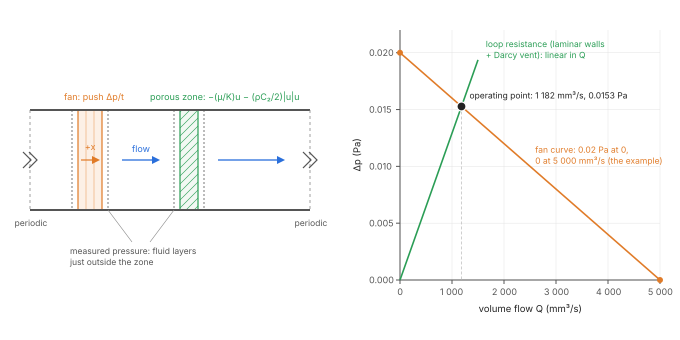
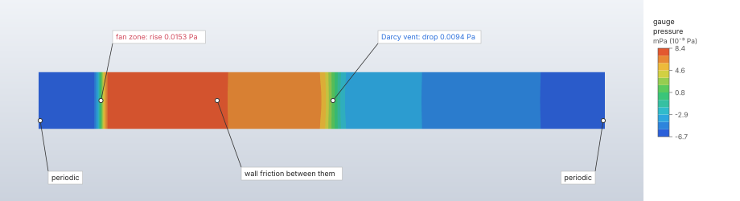
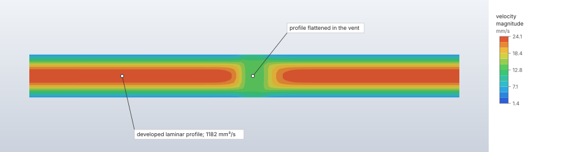

# Fans and vents

A fluid domain can hold fans and porous resistance zones, both axis-aligned boxes of cells. A
porous zone stands for a vent, grille, filter or perforated plate without resolving its holes: it
resists the flow with the Darcy–Forchheimer law. A fan raises the pressure along its direction by
its pressure–flow curve, read at the volume flow through it, so the operating point comes out of
the solve where the curve meets the system's resistance. Both act on the lattice Boltzmann flow as
body forces.

| | |
|---|---|
| **Commands** | `model.fluid_domain.create` / `.edit` (`porous`, `fans`), `solve.fluid` |
| **Step procedure** | `"fluid"` on a domain with `porous` or `fans` |
| **Solver** | `crates/lbm` (CPU, f64). The GPU backend refuses fans and porous zones. |
| **Method** | Darcy–Forchheimer resistance through Guo's forcing with the implicit velocity of Guo & Zhao (2002); fan curve with an under-relaxed pressure rise |
| **Verified by** | `crates/lbm/tests/zones.rs`; `a_fan_drives_a_duct_through_a_grille_and_the_reply_reports_the_operating_point` (`crates/engine/src/cmd/solve.rs`) |

## Synopsis

```json
{"name": "Duct", "material": "Air", "min": [0, 0, 0], "max": [60, 4, 4], "spacing": 1,
 "faces": {"x_min": {"type": "periodic"}, "x_max": {"type": "periodic"}},
 "porous": [{"name": "Grille", "min": [10, 0, 0], "max": [12, 4, 4], "axis": "x",
             "resistance": {"type": "darcy_forchheimer", "permeability": 0.05}}],
 "fans": [{"name": "Fan", "min": [2, 0, 0], "max": [4, 4, 4], "direction": "+x",
           "curve": [[0, 0.002], [1.0, 0]], "relaxation": 0.05}]}
```

`model.fluid_domain.create` (or `.edit`) takes the domain, in the display units; a fluid step on
it (`model.step.create`) and `solve.fluid` solve the flow and report each zone.

## Parameters

**Porous zone** (`porous`):

| Field | Value | Default | Meaning |
|---|---|---|---|
| `name` | text | required | Unique among the domain's fans and porous zones, not empty. |
| `min`, `max` | points | required | The box; its zone is the cells whose centres it contains. |
| `axis` | `"x"`, `"y"`, `"z"` | required | The flow's direction through it: its thickness for a loss coefficient and the direction its flow is reported in. The resistance itself acts in every direction. |
| `resistance` | `{"type": "darcy_forchheimer", "permeability": K, "inertial": C₂}` | `inertial` 0 | K > 0 (a length²), C₂ ≥ 0 (per length). |
| | `{"type": "loss_coefficient", "coefficient": k}` | — | k > 0: Δp = k ρ u²/2 across the zone along its axis. |

**Fan** (`fans`):

| Field | Value | Default | Meaning |
|---|---|---|---|
| `name` | text | required | Unique among the domain's fans and porous zones, not empty. |
| `min`, `max` | points | required | The box (usually one or a few cells thick). |
| `direction` | `"+x"`, `"-x"`, `"+y"`, `"-y"`, `"+z"`, `"-z"` | required | The direction it blows. |
| `curve` | `[[Q, Δp], …]`, 2 to 1000 points | required | Volume flow Q (volume per time) strictly increasing from 0 or more; pressure rise Δp not increasing, positive somewhere. Linear between points. |
| `relaxation` | 0 < r ≤ 1 | 0.01 | How far the pressure rise moves toward the curve's value each time step; smaller is steadier. |

A rising branch of a curve is refused: it has no stable operating point. A domain holds at most 1000
fans and porous zones together (`MAX_ZONES`). Every refusal leaves the model unchanged.

## Theory

**Porous resistance.** A porous zone adds the force per volume

```text
F = −(μ/K) u − (ρ C₂ / 2) |u| u
```

so a plate of thickness t crossed at the superficial velocity u drops the pressure by

```text
Δp = (μ/K) u t + (ρ C₂ / 2) u² t
```

(Darcy 1856 and Forchheimer 1901, through Ergun 1952). A loss coefficient k is C₂ = k / t over the
zone's thickness along its axis, with no viscous part (loss coefficients of grids and screens:
Idelchik 1996). In lattice units the acceleration is −α u − β |u| u, with α = ν Δt / K and
β = C₂ Δx / 2 (for a loss coefficient α = 0 and β = k / (2 n), n the zone's cell layers along its
axis).

**Implicit velocity.** The resistance depends on the velocity it defines in Guo's scheme,
u = (j + F/2) / ρ. Solving that quadratic exactly keeps strong resistances stable (Guo & Zhao
2002): with v = (j + (ρ a + push)/2) / ρ,

```text
u = v / (c₀ + √(c₀² + c₁ |v|)),   c₀ = (1 + α/2) / 2,   c₁ = β / 2
```

and the cell's force is ρ a + push − ρ (α + β |u|) u, which enters the collision through Guo's
forcing term.

**Fan.** A fan pushes its cells along its direction with the uniform force per volume Δp / t, t its
thickness. Before every step its volume flow Q is read (the mean over its cell layers of the flux
Σ u_axis through each), and its pressure rise moves toward the curve's value,

```text
Δp ← Δp + r (Δp_curve(Q) − Δp)
```

so the operating point settles where the curve meets the system's resistance curve. Beyond the
curve's last point the fan holds its end value (it never brakes the flow past free delivery);
before the first, the first value.



## Algorithm

Set-up:

1. Each zone takes the cells whose centres its box contains (tolerance 1e-9 of a cell). A box that
   contains no cell centre is refused ("make it at least one spacing thick and put it inside the
   box").
2. Each fluid cell belongs to the first zone that contains it, porous zones first, then fans. A
   zone with no fluid cell (inside obstacles or another zone) is refused.
3. A zone that reaches the layer of an inlet or outlet face is refused: zones stay at least one
   cell inside it.
4. Resistances and curves to lattice units (a pressure by ρ₀ Δx² / Δt², a volume flow by
   Δx³ / Δt); a value that is not finite there is refused.
5. The characteristic velocity of the automatic time step includes √(2 Δp_max / ρ) of each fan,
   Δp_max its shut-off pressure.

Each time step, before the collision: each fan's flow is read and its rise relaxed toward the
curve, and its push set to the rise over its thickness. In the collision, each zone cell's
velocity and force follow from the implicit formula above.

## Output

`solve.fluid`'s reply has `zones`, one entry per fan and porous zone:

| Field | Meaning |
|---|---|
| `name`, `kind` | The zone and `"fan"` or `"porous"`. |
| `flow` | The volume flow through it along its axis (a fan's along its direction), `final` and `mean` over the last quarter of the history. |
| `pressure_rise` | A fan's rise from its curve (its operating point), `final` and `mean`. |
| `measured_pressure_rise` | A fan's measured rise. |
| `pressure_drop` | A porous zone's measured drop (upstream by the flow's sign). |

The measured values are the static-pressure difference between the mean pressures of the fluid
cell layers just outside the zone, over its footprint (its own end layers where it meets the box's
ends). They include the wall friction over the zone's thickness plus one cell. The full histories
are kept in the result, one value per history time.

## Worked example

No bundled sample has a fan or a porous zone (the cooling samples drive their air with a uniform
inlet velocity), so this is a small model of its own: a square air duct closed on itself through
periodic ends, driven by a fan zone through a porous vent. The fan settles at the operating point
where its curve meets the loop's resistance, the vent's Darcy loss plus the walls' friction.

| | |
|---|---|
| **Geometry** | duct 100 × 10 × 10 mm, x_min and x_max periodic (a closed loop), the four long faces walls |
| **Cells** | 1 mm: 10 000, all fluid |
| **Fluid** | air, ρ = 1.2 kg/m³, μ = 1.8 × 10⁻⁵ Pa s |
| **Fan** | `Fan`, x = 10 to 12 mm, `+x`, curve Δp = 0.02 Pa at Q = 0 falling linearly to 0 at 5 000 mm³/s, `relaxation` 0.01 |
| **Vent** | `Vent`, x = 50 to 54 mm, axis x, Darcy, K = 0.1 mm² (10⁻⁷ m²) |
| **Step** | `Blow`: TRT, 10 s, two frames; automatic time step 2.739 × 10⁻⁴ s (36 515 steps), τ = 0.5123 |
| **Units** | mm, t, s, N, MPa (0.02 Pa = 2 × 10⁻⁸ MPa) |

```json
[
  {"command": "model.units", "params": {"system": "mm-t-s-N-MPa"}},
  {"command": "model.material.create", "params": {"name": "Air", "density": "1.2 kg/m^3",
    "fluid": {"type": "newtonian", "viscosity": "1.8e-5 Pa s"}}},
  {"command": "model.fluid_domain.create", "params": {"name": "Duct", "material": "Air",
    "min": [0, 0, 0], "max": [100, 10, 10], "spacing": 1,
    "faces": {"x_min": {"type": "periodic"}, "x_max": {"type": "periodic"}},
    "porous": [{"name": "Vent", "min": [50, 0, 0], "max": [54, 10, 10], "axis": "x",
                "resistance": {"type": "darcy_forchheimer", "permeability": 0.1}}],
    "fans": [{"name": "Fan", "min": [10, 0, 0], "max": [12, 10, 10], "direction": "+x",
              "curve": [[0, 2e-8], [5000, 0]], "relaxation": 0.01}]}},
  {"command": "model.step.create", "params": {"name": "Blow",
    "procedure": {"type": "fluid", "domain": "Duct", "end_time": 10, "frames": 2}}},
  {"command": "solve.fluid", "params": {"step": "Blow", "backend": "cpu"}},
  {"command": "results.streamlines", "params": {"show": false}},
  {"command": "results.slice", "params": {"field": "pressure", "axis": "y", "position": 5}},
  {"command": "results.slice", "params": {"field": "velocity", "axis": "y", "position": 5}}
]
```

The reference is an estimate built from the duct's parts at a mean velocity U = Q / A
(A = 100 mm², D = 10 mm): the fan curve Δp = 0.02 Pa (1 − U / 0.05 m/s); the vent's Darcy loss
(μ/K) U t with t = 4 mm, 0.72 U Pa s/m; and the fully developed laminar friction of a square duct,
Δp = 28.45 μ U L / D² (f Re = 56.9 on the hydraulic diameter), 0.512 U Pa s/m over the 100 mm loop.
Their intersection is U = 12.26 mm/s, Q = 1 225 mm³/s. Results from the `solve.fluid` reply's
`zones` (`final`; the `mean` over the last quarter agrees to 10 digits), 14.6 s on an Apple M4 Max,
CPU:

| Quantity | FieldCraft | Reference | Difference |
|---|---|---|---|
| Fan `flow` | 1 182.40 mm³/s | 1 225 mm³/s (estimate above) | −3.5 % |
| Fan `pressure_rise` (the operating point) | 1.52704 × 10⁻⁸ MPa | the curve at 1 182.40 mm³/s: 1.52704 × 10⁻⁸ MPa | < 10⁻⁶ |
| Vent `flow` | 1 182.26 mm³/s | the fan's flow | −1.2 × 10⁻⁴ |
| Fan `measured_pressure_rise` | 1.50910 × 10⁻⁸ MPa | the rise less the wall friction over t + Δx = 3 mm: 1.5089 × 10⁻⁸ MPa | +0.01 % |
| Vent `pressure_drop` | 9.3779 × 10⁻⁹ MPa | Darcy (μ/K) U t = 8.513 × 10⁻⁹ MPa, plus wall friction over 5 mm, 3.0 × 10⁻¹⁰ MPa: 8.816 × 10⁻⁹ MPa | +6.4 % |
| `mass.relative_change` | −8.5 × 10⁻¹³ | 0 | — |





**What to look at.** The fan's `pressure_rise` lies exactly on its curve at the flow it carries:
the under-relaxed update has converged to the operating point. The same flow passes the vent, and
the mass is conserved to 10⁻¹². The flow is 3.5 % below the estimate, and the vent's measured drop
6.4 % above its Darcy loss plus the plain duct's friction: the vent flattens the velocity profile,
which shears the walls harder inside it, and the flow redevelops behind it (the velocity picture). The
measured rise falls short of the fan's push by the friction over three cells, as the Output section
describes.

## Verification

**Theory** (`crates/lbm/tests/zones.rs`, TRT and regularised collisions; one-dimensional flows,
periodic across, so the resistance law is the whole pressure drop):

| Case | Reference | Tolerance | Test |
|---|---|---|---|
| 40 × 2 × 2 channel, plate 4 layers, K = 5, C₂ = 2, inlet u = 0.01 and 0.03 | flow 4u; Δp = ρ (ν/K u t + C₂/2 u² t), ρ the density in the plate | flow 1 %; Δp 0.5 % | `a_porous_plate_drops_the_pressure_by_the_darcy_forchheimer_law` |
| The same, loss coefficient k = 3, u = 0.03 | Δp = k ρ u²/2 | 0.5 % | the same |
| Periodic loop, fan with a linear curve, the plate above | the intersection of the curve's first segment with the plate's resistance | flow 0.5 %; rise 1 %; plate drop and measured rise 0.5 %; mass 1e-12; reply's histories 1 % | `a_fan_settles_at_the_intersection_of_its_curve_and_the_system_resistance` |
| Zones outside the box, thinner than a cell, on the inlet or outlet layer | refused, naming the zone | — | `zones_off_the_grid_or_on_an_open_layer_are_refused` |

**Through commands** (`crates/engine/src/cmd/solve.rs`): a 60 × 4 × 4 walled duct loop with a fan
and a Darcy grille. The fan's rise lies on its curve within 1 %, the grille's flow equals the fan's
within 1 %, the loop's momentum balance (fan, grille and the duct's wall shear) closes within 1 %,
the grille's own loss is Darcy's within 10 % (the remainder is wall shear in the grille's flattened
profile), and the mass changes by less than 1e-10. Hostile curves, directions, relaxations, boxes,
names and resistances are refused and leave the model as it was
(`a_fan_drives_a_duct_through_a_grille_and_the_reply_reports_the_operating_point`).

**GPU.** The backend refuses fans and porous zones by name, before it looks for a device
(`fans_and_porous_zones_are_refused_clearly`).

## Limitations

- CPU only: the GPU backend refuses a domain with fans or porous zones.
- Zones are axis-aligned boxes of whole cells.
- A porous zone's resistance is isotropic (the same law in every direction); `axis` sets only the
  loss coefficient's thickness and the reported direction.
- A fan is a uniform push over its cells: no swirl and no hub.
- The measured pressure differences include the wall friction over the zone and one cell.
- Zones stay off the inlet and outlet layers.
- The tests cover the two-relaxation-time and regularised collisions.

## Implementation

- `crates/model/src/fluid_zones.rs`: `PorousZone`, `Resistance`, `Fan`, `FanDirection`,
  `curve_value`, `validate_zones`, `MAX_ZONES`, `MAX_CURVE_POINTS`, `DEFAULT_FAN_RELAXATION`.
- `crates/lbm/src/setup.rs`: `zones` (to lattice units), `ZoneSetup`, `ZoneKind`, `cell_range`.
- `crates/lbm/src/flow.rs`: `velocity_force` (the implicit velocity), `refresh_fans`, `zone_flow`,
  `zone_samples`.
- `crates/lbm/src/solve.rs`: `ZoneHistory`.
- `crates/engine/src/cmd/solve.rs`: the reply's `zones`.

## References

- Z. Guo, T. S. Zhao. *Lattice Boltzmann model for incompressible flows through porous media.* Phys. Rev. E 66:036304, 2002.
- Z. Guo, C. Zheng, B. Shi. *Discrete lattice effects on the forcing term in the lattice Boltzmann method.* Phys. Rev. E 65:046308, 2002. doi:[10.1103/PhysRevE.65.046308](https://doi.org/10.1103/PhysRevE.65.046308)
- S. Ergun. *Fluid flow through packed columns.* Chem. Eng. Prog. 48:89, 1952.
- I. E. Idelchik. *Handbook of Hydraulic Resistance*, 3rd ed., 1996.
