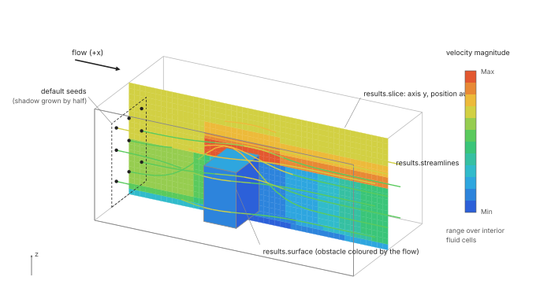
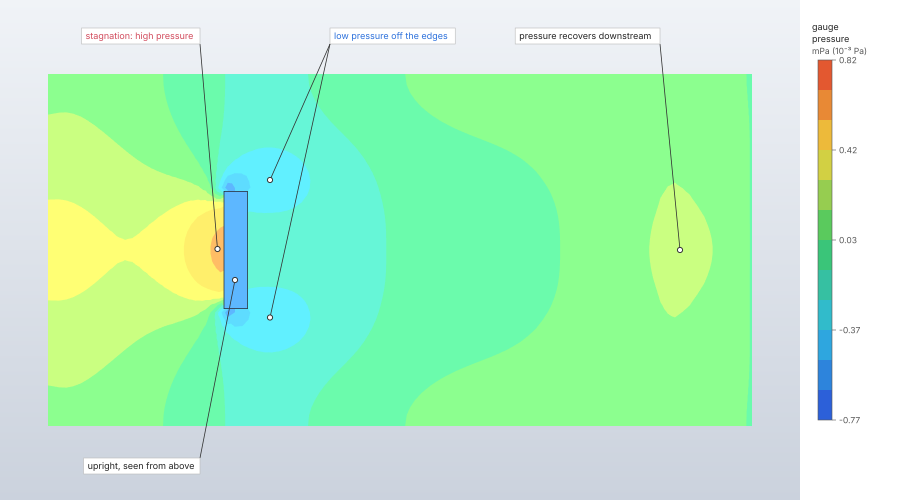
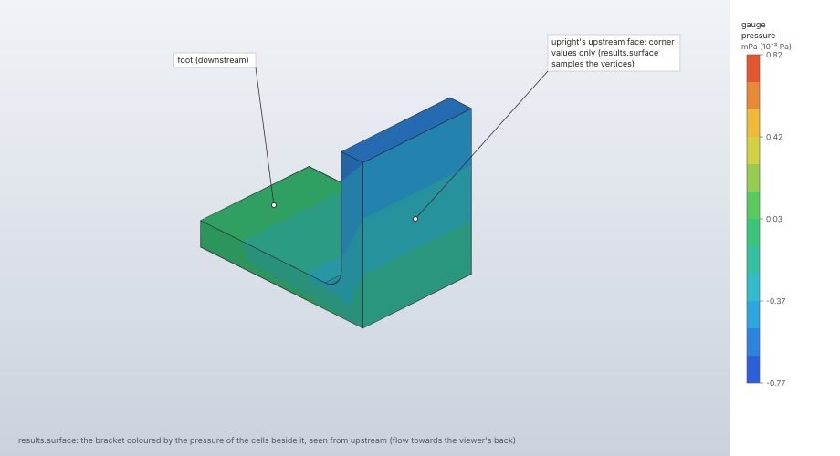
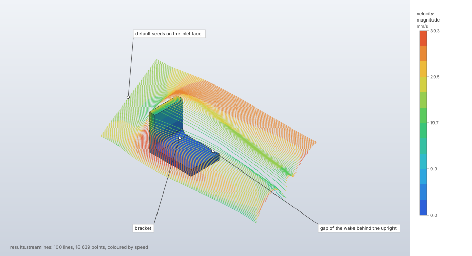

# Fluid results

A solved fluid step keeps, in the session, its output frames (velocity, gauge pressure and, with
heat, temperature in every cell), the force on every wall and, with heat, the heat into every wall
over time. The results commands probe them at points, along lines and on walls, and show them as a
coloured slice through the domain, as the obstacles coloured by the fluid beside them, and as
streamlines traced through the velocity field.

| | |
|---|---|
| **Commands** | `solve.fluid` (the reply), `solve.probe`, `results.slice`, `results.surface`, `results.streamlines`, `results.contour`, `results.frame`, `results.animate` |
| **Step procedure** | `"fluid"` |
| **Solver** | `crates/lbm` (`solve.rs`: frames and histories); display in `crates/engine/src/flow.rs`, `crates/render/src/flow.rs` |
| **Method** | Cell-centred fields; trilinear interpolation between cell centres; streamlines by the midpoint rule in half-cell steps |
| **Verified by** | `crates/render/src/flow.rs` and `crates/engine/src/flow.rs` tests; `crates/engine/src/flow/line.rs`, `flow/wall.rs` tests |

## Synopsis

```json
[
  {"command": "results.slice", "params": {"step": "Run", "field": "pressure", "axis": "z", "position": 0.05}},
  {"command": "results.streamlines", "params": {"step": "Run", "field": "velocity", "count": 100,
    "line": {"from": [0.01, 0.0, 0.05], "to": [0.01, 0.12, 0.05]}}},
  {"command": "results.surface", "params": {"step": "Run", "show": true, "field": "velocity"}},
  {"command": "solve.probe", "params": {"step": "Run", "points": [[0.15, 0.06, 0.05]]}},
  {"command": "solve.probe", "params": {"step": "Run", "line": {"from": [0.1, 0, 0.05],
    "to": [0.1, 0.12, 0.05], "field": "velocity_x"}}},
  {"command": "solve.probe", "params": {"step": "Run", "forces": ["F2:top", "Body1/F3"]}}
]
```

## Parameters

### Display

| Command | Field | Value | Default | Meaning |
|---|---|---|---|---|
| `results.slice` | `step` | step name | | The fluid step. |
| | `field` | `velocity`, `pressure`, `temperature` | as shown | Velocity magnitude, gauge pressure, or temperature when the frames carry heat. |
| | `axis` | `x`, `y`, `z`, `none` | as shown | The slice's normal; `none` hides the slice. |
| | `position` | coordinate or `"auto"` | the domain's middle | Where along `axis`; must lie inside the domain. |
| | `frame` | 0 … last | the one shown (at first the last) | The frame. |
| `results.surface` | `show` | bool | | Colour the obstacles by the field (`false`: the part in its own colours). |
| | `field` | `velocity`, `pressure`, `temperature`, `wall_heat_flux` | as shown | Read in the fluid cells beside each obstacle face; `wall_heat_flux` per face (below). |
| | `frame` | 0 … last | as shown | |
| `results.streamlines` | `show` | bool | | `false` hides them. |
| | `field` | `velocity`, `pressure`, `temperature` | as shown | Colour by speed or temperature; plain for pressure. |
| | `seeds` | `[[x, y, z], …]` | | At most 2000 seed points. |
| | `line` | `{"from", "to"}` | | `count` seeds evenly along this line. |
| | `count` | 1 to 2000 | 64 | Seeds along `line`, or on the inlet face when neither `seeds` nor `line` is given. |
| | `max_steps` | 1 to 100 000 | 4000 | Steps (half a cell each) per streamline. |
| | `frame` | 0 … last | as shown | |
| `results.contour` | `field` | `velocity`, `pressure`, `temperature`, `wall_heat_flux` | | The banded field and its legend (`bands` 2 to 24, `range`) for a fluid step. |
| `results.frame` | `frame` or `time` | index or flow time | the last | The frame shown (by index, or the frame nearest a time). |
| `results.animate` | `on` | bool | | Plays the recorded frames in order. |

What a command leaves out stays as shown. A fluid step is first shown with velocity magnitude on a
slice through the middle of the domain, normal to the horizontal axis across the flow (the slice
holds the flow direction and the vertical; Z is up), the obstacles coloured, and 64 streamlines
seeded on the inlet face. The flow direction is the axis of the largest mean velocity over the fluid
cells of the last frame (+x for fluid at rest).

### Probing (`solve.probe` on a fluid step)

| Form | Fields | Reply |
|---|---|---|
| Points | `points: [[x, y, z], …]` (at most 10 000), `frame` (default the last) | Per point: its `cell`, whether it is `solid`, `velocity`, `pressure` and, with heat, `temperature` of the cell containing it; `cell: null` outside the grid. |
| Line | `line: {"from", "to", "count", "field", "face"}`, `frame` | The field at `count` points evenly along the line (default one per cell spacing, at most 10 000), their `xyz`, and the `max` and `min` with their `xyz`. |
| Forces | `forces: ["x_min", "F2:top", "Body1/F2:top"]` (at most 100) | `times` and each wall's force history. |
| Heat | `heat: ["y_min", …]` (at most 100) | `times` and each wall's heat history (power, positive into the wall). Needs heat. |

Line fields: `velocity_x`, `velocity_y`, `velocity_z`, `speed`, `pressure`, `temperature`,
`wall_heat_flux` (with `face`, the box wall the line lies on).

## Theory

### Fields

A frame holds, per cell (index i + nx (j + ny k)), the velocity in the model's units (with Guo's
half force), the gauge pressure (ρ − 1) c_s² ρ₀ Δx²/Δt², and with heat the temperature, all in
single precision; solid cells hold zero. The fluid mass of the frame is kept in double precision.
The initial frame and `frames` more, evenly spaced to the end, are recorded; a run stopped by its
steady rule adds a frame at the stop. Force, heat and zone histories are sampled every
⌈steps/10 000⌉ steps.

### Interpolation

Values are cell-centred; solid cells have no value. Inside the fluid a point's value is the
trilinear interpolation between the cell centres around it, from the fluid cells among them. Within
half a cell of a box face there is no centre beyond the point, so the value is the nearest
centre's: a temperature line run onto a held wall reads the first cell's temperature;
`wall_heat_flux` reads the wall.

### Slices

A slice joins the cell centres of the layers either side of its plane, interpolated linearly
between them, into triangles carrying their corners' values, and bands them with the contour
legend. The outermost centres move out to the domain's faces, so the slice covers the whole domain.
A triangle touching cells with no value takes the mean of its other corners there, and one with
none is left out (the obstacle is drawn there). A layer larger than 2²⁰ quadrilaterals is sampled
every few cells.

### Ranges

The slice's `contour.range` (the legend's Max and Min) and the solve's `max_speed` are taken over
interior fluid cells: the layers of inlet and outlet faces are left out, convective outlets too,
because a wake reaching a uniform pressure outlet distorts the last layer ([Boundary
conditions](boundary-conditions.md)).

### Streamlines

Streamlines follow the trilinear interpolation of the cell velocities (solid cells at rest: the
no-slip value), integrated downstream along their arc length by the midpoint (second-order
Runge–Kutta) rule with a step of half a cell. Each stops where it leaves the domain, enters a solid
cell or reaches still fluid (a speed below 10⁻⁶ of the field's largest), or at `max_steps`. All of
them together stop at 2 000 000 points. Default seeds lie on a lattice across the inlet face (the
upstream face of the flow direction), half a cell inside it: over the obstacles' shadow on the face,
grown by half its size on every side and kept on the face, so the streamlines pass over and around
the obstacles; over the whole face without obstacles. A seed outside the fluid starts none.



### Wall heat flux

`results.surface` and `results.contour` with `wall_heat_flux` colour each obstacle face by the signed
power it receives divided by its complete tessellated area, in power per area (positive into the
wall). The face's heat history is interpolated at the shown frame's time without extrapolation:
frame 0, which predates the history, has no value; recorded adiabatic faces are zero; faces without
a history stay uncoloured. No slice is drawn for this surface-only field.

Along a line on a box wall, `solve.probe` gives the heat flux into the wall from its thermal
condition: a held temperature T_w gives the one-sided second-order difference through the wall and
the two cell-centre layers beside it (at Δx/2 and 3Δx/2), a flux face its flux, an adiabatic face
zero:

```text
q = k (9 T₁ − T₂ − 8 T_w) / (3 Δx)
```

### Line extremes

The `max` and `min` of a line probe lie between the samples, at the vertex of the parabola through
the extreme sample and its two neighbours; at an end of the line, or beside a point without a value,
the sample itself.

## Algorithm

1. `solve.fluid` stores the result and replies with its summary ([Lattice Boltzmann
   flow](lattice-boltzmann.md)).
2. A display command updates the session's results view (slice, surface, streamlines, field,
   frame); the desktop viewport and the headless pictures draw the same plot of it.
3. Streamlines are traced on the chosen frame and kept until the result, the frame or the settings
   change; the reply's `traced` gives the number of streamlines, their points, the seeds, and
   `no_start`, the seeds that started none.

## Output

| Command | Reply |
|---|---|
| `results.slice` | The view, with `contour.range` over interior fluid cells. |
| `results.surface` | The view. |
| `results.streamlines` | The view and `traced`: `streamlines`, `points`, `seeds`, `no_start`. |
| `solve.probe` | As in Parameters, in the display units. |

The reply of `solve.fluid` lists every wall's final and mean force and, with heat, its heat; the
probe returns their complete histories.

## Worked example

The bundled `flow-past` sample ([Lattice Boltzmann flow](lattice-boltzmann.md#worked-example))
after its 16 s run, read with every results command of this page: a pressure slice, the bracket
coloured by the pressure beside it, streamlines from a seed line, point and line probes, and two
faces' force histories.

| | |
|---|---|
| **Model** | `flow-past`: air at 25 mm/s past the L-bracket, box (−60, −40, 0) to (180, 80, 100) mm, 184 320 cells of 2.5 mm, step `Flow` (16 s, 3200 steps, 11 frames), solved on the CPU |
| **Views** | slice of `pressure` normal to z at 25 mm (half the upright's height); `results.surface` with `pressure`; 100 streamlines seeded along the line (−50, −20, 5) → (−50, 60, 60) mm, coloured by speed |
| **Probes** | four points on y = 20 mm (the bracket's mid-plane); a `velocity_x` line across the wake at x = 100 mm; the force histories of the upright's upstream (`F2:side:l6`) and downstream (`F2:side:l4`) faces |
| **Units** | mm, t, s, N, MPa |

```json
[
  {"command": "file.sample", "params": {"name": "flow-past"}},
  {"command": "solve.fluid", "params": {"step": "Flow", "backend": "cpu"}},
  {"command": "results.streamlines", "params": {"step": "Flow", "show": false}},
  {"command": "results.slice", "params": {"step": "Flow", "field": "pressure", "axis": "z", "position": 25}},
  {"command": "results.slice", "params": {"step": "Flow", "axis": "none"}},
  {"command": "results.surface", "params": {"step": "Flow", "show": true, "field": "pressure"}},
  {"command": "results.surface", "params": {"step": "Flow", "show": true, "field": "velocity"}},
  {"command": "results.streamlines", "params": {"step": "Flow", "show": true, "field": "velocity",
    "count": 100, "line": {"from": [-50, -20, 5], "to": [-50, 60, 60]}}},
  {"command": "solve.probe", "params": {"step": "Flow", "points": [[-30, 20, 25], [30, 20, 60], [100, 20, 25], [170, 20, 25]]}},
  {"command": "solve.probe", "params": {"step": "Flow", "line": {"from": [100, 20, 0], "to": [100, 20, 100], "field": "velocity_x"}}},
  {"command": "solve.probe", "params": {"step": "Flow", "forces": ["Bracket/F2:side:l6", "Bracket/F2:side:l4"]}}
]
```

The pictures were taken with the MCP `screenshot` tool after the slice (top view), the pressure
surface (camera yaw 135°, pitch 30°, looking at the upstream face) and the streamlines (iso view).
The headless pictures draw no colour legend; the ranges below are the replies' `contour.range`
(interior fluid cells of the whole domain, the last frame).

| Command | What it returned |
|---|---|
| `results.slice` (`pressure`) | `contour.range`: max 8.21 × 10⁻¹⁰ MPa at (−56.25, 18.75, 1.25), min −7.68 × 10⁻¹⁰ MPa at (1.25, 11.25, 51.25), just above the upright's top |
| `results.slice` (`velocity`, first view) | max 39.29 mm/s at (18.75, −16.25, 26.25), beside the bracket; min 0.043 mm/s at (103.75, −1.25, 1.25), on the floor in the wake |
| `results.streamlines` | `traced`: 100 streamlines, 18 639 points, 100 seeds, `no_start` 0 |
| `solve.probe` points (frame 10, 16 s) | (−30, 20, 25), upstream: u = (23.12, 0.26, 4.08) mm/s, p = 2.92 × 10⁻¹⁰ MPa. (30, 20, 60), above the bracket: u = (26.11, 0.02, 1.45) mm/s, p = −4.01 × 10⁻¹⁰ MPa. (100, 20, 25), 40 mm behind the foot: u = (6.33, −0.14, −4.17) mm/s, p = −3.11 × 10⁻¹¹ MPa. (170, 20, 25), 10 mm before the outlet: u = (14.95, −0.03, −6.90) mm/s, p = 1.51 × 10⁻¹⁰ MPa |
| `solve.probe` line, `velocity_x` at x = 100 mm | max 33.39 mm/s at z = 80.73 mm; min −0.876 mm/s at z = 5.23 mm |
| `solve.probe` forces | `times`: 3200 samples, 0.005 s to 16 s (every step: ⌈3200/10 000⌉ = 1). `F2:side:l6` x: 2.238 × 10⁻⁴ N at 0.005 s, 1.941 × 10⁻⁴ N at 16 s; `F2:side:l4` x: −1.175 × 10⁻⁴ N to −1.368 × 10⁻⁴ N |

Machine: Apple M4 Max; the solve on the CPU, the pictures on the GPU (`renderer`: Apple M4 Max
(Metal), hardware). Each results command replied in under 0.1 s.







**What to look at.** The slice shows the stagnation pressure ahead of the upright, the low
pressure where the flow separates off its two vertical edges, and the recovery downstream. The
line probe across the wake finds reversed flow near the floor (−0.88 mm/s at z = 5.2 mm, 40 mm
behind the foot) under the faster flow that went over the bracket (33.4 mm/s at z = 81 mm), and
the point probes show the flow turning down (w < 0) behind the bracket. `results.surface` colours
each tessellated triangle from the values at its vertices: the upright's flat upstream face is two
triangles, so it shows the pressure at its corners and misses the stagnation in its middle,
which the slice shows beside it. The force histories of the two upright faces are each
of order 10⁻⁴ N, over a hundred times the bracket's drag (1.13 × 10⁻⁶ N): each face's force carries the lattice's rest
pressure c_s² ρ₀ (Δx/Δt)² = 0.1 Pa over its area ([Lattice Boltzmann
flow](lattice-boltzmann.md#worked-example)), so drag is read from the sum over a closed set of
faces.

## Verification

| Case | Reference | Tolerance | Test |
|---|---|---|---|
| A uniform flow along x | The streamline runs straight to the outlet in half-cell steps (19 points over 10 cells); a solid cell stops it; seeds outside, in a solid or in still fluid start none | 10⁻¹² off the line | `streamlines_follow_the_flow` |
| A rigid rotation about z | Streamlines are circles: the midpoint rule keeps the radius 5 over 2000 steps | 0.05 (1 %) | `streamlines_of_a_vortex_close` |
| 64³ cells, hostile counts | Seeds capped at 2000, points at 2 000 000 | exact | `streamline_work_is_bounded` |
| Default seeds | Over the obstacle's shadow grown by half its size | | `seeds_lie_upstream_of_the_obstacle` |
| Slices | Cover the domain and interpolate; skip solid cells; a large layer is sampled | | `a_slice_covers_the_domain_and_interpolates`, `a_slice_skips_solid_cells_and_refuses_bad_input`, `a_large_slice_is_sampled` |
| First view | Slice across the flow, surfaces and streamlines | | `a_fluid_result_is_first_shown_across_the_flow` |
| Line extremes | Vertex of the parabola through three samples | | `extremes_lie_on_the_parabola_through_three_samples` |
| Wall heat on obstacle faces | Face identity, area, sign and frame; no heat before the first sample | | `wall_heat_uses_face_identity_area_sign_and_frame_in_both_views`, `histories_interpolate_without_fabricating_initial_heat` |

The local Nusselt numbers of the de Vahl Davis oracle cases are read with `solve.probe` lines
([Oracle results](../../oracle.md)).

## Limitations

- `results.export.vtu` does not export fluid steps yet: fluid results are per cell ("not
  supported yet").
- `results.export.csv` writes node probes only: a fluid probe's reply has no node rows and is
  refused.
- Frames are single precision.
- Transient peaks between frames are not seen; more frames resolve them.
- The speed ranges leave out every inlet and outlet layer.
- `results.xy` refuses a fluid step's fields: they are per cell (`solve.probe` reads them).

## Implementation

| File | Contents |
|---|---|
| `crates/lbm/src/solve.rs` | `Frame`, `ForceHistory`, `HeatHistory`, `FluidResult` (`probe`, `in_open_layer`, `temperatures`). |
| `crates/engine/src/flow.rs` | `FlowView::for_result`, `cell_values`, `interior_range`, `direction`. |
| `crates/engine/src/flow/line.rs` | Line probes, `wall_heat_flux` on box walls, line extremes. |
| `crates/engine/src/flow/wall.rs` | Face-averaged wall heat of obstacle faces. |
| `crates/render/src/flow.rs` | Slices, surface sampling, `streamlines`, `face_seeds`, the caps. |
| `crates/engine/src/cmd/results.rs` | `results.slice`, `results.surface`, `results.streamlines`. |
| `crates/engine/src/cmd/solve.rs` | `probe_fluid`. |
