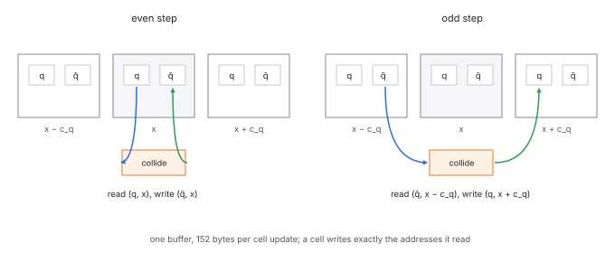
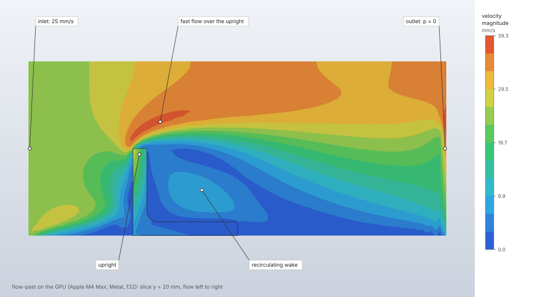
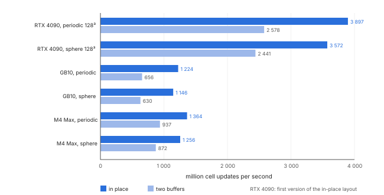

# GPU backend

The GPU backend steps a fluid step's lattice Boltzmann scheme on a graphics device through wgpu
compute shaders, in single precision. It runs the same collision operators, wall rules, open
boundaries, momentum exchange, heat, conducting solids and turbulence model as the CPU, prepared by
the CPU code so that voxelisation and every boundary rule exist once. The CPU result is the
reference: the GPU result is deterministic on its device and agrees with the CPU within stated
tolerances.

| | |
|---|---|
| **Commands** | `solve.fluid` (`backend: "gpu"`), `solve.settings` |
| **Step procedure** | `"fluid"` |
| **Solver** | `crates/lbm-gpu` (wgpu, WGSL, f32); adapter selection in `crates/gpu` |
| **Method** | The CPU scheme ([Lattice Boltzmann flow](lattice-boltzmann.md)) with in-place AA streaming (Bailey et al. 2009; Wittmann et al. 2013) and populations stored as deviations from their weights (Krüger et al. 2017, §13.3.4) |
| **Verified by** | `crates/lbm-gpu/tests/verification.rs` (every case against the CPU, every collision, both layouts); `throughput.rs` (ignored, performance) |

## Synopsis

```json
{"command": "solve.fluid", "params": {"step": "Run", "backend": "gpu"}}
```

```json
{"command": "solve.settings", "params": {"step": "Run", "backend": "gpu", "fallback": "cpu"}}
```

```text
FIELDCRAFT_GPU=hardware fieldcraft-cli run model.json
WGPU_BACKEND=vulkan FIELDCRAFT_GPU=auto fieldcraft-cli run model.json
```

## Parameters

| Setting | Value | Default | Meaning |
|---|---|---|---|
| `solve.fluid` `backend` | `"gpu"` | — | Solve on the device `FIELDCRAFT_GPU` picks; an error when the build has no GPU backend. |
| `solve.settings` `backend` | `"gpu"`, `"cpu"`, `"none"` | none | The backend a step prefers, saved with the model outside its definition. `none` forgets it. |
| `solve.settings` `fallback` | `"cpu"`, `"none"` | `"cpu"` for a GPU preference | On a machine with no suitable GPU: fall back to the CPU with a `notice`, or refuse. |
| `FIELDCRAFT_SOLVE_BACKEND` | `cpu`, `gpu` | unset | A machine's override of every step's preference. |
| `FIELDCRAFT_GPU` | `auto`, `hardware`, `software`, `cpu` | `auto` | The adapter policy (below). `cpu` means no GPU device: the fluid GPU backend refuses. |
| `WGPU_BACKEND` | wgpu backend names | the platform's | Narrows the graphics backends tried (`WGPU_BACKEND=gl` forces GL). |
| `WGPU_DX12_COMPILER` | `fxc`, `dxc` | DXC when `dxcompiler.dll` is on the DLL search path, else FXC | DX12's shader compiler. `staticdxc` is refused (not built in). |

Without a `backend` in `solve.fluid`, the backend is `FIELDCRAFT_SOLVE_BACKEND`'s when set, else
the step's saved preference, else the CPU; the reply's `backend_choice` says what chose it. The
desktop application and `fieldcraft-cli` register the GPU backend. In the browser there is no device
backend yet: `backend: "gpu"` reports that none is available.

### Adapter selection

`FIELDCRAFT_GPU` chooses the policy (`crates/gpu/src/select.rs`):

- `auto` walks a hardware GPU, then a software adapter (lavapipe, llvmpipe, WARP, SwiftShader).
- `hardware` and `software` are strict: an error when there is no such adapter.
- `cpu`: no device.

Within the hardware tier a discrete GPU outranks an integrated one, then a virtual one, then any
other; a CPU device is the software tier. Backends are Metal on macOS, DX12 and Vulkan on Windows,
Vulkan and GL elsewhere. Where both Vulkan and GL are on offer, Vulkan is asked first and GL is
brought up only when Vulkan has no adapter of the tier the policy wants. Each backend set has one
wgpu instance for the whole process (drivers that stop exposing the GPU after many instances
would otherwise lose it in a long session). A software adapter's name in the reply carries
`(software)`.

## Theory

### Precision

Every momentum population is stored in f32 as its deviation from its weight, h_q = f_q − w_q: the
deviations are small, so single precision keeps their digits instead of the weight's
(Krüger et al. 2017, §13.3.4). Then ρ = 1 + Σ h_q, the momentum is Σ h_q c_q, and every rule is
written for h. The temperature lattice is stored as deviations from w_q T₀, with T₀ the initial
temperature. Each group's force is read back as the sum of the deviations' exchange plus its
weights' share, which the host adds.

### Streaming layouts

The momentum populations stream in one of two layouts (`fieldcraft_lbm_gpu::Options::streaming`):

- **In place** (the AA pattern: Bailey, Myre, Walsh, Lilja and Saar, ICPP 2009; Wittmann, Zeiser,
  Hager and Wellein, Comput. Math. Appl. 65 (2013) 924–935, §6). One population buffer. Even steps
  read population q of cell x at (q, x) and write the collided one at (q̄, x); odd steps read it at
  (q̄, x − c_q) and write it at (q, x + c_q). In both, a cell writes exactly the addresses it read,
  so cells never race, and streaming happens inside the collision: 152 population bytes per cell
  update.
- **Two buffers** (A–B). Collide in place, then pull into the other buffer: 304 bytes per update.

The wall, reflection and open-face rules are the same per-link rules in both. In place, a gather
pass reads every link's post-collision source into a scratch value before a scatter pass writes,
so no link overwrites another's source; the momentum exchange is taken in the gather of the step
whose forces are read back (a submission's last). The temperature lattice is two-buffer in both.

`Streaming::Auto`, what a solve uses, streams in place: it was faster on every device measured
(Verification). With 128³ cells in place also needs one 152 MiB population buffer less.



### What runs on the GPU

| Feature | GPU |
|---|---|
| Collisions `trt`, `regularized`, `mrt` | yes |
| Collision `hrr` (hybrid recursive regularised), fixed and dynamic σ | yes |
| Vreman's subgrid model (`turbulence: {"type": "vreman"}`), with every collision | yes |
| Walls, moving walls, slip, periodic faces, obstacles, momentum exchange | yes |
| Velocity inlets, uniform and convective pressure outlets, edges of open faces | yes |
| Body acceleration, and changing it between steps | yes |
| Heat: the D3Q7 lattice, held temperatures, fluxes, buoyancy | yes |
| Conducting solids, thermal contacts, solid power | yes |
| Smagorinsky's model, the wall model (`wall_model: "musker"`), Van Driest damping (`van_driest`) | yes |
| Steady-state rule and averaging | yes (decided on the host from read-back fields) |
| Fans and porous zones | no: refused with the zone's name, solve on the CPU |
| The halfway wall-function bounce (`wall_model: "spalding_bounce_halfway"`) | yes |
| Han et al.'s on-node wall-function bounce (`wall_model: "spalding_bounce"`, their eq. 14) | yes |

## Algorithm

1. **Preparation on the CPU** (`Flow::new`): voxelisation, links, open cells, conducting cells, the
   initial state. A flow handed to the GPU never allocates the CPU's streaming targets.
2. **Refusals**: fans and porous zones; a policy that finds no device; an
   adapter that allows fewer storage buffers per compute stage than the shader needs (the message
   names the graphics backend and suggests Vulkan, Metal or DX12, or the CPU).
3. **Memory**: before preparation, the population buffer is checked against the device's limit per
   storage buffer (asked once per process), and the run's estimate includes the GPU readback.
4. **Device and kernels**: the device is requested with the adapter's own limits and shared; the
   kernels are compiled once per device and variant (layout, collision, Smagorinsky, Vreman, the
   hybrid collision and its dynamic σ, wall model, Van Driest damping) and reused by the next
   solve. A fixed σ of 1 compiles to the regularised kernels.
5. **Stepping**: steps are submitted in chunks of at most 64; after each submission the host reads
   the stability statistics (largest speed, a non-positive or non-finite density), so the GPU may
   notice an instability only at the end of the chunk. The solve advances the backend only up to
   its next frame, force-history sample, monitor sample or progress report, and the history
   samples every step of a run shorter than 10 000 steps (`MAX_HISTORY`), so such a run submits
   one step at a time and reads the forces back after each. A cancel takes effect
   between submissions. A device that does not answer within 120 s fails the solve.
6. **Readback**: populations stay on the device; frames (density, velocity, temperature), force and
   heat histories, monitor samples and the stability check come back. The time loop, frames,
   histories and stop rule are the CPU's `run`, driven through the `Backend` trait.

## Output

The reply's `backend` is `gpu: <adapter>`, and the solve adds the warning `solved on gpu: …: single
precision, deterministic on this device, within the backend's tolerance of the CPU`. The memory
estimate (`memory`) gives the population buffer against the device's limit per buffer. Frames are
single precision on both backends.

## Worked example

The `flow-past` sample (air past an L-bracket on the floor) solved on the CPU and on the GPU, then
the same model on a grid twice as fine. It shows the GPU backend's reply, its agreement with the CPU
reference, and where its time goes.

| | |
|---|---|
| **Geometry** | the upright L-bracket (60 × 40 × 50 mm, upright facing the inlet) on the floor of a 240 × 120 × 100 mm box |
| **Cells** | 2.5 mm: 184 320 (182 304 fluid); refined to 1.25 mm: 1 474 560 |
| **Fluid** | air, ρ = 1.2 kg/m³, μ = 1.8 × 10⁻⁵ Pa s |
| **Boundaries** | x_min velocity 25 mm/s, x_max pressure 0, floor no-slip, sides and top slip |
| **Step** | `Flow`: TRT, 16 s (3 200 steps of 0.005 s), ten frames; the 1.25 mm run 2 s (800 steps of 0.0025 s), one frame |
| **Units** | mm, t, s, N, MPa |

```json
[
  {"command": "file.sample", "params": {"name": "flow-past"}},
  {"command": "solve.fluid", "params": {"step": "Flow", "backend": "cpu"}},
  {"command": "solve.fluid", "params": {"step": "Flow", "backend": "gpu"}},
  {"command": "results.slice", "params": {"field": "velocity", "axis": "y", "position": 20}},
  {"command": "results.streamlines", "params": {"show": false}}
]
```

The finer grid edits the sample's domain and step, then solves on each backend:

```json
[
  {"command": "model.fluid_domain.edit", "params": {"name": "Wind", "material": "Air",
    "min": [-60, -40, 0], "max": [180, 80, 100], "spacing": 1.25,
    "faces": {"x_min": {"type": "velocity", "velocity": [25, 0, 0]}, "x_max": {"type": "pressure", "pressure": 0},
              "y_min": {"type": "slip"}, "y_max": {"type": "slip"}, "z_min": {"type": "wall"}, "z_max": {"type": "slip"}},
    "obstacles": ["Bracket"], "initial_velocity": [25, 0, 0]}},
  {"command": "model.step.edit", "params": {"name": "Flow",
    "procedure": {"type": "fluid", "domain": "Wind", "end_time": 2, "frames": 1}}},
  {"command": "solve.fluid", "params": {"backend": "gpu"}},
  {"command": "solve.fluid", "params": {"backend": "cpu"}}
]
```

The GPU reply names its adapter and layout, `backend: "gpu: Apple M4 Max, in-place streaming"`,
adds the warning `solved on gpu: Apple M4 Max, in-place streaming: single precision, deterministic
on this device, within the backend's tolerance of the CPU`, and gives the population buffer against
the device's limit (`memory.gpu_buffer`: 14 008 320 bytes of 4 294 967 292 at 2.5 mm, 112 066 560
at 1.25 mm). The forces are the sums over the bracket's faces of the `solve.fluid` replies' `forces`
(`final`, and `mean` over the last quarter of the run); the drag is their x component.

| Quantity (2.5 mm) | CPU | GPU | GPU − CPU |
|---|---|---|---|
| Drag, final | 1.13263 × 10⁻⁶ N | 1.13260 × 10⁻⁶ N | −2.2 × 10⁻⁵ relative |
| Drag, mean | 1.736549 × 10⁻⁶ N | 1.736543 × 10⁻⁶ N | −3.2 × 10⁻⁶ |
| Vertical force (z), final | −2.393076 × 10⁻⁴ N | −2.393077 × 10⁻⁴ N | 2.2 × 10⁻⁷ |
| Largest face force (`F2:side:l6`, x) | 1.9405010 × 10⁻⁴ N | 1.9405012 × 10⁻⁴ N | 1.1 × 10⁻⁷ |
| `max_speed` | 41.693213 mm/s | 41.693235 mm/s | 5.4 × 10⁻⁷ |
| `mass.relative_change` | −7.671 × 10⁻⁴ | −7.670 × 10⁻⁴ | — |

| Quantity (1.25 mm) | CPU | GPU | GPU − CPU |
|---|---|---|---|
| Drag, final | 7.83728 × 10⁻⁷ N | 7.83682 × 10⁻⁷ N | −5.8 × 10⁻⁵ relative |
| Drag, mean | 2.308221 × 10⁻⁶ N | 2.308195 × 10⁻⁶ N | −1.1 × 10⁻⁵ |
| Vertical force (z), final | −2.383840 × 10⁻⁴ N | −2.383839 × 10⁻⁴ N | −4.8 × 10⁻⁷ |

Run times are the wall-clock time of each `solve.fluid` call, voxelisation and readback included,
on an Apple M4 Max (14 CPU cores; GPU through Metal) shared with other jobs, so they varied between
runs. Million cell updates per second are cells × steps over that time; the reply does not report
them.

| Run | Cell updates | CPU | GPU |
|---|---|---|---|
| 2.5 mm, 3 200 steps | 5.90 × 10⁸ | 19.3–26.2 s (23–31 M/s) | 7.2–19.1 s (31–82 M/s) |
| 1.25 mm, 800 steps | 1.18 × 10⁹ | 18.1 s (65 M/s) | 3.6 s (328 M/s) |



**What to look at.** The GPU's face forces agree with the CPU's to 10⁻⁷ of themselves, well inside
the backend's 5 × 10⁻⁵ for wall forces. The drag is the small difference of the upright's front
and back forces (1.9 × 10⁻⁴ and −1.4 × 10⁻⁴ N), so single precision shows in it as a relative
difference of 2 × 10⁻⁵ to 6 × 10⁻⁵; measured against the face forces it adds up from, it is
2 × 10⁻⁷. Neither run reaches the throughput of the Performance table: below 10 000 steps
(`MAX_HISTORY`) the run records the force history at every step, so the GPU advances one step per
submission and reads the forces back after each one (`crates/lbm/src/solve.rs`, `run`), and that
fixed cost per step dominates the small grid. With eight times the cells per step the GPU is five
times faster than the CPU.

## Verification

### CPU and GPU

`cargo test -p fieldcraft-lbm-gpu --test verification` runs each case on both backends, with every
collision (two relaxation times, regularised, multiple relaxation times) and both streaming
layouts. The backend's stated tolerances, measured on lavapipe at 2–5 × 10⁻⁶ with a margin:

| Quantity | Tolerance |
|---|---|
| Velocity field | 2 × 10⁻⁵ of the largest speed |
| Density field | 10⁻⁶ |
| Wall forces | 5 × 10⁻⁵ of their magnitude (a wall's shear within 5 × 10⁻⁵ of itself) |
| Mass drift | below 10⁻⁶ |
| Temperatures | 2 × 10⁻⁵ of the field's range |
| Wall heats | 10⁻⁴ of the largest (a heat is a difference of populations, so it keeps fewer digits) |

The cases: plane Poiseuille against the parabola and the CPU (TRT within 2 × 10⁻⁵ of the peak,
regularised 2 × 10⁻³, MRT 4 × 10⁻³), Couette wall forces, Taylor–Green with mass conservation, flow
past a sphere (fields and forces), a Zou–He channel, a convective outlet with a vortex and backflow,
edges of two pressure faces, conduction between plates, a heated channel, wall heat at a held inlet,
natural convection, runs to steady state stopping where the CPU does, odd/even and chunk readbacks
with heat, open and slip faces and around an obstacle, Smagorinsky's model (Couette, forced
Poiseuille, heated Couette), a cavity held by the closure, a body force changed mid-run, the wall
model (Couette, a coarse channel, a steady channel's drag), and conducting solids (a composite wall
with power, a thermal contact, a heated block, a conductor through the inlet and outlet, a conductor
filling the box, a low-capacity solid). The thin Smagorinsky Couette case (τ = 0.55, 80 000 steps)
keeps fewer digits (measured on an RTX 4070 Laptop GPU: velocity up to 4.2e-5, wall shear up to
9.6e-5) and is held to 10⁻⁴ and 2 × 10⁻⁴.

On an Apple M4 Max (Metal), the regularised velocity fields are within 5e-7–7.4e-6 of the largest
speed, densities within 2.6e-7, wall shear within 1.9e-5 of itself, heats within 2.1e-6, mass drift
0.

### The hybrid collision, Vreman's model and dynamic σ

Their finite-difference gradient needs every neighbour's velocity at the same time level, so a
kernel (`gradient_velocity`) computes each cell's velocity before the collision exactly as the
collision does (half force, the wall model's reconstruction) into a buffer of three f32 per cell
(12 bytes, beside the population buffer's 76), and the collision reads its six axis neighbours'
from it: across a periodic face the periodic image, a solid cell or one beyond a face that is not
periodic missing, centred differences, first-order one-sided ones or none as on the CPU
(`fieldcraft_lbm::hrr`). The neighbours are explicit ±x, ±y, ±z cells, not a loop over the
lattice directions with a condition on c_q, a loop shape the NVIDIA GB10's driver (580.159)
miscompiles. With that buffer the collision binds 8 storage buffers, WebGPU's default per stage.
Smagorinsky's ν_t for dynamic σ is taken as (τ − τ₀)/3 written without the cancellation of
1/ω − 1/ω₀, and is 0 where the flux is below its f32 rounding (16 ε (|δρ| + ρ |u|)): dynamic σ
multiplies ν_t by |∇u|²/|∇²u|², large where ∇²u vanishes, and would otherwise take rounding for an
eddy viscosity. That length is capped at the box's shortest extent in cells (passed in the
uniforms), as on the CPU ([Collision operators](collision.md), "Dynamic σ").

Against the CPU (`the_hybrid_collision_follows_the_cpu`, `vreman_s_model_follows_the_cpu`,
`dynamic_sigma_follows_the_cpu`, `the_hybrid_collision_with_wall_damping_and_the_wall_function_bounce_follows_the_cpu`):
a forced channel (6 cells per half-height, perturbed, 150 steps; Re_τ 180 with a subgrid model,
30 without) and a periodic box with a ball (24³, ν 0.005, from a field of lattice speed 0.03, 200
steps), both layouts, both backends from the same initial state. Tolerances, those of the wall-model cases: velocity 10⁻⁴ of the largest speed,
density 10⁻⁵, the largest ν_t/ν 10⁻³ of itself, wall drag 10⁻³. Measured on the NVIDIA GB10
(Vulkan), the larger of the two layouts and cases:

| Case | velocity | density | ν_t/ν |
|---|---|---|---|
| `hrr` σ 0.9 | 7.9e-7 | 1.2e-7 | — |
| `hrr` σ 0.9 + Smagorinsky 0.1 | 4.4e-6 | 1.4e-7 | 1.1e-4 |
| Vreman 0.18 with `trt` / `regularized` / `mrt` / `hrr` | 3.0e-6 / 6.9e-6 / 3.8e-7 / 4.4e-6 | 6.3e-7 / 3.4e-7 / 7.4e-8 / 1.4e-7 | 3.1e-5 / 6.0e-6 / 3.3e-5 / 5.2e-6 |
| dynamic σ, Vreman 0.18 / Smagorinsky 0.1 | 5.4e-6 / 5.7e-6 | 1.1e-7 / 9.5e-8 | 1.6e-7 / 2.3e-6 |
| `hrr` σ 0.9 + Smagorinsky with Van Driest / the wall-function bounce (channel) | 4.4e-6 / 2.2e-6 | 1.5e-7 / 1.2e-7 | 6.3e-6 / 1.6e-6 (drag 4.0e-6 / 2.5e-7) |

σ 1 gives the regularised collision's fields bit for bit; two runs on one device give the same
fields bit for bit (`the_les_kernels_are_deterministic_on_their_device`); the shear wave of the
CPU's gate (N 16, τ̄ 0.8, σ 0.9) decays at the exact rate of the linear analysis within 4.2e-7
(tolerance 10⁻³, `a_shear_wave_decays_at_the_exact_rate_on_the_gpu`).

### Han et al.'s on-node wall-function bounce

Han, Ooka and Kikumoto's eq. 14 (`wall_model: "spalding_bounce"`, `crates/lbm/src/bounce.rs`)
runs on the GPU as on the CPU. The outermost cell layer at each wall face is boundary nodes: their
flag word marks them as streaming but not fluid, so they stream like any cell and stay out of the
collision, the finite-difference gradients, the moments, the mass and the mean velocity. Each
step, before the collision, `bounce_sample` takes each node's stress ρ u_τ² from Spalding's law
(κ 0.41, B 5.5) at its interior node one cell into the fluid (distance 1, the velocity with the
half force); after the collision `node_bounce` runs eq. 14 on each node in place of a collision,
reading and writing only the node's own populations (with the in-place layout's addressing of a
collision), and records the momentum the node took from the fluid. `wall_forces` adds that to one
of the node's links from outside the box (an open placeholder that exchanges nothing itself), so
the node's box face receives it; the weights' share, −n/3 per node, is added on the host. Each of
the six face orientations has its assignments written out (no loop over the lattice directions that
tests c_q, which the GB10's driver miscompiles). `node_bounce` binds two storage buffers (the
populations and the wall rows).

Against the CPU from step 0, both layouts, regularised, `hrr` σ 0.99, `mrt` and `trt`, each with
Smagorinsky 0.1 + Van Driest 26 and with Vreman 0.18
(`the_on_node_wall_function_bounce_follows_the_cpu`: the CPU's perturbed coarse channel, 13 cells
across, 150 steps; `the_on_node_wall_function_bounce_follows_the_cpu_in_han_s_a20_channel`, heavy:
Han et al.'s A20 box, 126 × 41 × 63 cells, 300 steps). Tolerances: velocity 10⁻⁴ of the largest
speed, density 10⁻⁵, the walls' drag 10⁻³ of the CPU's, the GPU walls' carried stress 10⁻³ of the
stress the GPU sampled, and that sampled stress 10⁻³ of the CPU's. The largest over the cases:

| Device, case | velocity | density | drag | carried vs sampled | sampled vs CPU |
|---|---|---|---|---|---|
| GB10, coarse channel | 4.1e-6 | 6.6e-7 | 9.5e-7 | 7.8e-7 | 8.7e-7 |
| GB10, A20 | 1.3e-5 | 1.1e-7 | 8.9e-6 | 9.5e-7 | 8.5e-6 |
| llvmpipe, coarse channel | 4.0e-6 | 6.5e-7 | 2.6e-6 | 7.3e-7 | 2.2e-6 |
| llvmpipe, A20 | 1.1e-5 | 1.0e-7 | 7.1e-6 | 1.4e-6 | 7.4e-6 |

Two runs on one device give the same fields and forces bit for bit
(`the_on_node_wall_function_bounce_is_deterministic_on_its_device`). The CPU's stationary toy
(the k_x = π mode of the wall rows, on-node, regularised, τ̄ 0.5015, u⁺ 5) damps on the GPU at
the CPU's rate (`the_on_node_bounce_damps_the_odd_even_mode_of_its_wall_rows_on_the_gpu`: −1.195e-4
per step on the GB10, −1.174e-4 on llvmpipe, −1.169e-4 on the CPU, tolerance 10 % and ≤ 0), seeded
at 1e-3 of a lattice speed: at the CPU's 1e-6 single precision's rounding of the base holds the mode
near 4e-6 and the rate measured is the rounding's.

The Taylor–Green study (`study_taylor_green_vortex_dissipation`, 64³, lattice speed 0.05, to
t = 20) on the GB10 gives the CPU's peak dissipation to the digits printed, at the same time:

| variant | Re 1600: peak −dk/dt (t) | Re 12000 |
|---|---|---|
| `hrr@0.99:0.1` (σ 0.99, Smagorinsky 0.1) | 0.01158 (8.39) | 0.01202 (8.89) |
| `hrr@0.99:v0.18` (σ 0.99, Vreman 0.18) | 0.01129 (8.39) | 0.01162 (8.39) |
| `hrr@dynamic:v0.18` (dynamic σ, Vreman 0.18) | 0.01352 (5.88) | 0.01357 (5.88) |

Fans and porous zones (`fans_and_porous_zones_are_refused_clearly`) are refused with a message
naming the CPU. Tests skip
without a GPU adapter unless `FIELDCRAFT_REQUIRE_GPU=1`, which makes a missing adapter a failure.
CI has no hardware GPU and runs the suite on lavapipe.

### Performance

`cargo test --release -p fieldcraft-lbm-gpu --test throughput -- --ignored --nocapture` runs each
case in both layouts on the device `FIELDCRAFT_GPU` picks, marks the one `Auto` chooses and prints
how long creating the pipelines took (on Metal this reads near zero: the driver compiles lazily or
from its cache, so the cost lands in the first dispatches instead). With
`FIELDCRAFT_LBM_GPU_PROFILE=1` it also prints each kernel's GPU time (`Options::profile`,
timestamp queries; the throughput is then not representative, as every dispatch gets its own
pass).

Million cell updates per second, means of three runs, two relaxation times (the RTX 4090 row is
from the first version of the in-place layout, before its addressing was made cheaper):

| device | case | in place | two buffers |
|---|---|---|---|
| RTX 4090, Vulkan | periodic 128³ | 3897 | 2578 |
| RTX 4090, Vulkan | sphere 128³ | 3572 | 2441 |
| GB10 (unified memory), Vulkan | periodic 128³ | 1224 | 656 |
| GB10 (unified memory), Vulkan | sphere 128³ | 1146 | 630 |
| M4 Max, Metal | periodic 128³ | 1364 | 937 |
| M4 Max, Metal | sphere 128³ | 1256 | 872 |

On the 4090 and the GB10 the two-buffer step is bound by memory bandwidth (~0.8 TB/s and ~0.2 of the
GB10's 0.27), so halving the bytes pays directly; on the M4 Max it gains once the in-place
addressing is cheap (a cell's coordinates once, neighbours wrapped by compare and add). 64³ fits in
cache, where the two layouts are closer and vary more between runs.

With the regularised collision, in place on the M4 Max: periodic 128³ 920–1030 against 1160–1250
for two relaxation times (−20 %), sphere 128³ 810–820 against 945–955 (−14 %) ([Collision
operators](collision.md)).

The hybrid collision and the subgrid models (`les_cost`: from a field of lattice speed 0.05, ν
0.002, 500 steps; median of three runs, the variants run alternately as separate processes with
`FIELDCRAFT_LES_VARIANT`), NVIDIA GB10, Vulkan, million cell updates per second:

| case | layout | `regularized` | `hrr` σ 0.99 | `hrr` + Vreman | `hrr` dynamic σ (Vreman) |
|---|---|---|---|---|---|
| periodic 128³ | in place | 1207 | 777 (−36 %) | 773 | 772 |
| periodic 128³ | two buffers | 636 | 490 (−23 %) | 492 | 493 |
| sphere 128³ | in place | 1103 | 723 (−34 %) | 724 | 720 |
| sphere 128³ | two buffers | 606 | 466 (−23 %) | 463 | 463 |

The cost is the velocity pass's traffic: it reads every population once more (76 bytes per cell)
and writes the velocity (12), against 152 bytes per in-place update, and the collision reads its
neighbours' velocities; Vreman's model and dynamic σ add arithmetic only.



## Limitations

- Single precision: results agree with the CPU within the stated tolerances and
  are deterministic per device only.
- Fans and porous zones run on the CPU only.
- An instability is noticed at the end of a chunk of up to 64 steps.
- A run shorter than 10 000 steps advances one step per submission (its force history samples
  every step), far below the throughput of the Performance table.
- A device must offer enough storage buffers per compute stage; GL adapters may not.
- No device backend in the browser yet.
- The whole population state lives in one buffer, which must fit the device's limit per storage
  buffer.

## Implementation

| File | Contents |
|---|---|
| `crates/lbm-gpu/src/native.rs` | `GpuFlow` (`with_options`, `advance`, readbacks), `Options`, `Streaming`, `register`, `buffer_limit`, `check_storage_buffers`, `MAX_CHUNK`, `DEVICE_TIMEOUT`. |
| `crates/lbm-gpu/src/lbm.wgsl` | The kernels: collision (TRT, `collide_regularized` with the hybrid blend, `collide_mrt`; Vreman's `vreman_nu`, `dynamic_sigma`), the velocity pass `gradient_velocity` and `fd_gradient`, AA and A–B streaming, links, open boundaries and convective outlets, momentum exchange, thermal lattice, conducting solids, wall model, Van Driest damping (`damping_refresh`). |
| `crates/lbm-gpu/src/lib.rs` | The wasm stub (`register` does nothing). |
| `crates/gpu/src/select.rs` | `Policy`, `pick`, `adapter`, `backends`, the process's wgpu instances. |
| `crates/lbm/src/backend.rs` | `Backend`, `register_backend`, `device_available`, `Choice`. |
| `crates/engine/src/cmd/solve.rs` | `solve.fluid`'s backend choice, `solve.settings`. |

## References

- P. Bailey, J. Myre, S. D. C. Walsh, D. J. Lilja, M. O. Saar. *Accelerating lattice Boltzmann fluid flow simulations using graphics processors.* ICPP 2009.
- M. Wittmann, T. Zeiser, G. Hager, G. Wellein. Comput. Math. Appl. 65:924–935, 2013.
- T. Krüger et al. *The Lattice Boltzmann Method: Principles and Practice.* Springer, 2017. doi:[10.1007/978-3-319-44649-3](https://doi.org/10.1007/978-3-319-44649-3)
