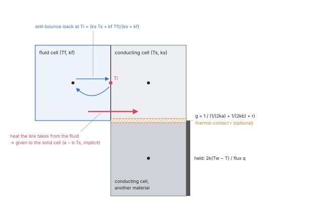
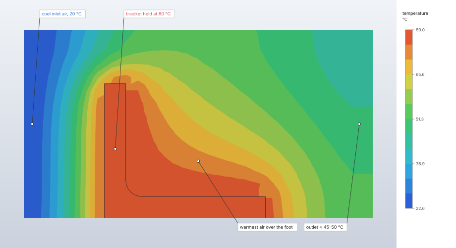
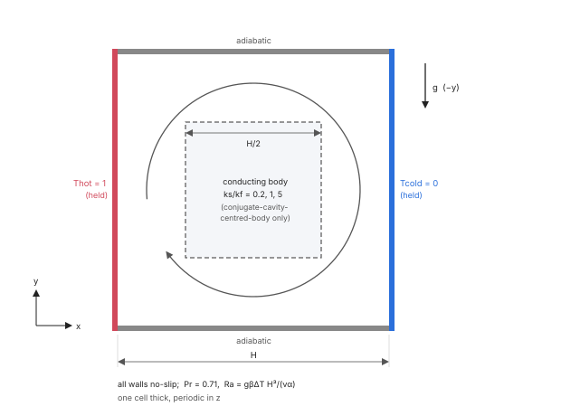

# Heat transfer in the flow

A fluid domain with thermal settings carries a temperature field with the flow: a second lattice,
D3Q7, advects it with the velocity of the momentum lattice and diffuses it with the fluid's
diffusivity k / (ρ c). The temperature drives the flow back through Boussinesq buoyancy. Obstacles
can conduct heat (conjugate heat transfer), with their own conductivity, heat capacity and power,
coupled to the fluid at every face they share, and with thermal interface layers between touching
solids. The solve reports the heat into every wall and each conducting solid's peak temperature
against its limit.

| | |
|---|---|
| **Commands** | `model.fluid_domain.create` / `.edit` (`thermal`), `model.fluid_domain.thermal_boundary`, `model.fluid_domain.limit`, `solve.fluid`, `solve.probe` |
| **Step procedure** | `"fluid"` on a domain with `thermal` settings |
| **Solver** | `crates/lbm` (CPU, f64); `crates/lbm-gpu` (GPU, f32), conducting solids and contacts included |
| **Method** | D3Q7 passive scalar with two relaxation times (Krüger et al. 2017; Ginzburg 2005); cell-centred finite-volume conduction in solids (Patankar 1980) coupled through anti-bounce-back links (Li, Mei & Klausner 2013) |
| **Verified by** | oracle `de-vahl-davis-ra1e3` … `ra1e6`, `conjugate-cavity-centred-body`; `crates/lbm/tests/thermal.rs`, `crates/lbm/tests/conjugate.rs` |

## Synopsis

```json
{"name": "Box", "material": "Air", "min": [0, 0, 0], "max": [100, 100, 10], "spacing": 1,
 "obstacles": ["Sink", "Die", "Lid"],
 "thermal": {
   "initial_temperature": 20,
   "gravity": [0, -9810, 0], "expansion": 2.1e-4,
   "faces": {"y_min": {"type": "temperature", "value": 80}, "y_max": {"type": "flux", "value": 1000}},
   "surfaces": [{"face": {"body": "Sink", "face": "F2:top"}, "condition": {"type": "temperature", "value": 80}}],
   "solids": [{"body": "Die", "material": "Silicon", "power": 5, "limit": 95},
              {"body": "Lid", "material": "Aluminium"}],
   "contacts": [{"bodies": ["Die", "Lid"], "thickness": 0.05, "conductivity": 5}]
 }}
```

`model.fluid_domain.create` (or `.edit`) takes the domain; the numbers are in the display units
(the default mm-t-s-N-MPa, with temperatures in °C). Single boundaries and limits change with:

```json
{"domain": "Box", "at": "x_min", "condition": {"type": "adiabatic"}}
{"domain": "Box", "body": "Die", "limit": 95}
```

(`model.fluid_domain.thermal_boundary` and `model.fluid_domain.limit`). A fluid step on the domain
(`model.step.create`, `"type": "fluid"`) solves the flow and the heat together.

## Parameters

**`thermal`** of the fluid domain (left out, the flow is isothermal):

| Field | Value | Default | Meaning |
|---|---|---|---|
| `initial_temperature` | temperature | 0 °C | The temperature everywhere at the start, and the reference T₀ of the buoyancy. |
| `gravity` | vector | `[0, 0, 0]` | Gravity for the buoyancy; zero for none. Separate from the domain's `acceleration`, which is a plain body force. |
| `expansion` | ≥ 0, per temperature | none | Volumetric expansion coefficient β; required with a gravity. |
| `faces.<face>` | condition | adiabatic | The thermal condition of each box face. |
| `surfaces` | `[{face, condition}]`, at most 10 000 | none | Conditions on named faces of non-conducting obstacles; their other faces are adiabatic. |
| `solids` | `[{body, material, power, limit}]` | none | Obstacles that conduct heat. |
| `contacts` | `[{bodies, resistance}]` or `[{bodies, thickness, conductivity}]`, at most 10 000 | none | Thermal interface layers between two touching conducting solids. |
| `temperature_zero` | kelvin | 0 °C | The temperature the lattice counts from (see Theory); a model from before SI storage keeps the zero of the system it was typed in. |

**Thermal conditions** (`faces`, `surfaces`, `model.fluid_domain.thermal_boundary`):

| `type` | Field | Meaning |
|---|---|---|
| `adiabatic` | — | No heat crosses it. At an inlet the fluid enters at the initial temperature; at an outlet it leaves at the temperature it has. |
| `temperature` | `value` | Held at this temperature; at a velocity inlet the fluid enters at it. |
| `flux` | `value` (power per area) | A heat flux into the fluid; negative draws heat out. On walls only: a flux on an inlet, outlet or periodic face is refused. |

**Conducting solid** (`solids`):

| Field | Value | Default | Meaning |
|---|---|---|---|
| `body` | obstacle name | required | An obstacle of the domain, listed once. Its faces exchange heat with the fluid and take no thermal condition. |
| `material` | material name | required | A density, a conductivity (isotropic, or `[kx, ky, kz]` along the box's axes) and a specific heat. |
| `power` | power | 0 | Heat generated, spread evenly over its cells; negative draws heat out. A powered solid that covers no cell centre is refused. |
| `limit` | temperature, above 0 K | none | The highest temperature it may reach (a junction or case limit); the solve reports its peak against it. |

**Thermal contact** (`contacts`): `bodies`, two conducting solids that share at least one cell face;
either `resistance` (per area, K·m²/W in SI) or `thickness` with `conductivity` (R = t / k), not
both. Solids not listed touch perfectly. One contact per pair.

The fluid's material needs a positive isotropic conductivity and a positive specific heat.

## Theory

**Temperature lattice.** D3Q7 (the rest direction and the six axis directions, the first seven of
D3Q19), weights ¼ and ⅛, c_s² = ¼, with the equilibrium

```text
g_q^eq = w_q T (1 + 4 c_q·u)
```

at the velocity the momentum lattice just collided to (the passive-scalar double-distribution
model, Krüger et al. 2017, ch. 8). It collides with two relaxation times (Ginzburg 2005): the
antisymmetric part of each axis pair, which carries the heat flux, relaxes with

```text
τ_T = 4 α + ½      (α in lattice units, α Δt / Δx²)
```

which sets the diffusivity; the symmetric part and the rest population relax with
τ_T⁺ = ½ + Λ_T / (τ_T − ½). With Λ_T fixed at 1/12 (`THERMAL_MAGIC`) a steady temperature field,
its walls included, does not depend on τ_T, and neither do the local wall heat fluxes
(d'Humières & Ginzburg 2009); at 1/12 the heat a held-wall link takes from a conducting field is
fourth-order accurate. Below τ_T = ½ + √Λ_T (0.79) the lattice keeps a single relaxation time,
Λ_T = (τ_T − ½)²: a fixed Λ_T makes τ_T⁺ grow without bound as τ_T approaches ½, which a von
Neumann analysis finds unstable from lattice speeds of 0.02–0.03, where the single relaxation time
holds 0.25. The choice and its study are in [Collision operators](collision.md).

**Numerical diffusion.** The linear equilibrium diffuses less along the flow by (τ_T − ½) u² in
lattice units, 4 u² of the diffusivity (Chopard, Falcone & Latt 2009): this bounds the lattice speed
a heat problem should run at.

**Boundaries.** The scalar populations stream along the momentum lattice's links:

- a held temperature is an anti-bounce-back, g_q = −g*_q̄ + 2 w_q T_w, which puts the temperature
  halfway between the cells;
- an adiabatic wall bounces back;
- a heat flux through a wall face adds the flux to the bounced population (one axis direction
  crosses each wall face, so the cell gains exactly that heat);
- an inlet holds its temperature (the equilibrium at the cell's velocity); an outlet takes its
  neighbour's populations.

**Buoyancy.** Boussinesq: every cell's body force per mass gains −β (T − T₀) g, T₀ the initial
temperature, through Guo's forcing as for the constant acceleration.

**Temperature scale.** The lattice's temperatures are the model's kelvin less `temperature_zero`
(0 °C unless the model is older than SI storage). The scheme's walls are not invariant under a
shift of the temperature scale (a wall's bounce-back carries T u), so the zero is part of the
model, never of how it is shown. Single precision (frames, the GPU) keeps the differences that
drive the heat.

**Turbulence.** With Smagorinsky's model each cell's turbulent diffusivity α_t = ν_t / Pr_t raises
its τ_T by 4 α_t ([Turbulence](turbulence.md)).

**Conduction in solids.** A cell-centred finite-volume conduction on the lattice's own cells
(Patankar 1980, ch. 4). The heat through the face between two cells is g (T_b − T_a), with g the
series conductance of the two half cells along the face's axis (the harmonic mean, which keeps the
flux continuous across a change of material); a held box face adds 2 k (T_w − T), a flux face its
flux. An orthotropic conductivity uses each axis's value on that axis's faces. Explicit in time,
sub-cycled so that every cell's sum of conductances over its heat capacity stays below one.

**Fluid–solid interface.** Each D3Q7 link from a fluid cell into a conducting cell is an
anti-bounce-back held at the interface temperature

```text
T_i = (k_s T_s + k_f T_f) / (k_s + k_f)
```

the temperature halfway between the two cell centres at which the conductive fluxes of the two
half cells are equal. The heat the link takes from the fluid is given to the solid cell, so the
heat leaving the fluid is the heat the solid receives to round-off. That heat is affine in the
solid's temperature, a − b T_s with b = 2 w_q k_s / (k_s + k_f), so the solid takes it
point-implicitly: stable for any heat capacity (an explicit link needs Σ b < C, which a corner
cell of aluminium in water already breaks). Interface conditions of this kind: Li, Mei & Klausner
(2013).



**Thermal contacts.** A thin layer (a paste, a pad, a gap filler) is not resolved: its resistance
per face r adds in series with the two half cells on every face between cells of the two bodies,

```text
g = 1 / (1/(2 k_a) + 1/(2 k_b) + r),   r = R (ρ c)_f Δx / Δt
```

(Incropera et al. 2011, §3.1.4). Both cells see the same g, so heat is conserved, and a resistance
only lowers a conductance, so the sub-cycling limit holds as without it.

**Units of the solid.** Heat is counted in the fluid's lattice heat, (ρ c)_f Δx³ per degree. A
solid's lattice conductivity is k Δt / ((ρ c)_f Δx²), its capacity ρ c / (ρ c)_f and its power
P Δt / ((ρ c)_f Δx³); a solid with the fluid's properties behaves exactly as the fluid at rest.

**Steady runs.** A step run to steady state (`steady`) scales each solid's heat capacity down to
the smallest that needs at most 4 sub-steps (`STEADY_SUBSTEPS`), when that is smaller: the steady
temperatures do not depend on it, while a solid's own time constant (seconds to minutes for a heat
sink, against milliseconds for the air around it) would otherwise set the run's length. The run
warns that the transient before the steady state is not physical.

## Algorithm

Set-up:

1. α = k / (ρ c) of the fluid; τ_T = 4 α Δt / Δx² + ½. τ_T below 0.505 is refused (the grid
   cannot resolve the diffusivity at this time step; the message gives the cell Péclet number);
   above 2 the run warns that the transient is coarse in time.
2. Conditions to lattice units: a flux becomes the temperature per step it adds through one cell
   face, Δt / ((ρ c)_f Δx) times the flux; held temperatures are taken relative to the zero.
3. Solids and contacts to lattice units; the conducting cells, their faces and the fluid links
   into them. The sub-step count is the worst cell's conductance sum over its capacity, over 0.9;
   more than 64 sub-steps (`MAX_SUBSTEPS`) is refused ("shorten the time step"). A contact
   between solids that share no cell face is refused.
4. With `steady`, each solid's capacity scaled as above.

Each time step:

1. Buoyancy: every cell's body force from its current temperature.
2. The momentum lattice's collision, streaming and open boundaries
   ([Lattice Boltzmann flow](lattice-boltzmann.md)).
3. Scalar collision with the velocity the momentum lattice collided to (τ_T raised by α_t with
   turbulence).
4. Scalar streaming with the wall, interface, inlet and outlet rules above.
5. Each cell's temperature; conduction in the solids by sub-steps, each solving its cells'
   balance with the interface heat implicit.
6. A temperature that is not a number stops the run as unstable, naming the step.

The heat each wall face receives is summed over its links like the momentum exchange. Links into
inlet and outlet cells are left out: the open boundary sets all their populations after
streaming, so that heat never stays in the fluid (counted, a held wall meeting a held inlet
reported twice its heat, #675).

## Output

`solve.fluid` adds, with heat:

| Field | Meaning |
|---|---|
| `tau_thermal` | The scalar lattice's τ_T. |
| `temperature` | `min` and `max` of the fluid's temperature in the last frame. |
| `heat` | Per wall with non-zero heat (box face or obstacle face, with its `body`): the power into it, `final` and `mean` over the last quarter of the history; positive into the wall. |
| `solids` | Per conducting solid: `body`, `cells`, `power`, `heat_to_fluid` (`final`, `mean`: what its faces give the fluid), `temperature` (`min`, `max`, `mean` at the end), `capacity_scale` (when scaled), `peak` and `peak_time`, `limit`, `margin` (limit less peak; negative over it), `ok`. |
| `components_ok` | Whether every solid with a limit stays at or under it; null when none has a limit. |

The `peak` is the solid's steady value when the run stopped as steady (its last frame), else the
highest over the run's frames (a transient peak between two frames is not seen; more frames
resolve it). Every frame carries the temperature of every cell.

`solve.probe` reads the temperature at points (`points`), the heat into named walls over time
(`heat`), and along a line (`line` with `field` `temperature` or `wall_heat_flux`). The wall heat
flux of a box wall is, at a held temperature, the second-order one-sided difference through the
wall and the two cell layers beside it, (8 T_w − 9 T₁ + T₂) / (3 Δx) times k; at a flux face its
flux; at an adiabatic face zero. A steady rule may monitor `heat` on faces and the
`mean_temperature` ([Steady state and averaging](steady-state-and-averaging.md)).

## Worked example

The `heated-flow` sample: air at 20 °C flows at 1 mm/s past the upright L-bracket, whose faces are
held at 80 °C. It shows held-temperature surfaces, the heat each face gives the air, and the
temperature carried to the outlet. The sample has no buoyancy and no conducting solid.

| | |
|---|---|
| **Geometry** | the upright L-bracket (60 × 40 × 50 mm, upright facing the inlet) on the floor of a 130 × 80 × 70 mm box |
| **Cells** | 5 mm: 5 824 (5 504 fluid) |
| **Fluid** | air, ρ = 1.2 kg/m³, μ = 1.8 × 10⁻⁵ Pa s, k = 0.026 W/(m K), c = 1005 J/(kg K) |
| **Flow boundaries** | x_min velocity 1 mm/s, x_max pressure 0, floor no-slip, sides and top slip; initial velocity 1 mm/s |
| **Thermal** | initial 20 °C; x_min held at 20 °C; every bracket face held at 80 °C (`surfaces`); other faces adiabatic |
| **Step** | `HeatedFlow`: TRT, 180 steps of 0.25 s (45 s), six frames |
| **Units** | mm, t, s, N, MPa; °C, mW |

```json
[
  {"command": "file.sample", "params": {"name": "heated-flow"}},
  {"command": "solve.fluid", "params": {"step": "HeatedFlow", "backend": "cpu"}},
  {"command": "results.surface", "params": {"field": "wall_heat_flux"}},
  {"command": "results.slice", "params": {"field": "temperature", "axis": "y", "position": 20}},
  {"command": "results.streamlines", "params": {"show": false}},
  {"command": "solve.probe", "params": {"step": "HeatedFlow", "points": [[92.5, -17.5, 2.5], [92.5, -17.5, 7.5]]}}
]
```

The outlet values come from `solve.probe` at the 224 cell centres of the last interior layer,
x = 92.5 mm (y = −17.5 to 57.5 mm, z = 2.5 to 67.5 mm, every 5 mm; the probe above shows its first
two points); the outlet layer itself, x = 97.5 mm, is an open-boundary layer.

Results from the `solve.fluid` reply (0.1–0.4 s, Apple M4 Max, CPU), `results.surface` and
`solve.probe`:

| Quantity | FieldCraft | Source |
|---|---|---|
| `tau`, `tau_thermal` | 0.95, 1.362 | `solve.fluid` |
| `temperature` (fluid) | 20 to 79.80 °C | `solve.fluid` |
| Heat into the bracket, all faces, final | −509.0 mW (`mean` −542.6 mW) | sum of `heat` |
| Largest face heat: `F2:side:l6` (upright's downstream face, 2 000 mm²) | −186.5 mW | `heat` |
| End faces `F2:start`, `F2:top` (y = 0 and 40 mm, mirror images about the mid-plane) | −70.53 mW each | `heat` |
| Underside `F2:side:l1` (on the floor) | 0 | `results.surface` |
| Largest flux: `F2:side:l5` (upright's top, 320 mm²) | −0.1644 mW/mm² | `results.surface` |
| Outlet temperature, mean of the 224 cells | 47.52 °C (43.27 to 52.49 °C) | `solve.probe` |
| Outlet temperature, weighted by the axial velocity | 45.85 °C | `solve.probe` |
| Volume flow through the layer | 5 311 mm³/s (inlet 1 mm/s × 80 × 70 mm = 5 600 mm³/s) | `solve.probe` |
| Heat carried through the layer, ρ c Q (T̄ − 20 °C) | 166 mW | from the above |
| `mass.relative_change` | 2.2 × 10⁻³ | `solve.fluid` |

The reply warns that the density varies by 15.9 % at the end (the weakly compressible error).



**What to look at.** Heat flows from the bracket into the air, so every face's `heat` is negative
(positive into the wall). The diffusivity α = k / (ρ c) = 21.6 mm²/s against 1 mm/s over the 50 mm
upright is a Péclet number of about 2.3: conduction carries heat nearly as fast as the flow, and the
warm region reaches upstream of the upright as well as downstream. τ_T = 1.362 is above
½ + √Λ_T (0.79), so the scalar lattice collides with two relaxation times. The run is a transient
of 45 s, about a third of a pass through the 130 mm box: the layer before the outlet carries
166 mW of the 509 mW the bracket gives, and the rest is still warming the box. The sample is a
display demonstration on a coarse grid, not a converged heat-transfer result.

## Verification

**Benchmarks** (oracle; docs/oracle.md). De Vahl Davis's differentially heated cavity, Pr 0.71,
two-dimensional as a one-cell-thick periodic slab, 64² cells (128² at Ra 10⁶):

| Case | Quantity | Reference | FieldCraft | Error | Tolerance |
|---|---|---|---|---|---|
| `de-vahl-davis-ra1e3` | mean Nu | 1.118 | 1.1179 | −0.012 % | 0.13 % |
| | largest local Nu | 1.505 | 1.5073 | 0.155 % | 0.4 % |
| | u H/α max | 3.649 | 3.6481 | −0.026 % | 0.2 % |
| `de-vahl-davis-ra1e4` | mean Nu | 2.243 | 2.2464 | 0.152 % | 0.27 % |
| | largest local Nu | 3.528 | 3.5438 | 0.448 % | 0.55 % |
| | w H/α max | 19.617 | 19.63 | 0.064 % | 0.23 % |
| `de-vahl-davis-ra1e5` | mean Nu | 4.519 | 4.5346 | 0.345 % | 0.73 % |
| | largest local Nu | 7.717 | 7.7371 | 0.261 % | 0.68 % |
| | smallest local Nu | 0.729 | 0.7498 | 2.85 % | 6.3 % |
| `de-vahl-davis-ra1e6` (nightly) | mean Nu | 8.8 | 8.8476 | 0.541 % | 1.3 % |
| | largest local Nu | 17.925 | — | known failure | 1.6 % |
| | u H/α max | 64.63 | 65.46 | 1.28 % | 1.5 % |

docs/oracle.md lists every quantity of these cases (the positions of the extremes and the mid-plane
velocities too). The Ra 10⁶ largest local Nusselt number is 2.7 % low on 128 cells and listed as a
known failure with its reason.



Conjugate cavity (`conjugate-cavity-centred-body`): the same cavity at Ra 10⁵ with a centred body
of side H/2, 64² cells, against House, Beckermann & Smith (1990), Table 3:

| k_s / k_f | Reference Nu | FieldCraft | Error | Tolerance |
|---|---|---|---|---|
| 0.2 | 4.6257 | 4.6356 | 0.214 % | 0.6 % |
| 1 | 4.5061 | 4.5151 | 0.201 % | 0.6 % |
| 5 | 4.3221 | 4.3298 | 0.178 % | 0.6 % |

The grid converges at second order from above: on 48 cells +0.5 %, on 64 cells +0.2 %;
extrapolated from the two, −0.22 % from the published values (`conjugate_cavity_matches_house_et_al`,
heavy).

**Theory** (`crates/lbm/tests/thermal.rs`, `crates/lbm/tests/conjugate.rs`; CPU):

| Case | Reference | Tolerance | Test |
|---|---|---|---|
| Plates held at 0 and 1, no flow | linear profile, walls halfway between cells | 1e-9 | `conduction_between_plates_is_linear` |
| Flux through one plate, the other held | drop q H / k; wall heat q A | 1e-6 | `a_heat_flux_sets_the_gradient_and_the_wall_heat_balances` |
| Plug flow from a held inlet | the inlet temperature everywhere | 1e-3 | `the_flow_carries_the_inlet_temperature` |
| Graetz channel, Pe 200 | the wall heat the inner layers received; out as ρ c_p Q (T_bulk − T_in) | 1e-9 / 2 % | `wall_heat_from_plates_that_start_at_the_inlet_is_what_the_fluid_keeps` |
| Periodic flow with a heat blob | total temperature conserved | 1e-10 | `a_periodic_flow_conserves_and_carries_heat` |
| Drifting sine | decays as e^(−α k² t); at rest 0.105 (k Δx)² faster, second order; along the flow the 4 u² deficit | orders > 1.8 | `a_drifting_sine_decays_at_the_diffusivity` |
| De Vahl Davis, Ra 10³, 16 cells, TRT and regularised | Nu 1.118; hot-wall heat equals cold-wall heat | 2 %; 1e-3 | `natural_convection_cavity_is_close_on_a_coarse_grid` |
| The same, Ra 10³ on 32 and 10⁴ on 48 cells | 1.118, 2.243 | 1 % | `natural_convection_cavity_matches_de_vahl_davis` (heavy) |
| Local wall flux at τ_T 0.8 and 1.4 | independent of τ_T with Λ_T fixed | 3e-3 (single relaxation time: > 2e-2) | `local_wall_heat_flux_does_not_depend_on_the_thermal_relaxation_time` |
| Fluid, conducting slab, fluid in series | q = ΔT / Σ (L/k), exact discrete solution | 1e-9 | `a_composite_wall_conducts_in_series` |
| Two solids with a contact | jump q R across it | 1e-9 | `a_contact_resistance_drops_the_temperature_by_q_r` |
| Powered die and lid, contact | solids gain power less what leaves, every step | 1e-9 | `heat_crosses_a_contact_conserved_and_a_contact_must_touch` |
| Heat-generating slab | half the power to each plate; parabola, error s Δx² / (8 k_s), second order | 1e-6; 2 %; order > 1.8 | `a_heat_generating_slab_balances_and_converges` |
| Heated wall under a channel flow | the conduction solution | 2e-3 | `a_heated_wall_under_a_channel_flow_conducts_across_it` |
| Low-capacity cube, strong links (τ_T 0.52) | stable, heat balanced every step | 1e-9 | `a_low_capacity_solid_with_strong_links_stays_stable` |
| Heated block in a channel flow | heat balanced every step; at steady state its faces give the fluid its power | 1e-9; 1e-3 | `a_heated_block_in_a_flow_conserves_heat` |
| Slow block run to steady state | capacity scaled; same temperatures as a long fixed run | 1e-3 of the rise | `a_steady_run_scales_a_slow_solid_and_lands_on_the_same_temperatures` |
| Conduction limit of the House et al. cavity | Nu 0.7069, 1, 1.4138 | 1.5 % | `a_conducting_body_in_a_cavity_without_flow_matches_house_et_al` |
| Square array of cylinders, κ 10 and 0.1, 16 cells | Rayleigh's series (Perrins et al. 1979; Godin 2012) | 1 %; 6 % (measured +0.55 %, −5.66 %) | `a_square_array_of_cylinders_conducts_as_rayleigh_s_series` |
| Insulating cylinders on 32 and 64 cells | the series | −2.99 %, −1.21 %: first order or better | `insulating_cylinders_converge_at_first_order` (heavy) |
| Slab against limits either side of its peak | peak 7.625 °C, pass and fail | 2 % | `a_heated_slab_passes_and_fails_limits_either_side_of_its_peak` |

A measurement of a curved conjugate interface, Rahman et al.'s vented cavity with a passive
conducting cylinder (40 cells), runs in the heavy job as a regression guardrail: its
heated-wall Nusselt number stays within 2 % of the published 4.842449. That is not the 1 % target
the case is meant for (`rahman_curved_conjugate_coarse_measurement`).

**GPU against CPU** (`crates/lbm-gpu/tests/verification.rs`): conduction between plates (profile
within 5e-5, wall heat within 1e-4 of k ΔT A / H), a heated channel, a held inlet's wall heat and
natural convection, temperature within 2e-5 of the range and heat within 1e-4; composite wall with
power, thermal contact, heated block in a channel, a conductor through the inlet and outlet, a
conductor filling the box and a low-capacity solid, temperature and heat within 2e-5.

## Limitations

- Solid–fluid interfaces are staircases of cell faces: curved interfaces lose accuracy, an
  error of first order for insulating inclusions.
- There is no contact resistance between a solid and the fluid.
- The fluid's conductivity is isotropic.
- A steady run's transient is not physical when a solid's capacity is scaled.
- The numerical diffusion along the flow, 4 u² of the diffusivity in lattice units, bounds the
  lattice speed of a heat problem.
- The automatic time step does not take the buoyant velocity into account; it comes from the
  inlets, walls, pressures, fans and the driving acceleration ([Lattice Boltzmann
  flow](lattice-boltzmann.md)).
- A solid's peak is read from the frames: a transient peak between two frames is missed.
- The heated square cylinder in a channel (Dhiman, Chhabra & Eswaran 2005) is a pending oracle case
  with its reference values not yet transcribed.

## Implementation

- `crates/lbm/src/flow.rs`: `ThermalState`, `collide_thermal`, `stream_thermal`,
  `open_boundaries_thermal`, `refresh_buoyancy`, `update_temperature`, `conduct`.
- `crates/lbm/src/conduction.rs`: `SolidHeat::build`, `series`, `with_resistance`,
  `smallest_capacity`, `MAX_SUBSTEPS`.
- `crates/lbm/src/setup.rs`: `ThermalSetup`, `SolidSetup`, `ContactSetup`, `thermal_magic`,
  `THERMAL_MAGIC`, the conversion of conditions, solids and contacts.
- `crates/lbm/src/solve.rs`: `HeatHistory`, `SolidResult`, `Peak`, `ComponentCheck`,
  `FluidResult::components_ok`.
- `crates/lbm-gpu/src/lbm.wgsl`: the scalar lattice and "Conducting solids"; `native.rs`
  `solid_data`.
- `crates/model/src/fluids.rs`: `FluidThermal`, `ThermalCondition`, `ConductingSolid`,
  `ThermalContact`.
- `crates/engine/src/cmd/define.rs`: `model.fluid_domain.thermal_boundary`,
  `model.fluid_domain.limit`; `crates/engine/src/cmd/solve.rs`: the reply and `solve.probe`.

## References

- T. Krüger, H. Kusumaatmaja, A. Kuzmin, O. Shardt, G. Silva, E. M. Viggen. *The Lattice Boltzmann Method: Principles and Practice.* Springer, 2017. doi:[10.1007/978-3-319-44649-3](https://doi.org/10.1007/978-3-319-44649-3)
- I. Ginzburg. *Equilibrium-type and link-type lattice Boltzmann models for generic advection and anisotropic-dispersion equation.* Adv. Water Resour. 28:1171, 2005.
- D. d'Humières, I. Ginzburg. *Viscosity independent numerical errors for Lattice Boltzmann models: From recurrence equations to "magic" collision numbers.* Comput. Math. Appl. 58:823, 2009.
- B. Chopard, J.-L. Falcone, J. Latt. Eur. Phys. J. Special Topics 171:245–249, 2009.
- Z. Guo, C. Zheng, B. Shi. *Discrete lattice effects on the forcing term in the lattice Boltzmann method.* Phys. Rev. E 65:046308, 2002. doi:[10.1103/PhysRevE.65.046308](https://doi.org/10.1103/PhysRevE.65.046308)
- S. V. Patankar. *Numerical Heat Transfer and Fluid Flow.* Hemisphere, 1980.
- L. Li, R. Mei, J. F. Klausner. *Boundary conditions for thermal lattice Boltzmann equation method.* J. Comput. Phys. 237:366–395, 2013.
- F. P. Incropera, D. P. DeWitt, T. L. Bergman, A. S. Lavine. *Fundamentals of Heat and Mass Transfer*, 7th ed. Wiley, 2011.
- G. de Vahl Davis. *Natural convection of air in a square cavity: a bench mark numerical solution.* Int. J. Numer. Methods Fluids 3:249–264, 1983. doi:[10.1002/fld.1650030305](https://doi.org/10.1002/fld.1650030305)
- J. M. House, C. Beckermann, T. F. Smith. *Effect of a centered conducting body on natural convection heat transfer in an enclosure.* Numer. Heat Transfer A 18(2):213–225, 1990. doi:[10.1080/10407789008944791](https://doi.org/10.1080/10407789008944791)
- M. M. Rahman, M. A. Alim, S. Saha, M. K. Chowdhury. *Mixed Convection in a Vented Square Cavity with a Heat Conducting Horizontal Solid Circular Cylinder.* J. Naval Architecture and Marine Engineering 5(2):37–46, 2008. doi:[10.3329/jname.v5i2.2504](https://doi.org/10.3329/jname.v5i2.2504)
- W. T. Perrins, D. R. McKenzie, R. C. McPhedran. *Transport properties of regular arrays of cylinders.* Proc. R. Soc. Lond. A 369:207–225, 1979.
- Y. A. Godin. J. Math. Phys. 53:063703, 2012.
- A. K. Dhiman, R. P. Chhabra, V. Eswaran. *Flow and heat transfer across a confined square cylinder in the steady flow regime: effect of Peclet number.* Int. J. Heat Mass Transfer 48:4598–4614, 2005. doi:[10.1016/j.ijheatmasstransfer.2005.04.033](https://doi.org/10.1016/j.ijheatmasstransfer.2005.04.033)
