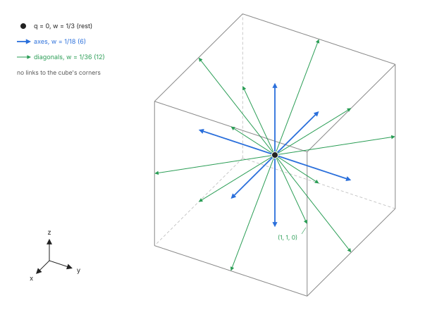
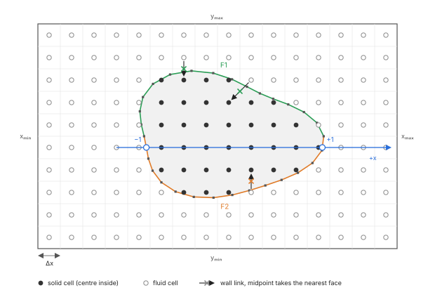
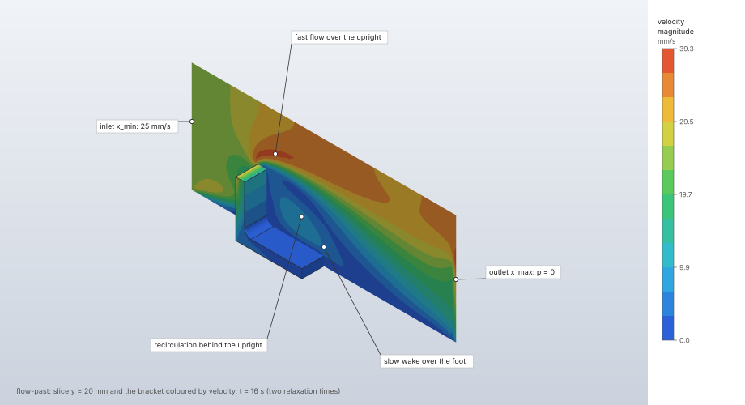

# Lattice Boltzmann flow

A fluid step computes time-dependent, weakly compressible, Newtonian flow in a box of cubic cells,
less the cells inside obstacle bodies, and the force the fluid exerts on every wall. It serves
internal and external flows at low Mach number: channels and ducts, flow past parts, cavities,
electronics cooling with heat, fans and vents. The method is the lattice Boltzmann equation on
the D3Q19 velocity set with a two-relaxation-time, recursive regularised or multiple-relaxation-time
collision, Guo forcing, halfway bounce-back walls and Zou–He open boundaries.

| | |
|---|---|
| **Commands** | `model.fluid_domain.create`, `model.fluid_domain.edit`, `model.fluid_domain.delete`, `model.fluid_domain.boundary`, `model.step.create`, `solve.fluid`, `solve.settings` |
| **Step procedure** | `"fluid"` |
| **Solver** | `crates/lbm` (CPU, f64, the reference); `crates/lbm-gpu` (wgpu, f32) |
| **Method** | D3Q19 lattice Boltzmann (Qian, d'Humières & Lallemand 1992; Krüger et al. 2017) |
| **Verified by** | `crates/lbm/tests/verification.rs`, `mrt.rs`, `regularized.rs`, `outlets.rs`, `steady.rs`, `thermal.rs`; `crates/lbm-gpu/tests/verification.rs`; oracle cases `de-vahl-davis-ra1e3` … `ra1e6`, `conjugate-cavity-centred-body` |

## Synopsis

```json
[
  {"command": "model.units", "params": {"system": "m-kg-s-N-Pa"}},
  {"command": "model.material.create", "params": {"name": "Air", "density": 1.2,
    "fluid": {"type": "newtonian", "viscosity": 1.8e-5}}},
  {"command": "model.fluid_domain.create", "params": {"name": "Flow", "material": "Air",
    "min": [0, 0, 0], "max": [0.24, 0.12, 0.1], "spacing": 0.0025,
    "faces": {"x_min": {"type": "velocity", "velocity": [0.025, 0, 0]},
              "x_max": {"type": "pressure", "pressure": 0}},
    "obstacles": ["Body1"]}},
  {"command": "model.step.create", "params": {"name": "Run", "procedure":
    {"type": "fluid", "domain": "Flow", "end_time": 16, "frames": 10}}},
  {"command": "solve.fluid", "params": {"step": "Run", "backend": "cpu"}}
]
```

Numbers are in the model's display units, here SI (set by `model.units`), or carry their own unit ("2 m/s"; [Units](../../units.md)). With air (ν = 1.5 × 10⁻⁵ m²/s) this box of 96 × 48 × 40 cells gets the automatic Δt = 5 ms and τ⁺ = 0.536.

## Parameters

### The fluid domain (`model.fluid_domain.create`, `.edit`)

| Field | Value | Default | Meaning |
|---|---|---|---|
| `name` | string | required | The domain's name; a fluid step refers to it. |
| `material` | material name | required | A material with a `density` and `fluid: {"type": "newtonian", "viscosity": μ}` (dynamic viscosity). The kinematic viscosity is ν = μ/ρ₀. |
| `min`, `max` | `[x, y, z]` | required | The box's lower and upper corners. |
| `spacing` | length | required | The side Δx of the cubic cells. Every extent of the box must be a whole number of spacings (to 10⁻⁶ of a spacing), 1 to 2²⁰ cells per side. |
| `faces` | `{"x_min": {…}, …}` | every face a wall | The condition of each box face ([Boundary conditions](boundary-conditions.md)). |
| `obstacles` | `["Body1", …]` | none | Solid bodies of the open design or imported surfaces, by name; at most 1000. Their cells are not fluid. |
| `surfaces` | `[{"face": {"body", "face"}, "condition": {…}}]` | every obstacle face a wall at rest | Moving-wall conditions on named obstacle faces; at most 10 000. |
| `initial_velocity` | `[u, v, w]` | `[0, 0, 0]` | The fluid's velocity at the start (equilibrium at density ρ₀ and this velocity). |
| `acceleration` | `[x, y, z]` | `[0, 0, 0]` | A body acceleration: gravity, or a uniform driving force per mass. |
| `tolerance` | length | Δx/10 | The chordal tolerance obstacles are triangulated with. |
| `thermal` | `{…}` | none (isothermal) | Heat in the fluid and conducting solids ([Heat transfer](heat-transfer.md)). |
| `porous`, `fans` | `[{…}]` | none | Porous resistance zones and fans, at most 1000 together ([Fans and vents](fans-and-vents.md)). |

### The fluid step (`model.step.create`, procedure `"fluid"`)

| Field | Value | Default | Meaning |
|---|---|---|---|
| `domain` | domain name | required | The fluid domain the step solves in. |
| `end_time` | time | — | The flow time to run. Exactly one of `end_time` and `steps`. |
| `steps` | 1 to 10⁹ | — | The number of time steps. |
| `time_step` | time | automatic | Δt. Left out, the solver chooses it (Theory, below). |
| `frames` | 1 to 1000 | 10 | Output frames after the initial one, evenly spaced to the end. |
| `collision` | `"trt"`, `"regularized"`, `"mrt"` | `"trt"` | The collision operator ([Collision operators](collision.md)). |
| `magic` | above 0, at most 1 | 3/16 | The two-relaxation-time parameter Λ. Warned about with any other collision. |
| `turbulence` | `{"type": "smagorinsky", …}` | none | Smagorinsky's subgrid eddy viscosity, Van Driest damping and the wall model ([Turbulence](turbulence.md), [Wall-modelled LES](../../lbm-wall-model.md)). |
| `steady` | `{…}` | none | Stop once the flow stops changing ([Steady state and averaging](steady-state-and-averaging.md)). |

### The solve (`solve.fluid`)

| Field | Value | Default | Meaning |
|---|---|---|---|
| `step` | step name | the only fluid step | The fluid step to solve. |
| `backend` | `"cpu"`, `"gpu"` | see below | `cpu`: double precision, the same result on every machine. `gpu`: the device `FIELDCRAFT_GPU` picks, single precision ([GPU backend](gpu.md)). Left out: `FIELDCRAFT_SOLVE_BACKEND` when set, else the step's saved preference (`solve.settings`), else the CPU. |
| `max_cells` | whole number | 16 000 000 | Cap on the grid's cells. May be raised up to what the machine's memory bound holds. |
| `max_steps` | whole number | 10 000 000 | Cap on the time steps. May only be lowered. |
| `max_cell_updates` | whole number | 10¹² | Cap on cells × time steps. May be raised up to the machine's ceiling. |
| `max_frame_bytes` | whole number | 2 × 10⁹ | Cap on the memory the output frames take. May be raised up to the machine's bound. |
| `threads` | whole number | as for `solve.static` | CPU threads. The result does not depend on it. |
| `estimate` | bool | `false` | Return only the memory estimate, without solving. |

The machine's memory bound is half its physical memory. A run with a raised `max_cells` or
`max_frame_bytes` must fit in it. A run over any cap is refused before it starts, with the value to
raise the cap to or what to coarsen.

`solve.settings` (`{"step", "backend": "gpu" | "cpu" | "none", "fallback": "cpu" | "none"}`) saves a
step's preferred backend with the model, outside its definition. With a GPU preference on a
machine without a suitable GPU the solve falls back to the CPU with a `notice` (`fallback: "none"`
refuses instead). `FIELDCRAFT_SOLVE_BACKEND=cpu|gpu` overrides every preference on a machine.

## Theory

### The lattice

The populations f_q(x, t) of the D3Q19 velocity set (the rest velocity, the six axis directions
and the twelve face diagonals) evolve by

```text
f_q(x + c_q Δt, t + Δt) = f*_q(x, t)           (streaming)
f*_q(x, t) = f_q − Ω(f_q − f_q^eq) + S_q          (collision with forcing)
```

with the weights w_q = 1/3 (rest), 1/18 (axes), 1/36 (diagonals), c_s² = 1/3 and the second-order
equilibrium

```text
f_q^eq = w_q ρ (1 + 3 c_q·u + 9/2 (c_q·u)² − 3/2 u²)
```

The density and momentum are ρ = Σ f_q and ρu = Σ f_q c_q + F/2 (Guo's half force). The scheme
recovers the incompressible Navier–Stokes equations with a pressure p = c_s² ρ and an error of
order Ma². Directions come in opposite pairs (1–2, 3–4, …, 17–18).



### Units

Lattice units take Δx, Δt and the fluid's density ρ₀ as 1 (Krüger et al. 2017, ch. 7). A model
quantity converts to lattice units by:

| Quantity | Lattice unit |
|---|---|
| Velocity | Δx/Δt |
| Kinematic viscosity | Δx²/Δt |
| Acceleration | Δx/Δt² |
| Pressure | ρ₀ Δx²/Δt² |
| Force | ρ₀ Δx⁴/Δt² |
| Volume flow | Δx³/Δt |

The lattice viscosity ν Δt/Δx² fixes the symmetric relaxation time, ν Δt/Δx² = c_s² (τ⁺ − ½). A
gauge pressure p is the lattice density ρ = 1 + p/(c_s² ρ₀ Δx²/Δt²), and the reported pressure of a
cell is (ρ − 1) c_s² ρ₀ Δx²/Δt².

### The time step

Unless the step gives `time_step`, Δt is the largest that keeps the characteristic lattice velocity
at 0.05 (Mach 0.087) and τ⁺ at most 1:

```text
Δt = min(0.05 Δx / U, (1 − ½) Δx² / (3 ν))
```

U, the characteristic velocity, is the largest of: the inlet and moving-wall velocities (box faces
and obstacle faces), the initial velocity, √(2 Δp/ρ₀) across the pressure faces, √(2 Δp_max/ρ₀) of
every fan's largest pressure rise, and, with a body acceleration a, the smaller of the viscous
plane-channel peak a H²/(8 ν) (H the box's smallest extent) and the free-fall speed √(2 a L) (L its
largest). With `end_time` and no `time_step`, the number of steps is ⌈t_end/Δt⌉ and Δt is shortened
to t_end over it. With both `time_step` and `end_time`, the steps are round(t_end/Δt).

### Limits

The setup refuses a step, naming the numbers and what to change, when:

| Check | Limit | Reason |
|---|---|---|
| Lattice Mach number U Δt/(Δx c_s) | at most 0.3 | The scheme is weakly compressible and loses stability towards Ma ≈ 0.5. |
| τ⁺ | at least 0.505; 0.5001 with a turbulence model | The stable velocity range shrinks to nothing as τ → ½ (Lallemand & Luo 2000). The message gives the cell Reynolds number and suggests refining, a longer time step or a turbulence model. |
| Lattice acceleration a Δt²/Δx | at most 0.01 | |
| Thermal τ_T | at least 0.505 | With heat; the message gives the cell Péclet number. |
| Cells across an inlet or outlet face | at least 2 | |
| Steps, cells, cell updates | the caps of `solve.fluid` | |

It warns when the lattice Mach number exceeds 0.1 (the compressibility error, of order Ma², may be
visible), when τ⁺ < 0.51 with the two-relaxation-time collision, when τ⁺ < 0.508 with the
regularised collision, and when τ_T > 2.

While running, a lattice speed above 0.5 (Mach 0.87) or a density that is not a positive number
stops the run as unstable at that time step. At the end, a density spread above 1 % is warned
about: the weakly compressible error is visible, and a shorter time step reduces it quadratically.

### Forcing

A body force per volume F enters by Guo, Zheng & Shi (2002): the velocity is u = (Σ f_q c_q + F/2)/ρ
and the source term, in its two-relaxation-time form (Krüger et al. 2017, ch. 10), is split into
its symmetric part, scaled by 1 − 1/(2τ⁺), and its antisymmetric part, scaled by 1 − 1/(2τ⁻):

```text
S_q⁺ = (1 − ω⁺/2) w_q (9 (c_q·u)(c_q·F) − 3 u·F)
S_q⁻ = (1 − ω⁻/2) w_q 3 c_q·F
```

F is the sum of ρ₀ times the domain's `acceleration`, the Boussinesq buoyancy −β (T − T₀) g per
mass with heat, a fan's push along its direction, and a porous zone's Darcy–Forchheimer resistance
−ρ (α u + β |u| u). A porous resistance depends on the velocity it defines; that quadratic is solved
exactly for u (Guo & Zhao 2002), which keeps strong resistances stable ([Fans and
vents](fans-and-vents.md)). Open boundaries prescribe the velocity with the half force.

### The fluid domain and its obstacles

The grid fills the box: cell (i, j, k) has its centre at min + (i + ½, j + ½, k + ½) Δx. Each
obstacle body is triangulated at the domain's `tolerance` (default Δx/10) from the open design, or
taken from an imported surface, and its surface must bound a solid (closed and oriented). A cell is
solid when its centre lies inside an obstacle: the winding number of the surface around the centre,
counted along the ray in +x, is positive. Every crossing is decided with exact predicates
(`orient2d`, `orient3d`), and degenerate positions (a ray through an edge or vertex, a centre on a
plane) by one symbolic perturbation of the centre (Edelsbrunner & Mücke 1990), so a watertight
surface gives a consistent count and the result never depends on rounding. The first obstacle that
covers a cell owns it.

Each wall link (a fluid cell next to a solid one) is assigned the face of the triangle nearest the
link's midpoint, so forces are reported per B-rep face by its persistent name. Imported surfaces
have no face names; their faces are `face0`, `face1`, …. An obstacle that covers no cell centre is
warned about; a conducting solid with power that covers none is refused.



### Streaming layout (CPU)

The CPU keeps two arrays of populations, structure of arrays (f[q · stride + cell]), each
direction's array starting an odd number of cache lines after the previous one. Streaming pulls:
every population of a cell comes from one source (a neighbour, a periodic image, the cell itself
through a wall, or an open boundary). Cells whose 18 neighbours are all fluid cells inside the box
stream by one shifted copy per direction; the others follow per-link rules (bounce-back, specular
reflection, periodic pull, open). The GPU backend streams in place or in two buffers ([GPU
backend](gpu.md)).

## Algorithm

`solve.fluid` runs:

1. **Estimate.** The memory the run needs (populations, flags, temperature lattice, frames,
   readback) is estimated from the model and checked against the caps and the machine's bound.
   With `estimate: true` the solve stops here.
2. **Obstacles.** Each obstacle is triangulated or taken from its imported surface.
3. **Setup.** The step in lattice units: the grid, Δt and the number of steps, τ⁺ and τ⁻, the
   characteristic velocity and its Mach number, the boundary conditions and zones, and the limit
   checks above.
4. **Preparation.** Voxelisation of every obstacle, the link list (every population that does not
   stream from its neighbour), the open cells of every inlet and outlet face, the zones' cells, and
   the initial equilibrium at ρ₀ and the initial velocity.
5. **Backend.** The CPU steps the prepared flow itself; the GPU backend takes its grid, links and
   open cells from it.
6. **Time loop.** Each time step: collide (with forcing and, with a turbulence model, each cell's
   relaxation rate), stream with the wall rules, measure the momentum exchange on every wall link,
   apply the open boundaries; then, with heat, the temperature lattice and the conducting solids.
   The steps run in chunks up to the next frame, history sample, monitor sample or progress count
   (at most 64 steps).
7. **Records.** Forces (and heat and zone flows) every k-th step, with k = ⌈steps/10 000⌉, so a
   history keeps at most 10 000 samples; frame j (1 to `frames`) at step round(j · steps/frames).
8. **Stop.** At the step count, at a steady-state decision, or at an instability (an error without a
   stop rule; with one, the run ends as diverged and keeps the frames saved so far).

Collision and streaming run by fixed blocks of cells on threads (`fieldcraft-parallel`), each cell
writing only its own populations; wall forces and every other sum run in a fixed order on one
thread. The CPU result is the same bit for bit on any number of threads and on every platform.

## Output

The reply of `solve.fluid`, in the display units (its `units` names them):

| Field | Meaning |
|---|---|
| `step`, `backend` | The step, and what stepped it: `cpu` or `gpu: <adapter>`. |
| `cells`, `fluid_cells`, `steps`, `time_step`, `end_time` | The grid and the run. |
| `tau`, `tau_minus`, `magic`, `collision` | τ⁺, τ⁻, Λ and the collision operator. |
| `velocity_scale`, `lattice_velocity`, `mach` | The characteristic velocity U, U Δt/Δx and the lattice Mach number. |
| `eddy_viscosity_ratio` | With a turbulence model, the largest ν_t/ν in the last step. |
| `frames` | The time of every frame. |
| `max_speed`, `max_speed_time`, `final_max_speed` | The largest speed over all frames, its time, and the last frame's, over interior fluid cells (the open-boundary layers excluded). |
| `mass` | `first`, `last` and `relative_change` of the fluid mass. |
| `forces` | Per wall with a non-zero history: `name`, `body`, `final` force and `mean` over the last quarter of the history. |
| `tau_thermal`, `temperature`, `heat`, `solids`, `components_ok` | With heat ([Heat transfer](heat-transfer.md)). |
| `zones` | Fans and porous zones ([Fans and vents](fans-and-vents.md)). |
| `stop` | With a steady rule ([Steady state and averaging](steady-state-and-averaging.md)). |
| `memory` | The run's estimate: `flow_bytes`, `frame_bytes` (about 16 bytes per cell per frame, 20 with heat), `total_bytes`, `bound_bytes`, `frames_that_fit`, each cap's `ceilings`, and on the GPU the population buffer against the device's limit per buffer. |
| `backend_choice`, `notice` | What chose the backend, and a fallback notice. |
| `warnings` | Every warning of the setup and the run. |

The result stays in the session for the results commands ([Fluid results](fluid-results.md)).

## Worked example

The bundled `flow-past` sample: air past an L-bracket standing on the floor of a box, solved with
this page's defaults (D3Q19, two relaxation times, the automatic time step) on the CPU. The run
shows the automatic Δt and τ⁺, the mass the weakly compressible scheme keeps, and the force on
every wall.

| | |
|---|---|
| **Geometry** | 8 mm L-bracket `Bracket`: upright 50 mm high and 40 mm wide at the upstream end (x 0–8 mm), foot 60 mm long along the flow, on the floor |
| **Domain** | box (−60, −40, 0) to (180, 80, 100) mm, Δx = 2.5 mm: 96 × 48 × 40 = 184 320 cells, 182 304 fluid |
| **Fluid** | air, ρ₀ = 1.2 kg/m³, μ = 1.8 × 10⁻⁵ Pa s (ν = 15 mm²/s) |
| **Boundaries** | `x_min` velocity inlet 25 mm/s; `x_max` pressure 0; `z_min` wall; `y_min`, `y_max`, `z_max` slip; initial velocity 25 mm/s |
| **Step** | `Flow`: fluid, `end_time` 16 s, 10 frames, `collision` default (`trt`, Λ = 3/16) |
| **Units** | mm, t, s, N, MPa (the sample sets them) |

```json
[
  {"command": "file.sample", "params": {"name": "flow-past"}},
  {"command": "solve.fluid", "params": {"step": "Flow", "backend": "cpu"}},
  {"command": "results.streamlines", "params": {"step": "Flow", "show": false}},
  {"command": "results.slice", "params": {"step": "Flow", "field": "velocity", "axis": "y", "position": "auto"}}
]
```

From the `solve.fluid` reply (Apple M4 Max, CPU, 14 cores; 7–23 s wall-clock over several runs on
a machine shared with other jobs). The drag is the sum of the x components of the eight bracket
faces in `forces`; q A = ½ ρ₀ U² × (40 × 50 mm²) = 7.5 × 10⁻⁷ N is the dynamic pressure on the
upright's frontal area.

| Quantity | FieldCraft | Reference | Difference |
|---|---|---|---|
| `time_step` | 0.005 s | min(0.05 Δx/U, Δx²/(6 ν)) = min(0.005, 0.0694) s | exact |
| `steps` | 3200 | 16 s / 0.005 s | exact |
| `tau` (τ⁺) | 0.536 | ½ + 3 ν Δt/Δx² = 0.536 | exact |
| `tau_minus` (τ⁻) | 5.708 | ½ + Λ/(τ⁺ − ½) | exact |
| `lattice_velocity`, `mach` | 0.05, 0.0866 | 0.05, 0.05 √3 | exact |
| `mass.relative_change` | −7.67 × 10⁻⁴ | 0 | — |
| `max_speed` | 41.69 mm/s at 1.6 s | — | — |
| `final_max_speed` | 39.29 mm/s | — | — |
| Drag on the bracket, `final` | 1.13 × 10⁻⁶ N (1.51 q A) | — | — |
| Drag on the bracket, `mean` (last quarter) | 1.74 × 10⁻⁶ N (2.32 q A) | — | — |
| `warnings` | "the density varies by 1.2% at the end: the weakly compressible error is visible; …" | | |



**What to look at.** The time step is the advective limit (lattice velocity 0.05, Mach 0.087);
the viscous limit allows 14 times more, so τ⁺ = 0.536 stays above the 0.51 warning of the
two-relaxation-time collision. The slice shows the flow accelerated over the upright's top edge and
a slow wake behind the upright over the foot; the 39.29 mm/s maximum of the last frame lies beside
the bracket, at (18.75, −16.25, 26.25) mm. The drag is a small
difference of large face forces: each wall's momentum exchange carries the lattice's rest pressure
c_s² ρ₀ (Δx/Δt)² = 0.1 Pa over its area (0.19 mN on the upstream face of the upright, 0.14 mN the
other way on its downstream face, 2.6 mN on the floor), which cancels only in the total of a body
closed in that direction. The final and mean drags differ by half because the drag still
oscillates at 16 s, by 1.0 × 10⁻⁶ N RMS about its mean from 4 s on ([Steady state and
averaging](steady-state-and-averaging.md)); the 1.2 % density spread is the weakly compressible
error the warning names.

## Verification

Analytic cases in `crates/lbm/tests/verification.rs` (two relaxation times, Λ = 3/16 unless stated):

| Case | Reference | Measured | Tolerance | Test |
|---|---|---|---|---|
| Plane Poiseuille, body force, 4/8/16 cells, τ = 1 | Parabola (theory) | Exact to round-off | 10⁻¹⁰ of the peak | `plane_poiseuille_is_exact_with_the_magic_parameter_and_second_order_otherwise` |
| The same with Λ = 1/4, 8 → 64 cells | Parabola | Order 2 | |order − 2| < 0.05 | same |
| Couette, 16 cells | Linear profile, wall shear μU/H (theory) | Profile exact; shear on both walls | 10⁻¹⁰; shear 10⁻⁶ relative | `couette_flow_is_linear_and_the_wall_shear_is_mu_u_over_h` |
| Taylor–Green vortex, 16/32/64 cells, τ = 0.8 | Amplitude e^(−2νt) (theory) | 1.6e-2, 4.0e-3, 9.9e-4: order 2.0; mass to 10⁻¹³ | finest < 2 × 10⁻³, order > 1.8 | `taylor_green_vortex_decays_at_the_viscous_rate_to_second_order_and_conserves_mass` |
| Poiseuille pipe, staircase wall, 4/8/16 cells per radius | Hagen–Poiseuille; wall force = driving force | L2 error < 5 % at 16 cells; force balance to 10⁻⁶ | | `pipe_poiseuille_on_a_staircase_wall_converges` (heavy) |
| Stokes drag of a simple cubic array of spheres, R = 3 and 6 cells | Hasimoto (1959) with Sangani & Acrivos (1982) (theory) | Within 5 % at R = 6, closer than at R = 3; mass to round-off | 5 % | `stokes_drag_of_a_sphere_array_matches_hasimoto` (heavy) |
| Parabolic inlet, pressure outlet, 16 cells, τ = 0.6 | Poiseuille profile and gradient −12 μŪ/H² | Profile 3.0e-4, gradient +0.07 % | 5 × 10⁻³, 1 % | `channel_with_a_parabolic_inlet_and_a_pressure_outlet_develops_poiseuille_flow` (heavy) |
| Pressure-driven channel, two pressure faces | Parabola; each end at its pressure | | 3 % | `pressure_driven_poiseuille_holds_its_end_pressures` |
| Stability limits | Refusals with clear errors | | | `stability_limits_are_enforced_with_clear_errors` |
| Memory estimate | What a run allocates | +0.5 % (channel), +0.2 % (heat, buoyancy), −0.1 % (sphere) | 1 % | `the_memory_estimate_matches_what_a_run_allocates` |
| Determinism | One thread against many | Bit for bit | exact | `results_are_bit_for_bit_reproducible` |

The other collision operators, open boundaries and benchmark flows are on their pages:
[Collision operators](collision.md), [Boundary conditions](boundary-conditions.md), [Steady state
and averaging](steady-state-and-averaging.md), [GPU backend](gpu.md). The natural-convection oracle
cases (`de-vahl-davis-ra1e3` to `ra1e6`, `conjugate-cavity-centred-body`) are in [Oracle
results](../../oracle.md). The isothermal oracle cases `cylinder-channel-2d1` (Schäfer & Turek
2D-1) and `lid-driven-cavity-re100` (Ghia et al.) are pending: their reference values are cited,
their recipes are not written yet; the same flows are run by the crate's tests ([Collision
operators](collision.md)).

## Limitations

- One uniform grid: no local refinement. Walls are staircase (halfway bounce-back at cell
  faces); curved walls are first order in position.
- Weakly compressible: the pressure is tied to the density, and the error grows as Ma².
- Newtonian fluids only.
- Obstacles do not move; a moving-wall condition gives a face a tangential velocity, the body stays
  where it is.
- A uniform pressure outlet distorts the last cell layer where an unrecovered wake reaches it;
  the reported extremes leave the open layers out ([Boundary conditions](boundary-conditions.md)).
- `results.export.vtu` does not export fluid steps yet ([Fluid results](fluid-results.md)).

## Implementation

| File | Contents |
|---|---|
| `crates/model/src/fluids.rs` | `FluidDomain`, `BoxFace`, `FaceCondition`, `SurfaceCondition`, validation. |
| `crates/model/src/steps.rs` | `Procedure::Fluid`, `Collision`, `Turbulence`, `Steady`. |
| `crates/lbm/src/lattice.rs` | D3Q19: `C`, `W`, `CS2`, `opposite`, `equilibrium`, `moving_wall`. |
| `crates/lbm/src/setup.rs` | `Setup::new`: lattice units, the time step, the limits; `TARGET_LATTICE_VELOCITY`, `MIN_TAU`, `MAX_MACH`. |
| `crates/lbm/src/voxel.rs` | `voxelise`, `TriangleTree`, `Grid`. |
| `crates/lbm/src/flow.rs` | `Flow::new` (links, open cells), `Flow::step`, `collide`, `stream`, `open_boundaries`, `zou_he`. |
| `crates/lbm/src/solve.rs` | `solve_fluid_on`, `run`: the time loop, frames and histories. |
| `crates/lbm/src/memory.rs` | `Memory::estimate`, the caps' checks. |
| `crates/lbm/src/backend.rs` | The `Backend` trait, `register_backend`, `Choice`. |
| `crates/engine/src/cmd/solve.rs` | `solve.fluid` (`run_fluid`, `fluid_summary`, `obstacles`), `solve.settings`. |
| `crates/engine/src/cmd/define.rs` | `model.fluid_domain.*` commands. |

## References

- Y. H. Qian, D. d'Humières, P. Lallemand. *Lattice BGK models for Navier–Stokes equation.* EPL 17(6):479, 1992. doi:[10.1209/0295-5075/17/6/001](https://doi.org/10.1209/0295-5075/17/6/001)
- T. Krüger, H. Kusumaatmaja, A. Kuzmin, O. Shardt, G. Silva, E. M. Viggen. *The Lattice Boltzmann Method: Principles and Practice.* Springer, 2017. doi:[10.1007/978-3-319-44649-3](https://doi.org/10.1007/978-3-319-44649-3)
- I. Ginzburg, F. Verhaeghe, D. d'Humières. *Two-relaxation-time lattice Boltzmann scheme: about parametrization, velocity, pressure and mixed boundary conditions.* Commun. Comput. Phys. 3(2):427–478, 2008. doi:[10.4208/cicp.2008.v3.p427](https://doi.org/10.4208/cicp.2008.v3.p427)
- Z. Guo, C. Zheng, B. Shi. *Discrete lattice effects on the forcing term in the lattice Boltzmann method.* Phys. Rev. E 65:046308, 2002. doi:[10.1103/PhysRevE.65.046308](https://doi.org/10.1103/PhysRevE.65.046308)
- Z. Guo, T. S. Zhao. *Lattice Boltzmann model for incompressible flows through porous media.* Phys. Rev. E 66:036304, 2002.
- P. Lallemand, L.-S. Luo. *Theory of the lattice Boltzmann method: dispersion, dissipation, isotropy, Galilean invariance, and stability.* Phys. Rev. E 61:6546–6562, 2000. doi:[10.1103/PhysRevE.61.6546](https://doi.org/10.1103/PhysRevE.61.6546)
- H. Edelsbrunner, E. P. Mücke. *Simulation of Simplicity.* ACM Trans. Graph. 9(1):66–104, 1990.
- H. Hasimoto. J. Fluid Mech. 5(2):317–328, 1959.
- A. S. Sangani, A. Acrivos. Int. J. Multiphase Flow 8(4):343–360, 1982.
