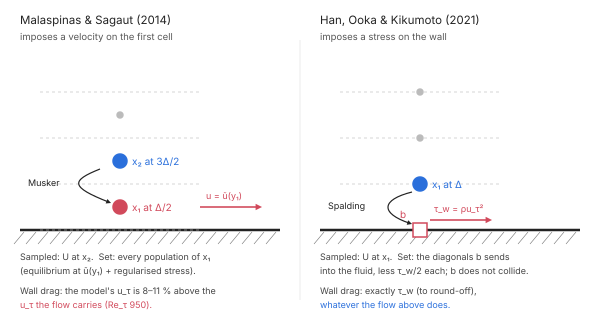
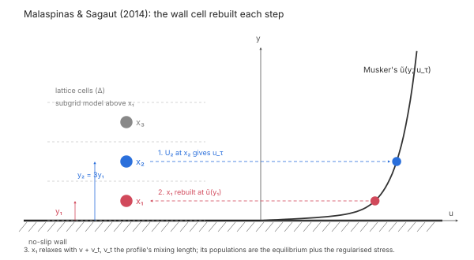
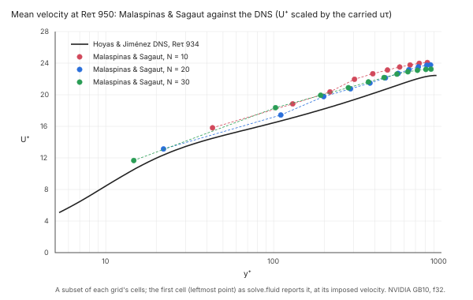
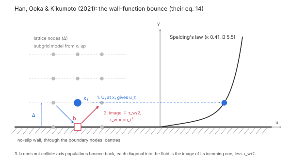
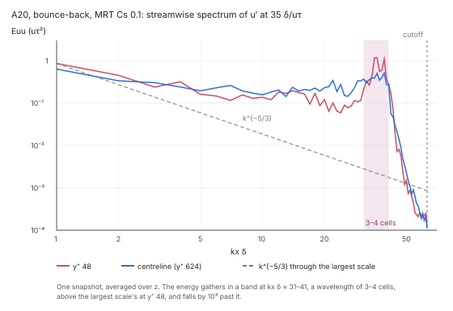

# Large-eddy simulation

A large-eddy simulation resolves the flow's large eddies on the lattice and models the rest with
a subgrid eddy viscosity ([Turbulence](turbulence.md): Smagorinsky's and Vreman's models, Van
Driest's damping). Near a no-slip wall the eddies shrink with the distance from it, so a grid that
resolves them there needs its first cell at y⁺ ≈ 1. At Re_τ 10³ and above that grid is too fine to
run, and the wall is **modelled** instead: the first cell lies in the log layer, and a law of the
wall supplies what the grid cannot resolve.

FieldCraft has two wall models. Each is named by the authors of the paper it is written from, and
each is first reproduced against that paper's own case, then documented here with its
measurements.

| Wall model | `wall_model` | What it imposes | Status |
|---|---|---|---|
| [Malaspinas & Sagaut (2014)](#malaspinas--sagaut-2014) | `"musker"` | a velocity on the first fluid cell | **Reproduced** at Re_τ 950. The drag the flow carries is 14–17 % below Dean's correlation. |
| [Han, Ooka & Kikumoto (2021)](#han-ooka--kikumoto-2021) | `"spalding_bounce"` | a stress on the wall | **Not reproduced** at A20, on the paper's collision or on the hybrid one. |

Neither passes the drag gate yet (the carried skin friction within 5 % of the DNS), so neither is
recommended for engineering skin friction or pressure drop. [Compared](#the-two-wall-models-compared)
below.

| | |
|---|---|
| **Commands** | `model.step.create` (`turbulence.wall_model` of a `fluid` procedure), `solve.fluid` |
| **Solver** | `crates/lbm` (CPU, f64), `crates/lbm-gpu` (GPU, f32): both wall models on both |
| **Implementation** | `crates/lbm/src/wall.rs`, `crates/lbm/src/mrt.rs` (Malaspinas & Sagaut); `crates/lbm/src/bounce.rs` (Han, Ooka & Kikumoto); `crates/lbm-gpu/src/lbm.wgsl` |
| **Verified by** | `crates/lbm-gpu/tests/verification.rs` (the two channel studies), `crates/lbm/tests/wall_stability.rs`, `crates/lbm/tests/turbulence.rs` |

## Synopsis

Malaspinas & Sagaut's wall model, on the collision it is validated with:

```json
{"name": "Flow", "procedure": {
  "type": "fluid", "domain": "Channel", "end_time": 2.0,
  "collision": "mrt",
  "turbulence": {"type": "smagorinsky", "constant": 0.1, "wall_model": "musker"}
}}
```

Han, Ooka & Kikumoto's wall-function bounce, as their paper sets it up:

```json
"collision": "mrt",
"turbulence": {"type": "smagorinsky", "constant": 0.1, "van_driest": 26, "wall_model": "spalding_bounce"}
```

`model.step.create` takes these fields. `solve.fluid` runs the step with `"backend": "cpu"` or
`"backend": "gpu"`.

## Parameters

| Field | Value | Meaning |
|---|---|---|
| `turbulence.type` | `"smagorinsky"`, `"vreman"` | The subgrid model ([Turbulence](turbulence.md)). Malaspinas & Sagaut's wall model is validated with Smagorinsky's only. |
| `turbulence.constant` | 0.08–0.1 | Smagorinsky's C. Malaspinas & Sagaut use 0.08, Han, Ooka & Kikumoto 0.1. |
| `turbulence.wall_model` | `"musker"` | Malaspinas & Sagaut: rebuild the cells next to no-slip walls from Musker's profile. |
| | `"spalding_bounce"` | Han, Ooka & Kikumoto's eq. 14, on-node: the outermost cell layer at each plane no-slip box face is the wall. The box is periodic along the walls; no obstacles, moving walls or heat. |
| | `"spalding_bounce_halfway"` | Our halfway variant of the wall-function bounce, kept for the record below. It is not the paper's scheme and amplifies an odd–even mode of the wall rows; don't use it. |
| | omitted | The bounce-back alone. |
| `turbulence.van_driest` | 26 or omit | Van Driest's damping. Han, Ooka & Kikumoto use it with their wall model; Malaspinas & Sagaut's model replaces it, so don't combine the two. |
| `collision` | `"mrt"`, `"hrr"` | Malaspinas & Sagaut is validated with `"mrt"` (d'Humières et al. 2002). The wall-function bounce was run with `"mrt"` and `"hrr"` ([Collision operators](collision.md)). |

With a wall model the fluid's own relaxation time may go down to τ = 0.5001. A grid that needs a
lower τ is refused with the value it needs.

## When to use it

- **Use a wall model** when the first fluid cell lies in the log layer, y⁺ ≈ 30–100: internal
  flows at Re_τ 10³ and above, such as ducts, heat-sink channels and fin passages. Plan skin
  friction and pressure drop with the margins under [Limitations](#limitations).
- **Don't use one** on a wall-resolved grid, with the first cell at y⁺ ≲ 2. Use Van Driest's
  damping or no wall treatment there.
- **Don't use one in the buffer layer** (y⁺ 5–30). Neither model is validated with a first cell
  there.

y⁺ = y u_τ / ν, y the distance of the first cell's centre from the wall: half a cell with
Malaspinas & Sagaut's halfway wall, one cell with Han, Ooka & Kikumoto's on-node wall.

## The two wall models compared



| | Malaspinas & Sagaut (2014) | Han, Ooka & Kikumoto (2021) |
|---|---|---|
| Imposes | the first cell's velocity, ũ(y₁) | the wall's shear stress, τ_w = ρ u_τ² |
| Where the wall lies | halfway along the link, half a cell below x₁ | through the boundary nodes' centres; a channel 2δ wide is 2δ + Δx high |
| Samples | the velocity at x₂, 3y₁ from the wall | the velocity at x₁, Δ from the wall |
| Law of the wall | Musker's profile (κ 0.41) | Spalding's law (κ 0.41, B 5.5) |
| The first cell | rebuilt: equilibrium plus regularised stress, relaxed with a mixing-length ν_t | the boundary node does not collide: bounce-back plus the stress on its diagonals |
| Drag the flow carries | what the rebuilt cell carries; the model's u_τ is 8–11 % above it | τ_w exactly, to round-off (7 × 10⁻¹⁵) |
| Walls | any no-slip wall: exact on plane walls, within a fraction of a cell on curved ones | plane box faces only |
| Reproduced | yes, Re_τ 950, E within 8 % of the paper on three grids | no, at A20 on MRT or the hybrid collision |
| Carried C_f against Dean | −14 to −17 % (Re_τ 950, MRT) | +53 % (MRT), −52 to −55 % (hybrid) at Re_τ 640 |

Imposing the stress closes the gap between the model and the drag that Malaspinas & Sagaut leave
open: the wall takes exactly what Spalding's law gives for the sampled velocity. It does not make
the drag right. That now depends on the velocity at x₁, which the LES above the wall sets, and the
LES gets it wrong in both directions: MRT at C_s 0.1 mixes the channel into a plug and carries
too much drag, the hybrid collision's own dissipation slows the near-wall exchange and carries
half the right drag. Both models still face the log-layer mismatch of wall-modelled LES (Kawai &
Larsson 2012), which samples the wall model's input in the first cells, where the LES is least
accurate.

## Malaspinas & Sagaut (2014)



Before each collision, for every wall cell x₁ (a fluid cell with a no-slip bounce-back link) and the
cell x₂ one link further along the wall normal:

1. **Friction velocity.** The velocity at x₂, relative to the wall, gives the direction e parallel
   to the wall and the speed U₂. u_τ is the root of U₂ = ũ(y₂; u_τ), where ũ is Musker's profile
   and y₂ = 3 y₁. The profile covers the viscous sublayer, the buffer layer and the log law in one
   expression. Each root is solved by Newton's method, guarded by bisection.
2. **Velocity.** x₁'s velocity is set to ũ(y₁; u_τ) e.
3. **Density.** x₁'s density is the one its known populations give with that velocity, by the
   Zou–He relation.
4. **Stress.** x₁'s non-equilibrium stress is the one its known populations carry. The unknown
   populations, those streaming in from the wall, are taken from their opposites.
5. **Reconstruction.** All of x₁'s populations are rebuilt as the equilibrium at that density and
   velocity, plus the regularised non-equilibrium part of that stress.
6. **Relaxation.** x₁ relaxes with ν + ν_t, where ν_t is a damped mixing-length viscosity from the
   profile's shear at y₁: (κ y₁ (1 − e^(−y₁⁺/A⁺)))² |∂ũ/∂y|, with κ = 0.384 and A⁺ = 26. Smagorinsky's
   viscosity applies everywhere else.

**Collision.** The D3Q19 multiple-relaxation-time operator maps the populations to 19 orthogonal
moments, each relaxed at its own rate:

| Moments | Rate |
|---|---|
| energy | 1.19 |
| energy square, quartic modes | 1.4 |
| energy flux | 1.2 |
| cubic modes | 1.98 |
| the five stresses | 1 / (3 (ν + ν_t) + ½), per cell |

Guo's forcing enters through the moments. The rates are those Malaspinas & Sagaut use, from
d'Humières et al.'s stability analysis.

**Walls.** The wall distance and normal come from each wall cell's bounce-back links: exact for
plane walls, and within a fraction of a cell for curved ones. A moving wall is taken relative to its
own velocity. A wall cell whose x₂ is not a fluid cell inside the domain keeps the bounce-back.

**Reported wall force.** The wall force that `solve.fluid` reports is the momentum the flow
transfers to the wall, the drag the simulation actually carries. It is not the stress the wall
model infers at x₂. The two differ on coarse grids, as the verification below shows. The force has
two parts:
- the bounce-back's momentum exchange on the wall cell's links, after the rebuilt cell's
  collision;
- the momentum the reconstruction (step 5) takes from the cell: the momentum of its streamed
  populations less that of its rebuilt ones.

Together they close the fluid's momentum budget every step, so at steady state the walls carry
the body force exactly. A wall cell on an edge or corner, with links into more than one wall,
puts all of the reconstruction's share into the wall of its nearest link.

**Reported velocity at x₁.** The velocity field that `solve.fluid` reports gives each modelled
wall cell the velocity its reconstruction imposed in the last step, ũ(y₁; u_τ) e (step 2). The
cell's populations between steps are the streamed state that the next reconstruction overwrites;
in a channel their velocity is a quarter below ũ. The density reported is that of those
populations, so the reported mass stays the populations' sum. Before the first step nothing is
imposed yet, and x₁ reports its initial state.

The density the reconstruction sets (step 3) does not conserve mass exactly. In a coarse
channel the total mass drifts by 1e-7 to 1e-5 over the first 40 steps.

### Verification: the paper's channel at Re_τ 950

The paper's channel (its §5), run exactly as it sets it up and compared on its own measures.

| Item | Setting (as printed in the paper) |
|---|---|
| Case | Periodic channel, half-height δ, domain 2πδ × 2δ × 2πδ (rounded to whole cells) |
| Reynolds number | Re_τ 950; bulk Re_m 37 042 from Dean's correlation |
| Grids | N = 10, 20 and 30 cells per δ (first cell at y⁺ 47.5, 23.8 and 15.8) |
| Model | Smagorinsky C 0.08, D3Q19 MRT, Musker's profile |
| Forcing | Body force updated every step to hold the bulk velocity (their eq. 67); u_m = 0.1 in lattice units |
| Reference | Hoyas & Jiménez's DNS mean profile (the `Re950.prof` file, Re_τ 934), as in the paper |
| Precision | f32 on the GPU (NVIDIA GB10) |
| Averaging | From 20 δ/u_τ, at least 50 δ/u_τ, until the wall force's 95 % half-width is below 1 % |

**Pass criteria**, fixed before the runs: C_f by the wall model's u_τ within the paper's 4.22 % of
Dean, and the profile error E within 15 % of the paper's Table 1 on every grid.

| N | E | E, paper | C_f by the model's u_τ vs Dean | C_f by the carried drag vs Dean | model u_τ / carried u_τ |
|---|---|---|---|---|---|
| 10 | 2.08 | 2.11 (−1.4 %) | +1.8 % | −16.8 % | 1.106 |
| 20 | 0.99 | 1.07 (−7.5 %) | +0.8 % | −13.7 % | 1.081 |
| 30 | 0.87 | 0.83 (+4.8 %) | +3.5 % | −14.1 % | 1.098 |

**The reproduction passes:** E within 8 % of the paper on every grid, and C_f by the model's u_τ
within its 4.22 %.




**Readings where the paper is silent.** The paper doesn't state these; each was chosen as below,
and only this combination matches its Table 1 on all three grids.

| Question | Reading used | The other readings |
|---|---|---|
| Which u_τ scales U⁺ and y⁺ in E | The carried u_τ (from the force balance), the DNS convention | The model's u_τ gives E 2–5 × below the paper's |
| Which points E sums over | Every cell centre of the whole channel, M = 2N | The half channel gives E √2 higher (+37 to +52 %) |
| x₁'s velocity | The velocity the wall model imposes on it | — |
| Which u_τ the paper's C_f (their eq. 70) uses | The wall model's | The carried drag is reported beside it |

E is the paper's eq. 69: 100/M times the root of the summed squared relative errors of U⁺ against
the DNS.

**The drag the flow carries.** The paper reports C_f from the friction velocity the wall model
infers at x₂. The flow carries less: the body force that holds the bulk velocity, which equals the
drag on the walls at steady state, gives a C_f 14–17 % below Dean's correlation on every grid. The
model's u_τ is 8–11 % above the carried one. This is a property of the method: it imposes a
velocity on x₁, and the stress the flow then carries comes from the rebuilt populations and the
bounce-back on x₁'s wall links, which nothing makes equal to ρ u_τ². In the velocity profile the
gap shows as the whole curve lying about 1–2.5 U⁺ above the DNS once it is scaled by the carried
u_τ. `solve.fluid` reports the carried drag, so expect skin friction and pressure drop about 15 %
low on these grids.

**Reported velocity of the wall cells.** Before #755 the velocity field the solver reported came
from x₁'s populations as streamed, before the rebuild: 0.72–0.79 of the velocity the wall model
imposes in this channel. The reported field now gives each rebuilt cell its imposed velocity, on
the CPU and the GPU. The flow itself is unchanged.

### Verification: Lee & Moser at Re_τ 1000 and 2000

Before the reproduction, the wall model ran at Re_τ 1000 and 2000 against Lee & Moser's DNS, with
the bulk held at Dean's correlation, Smagorinsky's C 0.08 at Re_τ 1000 and 0.1 at Re_τ 2000, and
the same averaging (#749; the full record, with Re_τ 550, is in
[Verification and validation](../../verification.md)). Its E values used x₁'s pre-rebuild
velocity, so they are not comparable with the paper's; its C_f values are unaffected.

| Re_τ | N | first cell y⁺ | C_f, carried drag: vs Lee & Moser / vs Dean | C_f, wall-model u_τ: vs Dean |
|---|---|---|---|---|
| 1000 | 10 | 46 | −11.4 % / −14.5 % | +1.3 % |
| 1000 | 20 | 23 | −8.9 % / −12.1 % | −0.9 % |
| 1000 | 30 | 16 | −8.7 % / −11.9 % | +1.4 % |
| 2000 | 10 | 100 | refused: needs τ = 0.50007 | — |
| 2000 | 20 | 52 | +10.2 % / +8.9 % | −3.1 % |
| 2000 | 30 | 33 | −0.7 % / −1.8 % | −1.8 % |

At Re_τ 1000 the 20- and 30-cell grids put the first cell below y⁺ 30, outside the method's range.
Re_τ 2000 at N = 30 is the one grid where the carried drag lands within 5 %; across the rest it is
9–15 % off, with a sign that depends on Re_τ and N.

### Reproduce

```sh
FIELDCRAFT_PAPER_CHANNEL=950 cargo test --release -p fieldcraft-lbm-gpu --test verification \
  -- --ignored study_malaspinas_and_sagaut_s_channel_against_lee_and_moser --nocapture
```

`FIELDCRAFT_PAPER_CHANNEL=950:20` runs one grid; `1` runs the Re_τ 1000 and 2000 study. The runs
take 2 minutes (N = 10) to an hour (N = 30) each on a GB10.

## Han, Ooka & Kikumoto (2021)



The wall-function bounce of their eq. 14 is on-node: the outermost cell layer at each plane no-slip
box face is the wall, which passes through those nodes' centres, and the first interior node x₁
lies one cell, Δ, from it. Each step:

1. **Friction velocity.** The velocity at x₁ parallel to the wall gives the direction and the
   speed U₁; u_τ is the root of Spalding's law (κ 0.41, B 5.5) at y = Δ, solved by Newton's
   method guarded by bisection.
2. **Stress.** τ_w = ρ u_τ² along that direction, with ρ the density at x₁.
3. **Boundary node.** The boundary node b does not collide. After the fluid cells' collision:
   - the axis and wall-parallel populations bounce back;
   - each diagonal into the fluid is the specular image of the one arriving from the fluid,
     ∓ τ_w/2 along the wall;
   - each diagonal into the wall takes its opposite's value; the rest population is kept.

   Streaming is unchanged. Populations that would arrive from outside the box are replaced by the
   images of those from the fluid, so each node keeps its mass, and a node's stress reaches the
   interior neighbours at x ± 1.
4. **Wall force.** The momentum the boundary nodes take from the fluid: τ_w along the wall per node
   and step, to round-off, and the bounce-back's 2 Σ f of the incoming populations along the
   normal.

The boundary nodes are not fluid cells: no eddy viscosity, no part in their neighbours'
finite-difference gradients (one-sided there), and left out of the cell count, the mass, the mean
velocity and the fields. With Van Driest's damping, x₁ is the wall cell. The GPU runs the same
scheme (`node_bounce`), within 10⁻⁴ of the CPU's velocity and 10⁻³ of its wall drag from the first
step ([GPU backend](gpu.md)).

**Our halfway variant** (`spalding_bounce_halfway`) was implemented first, from a halfway reading
of the scheme: the wall half a cell outside the outermost cells, reflected specularly, and each
wall cell's own Spalding stress at y = Δ/2 taken off its inward diagonals after streaming. It is
not Han, Ooka & Kikumoto's scheme. It is kept only so the record below can be rerun, and its
removal is pending.

### Verification: the paper's channel on MRT

Their channel (Fluid Dyn. Res. 53:045506, 2021) as the paper sets it up: 2πD × 2D × πD, periodic
in x and z, MRT with d'Humières et al.'s rates, Smagorinsky C_s 0.1 with Van Driest's damping
(A⁺ 26), driven by the constant pressure gradient of u_τ = 1, at their Mach numbers. A20 (20
cells per D, Re_τ 640, x₁ at y⁺ 32) and A40. WFB is the wall-function bounce, BB plain
bounce-back. Pass criteria fixed before the runs: ε_u⁺ over the whole channel and the log-law
intercept b within 15 % of their Tables 2 and 3. Recorded on Linux aarch64 (NVIDIA GB10), GPU,
f32 unless stated; Hoyas & Jiménez's U_b⁺ is about 21.7.

| A20, averaged 20–150 δ/u_τ | U_b⁺ | C_f vs Dean | ε whole (paper) | b (paper) | walls carry |
|---|---|---|---|---|---|
| BB | 9.24 | +235 % | 0.511 (0.056) | −2.55 (5.6) | 1.01 |
| WFB, eq. 14 | 14.44 | +53 % | 0.248 (0.057) | 1.92 (6.4) | 1.01 |
| WFB, our halfway variant | 9.56 | +215 % | 0.499 (0.057) | −2.64 (6.4) | 1.03 |
| WFB, halfway variant, CPU f64 | 9.54 | +217 % | 0.500 (0.057) | −2.66 (6.4) | 1.03 |

A40 with the halfway variant went unstable at 93 δ/u_τ (U_b⁺ ≈ 6.9 throughout); A40 BB was
stopped at 52.5 δ/u_τ, U_b⁺ 7.88 and falling. **Not reproduced.** CPU and GPU agree, and the
walls carry the body force, so neither the port nor the momentum budget is the cause.


**What the flow does.** In A20 BB (snapshot at 35 δ/u_τ) the resolved stress −⟨u′v′⟩ carries the
whole momentum flux and the eddy viscosity is small (⟨ν_t⟩/ν ≈ 3 across the channel);
u′rms⁺ ≈ v′rms⁺ ≈ 5 from y⁺ 48 to the centreline (about 1 in the DNS core), and the mean profile
is flat from y⁺ 48 to the centre. u′'s streamwise spectrum has a distinct band at k_x δ ≈ 31–41 (a
wavelength of 3–4 cells), above the largest scale's energy at y⁺ 48, falling by 10³ past
k_x δ ≈ 43 (the cutoff is 63). That band mixes the channel into a plug, which raises the drag.




**Ruled out.** Hou et al.'s ν_t applies C² with Δ = Δx (the simple-shear test gives ν₀ + C²γ);
Van Driest's y is measured from the wall point; the energy mode's rate is 1.19, not near 2;
forcing and units are covered by the MRT Poiseuille tests.

**Sensitivity** (A20, BB unless stated, 10–35 δ/u_τ averaged, diagnostic switches not merged):

| A20, 10–35 δ/u_τ | U_b⁺ | ε whole | b | C_f vs Dean |
|---|---|---|---|---|
| MRT, C_s 0.1, damped (the paper's) | 10.9 | 0.426 | −0.99 | +150 % |
| without damping | 6.8 | 0.637 | −5.19 | +466 % |
| C_s 0.05 | unstable | | | |
| regularised collision, C_s 0.1 | 8.6 | 0.537 | −4.69 | +280 % (checkerboard at y⁺ 16–80) |
| TRT, C_s 0.1 | unstable at 0.4 δ/u_τ | | | |
| MRT with d'Humières et al.'s optimised equilibria | 12.9 | 0.325 | 0.70 | +88 % (same state, reached later) |
| C_s 0.15 | 19.2 | 0.066 | 6.46 | −7 % (v′ > u′ in the core) |
| C_s 0.2 | 20.4 | 0.129 | 7.41 | −16 % |
| WFB (halfway variant), C_s 0.2 | 15.0 | 0.207 | 1.36 | +44 % |

Tuning the model's constant until the bulk fits is not a reproduction, and none of these rows
passes on both measures.

**Without walls the scheme dissipates as it should** (`study_taylor_green_vortex_dissipation`, 64³,
lattice speed 0.05): MRT with C_s 0.1 peaks at −dk/dt 0.0121 (t 8.4) at Re 1600 and 0.0122 (t 8.1)
at Re 12000, against the spectral DNS's 0.0127 near t 9. The pile-up is driven at the walls.

**Cause.** The documented failure of this MRT in under-resolved channels: Nathen et al. (2018),
with the same rates, find an unphysical state in channels at Re_τ 395 and 590 (spurious
oscillations, energy moving to high wavenumbers, no mesh convergence) where BGK is fine. Han,
Ooka & Kikumoto's clean MRT result at C_s 0.1 is not explained by anything they publish (the
2021 paper and their 2019 LBM-LES paper, IJHMT 130:700, read).

### Verification: the odd–even mode of the wall rows

In the channels our halfway variant grew a streamwise odd–even (k_x = π) mode of u_x in its wall
rows, about 3 × 10⁻⁵ per step, until the run broke. A numerical linear analysis of that mode
(`crates/lbm/tests/wall_stability.rs`) compares it with eq. 14 on-node: a periodic box
16 × (2N + 1) × 2 cells on-node, 16 × 2N × 2 halfway, N = 4, both walls modelled, no subgrid model,
a body force holding the laminar base steady, and a checkerboard of 10⁻⁶ in u_x added to the
first fluid row at each wall. The growth rate per step is the least-squares slope of ½ ln E of the
mode's energy over the second half of 20 000 steps, shown as the range over the regularised,
hybrid (σ 0.99), MRT and TRT collisions and both aimed u⁺ (the first node's u⁺ in brackets).

| τ̄ | eq. 14, on-node | halfway variant |
|---|---|---|
| 0.50015 | −5.2e-5 to −1.9e-5 (5, 11) | +5.6e-5 to +1.4e-4 (5, 10.8) |
| 0.5015 | −2.9e-4 to −8.8e-5 (5, 8.1) | +5.5e-4 to +7.1e-4 (4.8; MRT broke at step 18 368) |
| 0.505 | −7.1e-4 to −3.3e-4 (5) | +1.8e-3 to +2.3e-3 (2.7; broke by step 7 500) |
| 0.55 | −4.4e-3 to −2.6e-3 (1.6) | +2.1e-2 to +2.4e-2 (0.85; broke by step 640) |
| 0.8 | −1.6e-2 to −1.5e-2 (0.65) | +0.13 (0.35; broke by step 107) |

**Eq. 14 damps the mode** with every collision and τ̄; the halfway variant amplifies it, faster
as τ̄ rises. The trunk keeps one case (on-node, regularised, τ̄ 0.5015, u⁺ 5, rate ≤ 0); the sweep
is the heavy test `the_odd_even_mode_of_the_wall_rows_across_forms_collisions_and_tau`.

### Verification: the paper's channel on the hybrid collision

The same channel on the hybrid recursive regularised collision (Jacob, Malaspinas & Sagaut 2018),
a labelled change of collision: it holds the turbulent channel where MRT piles up energy.

| set-up | collision | subgrid model |
|---|---|---|
| `paper` | MRT | Smagorinsky C_s 0.1, Van Driest A⁺ 26 |
| `hrr-vreman` | hrr, σ 0.99 | Vreman C_s 0.18 (Jacob et al.'s explicit LES, case 3) |
| `hrr-dynamic` | hrr, dynamic σ | Vreman C_s 0.18, which only sets σ (their case 4) |
| `hrr-smagorinsky` | hrr, σ 0.99 | Smagorinsky C_s 0.1, Van Driest A⁺ 26 |

A20, GPU f32, NVIDIA GB10, Re_τ 640, averaged 20–150 δ/u_τ; WFB is eq. 14 on-node:

| set-up, wall | U_b⁺ | C_f vs Dean | ε whole (paper) | b (paper) | walls carry |
|---|---|---|---|---|---|
| `hrr-vreman`, BB | 17.90 | +5.2 % | 0.153 (0.056) | 4.68 (5.6) | 1.00 |
| `hrr-vreman`, WFB | 28.77 | −54 % | 0.535 (0.057) | 15.23 (6.4) | 0.99 |
| `hrr-smagorinsky`, BB | 16.69 | +19 % | 0.171 (0.056) | 3.53 (5.6) | 1.01 |
| `hrr-smagorinsky`, WFB | 27.94 | −52 % | 0.491 (0.057) | 14.30 (6.4) | 0.99 |
| `hrr-dynamic`, BB | 6.23 | not stationary | | | 1.20 (20–70 δ/u_τ) |
| `hrr-dynamic`, WFB | 28.94 | −55 % | 0.607 (0.057) | 9.04 (6.4) | 1.00 |

Every eq. 14 run held, with no odd–even mode in the walls; the halfway variant on the hybrid
collision went unstable at 39 δ/u_τ (fixed σ) and 113 δ/u_τ (dynamic σ).

**Where the dissipation sits.** With σ 0.99 the hybrid collision's own viscosity ν_s/ν at
k_x Δx 1.5–2.1 is about 10–18 at y⁺ 48 and on the centreline, against the subgrid ⟨ν_t⟩/ν of
0.2–1.4: the collision's filter, not Vreman's or Smagorinsky's model, damps the band that MRT
piled up. Dynamic σ drives σ to 0.006–0.007 with eq. 14 and 0.57–0.74 with BB.

**Result: not reproduced at A20, with their own eq. 14.** No set-up meets the gate on any wall.
MRT at C_s 0.1 carries too much drag, the hybrid collision with eq. 14 too little (C_f about half
Dean's, b two to three times theirs); the paper's result lies between them. BB on the hybrid
collision with Vreman's model comes nearest the DNS bulk (C_f +5 %), but it is a no-slip run at
y⁺ 32, not the paper's wall model, and its ε is three times theirs. A40 was not run.

### Reproduce

```sh
FIELDCRAFT_HAN=A20,A40 FIELDCRAFT_HAN_SETUP=paper,hrr-vreman,hrr-dynamic,hrr-smagorinsky \
FIELDCRAFT_STUDY_RECORDS=<dir> \
  cargo test --release -p fieldcraft-lbm-gpu --test verification study_han -- --ignored --nocapture
```

`FIELDCRAFT_HAN_SETUP` takes a comma-separated list or `all` (`paper` when unset).
`FIELDCRAFT_HAN_WALL=halfway` runs the WFB cases with the halfway variant. `FIELDCRAFT_HAN_START`
and `FIELDCRAFT_HAN_END` (δ/u_τ, default 20 and 150) shorten a smoke test, which is not a result;
`FIELDCRAFT_HAN_CPU=1` runs on the CPU in f64. Every run records
(`<dir>/han-<setup>-<case>-<wall>.json`), from a velocity readback every 0.05 δ/u_τ:

- per row of the folded half channel: U⁺, u′, v′, w′ rms⁺, the shear budget −⟨u′v′⟩⁺ + viscous +
  subgrid against 1 − y/δ, ⟨ν_t⟩/ν, and the molecular and subgrid dissipation. Vreman's ν_t is
  the model's own formula on the readback; Smagorinsky's is an estimate, (C D Δx)² √(2 S:S) with
  Van Driest's D at the nominal y⁺; dynamic σ is `fieldcraft_lbm::hrr::dynamic_sigma` on the
  readback;
- u′'s streamwise spectrum at the row nearest y⁺ 48 and at the centreline, with the premultiplied
  peak and the share above k_x Δx = π/2;
- on the hybrid collision, the scheme's own viscosity ν_s/ν at k_x Δx 1.5, 1.8 and 2.1 and at the
  spectrum's peak: the exact decay of a transverse shear wave under the collision less ν̄ k², so a
  pass is not credited to the subgrid model when the collision's filter did the work.

## Limitations

- **No wall model passes the drag gate.** Malaspinas & Sagaut carry 14–17 % less wall drag than
  Dean's correlation at Re_τ 950 on 10 to 30 cells per δ, and 9–15 % off either way at Re_τ 1000
  and 2000, except at Re_τ 2000 with 30 cells per δ (within 2 %). Han, Ooka & Kikumoto is not
  reproduced: +53 % on MRT, about −53 % on the hybrid collision.
- **Equilibrium boundary layers.** Both laws of the wall assume an attached, equilibrium boundary
  layer. Separation, reattachment and strong pressure gradients are not validated.
- **Smooth walls only.** No roughness.
- **No wall heat flux model.** Malaspinas & Sagaut's model leaves the thermal lattice's bounce-back
  walls as they are, and the wall-function bounce refuses heat, so wall heat transfer on a
  wall-modelled grid is not validated.
- **Han, Ooka & Kikumoto on box faces only.** The wall-function bounce needs plane box faces,
  periodic along the walls, with no obstacles or moving walls.

## References

- O. Malaspinas, P. Sagaut. *Wall model for large-eddy simulation based on the lattice Boltzmann
  method.* J. Comput. Phys. 275:25–40, 2014.
  doi:[10.1016/j.jcp.2014.06.020](https://doi.org/10.1016/j.jcp.2014.06.020)
- M. Han, R. Ooka, H. Kikumoto. *A wall function approach in lattice Boltzmann method: algorithm
  and validation using turbulent channel flow.* Fluid Dyn. Res. 53:045506, 2021.
  doi:[10.1088/1873-7005/ac1782](https://doi.org/10.1088/1873-7005/ac1782)
- J. Jacob, O. Malaspinas, P. Sagaut. *A new hybrid recursive regularised Bhatnagar–Gross–Krook
  collision model for lattice Boltzmann method-based large eddy simulation.* J. Turbul.
  19(11–12):1051–1076, 2018.
  doi:[10.1080/14685248.2018.1540879](https://doi.org/10.1080/14685248.2018.1540879)
- D. d'Humières, I. Ginzburg, M. Krafczyk, P. Lallemand, L.-S. Luo. *Multiple-relaxation-time
  lattice Boltzmann models in three dimensions.* Phil. Trans. R. Soc. Lond. A 360:437–451, 2002.
  doi:[10.1098/rsta.2001.0955](https://doi.org/10.1098/rsta.2001.0955)
- P. Nathen, D. Gaudlitz, M. J. Krause, N. A. Adams. *On the stability and accuracy of the BGK,
  MRT and RLB Boltzmann schemes for the simulation of turbulent flows.* Commun. Comput. Phys.
  23:846–876, 2018. doi:[10.4208/cicp.OA-2016-0229](https://doi.org/10.4208/cicp.OA-2016-0229)
- A. J. Musker. *Explicit expression for the smooth wall velocity distribution in a turbulent
  boundary layer.* AIAA J. 17(6):655–657, 1979.
  doi:[10.2514/3.61193](https://doi.org/10.2514/3.61193)
- D. B. Spalding. *A single formula for the "law of the wall".* J. Appl. Mech. 28(3):455–458,
  1961. doi:[10.1115/1.3641728](https://doi.org/10.1115/1.3641728)
- M. Lee, R. D. Moser. *Direct numerical simulation of turbulent channel flow up to Re_τ ≈ 5200.*
  J. Fluid Mech. 774:395–415, 2015.
  doi:[10.1017/jfm.2015.268](https://doi.org/10.1017/jfm.2015.268)
- S. Hoyas, J. Jiménez. *Reynolds number effects on the Reynolds-stress budgets in turbulent
  channels.* Phys. Fluids 20:101511, 2008.
  doi:[10.1063/1.3005862](https://doi.org/10.1063/1.3005862). Mean profiles from
  [torroja.dmt.upm.es](https://torroja.dmt.upm.es/ftp/channels/data/statistics/).
- J. C. del Álamo, J. Jiménez. *Spectra of the very large anisotropic scales in turbulent
  channels.* Phys. Fluids 15:L41–L44, 2003.
  doi:[10.1063/1.1570830](https://doi.org/10.1063/1.1570830). The Re_τ 934 simulation behind
  `Re950.prof`.
- R. B. Dean. *Reynolds number dependence of skin friction and other bulk flow variables in
  two-dimensional rectangular duct flow.* J. Fluids Eng. 100(2):215–223, 1978.
  doi:[10.1115/1.3448633](https://doi.org/10.1115/1.3448633)
- S. Kawai, J. Larsson. *Wall-modeling in large eddy simulation: length scales, grid resolution,
  and accuracy.* Phys. Fluids 24:015105, 2012.
  doi:[10.1063/1.3678331](https://doi.org/10.1063/1.3678331)
- U. Piomelli, E. Balaras. *Wall-layer models for large-eddy simulations.* Annu. Rev. Fluid Mech.
  34:349–374, 2002.
  doi:[10.1146/annurev.fluid.34.082901.144919](https://doi.org/10.1146/annurev.fluid.34.082901.144919)

See also [Turbulence](turbulence.md), [Collision operators](collision.md),
[Verification and validation](../../verification.md) and
[the solver literature](../../solvers/literature.md), entries C5.1–C5.5.
