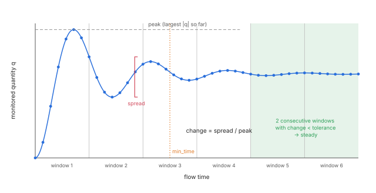
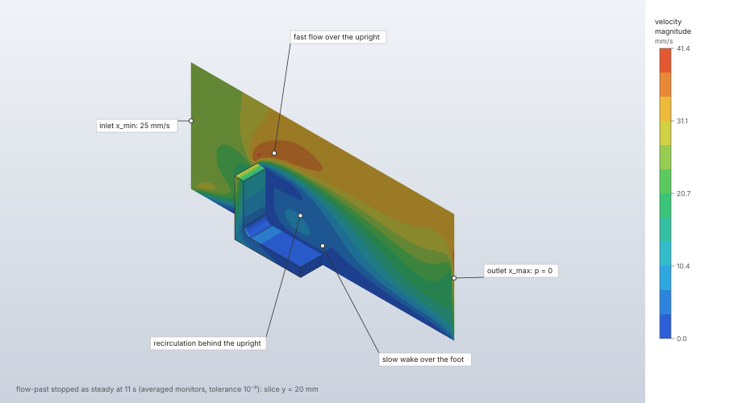

# Steady state and averaging

A fluid step is time-dependent. With a steady-state rule it stops on its own once the flow stops
changing: the velocity field, the temperature field with heat, and any monitored mass flows, wall
forces, wall heats and mean temperature vary over a window of flow time by less than a tolerance.
For a turbulent or periodically shedding flow, which never stops fluctuating, the rule watches
each quantity's running mean instead and reports its mean, fluctuation and extremes. A divergence
limit stops a run that blows up while keeping the frames saved so far.

| | |
|---|---|
| **Commands** | `model.step.create` (procedure `fluid`, `steady`), `solve.fluid` (reply `stop`) |
| **Step procedure** | `"fluid"` |
| **Solver** | `crates/lbm` (`steady.rs`), on the CPU and the GPU backend |
| **Method** | Relative spread of each monitored quantity per window; running means after a start-up |
| **Verified by** | `crates/lbm/tests/steady.rs`; `runs_to_steady_state_stop_where_the_cpu_does` (`crates/lbm-gpu/tests/verification.rs`) |

## Synopsis

A run to steady state with a monitored drag:

```json
{"name": "Run", "procedure": {"type": "fluid", "domain": "Flow", "end_time": 20,
  "steady": {"tolerance": 1e-3, "window": 0.5, "min_time": 2,
    "monitors": [{"type": "force", "faces": [{"body": "Cylinder", "face": "side"}]},
                 {"type": "mass_flow", "face": "x_max"}]}}}
```

A statistically steady run of a shedding or turbulent flow:

```json
"steady": {"tolerance": 1e-2, "window": 1.0,
  "monitors": [{"type": "force", "faces": [{"body": "Cylinder", "face": "side"}]}],
  "averaging": {"start": 4.0}}
```

## Parameters

`steady` in a fluid step:

| Field | Value | Default | Meaning |
|---|---|---|---|
| `tolerance` | above 0, below 1 | 10⁻³ | The relative change per window below which a quantity is steady. |
| `window` | flow time | a twentieth of the step's length | The flow time each change is measured over. Sampled 8 times. |
| `min_time` | flow time, not negative | 0 | No decision, steady or diverged by the limit, before this time. |
| `divergence` | above `tolerance` | none | A relative change above this after `min_time` stops the run as diverged. |
| `monitors` | up to 100 | none | Quantities monitored besides the residuals (below). |
| `averaging` | `{"start": t}` | none | Decide on running means from flow time `start` on (`start` not negative). |

Monitors:

| `type` | Fields | Quantity |
|---|---|---|
| `mass_flow` | `face`: a box face | The mass flow out through the face: Σ ρ u_n over the face's cell layer, times ρ₀ Δx² (positive leaving the box). |
| `force` | `faces`: 1 to 1000 box faces or obstacle faces `{"body", "face"}` | The total force of the fluid on those walls (a vector). |
| `heat` | `faces`: 1 to 1000 | The total heat the fluid gives those walls. Needs heat in the domain. |
| `mean_temperature` | — | The mean temperature of the fluid cells. Needs heat in the domain. |

The step's `end_time` or `steps` is the most the run may take. A face a monitor names must be a
wall of the domain (an obstacle face selects its split pieces too); one that names none, and a
`heat` or `mean_temperature` monitor without heat, are refused when the solve starts.

## Theory

### The monitored quantities

The rule always monitors the **velocity** residual, and with heat the **temperature** residual,
then the step's monitors in their order. Each quantity q is a vector: the whole velocity field of
the fluid cells (three components each) for the velocity residual; the temperatures of the fluid
cells and the conducting solids' cells, counted from the initial temperature, for the temperature
residual; the force vector; or a single number. Its reported value is the root mean square over the
cells for a residual (the RMS speed, the RMS temperature change), the vector for a force, the
number otherwise.

### The relative change

Over each window the rule takes the componentwise extremes of q over the window's samples (both
ends included) and forms the relative spread

```text
change = ‖max q − min q‖ / max over all samples so far of ‖q‖
```

with the Euclidean norm. It is 0 while q has always been 0, and infinite for a spread over a zero
peak. The spread sees an oscillation whose period divides the window, which the difference of
the window's ends would miss. Temperatures count from the initial temperature, so an offset (kelvin, say)
does not hide a change. A sample that is not a finite number makes the change infinite.

### The stop rule

At the end of every full window:

1. **Diverged** when any change is not finite (at any time), or exceeds `divergence` at or after
   `min_time`.
2. **Steady** when every change is below `tolerance` for the second consecutive window, the second
   ending at or after `min_time`.
3. Otherwise the count of steady windows restarts, and the run goes on.

A last window cut short by the end of the step takes no decision; the run then stops at its full
length (`max_time`) with a warning. When the backend reports the flow unstable (a lattice speed
above 0.5 or a density that is not a positive number), the run stops as diverged with the backend's
message; without a stop rule the same instability is an error.



### Averaging

With `averaging`, each quantity's running mean of its reported value (the RMS speed for the velocity
field) from `start` on is what must settle. Samples from the start on enter running sums of the
value and its square, and its extremes. A window's change counts only when the window begins at or
after the start, and its peak is the largest running mean so far, so the start-up never enters a
decision. Before the start only a value that is not a number counts (it ends the run). A sample
that is not a finite number still ends the run as diverged.

At the end the report gives, per quantity and componentwise over the averaged samples, the mean,
the root mean square about the mean (the fluctuation), and the extremes:

```text
mean = Σ x / n,   rms = √(max(Σ x²/n − mean², 0))
```

### Window and sampling in time steps

The window is round(`window`/Δt) steps, clamped to 1 … the step's length, and never shorter than
⌈steps/10 000⌉ steps, so the sample history stays bounded. The sample interval is
max(1, window/8) steps, and the window is rounded down to a whole number of samples. `min_time` and
`averaging.start` become ⌈t/Δt⌉ steps. Samples are taken at the same chunk boundaries on every
backend, so the CPU and the GPU take their decisions at the same steps; a GPU backend reads its
fields back a few times per window, never per step.

### Conducting solids

A step with a steady rule scales each conducting solid's heat capacity down to the smallest the
lattice allows, which the steady temperatures do not depend on: the solids reach steady state
sooner, and the temperatures before it are not a physical transient. The solve warns and reports
each solid's `capacity_scale`. A solid's `peak` temperature is the last frame's when the run stopped
steady, else the highest over the frames ([Heat transfer](heat-transfer.md)).

## Algorithm

1. **Setup.** Validate the rule; convert `window`, `min_time` and `averaging.start` to steps;
   resolve each monitor's faces to force groups (refusing one that names no wall, and heat
   monitors without heat).
2. **Initial sample** at step 0 (no change yet).
3. **Time loop.** The chunks of steps end at every sample point, as at frames and history samples.
   At each sample: read the fields (and forces, heats) from the backend, update every quantity's
   window extremes (and running sums with averaging).
4. **At a window's end:** compute every change, decide (above), record the sample with its values
   and changes, and start the next window from this sample.
5. **Stop.** On a decision the loop ends; when the flow is still sound, a frame is added at the stop
   step if the last frame is not there. A diverged run keeps the frames saved so far and warns
   `the run diverged at time t: …; the frames end there`.
6. **Report** the reason, the history and, with averaging, the statistics.

## Output

`solve.fluid`'s reply carries `stop` when the step has a rule, and `end_time` and `steps` are where
the run stopped:

| Field | Meaning |
|---|---|
| `reason` | `steady`, `max_time` (the step's length passed first) or `diverged`. |
| `steps`, `time` | The time step and flow time of the stop. |
| `tolerance`, `window` | The rule's tolerance and its window in flow time (whole samples). |
| `quantities` | The monitored quantities: `velocity`, `temperature` (with heat), then each monitor's label (`mass_flow x_max`, `force x_min, Body1/F3`, `heat …`, `mean_temperature`). |
| `history` | Every sample: `step`, `time`, `values` (per quantity, in the display units) and `changes` (per quantity, the relative change of the window ending there, null otherwise). |
| `units` | The display unit of each quantity's values. Residuals are root mean squares; a temperature residual is a temperature difference. |
| `message` | Why the run diverged. |
| `averages` | With averaging, per quantity: `quantity`, `from` (the averaging start), `samples`, `mean`, `rms` (in `rms_unit`: for a temperature a difference, without the scale's offset), `min`, `max`, `unit`. |

Warnings: `the flow did not reach steady state (relative changes below …) within the step's length;
run longer or loosen the tolerance`, and the diverged warning above.

## Worked example

The bundled `flow-past` sample ([Lattice Boltzmann flow](lattice-boltzmann.md#worked-example))
with three stop rules on copies of its step, monitoring the total force on the bracket's eight
wetted faces and the mass flow out through `x_max`: the instantaneous rule, and running means
from 4 s at two tolerances.

| | |
|---|---|
| **Model** | `flow-past`: air at 25 mm/s past the L-bracket, 184 320 cells of 2.5 mm, Δt = 0.005 s, at most 16 s (3200 steps) |
| **Monitors** | `force` on `Bracket` faces `F2:start`, `F2:side:l2` … `l6`, `F2:top`, `F3:blend:F2:side:l3\|F2:side:l4`; `mass_flow` through `x_max` |
| **Rules** | `Steady`: `tolerance` 10⁻³, `window` 1 s, `min_time` 2 s. `Averaged`: `tolerance` 10⁻³, `window` 1 s, `averaging.start` 4 s. `AveragedLoose`: the same with `tolerance` 10⁻² |
| **Units** | mm, t, s, N, MPa |

```json
[
  {"command": "file.sample", "params": {"name": "flow-past"}},
  {"command": "model.step.create", "params": {"name": "Steady", "procedure": {"type": "fluid",
    "domain": "Wind", "end_time": 16, "frames": 10,
    "steady": {"tolerance": 1e-3, "window": 1.0, "min_time": 2, "monitors": [
      {"type": "force", "faces": [
        {"body": "Bracket", "face": "F2:start"}, {"body": "Bracket", "face": "F2:side:l6"},
        {"body": "Bracket", "face": "F2:side:l5"}, {"body": "Bracket", "face": "F2:side:l4"},
        {"body": "Bracket", "face": "F2:side:l3"}, {"body": "Bracket", "face": "F2:side:l2"},
        {"body": "Bracket", "face": "F2:top"},
        {"body": "Bracket", "face": "F3:blend:F2:side:l3|F2:side:l4"}]},
      {"type": "mass_flow", "face": "x_max"}]}}}},
  {"command": "model.step.create", "params": {"name": "Averaged", "procedure": {"type": "fluid",
    "domain": "Wind", "end_time": 16, "frames": 10,
    "steady": {"tolerance": 1e-3, "window": 1.0, "averaging": {"start": 4}, "monitors": [
      {"type": "force", "faces": [
        {"body": "Bracket", "face": "F2:start"}, {"body": "Bracket", "face": "F2:side:l6"},
        {"body": "Bracket", "face": "F2:side:l5"}, {"body": "Bracket", "face": "F2:side:l4"},
        {"body": "Bracket", "face": "F2:side:l3"}, {"body": "Bracket", "face": "F2:side:l2"},
        {"body": "Bracket", "face": "F2:top"},
        {"body": "Bracket", "face": "F3:blend:F2:side:l3|F2:side:l4"}]},
      {"type": "mass_flow", "face": "x_max"}]}}}},
  {"command": "model.step.create", "params": {"name": "AveragedLoose", "procedure": {"type": "fluid",
    "domain": "Wind", "end_time": 16, "frames": 10,
    "steady": {"tolerance": 1e-2, "window": 1.0, "averaging": {"start": 4}, "monitors": [
      {"type": "force", "faces": [
        {"body": "Bracket", "face": "F2:start"}, {"body": "Bracket", "face": "F2:side:l6"},
        {"body": "Bracket", "face": "F2:side:l5"}, {"body": "Bracket", "face": "F2:side:l4"},
        {"body": "Bracket", "face": "F2:side:l3"}, {"body": "Bracket", "face": "F2:side:l2"},
        {"body": "Bracket", "face": "F2:top"},
        {"body": "Bracket", "face": "F3:blend:F2:side:l3|F2:side:l4"}]},
      {"type": "mass_flow", "face": "x_max"}]}}}},
  {"command": "solve.fluid", "params": {"step": "Steady", "backend": "cpu"}},
  {"command": "solve.fluid", "params": {"step": "Averaged", "backend": "cpu"}},
  {"command": "solve.fluid", "params": {"step": "AveragedLoose", "backend": "cpu"}},
  {"command": "results.streamlines", "params": {"step": "AveragedLoose", "show": false}},
  {"command": "results.slice", "params": {"step": "AveragedLoose", "field": "velocity", "axis": "y", "position": "auto"}}
]
```

The relative change of each quantity per window, from `stop.history[].changes` of the
`solve.fluid` replies (velocity residual, force, mass flow):

| Window ending at | `Steady` | `Averaged` and `AveragedLoose` |
|---|---|---|
| 1 s | 0.378, 1.01, 0.342 | — (before the start) |
| 5 s | 0.174, 0.0207, 0.418 | 0.0254, 0.00484, 0.132 |
| 8 s | 0.137, 0.0126, 0.424 | 0.00193, 0.000891, 0.0179 |
| 10 s | 0.117, 0.0110, 0.457 | 0.000600, 0.000525, 0.00989 |
| 11 s | 0.101, 0.0120, 0.364 | 0.00189, 0.000280, 0.00872 |
| 16 s | 0.0834, 0.0076, 0.406 | 0.00196, 0.000107, 0.00372 |

| Rule | `stop.reason` | Stopped at | Wall-clock (Apple M4 Max, CPU) |
|---|---|---|---|
| `Steady` (10⁻³) | `max_time`, with the warning "the flow did not reach steady state (relative changes below 1e-3) within the step's length; run longer or loosen the tolerance" | 16 s, step 3200 | 17.4 s |
| `Averaged` (10⁻³) | `max_time`, the same warning | 16 s, step 3200 | 17.6 s |
| `AveragedLoose` (10⁻²) | `steady` | 11 s, step 2200 (a frame added at 11 s) | 12.6 s |

The force on the bracket (x, the drag) and the mass flow out, `AveragedLoose` (`stop.averages`,
57 samples from 4 s to 11 s), against the instantaneous values and the inflow ρ₀ U A = 1.2 × 10⁻¹²
t/mm³ × 25 mm/s × 120 × 100 mm² = 3.6 × 10⁻⁷ t/s:

| Quantity | Last sample (11 s) | `mean` | `rms` | `min` … `max` | Reference |
|---|---|---|---|---|---|
| Drag | 2.003 × 10⁻⁶ N | 1.776 × 10⁻⁶ N | 1.25 × 10⁻⁶ N | −8.4 × 10⁻⁷ … 5.11 × 10⁻⁶ N | — |
| Mass flow out | 4.29 × 10⁻⁷ t/s | 3.619 × 10⁻⁷ t/s | 8.07 × 10⁻⁸ t/s | 2.56 … 4.74 × 10⁻⁷ t/s | 3.6 × 10⁻⁷ t/s (+0.54 %) |
| RMS speed | | 27.33 mm/s | 0.593 mm/s | 26.12 … 28.45 mm/s | — |



**What to look at.** The sample's flow is laminar, yet the instantaneous rule never stops it: the
mass flow out swings by ±30 % from window to window (changes 0.34–0.46 to the end) and the drag
crosses zero, so at the resolution of these monitors the flow is not steady. On running means
from 4 s, the drag's change stays below 10⁻³ from 8 s on, but the mass flow's mean settles slowly
(3.7 × 10⁻³ at 16 s), so the 10⁻³ rule also runs the full 16 s; at 10⁻² it stops after the two
windows ending at 10 and 11 s, with 31 % fewer steps. The averaged mass flow out matches the
inflow within 0.54 %. The averaged drag, 1.78 × 10⁻⁶ N, comes with an RMS of 1.25 × 10⁻⁶ N: the
size of the oscillation a single last sample hides.

## Verification

| Case | Reference | Measured | Tolerance | Test |
|---|---|---|---|---|
| Plane Poiseuille, wall forces monitored, tolerance 10⁻⁵ | A fixed long run; wall force = driving force ρ a V (theory) | Steady in under half the long run's steps; a frame at the stop | velocity 10⁻³ of the peak; force 10⁻³; same decisions every run | `poiseuille_flow_stops_at_steady_state_with_the_long_run_s_profile` |
| de Vahl Davis cavity, Ra 10³, 16 cells, heats and mean temperature monitored | A fixed long run | Steady in under half the steps | hot-wall heat 10⁻³, velocity 10⁻², mean temperature within 1.5 × 10⁻³ of the mid temperature (wall difference 1) | `the_de_vahl_davis_cavity_stops_at_steady_state_with_the_long_run_s_heat` |
| Periodic box accelerating without bound | Unstable at the lattice-speed check | Error without a rule; with one, diverged between steps 50 and 60 with finite frames | | `an_unstable_flow_stops_as_diverged` |
| The same with `divergence` 0.05 and `min_time` 20 Δt | Diverged at the first sample at or after `min_time` | Step 20 | exact | same |
| Poiseuille stopped before it settles | `max_time`, the full length, a warning | 17 samples (16 windows of ⅛ and the initial one) | exact | `a_flow_that_does_not_settle_runs_its_length_and_says_so` |
| Monitors naming no wall, heat without heat | Refused | | | `monitors_the_flow_cannot_measure_are_refused` |
| Mass flow through two periodic faces | ρ ū H Δx; the two opposite | | 10⁻²; sum 10⁻¹² | same |
| Vortex shedding, Schäfer–Turek 2D-2 channel at Re 100, 10 cells across the cylinder, convective outlet, 16 s | The long run's mean drag and lift RMS | Instantaneous rule: `max_time`. Running mean from 4 s: steady at 9 s, mean drag 0.24 % from the long run's, lift RMS 0.8 % from it; lift extremes either side of 0 | drag 1 %, lift RMS 10 % | `vortex_shedding_stops_on_its_running_mean_with_the_long_run_s_mean_drag` (heavy) |
| CPU and GPU | Stop at the same step | | | `runs_to_steady_state_stop_where_the_cpu_does` |

A turbulent case stopping on its running mean (the channel, or a graphics-card cooling case) is not
run ([Verification and validation](../../verification.md), "What #664's acceptance still lacks").

## Limitations

- The rule watches the quantities it is given: a flow steady in the residuals and the monitors may
  still change elsewhere, in a quantity nobody monitors.
- The decision is per window: a run stops at the end of a window, never between two.
- With heat and conducting solids, the temperatures before the steady state are not a physical
  transient (their capacity is scaled).
- Averaging needs a `start` after the start-up: the start-up is excluded from the decision but a
  start set too early lets it into the means.

## Implementation

| File | Contents |
|---|---|
| `crates/model/src/steps.rs` | `Steady`, `Averaging`, `FlowMonitor`, `Steady::validate`. |
| `crates/lbm/src/steady.rs` | `SteadySetup::new`, `Monitor::new`, `Monitor::sample`, `Monitor::report`, `StopReason`, `SUB_SAMPLES`, `STEADY_WINDOWS`. |
| `crates/lbm/src/solve.rs` | `run`: chunks to sample points, the stop, the frame at the stop, the warnings. |
| `crates/lbm/src/setup.rs` | The heat capacity scaling of conducting solids for a steady run. |
| `crates/engine/src/cmd/solve.rs` | `steady_summary`: the reply's `stop` in the display units. |

## References

- M. Schäfer, S. Turek. *Benchmark computations of laminar flow around a cylinder.* NNFM 52:547–566, 1996. doi:[10.1007/978-3-322-89849-4_39](https://doi.org/10.1007/978-3-322-89849-4_39)
- G. de Vahl Davis. *Natural convection of air in a square cavity: a bench mark numerical solution.* Int. J. Numer. Methods Fluids 3:249–264, 1983. doi:[10.1002/fld.1650030305](https://doi.org/10.1002/fld.1650030305)
