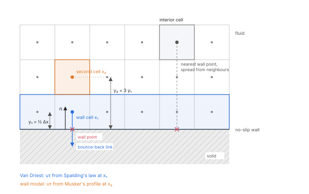
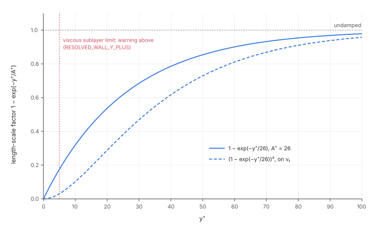
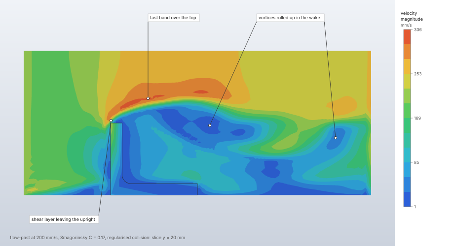
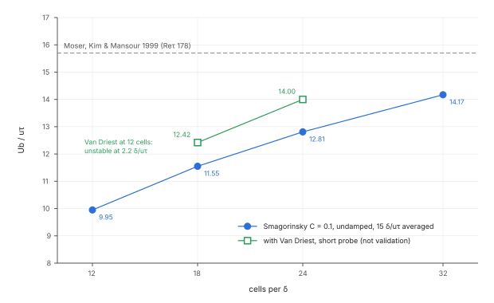

# Turbulence

A fluid step can add a subgrid eddy viscosity to the lattice Boltzmann flow: a large-eddy
simulation with Smagorinsky's model. The eddy viscosity of each cell follows from its own
non-equilibrium momentum flux in closed form, with no finite differences, and raises that cell's
relaxation time. Near no-slip walls the model can be damped with Van Driest's mixing length, or the
wall cells can be rebuilt from a law of the wall for grids that do not resolve the wall.

| | |
|---|---|
| **Commands** | `model.step.create` (`turbulence` of a `fluid` procedure), `solve.fluid` |
| **Step procedure** | `"fluid"` with `"turbulence": {"type": "smagorinsky", …}` |
| **Solver** | `crates/lbm` (CPU, f64); `crates/lbm-gpu` (GPU, f32) for the model and the wall model |
| **Method** | Smagorinsky 1963 with Hou et al.'s local relaxation time (1996); Van Driest damping (1956) with Spalding's law (1961); wall model of Malaspinas & Sagaut (2014) |
| **Verified by** | `crates/lbm/tests/turbulence.rs`, `crates/lbm/tests/mrt.rs`, `crates/lbm-gpu/tests/verification.rs`; Re_τ 180 channel study (docs/verification.md) |

## Synopsis

```json
{"name": "Flow", "procedure": {
  "type": "fluid", "domain": "Channel", "end_time": 2.0,
  "collision": "regularized",
  "turbulence": {"type": "smagorinsky", "constant": 0.1, "prandtl": 0.9, "van_driest": 26}
}}
```

`model.step.create` takes these fields; `solve.fluid` runs the step. The wall model replaces
`van_driest` with `"wall_model": "musker"` and is used with `"collision": "mrt"`
([Wall-modelled large-eddy simulation](../../lbm-wall-model.md)).

## Parameters

| Field | Value | Default | Meaning |
|---|---|---|---|
| `turbulence.type` | `"smagorinsky"` | required | The only subgrid model. Without `turbulence` the step has no eddy viscosity. |
| `turbulence.constant` | above 0, at most 0.5 | required | Smagorinsky's constant C. 0.1 to 0.2 is usual; 0.17 is Lilly's value for isotropic turbulence. |
| `turbulence.prandtl` | 0.1 to 10 | 0.9 | Turbulent Prandtl number Pr_t of the turbulent heat diffusivity ν_t / Pr_t (with heat only). 0.85 to 0.9 is usual for air and water. |
| `turbulence.van_driest` | 1 to 100 | none | Van Driest's A⁺: damps the length scale near no-slip walls. 26 is Van Driest's value. |
| `turbulence.wall_model` | `"musker"`, `"spalding_bounce"` | none | `"musker"` rebuilds each fluid cell next to a no-slip wall from Musker's profile, for a first cell above the viscous sublayer (y⁺ 30 to 100). `"spalding_bounce"` reflects the populations at plane no-slip box faces at rest and gives each wall the stress of Spalding's law at its wall cells' own velocity, exactly (Han, Ooka and Kikumoto 2021); a moving wall is refused. |
| `collision` | `"trt"`, `"regularized"`, `"mrt"`, `"hrr"` | `"trt"` | The model runs with every collision ([Collision operators](collision.md)); with `hrr` the finite-difference stress uses the cell's τ̄ with its eddy viscosity (CPU only). |

A value outside its range is refused when the step is set up, naming the range. With a
turbulence model the fluid's own symmetric relaxation time τ⁺ may go down to 0.5001
(`MIN_TAU_TURBULENT`); without one the floor is 0.505 and the refusal suggests adding `turbulence`.

## Theory

**Eddy viscosity.** Smagorinsky's model adds

```text
ν_t = (C Δx)² |S|,   |S| = √(2 S:S)
```

with the filter width the lattice spacing Δx and S the local strain-rate tensor. In lattice units
(Δx = Δt = 1, c_s² = ⅓) the non-equilibrium momentum flux of a cell is

```text
P = Σ_q c_q c_q f_q − ρ (c_s² I + u u) + ½ (u F + F u)  ≈  −2 ρ c_s² τ S
```

the flux Guo's forcing ties to the strain rate. The cell's relaxation time τ = τ₀ + 3 ν_t then
solves a quadratic (Hou et al. 1996), with |P| = √(P:P):

```text
τ = ½ (τ₀ + √(τ₀² + 18 √2 C² |P| / ρ))
```

so τ ≥ τ₀, with τ = τ₀ where the flow does not shear. The model is built on the regularised
collision's flux (Malaspinas & Sagaut 2012).

**Per collision.** With two relaxation times the symmetric rate takes the cell's τ and the
antisymmetric one follows, keeping Λ = (τ⁺ − ½)(τ⁻ − ½). The regularised collision relaxes its
rebuilt non-equilibrium part with the cell's τ. The multiple-relaxation-time collision replaces
the rate of its five stress moments with the cell's, as in Malaspinas & Sagaut's eqs. 47–48.

**Turbulent heat diffusivity.** With heat, each cell's turbulent diffusivity α_t = ν_t / Pr_t
(the Reynolds analogy) adds to the scalar lattice's relaxation time, τ_T = 4 (α + α_t) + ½; τ_T⁺
follows with Λ_T kept, and a cell on a single relaxation time stays on one
([Heat transfer](heat-transfer.md)).

**Van Driest damping.** Smagorinsky's eddy viscosity is largest where the shear is, at the wall,
where the turbulence it stands for is suppressed, so the wall friction comes out too high. Van
Driest's mixing length damps it over the viscous sublayer:

```text
l = C Δx (1 − exp(−y⁺/A⁺)),   y⁺ = y u_τ / ν
```



**Wall distance.** Every fluid cell with a no-slip bounce-back link is a wall cell; its wall lies
halfway along the link, and the nearest such point (an axis link first, then the lowest direction)
is its wall point and gives the wall's normal. Each other fluid cell takes the nearest wall point
of its 26 neighbours, spread outward in cell order until no distance shrinks (vector propagation,
Danielsson 1980): exact for plane walls, within a fraction of a cell elsewhere.

**Friction velocity.** Each wall cell's u_τ solves Spalding's law of the wall at its distance y,
from its speed parallel to the wall relative to the wall's own velocity:

```text
y⁺ = u⁺ + e^{−κB} (e^{κu⁺} − 1 − κu⁺ − (κu⁺)²/2 − (κu⁺)³/6),   κ = 0.4, B = 5.5
```

the sublayer u⁺ = y⁺ where the wall cell lies in it and the log law above. Every cell is damped
with the u_τ of the wall cell its wall point belongs to. A still flow over a still wall has
u_τ = 0, which damps the eddy viscosity fully.



**Wall model.** On a grid whose first cell lies above the viscous sublayer, the bounce-back cannot
carry the wall stress and damping cannot help. The wall model (`wall_model: "musker"`) samples the
velocity at the second cell off the wall, solves Musker's profile for u_τ there, and rebuilds every
population of the wall cell from the profile's velocity at the first cell, its density and its
regularised stress; the cell relaxes with a mixing-length eddy viscosity (κ = 0.384, A⁺ = 26) in
place of Smagorinsky's. The method, its parameters, its reported wall force and its validation are
in [Wall-modelled large-eddy simulation](../../lbm-wall-model.md).

## Algorithm

Each time step, before the collision:

1. **Damping** (`van_driest`). Each wall cell's u_τ is solved from Spalding's law, in parallel,
   each wall cell's its own: u⁺ y⁺(u⁺) = U y / ν is bracketed between 0 and √(U y / ν), started
   at the log law, and refined by Newton steps guarded by bisection, at most 100
   (`SPALDING_ITERATIONS`). A speed or a Reynolds number that is not a positive finite number
   gives u_τ = 0.
2. **Wall model** (`wall_model`). With `"musker"`, each wall cell whose second cell is fluid
   inside the box samples that cell's velocity and stores its modelled velocity and relaxation
   rate. A wall cell whose second cell is not fluid inside the box keeps the bounce-back alone.
   With `"spalding_bounce"`, each wall cell on a plane wall (its centre half a cell from it)
   takes the stress τ = ρ u_τ² along its own velocity parallel to the wall, u_τ the root of
   Spalding's law with κ 0.41 and B 5.5 (Han, Ooka and Kikumoto's constants) at y = ½ Δx, solved
   as for damping. Its wall links reflect specularly instead of bouncing back (no tangential
   momentum of their own; bounce-back at an edge or corner). After streaming, the two
   populations that point into the fluid diagonally along each tangential axis are shifted by
   ∓τ/2: the cell loses τ of momentum and no mass, and the wall's force takes τ.
3. **Collision.** For each fluid cell: the flux P from its populations; the cell's constant C,
   scaled by `1 − exp(−y⁺/A⁺)` with damping (taken as 1 from y⁺/A⁺ = 40, where it rounds to 1);
   the cell's rate from the closed form above, or the fluid's own rate where the result is not a
   finite number at least τ₀ (a zero or hostile flux or density); a modelled wall cell relaxes
   with its wall-model rate instead. The cell's ν_t = (τ − τ₀) / 3 is kept for the reply's
   maximum and, with heat, for the scalar lattice.
4. **Heat.** The scalar lattice collides each cell with τ_T raised by 4 ν_t / Pr_t.

The wall distances are spread once, when the flow is built. The spreading may lower each cell's
distance at most 64 times on average (`MAX_UPDATES_PER_CELL`); past that the run is refused with
`Limit` ("the wall distances did not settle"). Damping and the wall model build the wall cells
from the no-slip links only: slip faces have no friction and are left out.

If a damped run goes unstable, its error adds the largest first-cell y⁺, stating that the grid
does not resolve the wall when it is past y⁺ 5.

## Output

`solve.fluid` adds to its reply:

| Field | Meaning |
|---|---|
| `eddy_viscosity_ratio` | The largest ν_t / ν over the fluid cells in the last step (null without a turbulence model). Under the wall model it includes the wall cells' mixing-length viscosity. |
| `warnings` | With damping, a warning when the first cells off the walls reached y⁺ above 5 at the end of the run: the grid does not resolve the wall. |

The flow fields, wall forces, heat and the steady-state report are those of any fluid step
([Fluid results](fluid-results.md)). A turbulent flow never settles to a tolerance; the running
mean stop rule (`steady.averaging`) is described in [Steady state and
averaging](steady-state-and-averaging.md).

## Worked example

The `flow-past` sample (air past an L-bracket on the floor) with its inlet speed raised from
25 mm/s to 100 and 200 mm/s, solved with and without Smagorinsky's model. On the sample's 2.5 mm
grid the relaxation time falls toward ½ as the speed rises; the model decides whether the run is
accepted and whether it stays stable.

| | |
|---|---|
| **Geometry** | the upright L-bracket (60 × 40 × 50 mm, upright facing the inlet) on the floor of a 240 × 120 × 100 mm box |
| **Cells** | 2.5 mm: 184 320 (182 304 fluid) |
| **Fluid** | air, ρ = 1.2 kg/m³, μ = 1.8 × 10⁻⁵ Pa s |
| **Boundaries** | x_min velocity U, x_max pressure 0, floor no-slip, sides and top slip; initial velocity U |
| **Cases** | U = 100 mm/s (Re 333 on the 50 mm upright, τ = 0.509), 4 s; U = 200 mm/s (Re 667, τ = 0.5045), 2 s; both 3 200 steps, ten frames |
| **Turbulence** | none, or `{"type": "smagorinsky", "constant": C}` with C = 0.1 and 0.17 |
| **Collision** | `trt`, `regularized`, `mrt` |
| **Units** | mm, t, s, N, MPa |

The 200 mm/s case with C = 0.17 (the others change `velocity`, `initial_velocity`, `end_time`,
`collision` and `turbulence`, or leave `turbulence` out):

```json
[
  {"command": "file.sample", "params": {"name": "flow-past"}},
  {"command": "model.fluid_domain.edit", "params": {"name": "Wind", "material": "Air",
    "min": [-60, -40, 0], "max": [180, 80, 100], "spacing": 2.5,
    "faces": {"x_min": {"type": "velocity", "velocity": [200, 0, 0]}, "x_max": {"type": "pressure", "pressure": 0},
              "y_min": {"type": "slip"}, "y_max": {"type": "slip"}, "z_min": {"type": "wall"}, "z_max": {"type": "slip"}},
    "obstacles": ["Bracket"], "initial_velocity": [200, 0, 0]}},
  {"command": "model.step.edit", "params": {"name": "Flow", "procedure": {"type": "fluid", "domain": "Wind",
    "end_time": 2, "frames": 10, "collision": "regularized",
    "turbulence": {"type": "smagorinsky", "constant": 0.17}}}},
  {"command": "solve.fluid", "params": {"backend": "cpu"}},
  {"command": "results.slice", "params": {"field": "velocity", "axis": "y", "position": 20}},
  {"command": "results.streamlines", "params": {"show": false}}
]
```

Results from the `solve.fluid` replies (Apple M4 Max, CPU; each completed run 9–16 s). The drag is
the x component of the bracket's face forces summed, `mean` over the last quarter of the run;
`eddy_viscosity_ratio` is the largest ν_t / ν in the last step.

**U = 200 mm/s, regularised collision:**

| Turbulence | Outcome | `eddy_viscosity_ratio` | Drag (mean) | `max_speed` | `mass.relative_change` |
|---|---|---|---|---|---|
| none | refused: "the relaxation time τ = 0.50450 is below 0.505: the grid cannot resolve viscosity 0.000015 at this time step (cell Reynolds number 33.3); … or add a turbulence model (`turbulence`)" | — | — | — | — |
| C = 0.1 | completed | 0.980 | 1.00056 × 10⁻⁴ N | 443.8 mm/s | −1.94 × 10⁻³ |
| C = 0.17 | completed | 1.837 | 9.9395 × 10⁻⁵ N | 414.4 mm/s | −1.70 × 10⁻³ |

Both completed runs carry the warning that τ = 0.5045 is below 0.508, where even the regularised
collision went unstable on a coarse bluff-body grid.

**U = 100 mm/s:**

| Collision | Turbulence | Outcome | `eddy_viscosity_ratio` | Drag (mean) |
|---|---|---|---|---|
| `trt` | none | unstable at time step 668 | — | — |
| `trt` | C = 0.1 | unstable at time step 837 | — | — |
| `trt` | C = 0.17 | completed; warnings: τ = 0.5090 close to ½, density varies by 30.6 % | 2.856 | 2.2099 × 10⁻⁵ N |
| `regularized` | none | completed | — | 2.4658 × 10⁻⁵ N |
| `regularized` | C = 0.1 | completed | 0.318 | 2.4909 × 10⁻⁵ N (+1.0 %) |
| `regularized` | C = 0.17 | completed | 0.920 | 2.5358 × 10⁻⁵ N (+2.8 %) |
| `mrt` | C = 0.17 | unstable at time step 130 (lattice speed 0.509) | — | — |



**What to look at.** At 200 mm/s the fluid's own τ⁺ = 0.5045 is below the 0.505 floor and the
step is refused; with the model the floor is 0.5001 (`MIN_TAU_TURBULENT`) and the run completes.
The eddy viscosity scales with C²: from C = 0.1 to 0.17 its largest ratio rises 1.9 times
(0.98 → 1.84, against 2.9 times for C²), the peak
speed falls 7 % and the mean drag moves by 0.7 %. At 100 mm/s with the two-relaxation-time
collision the model is what keeps the run stable: C = 0.1 only delays the instability (step 837
against 668), C = 0.17 holds it, at a peak ν_t/ν of 2.9 and with the reply's warning of a 30.6 % density
variation (the weakly compressible error). With the regularised collision the same flow is stable without a model,
and the model adds viscosity to the laminar wake, raising the drag by 1.0 % and 2.8 %: the eddy
viscosity acts wherever the flow shears, laminar flow included. This grid does not resolve the
wall (the floor's first cell is 1.25 mm off it), so no damping is used; a wall-modelled channel
is in [Wall-modelled large-eddy simulation](../../lbm-wall-model.md).

## Verification

**Theory** (`crates/lbm/tests/turbulence.rs`, `crates/lbm/tests/mrt.rs`; CPU, every run):

| Case | Reference | Result | Tolerance | Test |
|---|---|---|---|---|
| Plane Couette, 16 cells, C = 0.4 (ν_t/ν > 0.05), TRT and regularised | uniform ν_t = (C Δx)² U/h, linear profile, wall shear ρ (ν + ν_t) U/h | profile, shear and ν_t/ν within tolerance | profile 2e-3 of U; wall shear 0.2 %; ν_t/ν 0.2 % (regularised), 20 % (TRT: the cells next to the walls read a little more flux) | `couette_flow_takes_the_smagorinsky_viscosity_of_its_shear` |
| The same, MRT | the same | within tolerance | wall shear 0.2 %; ν_t/ν 2 % | `smagorinsky_couette_flow_takes_the_closed_form_eddy_viscosity` |
| Simple shear, the closed form alone | ν₀ + C² γ | exact | 1e-12 | `turbulence::tests::simple_shear_gets_the_smagorinsky_viscosity` |
| Plane Poiseuille, C = 0.4, 8 → 64 cells | the laminar parabola; the eddy viscosity's error falls like Δx² | observed orders TRT 1.970, 1.993, 1.998; regularised 1.839, 1.906, 1.950 | each above 1.8, the last within 0.06 of 2 | `with_the_model_on_poiseuille_converges_to_the_laminar_profile_like_dx_squared` |
| Taylor–Green vortex, C = 0.4, 16 → 64 cells | the laminar decay | second order | above 1.8 | `with_the_model_on_taylor_green_approaches_the_laminar_decay_to_second_order` |
| Heated Couette, C = 0.4, Pr_t = 0.9 | steady drop q h / (ρ c (α + α_t)), α_t = ν_t / Pr_t | within tolerance | 0.2 % | `heated_couette_flow_conducts_with_the_turbulent_diffusivity` |
| Lid-driven cavity 48², Re 5000 (cell Reynolds number 104, τ⁺ = 0.5029) | refused without a model; stable with one | refused without; C = 0.17 stable over 4000 steps | — | `the_closure_holds_a_cavity_too_fast_for_the_lattice_alone` |
| Couette at h⁺ = 10, A⁺ = 26 (damping) | wall distances exactly the half-cell offsets; largest ν_t/ν the undamped value times the factor squared at the farthest cell (y⁺ ≈ 4.7, factor 0.165) | within tolerance | ν_t/ν 2 % (regularised), 20 % (TRT); first-cell y⁺ 1 %; wall shear the laminar one within 0.2 % | `van_driest_damping_scales_couette_flow_s_eddy_viscosity_by_the_wall_factor` |
| Pipe of radius 1, 8 cells per radius (wall distance) | R − r | within 0.75 cell (staircase) | 0.75 cell | `wall_distances_in_a_pipe_follow_its_radius` |
| Couette, 4 cells, first cell at y⁺ ≈ 12, damped | the unresolved-wall warning | warned; undamped and resolved grids not | — | `damping_on_a_wall_the_grid_does_not_resolve_is_warned_about` |
| Wall-function bounce (`spalding_bounce`), perturbed coarse channel, 40 steps, every collision | the walls carry the sampled stress; momentum budget P(t + 1) − P(t) = a M − F; Spalding's law; mass | to round-off | 3e-15, 3e-14, 3e-14, 4e-14 | `the_wall_function_bounce_gives_the_walls_exactly_the_law_s_stress` |
| Wall-function bounce on a moving wall | refused, naming the face | refused | — | `the_wall_function_bounce_refuses_a_moving_wall` |
| Damped and wall-modelled cavity, 1, 3 and 7 threads | bit-for-bit equality | equal | exact | `damped_results_are_bit_for_bit_the_same_on_one_and_many_threads`, `wall_modelled_results_are_bit_for_bit_the_same_on_one_and_many_threads` |

**GPU against CPU** (`crates/lbm-gpu/tests/verification.rs`, every collision and both streaming
layouts): Couette with the model on, velocity within 1e-4, wall shear within 2e-4 and ν_t/ν within
5e-4 of the CPU's (`couette_flow_with_smagorinsky_matches_the_cpu`); forced Poiseuille, velocity
within 2e-5 (`forced_poiseuille_with_smagorinsky_matches_the_cpu`); heated Couette, temperature and
wall heat within 3e-4 (`heated_couette_flow_with_smagorinsky_matches_the_cpu`); the Re 5000 cavity
over 1000 steps, ν_t/ν within 1e-3 (`a_cavity_held_by_the_closure_follows_the_cpu`). Van Driest
damping in a coarse three-dimensional channel (6 cells per half-height, perturbed, 150 steps), on
bounce-back walls and under the wall model: velocity within 1e-4 of the largest speed, density
within 1e-5, ν_t/ν and the wall cells' largest y⁺ within 1e-3 of the CPU's (measured on an NVIDIA
GB10: velocity up to 5.6e-6, ν_t/ν up to 1.2e-4, y⁺ up to 6.3e-6;
`a_coarse_channel_with_van_driest_damping_follows_the_cpu`). The wall-function bounce with
Van Driest damping in the same channel: the same tolerances, and the walls' drag within 1e-3 of
the CPU's (measured: velocity up to 3.1e-6, drag up to 3.5e-6;
`a_coarse_channel_with_the_wall_function_bounce_follows_the_cpu`). On the GPU the shift of the
reflected populations is applied as link streaming writes them (`bounce_shift`), the stress
sampled before the collision (`bounce_sample`).

**Benchmark: Re_τ 180 channel** (a long study, run by hand; docs/verification.md, "Long studies").
C = 0.1, regularised collision, channel 2πδ × 2δ × πδ driven by u_τ²/δ, 10 δ/u_τ of start-up
discarded and 15 averaged. Reference: Moser, Kim & Mansour (1999), Re_τ = 178: U_b/u_τ ≈ 15.7,
U_c/u_τ ≈ 18.3, C_f ≈ 8.18 × 10⁻³. Recorded on Windows x86_64 (PR #668), undamped:

| cells per δ | y⁺ per cell | U_b/u_τ | U_c/u_τ | C_f |
|---|---|---|---|---|
| 12 | 15.0 | 9.95 (−36.6 %) | 13.07 (−28.6 %) | 2.02e-2 |
| 18 | 10.0 | 11.55 (−26.4 %) | 14.42 (−21.2 %) | 1.50e-2 |
| 24 | 7.5 | 12.81 (−18.4 %) | 15.60 (−14.8 %) | 1.22e-2 |
| 32 | 5.6 | 14.17 (−9.8 %) | 17.00 (−7.1 %) | 9.96e-3 |



None of these grids is within a tolerance of the reference. The bulk speed approaches it
monotonically as the first cell moves toward the viscous sublayer; without damping the eddy
viscosity is too large in the first cells, so the friction is too high. The heavy CI job runs the
12-cell grid with the full protocol and checks it stays turbulent and within 3 % of the recorded
means (`a_coarse_channel_at_re_tau_180_stays_turbulent_with_the_study_s_means`); the flow is
chaotic, so the means move with the platform (9.90 and 12.95 on macOS aarch64). With
`van_driest: 26` short probes (5 δ/u_τ discarded, 1 averaged) gave U_b/u_τ 12.42 at 18 cells per δ
and 14.00 at 24, and the 12-cell grid went unstable at 2.2 δ/u_τ: at Re_τ 180 none of these grids
resolves the wall (Δy⁺ = 180 / N), and damping is meant for a first cell at y⁺ ≈ 1–2.

**Wall model.** The wall-modelled channel against Lee & Moser (2015) and Dean (1978) is recorded in
docs/verification.md and summarised in [Wall-modelled large-eddy simulation](../../lbm-wall-model.md).

## Limitations

- Smagorinsky's model with a constant C is the only subgrid model; the filter width is the lattice
  spacing.
- The model adds viscosity wherever the flow shears, laminar flow included: a laminar answer is
  reached only as the grid is refined, the eddy viscosity falling like Δx².
- Damping is meant for a wall resolved to y⁺ ≈ 1–2 at the first cell. Above y⁺ 5 the run warns,
  and on a coarse grid removing the eddy viscosity at the wall can make the run unstable.
- One wall point per cell (the nearest). The wall-distance spreading does not cross periodic
  faces, so near one a distance may come out longer than across it.
- No grid of the Re_τ 180 study reaches the reference: the bulk speed is 9.8 % low at 32 cells
  per δ, and that grid had not settled. Each grid is one realisation; no confidence interval is
  stated.
- A turbulent case stopping on its running mean has not been run; the stop rule is shown on
  laminar vortex shedding.

## Implementation

- `crates/lbm/src/turbulence.rs`: `flux` (the non-equilibrium flux P), `omega` (the cell's rate
  from Hou et al.'s closed form).
- `crates/lbm/src/wall.rs`: `Walls` (wall cells, wall distances, `refresh` of u_τ, `factor`,
  `sample` and `reconstruct` for the wall model), `friction_velocity` (Spalding), `musker`,
  `wall_law`, `unresolved_wall`.
- `crates/lbm/src/flow.rs`: `Flow::collide` (the rate per cell for each collision),
  `collide_thermal` (α_t), `refresh_damping`, `sample_walls`, `eddy_viscosity_ratio`.
- `crates/lbm/src/regularized.rs`, `crates/lbm/src/mrt.rs`: the collisions' use of the cell's rate.
- `crates/lbm/src/setup.rs`: `MAX_SMAGORINSKY`, `TURBULENT_PRANDTL`, `VAN_DRIEST`,
  `MIN_TAU_TURBULENT`, and the step's checks.
- `crates/lbm-gpu/src/lbm.wgsl`: `smagorinsky_omega`, `collide_trt_smagorinsky`, `wall_omega`,
  behind the override constants `SMAGORINSKY` and `WALL_MODEL`.
- `crates/model/src/steps.rs`: `Turbulence`, `WallModel`.

## References

- J. Smagorinsky. *General circulation experiments with the primitive equations.* Mon. Weather Rev. 91(3):99–164, 1963. doi:[10.1175/1520-0493(1963)091<0099:GCEWTP>2.3.CO;2](https://doi.org/10.1175/1520-0493(1963)091%3C0099:GCEWTP%3E2.3.CO;2)
- S. Hou, J. Sterling, S. Chen, G. D. Doolen. *A lattice Boltzmann subgrid model for high Reynolds number flows.* Fields Inst. Commun. 6:151–166, 1996. doi:[10.1090/fic/006/12](https://doi.org/10.1090/fic/006/12)
- O. Malaspinas, P. Sagaut. *Consistent subgrid scale modelling for lattice Boltzmann methods.* J. Fluid Mech. 700:514–542, 2012. doi:[10.1017/jfm.2012.155](https://doi.org/10.1017/jfm.2012.155)
- O. Malaspinas, P. Sagaut. *Wall model for large-eddy simulation based on the lattice Boltzmann method.* J. Comput. Phys. 275:25–40, 2014. doi:[10.1016/j.jcp.2014.06.020](https://doi.org/10.1016/j.jcp.2014.06.020)
- E. R. Van Driest. *On turbulent flow near a wall.* J. Aeronaut. Sci. 23(11):1007–1011, 1956. doi:[10.2514/8.3713](https://doi.org/10.2514/8.3713)
- D. B. Spalding. *A single formula for the "law of the wall".* J. Appl. Mech. 28(3):455–458, 1961. doi:[10.1115/1.3641728](https://doi.org/10.1115/1.3641728)
- P. Moin, J. Kim. *Numerical investigation of turbulent channel flow.* J. Fluid Mech. 118:341–377, 1982. doi:[10.1017/S0022112082001116](https://doi.org/10.1017/S0022112082001116)
- P.-E. Danielsson. *Euclidean distance mapping.* Comput. Graph. Image Process. 14(3):227–248, 1980. doi:[10.1016/0146-664X(80)90054-4](https://doi.org/10.1016/0146-664X(80)90054-4)
- M. Han, R. Ooka, H. Kikumoto. *A wall function approach in lattice Boltzmann method: algorithm and validation using turbulent channel flow.* Fluid Dyn. Res. 53:045506, 2021. doi:[10.1088/1873-7005/ac1782](https://doi.org/10.1088/1873-7005/ac1782)
- A. J. Musker. *Explicit expression for the smooth wall velocity distribution in a turbulent boundary layer.* AIAA J. 17(6):655–657, 1979. doi:[10.2514/3.61193](https://doi.org/10.2514/3.61193)
- U. Piomelli, E. Balaras. *Wall-layer models for large-eddy simulations.* Annu. Rev. Fluid Mech. 34:349–374, 2002. doi:[10.1146/annurev.fluid.34.082901.144919](https://doi.org/10.1146/annurev.fluid.34.082901.144919)
- R. D. Moser, J. Kim, N. N. Mansour. *Direct numerical simulation of turbulent channel flow up to Re_τ = 590.* Phys. Fluids 11:943–945, 1999.
- M. Lee, R. D. Moser. *Direct numerical simulation of turbulent channel flow up to Re_τ ≈ 5200.* J. Fluid Mech. 774:395–415, 2015. doi:[10.1017/jfm.2015.268](https://doi.org/10.1017/jfm.2015.268)
