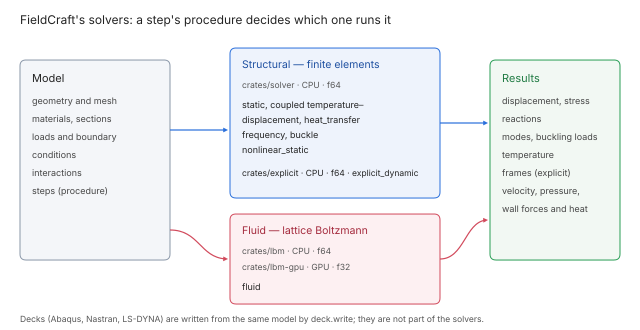

# Solver manual

This manual describes every analysis FieldCraft solves with its own solvers: what each one
computes, the equations and algorithms behind it, its parameters and output, how it is verified
and where its limits are. Each page follows the same order: synopsis, parameters, theory,
algorithm, output, verification, limitations, implementation and references.

## Analyses

A step's procedure decides which solver runs it. `solve.run` solves every step in order; each
`solve.*` command solves one.

| Procedure | Command | Solver | Precision | Page |
|---|---|---|---|---|
| `static` | `solve.static` | Sparse direct, `crates/solver` | f64, CPU | [Linear static](structural/linear-static.md) |
| `coupled_temperature_displacement` | `solve.static` | Sparse direct, `crates/solver` | f64, CPU | [Heat transfer](structural/heat-transfer.md) |
| `frequency` | `solve.frequency` | Eigenvalue solver, `crates/solver` | f64, CPU | [Natural frequencies](structural/frequency.md) |
| `buckle` | `solve.buckle` | Eigenvalue solver, `crates/solver` | f64, CPU | [Linear buckling](structural/buckling.md) |
| `heat_transfer` | `solve.heat` | Sparse direct, `crates/solver` | f64, CPU | [Heat transfer](structural/heat-transfer.md) |
| `nonlinear_static` | `solve.nonlinear` | Newton iterations, `crates/solver` | f64, CPU | [Nonlinear static](structural/nonlinear-static.md) |
| `explicit_dynamic` | `solve.explicit` | Central differences, `crates/explicit` | f64, CPU | [Explicit dynamics](structural/explicit-dynamics.md) |
| `fluid` | `solve.fluid` | Lattice Boltzmann, `crates/lbm`, `crates/lbm-gpu` | f64 on the CPU, f32 on the GPU | [Lattice Boltzmann flow](fluid/lattice-boltzmann.md) |

The structural pages that apply to several procedures: [elements](structural/elements.md),
[materials](structural/materials.md), [contact](structural/contact.md),
[constraints and connectors](structural/constraints-and-connectors.md) and
[linear solvers](structural/linear-solvers.md). The fluid pages: [collision
operators](fluid/collision.md), [boundary conditions](fluid/boundary-conditions.md),
[turbulence](fluid/turbulence.md), [large-eddy simulation](fluid/les.md), [heat
transfer](fluid/heat-transfer.md), [fans and vents](fluid/fans-and-vents.md), [steady state and
averaging](fluid/steady-state-and-averaging.md), [the GPU backend](fluid/gpu.md) and [fluid
results](fluid/fluid-results.md).

## Conventions

- **Units.** The model, the solvers and their results are in SI. Command parameters, replies,
  forms and decks convert through the model's display units ([Units](../units.md)).
- **Determinism.** The same model gives the same result bit for bit on every platform for the CPU
  solvers, whatever the thread count. The GPU backend is deterministic on a given device and is
  checked against the CPU within a stated tolerance.
- **Bounded work.** Every iterative algorithm has explicit caps on iterations, increments and size,
  and reports when it stops early. A solve that cannot proceed returns an error that names the
  cause and leaves the model unchanged.
- **Verification.** Every capability is checked three ways: against theory (closed-form solutions
  and patch tests), against experiments, and against published benchmarks. Once a result matches
  its reference within the stated tolerance it is frozen as a fixture, so a later change that moves
  it fails CI ([Verification and validation](../verification.md), [Oracle results](../oracle.md)).
- **Sources.** Every method is implemented from the published papers each page cites, collected
  in [the solver literature](../solvers/literature.md).
