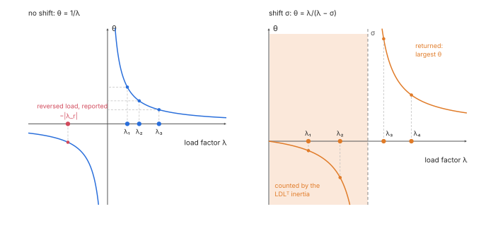
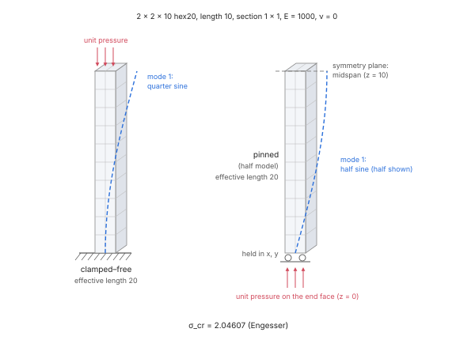
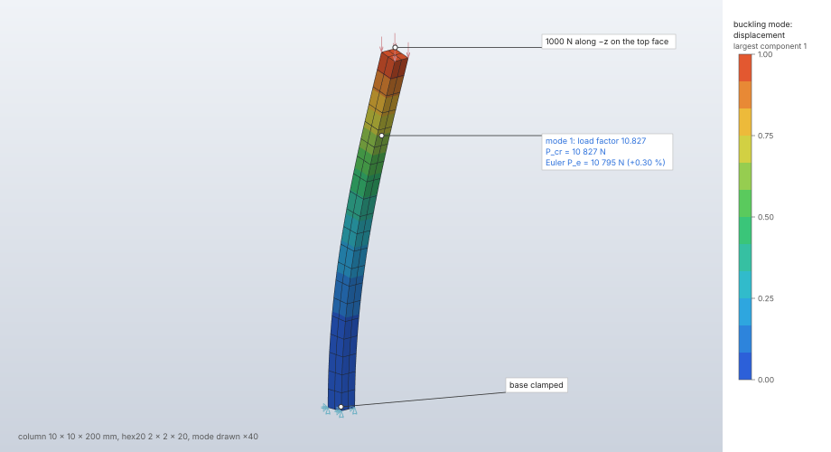

# Linear buckling

`solve.buckle` computes the load factors λ at which the loads of a step, applied as a linear
preload, make the structure lose stiffness, (K + λ K_σ) φ = 0, and the buckling mode shapes φ.
The step is solved as a linear static step first; the preload's stresses form the
initial-stress stiffness K_σ of every solid and 2D element; the lowest positive load factors, or
those above a given shift, come from the block Lanczos method in the buckling spectral
transformations.

| | |
|---|---|
| **Commands** | `solve.buckle` (and `solve.run`); `solve.probe` (`mode`), `results.modes` |
| **Step procedure** | `{"type": "buckle", "modes", "shift"}` |
| **Solver** | `crates/solver` (CPU, f64): Cholesky without a shift, LDLᵀ with one |
| **Method** | linearised buckling (Bathe 2014, §6.8.2); buckling transformations of the shifted block Lanczos method (Grimes, Lewis & Simon 1994, §3) |
| **Verified by** | `buckle-euler-cantilever`, `buckle-euler-pinned`, `buckle-plate-square`; `crates/solver/tests/buckle.rs`, `analysis::tests` |

## Synopsis

```json
[
  {"command": "model.load.create", "params": {"name": "press", "type": "pressure", "set": "top", "magnitude": 1}},
  {"command": "model.step.create", "params": {"name": "Buckle", "procedure": {"type": "buckle", "modes": 4},
    "boundary_conditions": ["base"], "loads": ["press"]}},
  {"command": "solve.buckle", "params": {"step": "Buckle"}}
]
```

The first `load_factor` in the reply times the applied loads is the critical load.

## Parameters

### The step

| Field | Value | Default | Meaning |
|---|---|---|---|
| `modes` | 1 to 100 000 | — | the number of load factors and modes |
| `shift` | finite | none | without it, the lowest positive load factors; with it, those nearest above it (a negative shift sets no lower bound) |
| `boundary_conditions` | names | none | their prescribed values act in the preload; held at zero in the eigenproblem |
| `loads` | names | none | the preload; temperature loads strain it thermally |

### `solve.buckle`

| Field | Value | Default | Meaning |
|---|---|---|---|
| `step` | step name | the only buckling step | |
| `max_dofs` | 1 to 6 000 000 | 6 000 000 | may only be lowered |
| `max_factor_entries` | 1 to 2 000 000 000 | 400 000 000 | factor entries, also bounding the Lanczos basis ([Linear solvers](linear-solvers.md#memory-limits)) |
| `max_iterations` | 1 to 3000 | 3000 | cap on the Lanczos vectors; may only be lowered |
| `threads` | 1 to 256 | the session's | changes the time, never the result |

## Theory

A preload state of stress σ⁰ from loads P stiffens or softens the structure through the
initial-stress (geometric) stiffness; scaling the loads by λ scales it, and the structure buckles
where the total tangent becomes singular (Bathe 2014, §6.8.2):

```text
(K + λ K_σ) φ = 0,   K_σ = ∫ (∇N_a · σ⁰ ∇N_b) I dV
```

K_σ is formed from the preload's stresses at each element's stiffness integration points
(`Solid::geometric_stiffness`, `Plane::geometric_stiffness`, with the axisymmetric hoop term).
Pressures are dead loads: the load stiffness of a follower pressure is not part of K_σ.

K is positive definite for a supported structure, while K_σ is indefinite. The eigenproblem is
solved in the K inner product (Grimes, Lewis & Simon 1994, §3):

- **Without a shift**, the operator K⁻¹(−K_σ) has eigenvalues θ = 1/λ: the lowest positive
  load factors are its largest positive θ, well separated, and K is factored by Cholesky.
  Converged negative θ are the load factors of the reversed load, reported apart.
- **With a shift σ ≠ 0**, the buckling spectral transformation (K + σ K_σ)⁻¹ K has
  θ = λ/(λ − σ), largest for the load factors nearest above σ. K + σ K_σ is indefinite once σ
  passes the first load factor and is factored by LDLᵀ, whose inertia (Sylvester's law) counts
  the load factors between 0 and σ, so none is missed silently. Each solve with it is refined
  iteratively against K + σ K_σ (at most two steps; Higham 2002, §12.2).

Modes are scaled to a largest component of 1 (positive).





## Algorithm

1. **Select and check.** The step named, or the only buckling step; `modes` 1 to 100 000 and a
   finite shift are checked; a model with contact is refused. Trusses, shells and beams are
   refused by name ("their initial-stress stiffness is not implemented").
2. **Preload.** The step solved as a [linear static](linear-static.md) step on the same mesh: its
   loads, prescribed motions and temperature loads (heat loads have no effect, with a warning);
   its warnings carry over.
3. **Matrices.** K assembled as for static; K_σ assembled from the preload's integration-point
   stresses, element by element in parallel, added in label order. Both reduced with every
   boundary condition held at zero. Every unknown held: "every degree of freedom is held; there
   is nothing to buckle". A K_σ that is zero: "step `name` puts no stress into the model, so
   nothing can buckle (give it loads)".
4. **Factor.** Without a shift, K by Cholesky (an unsupported structure is the located
   singular-stiffness error). With a shift, K + σ K_σ by LDLᵀ; a singular one is "the shift σ is
   a buckling load factor (K + σ K_σ is singular); move it a little"; a nonzero count of negative
   pivots adds the warning "N buckling load factor(s) lie between 0 and the shift σ; the modes
   returned are those above it".
5. **Lanczos** as for [natural frequencies](frequency.md#algorithm): block size 6, full
   reorthogonalization, relative residual 10⁻⁹, the basis capped by `max_iterations` and by
   `max_factor_entries` / (2 n). Without a shift, positive θ give the load factors and the
   converged negative θ the reversed-load factors; with a positive shift the load factors returned
   are those above σ.
6. **Modes.** Each scaled to a largest component of 1 and expanded to every node. Fewer than
   `modes` found: "found k of the N buckling modes asked for". A negative load factor found:
   "the reversed load buckles too: negative load factor λ (and k more found)".

## Output

| Key | Meaning |
|---|---|
| `step`, `dofs`, `equations`, `lanczos_vectors` | as for frequency steps |
| `modes` | per mode: `mode` (from 1), `load_factor` λ |
| `buckling` | `negative`: converged negative load factors, nearest to zero first (without a shift only); `shift` and `below_shift` (the count of load factors between 0 and the shift) with a shift |
| `warnings` | the preload's warnings and those above |

The result is stored as a frequency result whose eigenvalues are load factors (frequency,
participation and total mass zero): `solve.probe` with `mode` gives the shape, and the modes
display like frequency modes.

A buckling mode can seed a geometric imperfection of a nonlinear static step:
`"imperfection": {"step": "Buckle", "mode": 1, "scale": 0.01}` solves this step first and adds
the mode, scaled to a largest component of `scale`, to the node coordinates; the step is solved
and reported on that geometry, with a warning naming the mode ([Nonlinear
static](nonlinear-static.md)).

**Decks.** Abaqus writes a buckling step as `*BUCKLE, EIGENSOLVER=LANCZOS`, and refuses one after
a general step (Abaqus would buckle from that step's loaded state) and one with a shift; Nastran
SOL 105 and LS-DYNA refuse it by name. Abaqus and LS-DYNA decks refuse an imperfection by name
(their imperfection reads a results file).

## Worked example

A steel column of square section, clamped at its base and free at its top, under an axial end
force: Euler's clamped–free column, whose critical load is π² E I / (4 L²). The square section
buckles equally in its two planes, so each load factor comes as a pair.

| | |
|---|---|
| **Geometry** | 200 mm along z, 10 × 10 mm section; one block (`mesh.block`), faces `base` (z = 0) and `top` (z = 200) |
| **Mesh** | 80 hex20 (2 × 2 × 20), 621 nodes, 1 863 unknowns (1 800 free) |
| **Material** | steel: E = 210 000 MPa, ν = 0.3 |
| **Boundary conditions** | `base` fixed |
| **Load** | 1 000 N along −z on `top` (`force`, the total spread by area) |
| **Step** | buckle, `modes` 4, no shift |
| **Units** | mm, t, s, N, MPa |

```json
[
  {"command": "model.units", "params": {"system": "mm-t-s-N-MPa"}},
  {"command": "mesh.block", "params": {"body": "Column", "kind": "hex20",
    "corners": [[0,0,0],[10,0,0],[10,10,0],[0,10,0],[0,0,200],[10,0,200],[10,10,200],[0,10,200]],
    "divisions": [2, 2, 20], "faces": {"1": "base", "2": "top"}}},
  {"command": "model.set.create", "params": {"name": "all", "geometry": [{"body": "Column"}]}},
  {"command": "model.set.create", "params": {"name": "base", "geometry": [{"body": "Column", "face": "base"}]}},
  {"command": "model.set.create", "params": {"name": "top", "geometry": [{"body": "Column", "face": "top"}]}},
  {"command": "model.material.create", "params": {"name": "Steel", "elastic": {"type": "isotropic", "young": 210000, "poisson": 0.3}}},
  {"command": "model.section.create", "params": {"name": "Column", "set": "all", "material": "Steel", "kind": {"type": "solid"}}},
  {"command": "model.boundary_condition.create", "params": {"name": "Clamp", "type": "fixed", "target": {"set": "base"}}},
  {"command": "model.load.create", "params": {"name": "Press", "type": "force", "target": {"set": "top"}, "vector": [0, 0, -1000]}},
  {"command": "model.step.create", "params": {"name": "Buckle",
    "procedure": {"type": "buckle", "modes": 4}, "boundary_conditions": ["Clamp"], "loads": ["Press"]}},
  {"command": "solve.buckle", "params": {"step": "Buckle"}},
  {"command": "results.modes", "params": {"step": "Buckle", "mode": 1}},
  {"command": "results.contour", "params": {"step": "Buckle", "field": "displacement"}},
  {"command": "results.deformed", "params": {"step": "Buckle", "show": true, "scale": 40}}
]
```

Results from the `solve.buckle` reply (54 Lanczos vectors, under 0.05 s, Apple M4 Max, CPU); the
critical load is the load factor times 1 000 N. P_e = π² E I / (4 L²) is Euler's load, and
P = P_e / (1 + P_e/(κ G A)) with κ = 5/6 adds Engesser's shear correction (Timoshenko & Gere
1961, §2.1, §2.17); the second buckling load of the clamped–free column is 9 P_e.

| Quantity | FieldCraft | Reference | Difference |
|---|---|---|---|
| Load factors 1, 2 | 10.8270043, 10.8270043 | — | equal to 2 · 10⁻¹⁰ |
| First critical load | 10 827.0 N | P_e = 10 794.9 N; with shear 10 777.6 N | +0.30 %; +0.46 % |
| Second critical load (load factors 3, 4: 95.9133, 95.9133) | 95 913.3 N | 9 P_e with shear: 95 771.5 N | +0.15 % |
| `buckling.negative` | none | none (a compressive load) | — |
| First critical load, ν = 0 (same mesh) | 10 776.7 N | with shear: 10 781.6 N | −0.05 % |



**What to look at.** The first mode is the quarter sine wave of Euler's column, zero slope at the
clamp and the largest sway at the free top; the mode is scaled to a largest component of 1 and
drawn 40 times. The two first load factors agree to ten digits: the square section has no
preferred plane, and the block Lanczos iteration finds the repeated pair together. The critical
load sits 0.46 % above the shear-corrected Euler load at ν = 0.3 and 0.05 % below it at ν = 0:
the fixed base face also holds the section's Poisson expansion under the preload, which stiffens
the column slightly. The verification case `buckle-euler-cantilever` uses ν = 0.

## Verification

| Case | Reference | Error | Tolerance | Test |
|---|---|---|---|---|
| Clamped–free column, hex20 2 × 2 × 10, unit end pressure | theory: Euler with Engesser's shear correction P = P_e/(1 + P_e/(κ G A)), κ = 5/6 (Timoshenko & Gere 1961, §2.1, §2.17), σ_cr = 2.046071 | −0.181 % | 0.5 % | `buckle-euler-cantilever` |
| Pinned column (half, symmetry at midspan) | theory, as above | −0.179 % | 0.5 % | `buckle-euler-pinned` |
| Simply supported square plate in uniaxial compression, quarter of 10 × 10 × 2 hex20, b/t = 100 | theory: Bryan, σ_cr = 4π²E/(12(1 − ν²)) (t/b)² = 0.361524 (Timoshenko & Gere 1961, §9.2) | −0.386 % | 1 % | `buckle-plate-square` |
| Euler columns; the square section's two planes; mode scaling | theory | < 0.5 %; second load factor equal to the first to 10⁻⁶; largest component 1 to 10⁻¹² | as stated | `euler_columns` |
| Shift between the first and higher modes | the unshifted solution | `below_shift` = 2; the first mode above the shift equals the unshifted third to 10⁻⁷ | exact count | `euler_columns` |
| Imperfection from the first mode under half the buckling load | theory: added deflection δ₀ α/(1 − α) (Timoshenko & Gere 1961, §1.12) | 2.8 % | 5 % | `an_imperfection_from_the_buckling_mode` |
| Preload equals the static solution with loads, prescribed motion and temperature, on 1 and 3 threads | static solve | bit for bit | exact | `buckling_preloads_match_static_with_loads_motion_and_temperature` |
| Refusals: no load, unsupported model, invalid modes and shift; caps and cancellation | — | located errors | — | `buckling_steps_refuse_what_they_cannot_do`, `buckling_preload_keeps_limits_and_cancellation` |

## Limitations

- Trusses, shells and beams are refused: they have no initial-stress stiffness yet.
- Linearised buckling about the undeformed state: the preload is linear, pressures are dead loads
  (no load stiffness), and material nonlinearity is left out (plastic materials take their
  elastic constants, with a warning).
- Contact is refused.
- Negative load factors are reported, not returned as modes, and only without a shift.

## Implementation

| File | Contents |
|---|---|
| `crates/engine/src/cmd/solve.rs` | `BUCKLE` spec, `run_buckle` |
| `crates/solver/src/buckle.rs` | `solve_buckle`, the `Plain` and `Shifted` operators, `Buckling` |
| `crates/solver/src/analysis.rs` | `static_on` (the preload), `assemble`, `reduction`, `factor_symmetric`, `lanczos_basis` |
| `crates/solver/src/eigen.rs` | `lanczos` with the operator's `operand` and `eigenvalue` |
| `crates/solver/src/ldlt.rs` | `Symmetric`, `Kind`, inertia, `solve_refined` |
| `crates/fem/src/finite.rs`, `plane.rs` | `geometric_stiffness` of solids and 2D elements |

## References

- K.-J. Bathe. *Finite Element Procedures*, 2nd ed., 2014.
- R. G. Grimes, J. G. Lewis, H. D. Simon. *A shifted block Lanczos algorithm for solving sparse symmetric generalized eigenproblems.* SIAM J. Matrix Anal. Appl. 15(1):228–272, 1994.
- S. P. Timoshenko, J. M. Gere. *Theory of Elastic Stability*, 2nd ed. McGraw-Hill, 1961.
- G. H. Bryan. Proc. London Math. Soc. 22:54–67, 1891.
- N. J. Higham. *Accuracy and Stability of Numerical Algorithms*, 2nd ed. SIAM, 2002.
