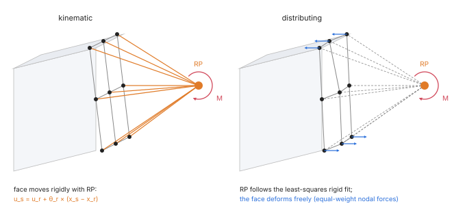
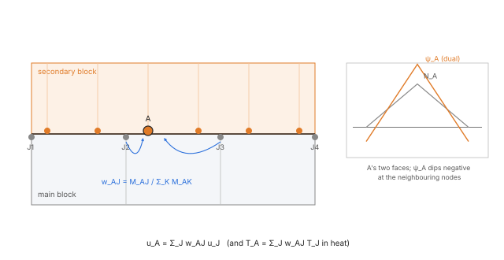
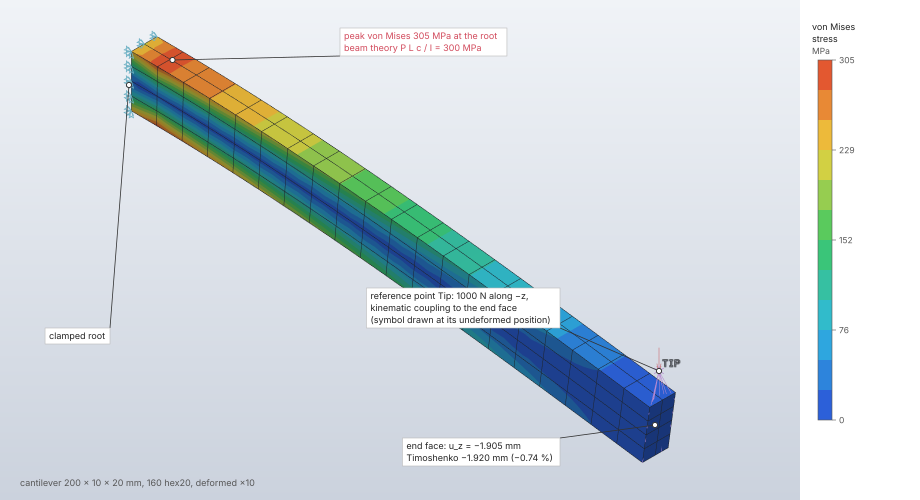

# Constraints and connectors

Constraints relate degrees of freedom to each other: couplings tie a reference point to a set of
nodes, ties bond non-matching meshes by dual mortar conditions, and symmetry conditions hold the
motion normal to a plane of any orientation. The implicit solvers eliminate every linear
constraint by transformation, so the reduced matrix stays symmetric positive definite with no
penalty numbers and no Lagrange multipliers. Connectors add discrete stiffness, damping and mass:
springs, dashpots and point masses with rotary inertia.

| | |
|---|---|
| **Commands** | `model.reference_point.create\|edit\|delete`, `model.coupling.create\|edit\|delete`, `interaction.tie`, `interaction.tie.edit`, `interaction.tie.delete`, `model.boundary_condition.create` (`"type": "symmetry"`), `model.boundary_condition.symmetry`, `model.spring.create\|edit\|delete`, `model.mass.create\|edit\|delete` |
| **Step procedure** | Couplings, ties: `"static"`, `"frequency"`, `"buckle"`, `"nonlinear_static"` (ties also `"heat_transfer"`, `"coupled_temperature_displacement"`). Symmetry, springs, point masses: the implicit structural steps and `"explicit_dynamic"` (translational only). Dashpots: `"explicit_dynamic"` |
| **Solver** | `crates/solver` (`constraints`, `tie`, `discrete`), `crates/explicit` (`discrete`, `integrate`); CPU, f64 |
| **Method** | Master–slave elimination by transformation (Cook, Malkus, Plesha & Witt 2002 §9.2; Abel & Shephard 1979); dual mortar ties (Wohlmuth 2000; Popp et al. 2012); interpolation constraints (Heirman & Desmet 2010) |
| **Verified by** | `crates/solver/tests/{couplings,contact,inclined_symmetry,one_d}.rs`, `crates/explicit/tests/{one_d,inclined_symmetry}.rs`; oracle cases `tube-torsion-coupling`, `pure-bending-coupling`, `tie-patch`, `tie-heat-series` |

## Synopsis

```json
[
  {"command": "model.reference_point.create", "params": {"name": "RP", "xyz": [3, 0.5, 0.5]}},
  {"command": "model.coupling.create", "params": {
    "name": "pad", "reference_point": "RP", "set": "end", "kind": "kinematic"}},
  {"command": "interaction.tie", "params": {"name": "glue", "main": "plate", "secondary": "rib"}},
  {"command": "model.boundary_condition.symmetry", "params": {"name": "Sym", "datum": "Mid"}},
  {"command": "model.spring.create", "params": {
    "name": "mount", "type": "spring", "stiffness": 1000,
    "first": {"set": "foot"}, "direction": {"dof": 3}}},
  {"command": "model.mass.create", "params": {
    "name": "motor", "target": {"reference_point": "RP"}, "mass": 2.5,
    "inertia": [0.1, 0.1, 0.2, 0, 0, 0]}}
]
```

## Parameters

**Reference point** (`model.reference_point.create`):

| Field | Value | Default | Meaning |
|---|---|---|---|
| `name` | text | required | |
| `xyz` | [x, y, z] | required | Its position. |
| `label` | integer | the highest free label | Its node label in decks, kept through remeshes. A mesh node on the same label is an error of the check. |

**Coupling** (`model.coupling.create`):

| Field | Value | Default | Meaning |
|---|---|---|---|
| `name` | text | required | |
| `reference_point` | name | required | The point coupled. |
| `set` | node set | required | The nodes it is coupled to. |
| `kind` | `"kinematic"` \| `"distributing"` | required | Rigid link, or least-squares interpolation constraint. |
| `dofs` | subset of 1–6 | all | The coupled degrees of freedom (1–3 translations, 4–6 rotations, global axes). |

**Tie** (`interaction.tie`, `interaction.tie.edit`):

| Field | Value | Default | Meaning |
|---|---|---|---|
| `name` | text | required | |
| `main`, `secondary` | face sets | required | Each secondary node follows the main surface under it. |
| `position_tolerance` | length | half the main element's thickness | How far a secondary node may lie from the main surface and still be tied. |

**Symmetry** (`model.boundary_condition.create`, `"type": "symmetry"`):

| Field | Value | Default | Meaning |
|---|---|---|---|
| `target` | `{"set"}` \| `{"reference_point"}` | required | The nodes held. |
| `plane` | `"x"` \| `"y"` \| `"z"` \| `{"normal": [nx, ny, nz]}` | required | The plane's normal; any finite, non-zero vector. |

`model.boundary_condition.symmetry` takes `{"name", "datum", "set"?, "bodies"?}`: a datum plane of
any orientation and, unless `set` is given, a new set of the same name holding every face of the
open design's bodies (or of `bodies`) that lies on the plane within 10⁻⁶ of the body's size, such
as a partition's cut faces. It reports the plane as `"x"`, `"y"`, `"z"` or its unit normal. Both
forms are activated in steps with `model.step.activate`.

**Spring or dashpot** (`model.spring.create`):

| Field | Value | Default | Meaning |
|---|---|---|---|
| `type` | `"spring"` \| `"dashpot"` | required | |
| `stiffness` / `coefficient` | number | required | Force per relative displacement / per relative velocity. |
| `first` | `{"set"}` \| `{"reference_point"}` | required | Every node of the target gets its own copy. |
| `second` | target | none | Without it each node of `first` connects to the ground; with it each end is one node. |
| `direction` | `{"dof": 1..6}` \| `{"vector": [x, y, z]}` \| `"line"` | required | A global degree of freedom (4–6: torsional), a fixed vector, or the line through the two ends (two-point only, from the undeformed positions). |

**Point mass** (`model.mass.create`):

| Field | Value | Default | Meaning |
|---|---|---|---|
| `target` | `{"set"}` \| `{"reference_point"}` | required | Every node of the target gets the full value. |
| `mass` | number \| [mx, my, mz] | required | Translational mass, the same in every direction or per global direction. |
| `inertia` | [I11, I22, I33, I12, I13, I23] | none | Rotary inertia tensor about the node in global axes; needs rotations (a reference point, or a shell or beam node). |

A point mass of 2 on a set of five nodes adds 2 at each of them; a mass shared over a face is a
point mass on a reference point coupled to the face.

## Theory

### Reference points and couplings

A reference point is a single node off the mesh with three translations and three rotations,
numbered after the mesh's translational degrees of freedom. Each coupling becomes linear
constraint rows Σ cⱼ uⱼ = 0.

**Kinematic** (a rigid link): every node s of the set follows the point r rigidly in the coupled
translations,

```text
u_s = u_r + θ_r × (x_s − x_r)
```

(small rotations; Cook et al. 2002, §9.2). The point's rotations take part through the lever
arms, so a moment on it reaches the face as a couple even when only translations are coupled.
Coupled rotations tie the rotations of shell and beam nodes, θ_s = θ_r; solid nodes have none.

**Distributing** (an interpolation constraint): the point moves with the rigid motion that fits the
set's nodal translations best in the least-squares sense, with equal weights. About the nodes'
centroid c, with rᵢ = xᵢ − c,

```text
u_c = Σ uᵢ / N,   θ = J⁻¹ Σ rᵢ × uᵢ,   J = Σ (|rᵢ|² I − rᵢ rᵢᵀ)
θ_r = θ,   u_r = u_c + θ × (x_r − c)
```

Only the coupled degrees of freedom are tied. By virtual work a force or moment on the point is
spread over the nodes as the forces whose resultant and moment about the point equal it, weighted
like the fit, and the region stays free to deform (Heirman & Desmet 2010). Nodes on one line cannot
carry a rotation about that line: an error when rotations are coupled, their mean motion
otherwise.



### Elimination

Every degree of freedom is free, prescribed (a boundary condition), dependent on others, or
inactive (a reference point direction no coupling ties). Rows are taken one at a time in a fixed
order: boundary conditions first, then couplings by name, nodes by label, directions in order. A row
is rewritten in terms of the current free and prescribed degrees of freedom; one free degree of
freedom is then chosen to depend on the rest: the row's intended one (the coupled node, the
distributing coupling's reference point, a tie's secondary node) while it is free, otherwise the
largest coefficient, lowest index first (Abel & Shephard 1979). A row with no free degree of
freedom left is redundant when the prescribed values satisfy it and contradictory otherwise (an
error naming it). Every dependent degree of freedom ends up as u = T_f q + T_p u_p, so

```text
T_fᵀ K T_f q = T_fᵀ (f − K T_p u_p),   reactions = T_pᵀ (K u − f)
```

With no coupling T is the identity on the free degrees of freedom and the result is the plain
elimination of prescribed values, bit for bit. A held distributing coupling point makes one coupled
node depend on all the others, a dense (3N)² block in the reduced matrix: its size is estimated
from the rows and refused against the factorization's memory budget before anything is built, and
every other reduction counts its entries, stopping at the budget, before it allocates them.

### Ties (dual mortar)

Each secondary node A follows the main surface under it through the mortar condition
∫ ψ_A (u_s − u_m) dA = 0 per direction, integrated over the overlaps of the secondary faces with
the main faces in the reference configuration (`fieldcraft_fem::mortar`). The multiplier space uses
each secondary face's dual shape functions,

```text
ψ_a = Σ_b A_ab N_b,   A = D M⁻¹,   M_ab = ∫ N_a N_b,   D = diag ∫ N_a
```

biorthogonal to its own shape functions, ∫ ψ_a N_b = δ_ab ∫ N_b (Wohlmuth 2000; Popp et al. 2012).
The secondary mortar matrix is then diagonal, and each secondary node is a weighted average of the
main nodes under it:

```text
u_A = Σ_J (M_AJ / Σ_K M_AK) u_J,   M_AJ = Σ_overlaps ∫ ψ_A N_J dA
```

The rows go to the elimination like a coupling's, the secondary node the intended dependent, in
linear static, frequency, buckling and nonlinear steps (small-displacement constraints). Where a
secondary face is wholly covered, Σ_K M_AK = ∫ N_A, the plain mortar condition; dividing by the sum
keeps rigid motions exact at a surface's edge where a face is only partly covered. A uniform stress
crosses a tie on flat faces exactly, because the dual mortar conditions are satisfied by the linear
field on both sides.

**Pairing.** Each secondary face takes the main faces whose boxes, grown by the position
tolerance, overlap its own, and that it overlaps along its normal with a mean gap within the
tolerance. A secondary node with no main face under it stays free, with a warning.

**Nodes in several ties.** A node on the secondary surfaces of several ties (two secondary surfaces
meeting at an edge) gets one constraint, over the main faces of all of them together, as if they
were one tie: two near-repeated constraints would make the elimination divide by round-off. Two ties
holding one interface both ways are an error naming them, and so are constraints that still nearly
repeat each other (a tie and a coupling on one node, longer loops).

**Heat.** The same weights tie temperatures, T_A = Σ_J w_AJ T_J (one row per secondary node), in
steady and transient heat transfer and in the heat solution of coupled temperature–displacement
steps. The heat solver eliminates them with the prescribed temperatures through the same
transformation, so the interface has no resistance, the heat leaving one side enters the other, and
the reactions at prescribed temperatures (T_pᵀ (K T + C Ṫ − f)) balance the heat supplied.



### Symmetry planes

A plane normal to X, Y or Z holds global degrees of freedom: X holds 1, 5 and 6, Y holds 2, 4
and 6, Z holds 3, 4 and 5. A normal within 10⁻¹² of an axis (unit length) is that axis. On any other
plane the condition is linear constraint rows: at every target node n · u = 0, eliminating the
translation of the largest |nₖ|, and at a node with rotations (shells, beams, a reference point
whose rotations exist) tᵢ · θ = 0 about two in-plane axes, t₁ = n × e / |n × e| with e the axis n
leans on least and t₂ = n × t₁: a mirror image turns only about the normal. A node also held, or on
two planes, is no conflict; a prescribed motion off the plane is (an error). In explicit dynamics
an inclined plane removes its nodes' velocity along its normal after the velocity update, from
their free components (the mass-weighted projection onto the constraint).

### Springs, dashpots and point masses

**Implicit.** A point mass adds m_x, m_y, m_z on the node's translations and its inertia tensor J
(3 × 3, products included) on its rotations, the same in the consistent and the lumped mass matrix.
A spring with stiffness k and unit direction coefficients c on each end's six degrees of freedom
adds k c cᵀ to each end and −k c cᵀ between them (Cook et al. 2002, §2.2): the elongation is
cᵀ(u_second − u_first); a grounded spring adds k c cᵀ. A dashpot has the same form on velocities.
Gravity acts on point masses when it acts on the whole model.

**Explicit.** Point masses add to the lumped mass of their node, per direction. Springs add the
force k (cᵀ Δu) c and dashpots c_d (cᵀ Δv) c, with Δu, Δv the relative motion of the ends along c;
a direction along the line of the ends follows that line as it turns under nonlinear geometry,
with the stretch l − L₀. Dashpots use the velocity of the previous half increment v^{n−½}, as the
bulk viscosity does (Belytschko et al. 2014, §6.2). Spring work counts as internal energy, dashpot
work as viscous (dissipated) energy. Their stable increment is bounded per degree of freedom
([explicit dynamics](explicit-dynamics.md)); a run warns when a spring or dashpot limits the
increment.

## Algorithm

1. Resolve each definition to its nodes. A reference point direction that no coupling ties is
   inactive; a boundary condition on a reference point that no coupling ties to the mesh and no
   spring or point mass uses holds nothing, with a warning.
2. Build the constraint rows: couplings (kinematic or distributing), tie rows (pairing, dual
   shape functions, merged per secondary node), inclined symmetry rows.
3. Eliminate in the fixed order (boundary conditions, couplings by name, nodes by label,
   directions), checking redundancy and contradiction, and the memory budget of the reduction.
4. Assemble springs, dashpots and point masses into the stiffness, damping and mass of the free
   degrees of freedom; solve; recover dependent degrees of freedom and the reactions
   T_pᵀ (K u − f), including the forces and moments at reference points and the reactions of
   inclined symmetry planes.

## Output

Static and nonlinear replies list each coupled reference point (`reference_points`: name, label,
six displacements, six reactions); `solve.probe` with a reference point's label gives the same.
Frequency results give the reference point's mode shape (`point_shape`); point masses count in the
total mass and the effective masses. Ties report uncovered secondary nodes as warnings. Explicit
results count point masses in `total_mass` (with their mean over the three directions) and spring
and dashpot work in the internal and viscous energies.

**Decks.**

| Definition | Abaqus | Nastran | LS-DYNA |
|---|---|---|---|
| Kinematic coupling | `*COUPLING` with `*KINEMATIC` | `RBE2` (reference point independent) | `*CONSTRAINED_NODAL_RIGID_BODY`; some degrees of freedom only: refused |
| Distributing coupling | `*COUPLING` with `*DISTRIBUTING, WEIGHTING METHOD=UNIFORM` | `RBE3` (equal weights, reference point dependent) | `*CONSTRAINED_INTERPOLATION` |
| Tie | `*TIE, ADJUST=NO` (secondary first, `POSITION TOLERANCE` when given) | refused | `*CONTACT_TIED_SURFACE_TO_SURFACE` between segment sets |
| Inclined symmetry plane | `*EQUATION` (model data: refused when active in some steps only) | one `MPC` set per step | `*BOUNDARY_SPC_*_ID` in a `*DEFINE_COORDINATE_SYSTEM` whose x axis is the normal |
| Point mass, rotary inertia | `MASS` / `*MASS`, `ROTARYI` / `*ROTARY INERTIA` | `CONM1` | `*ELEMENT_MASS`, `*ELEMENT_INERTIA` |
| Spring, dashpot | `SPRING1/2/A`, `DASHPOT1/2/A` | `CELAS2`, `CDAMP2` | `*ELEMENT_DISCRETE` |

Abaqus reports a mass that differs by direction and a spring along a skew fixed vector; per-direction
masses are written by Nastran only, skew fixed spring directions by LS-DYNA only.

## Worked example

A steel cantilever whose end face is coupled to a reference point at its centroid, loaded by a
force on that point: first through a kinematic coupling, then the same model with the coupling
edited to distributing. The reference point's displacement and rotation come back in the
`solve.static` reply and compare with Timoshenko beam theory.

| | |
|---|---|
| **Geometry** | 200 mm along x, 10 mm wide (y), 20 mm deep (z); one block, faces `root` (x = 0) and `end` (x = 200) |
| **Mesh** | 160 hex20 (20 × 2 × 4), 1 077 nodes |
| **Material** | steel: E = 210 000 MPa, ν = 0.3 |
| **Reference point** | `Tip` at (200, 5, 10), the centroid of `end` |
| **Coupling** | `End`: `Tip` to the nodes of `end`, all six degrees of freedom; kinematic, then distributing |
| **Boundary conditions, load** | `root` fixed; 1 000 N along −z on `Tip` |
| **Step** | static |
| **Units** | mm, t, s, N, MPa |

```json
[
  {"command": "model.units", "params": {"system": "mm-t-s-N-MPa"}},
  {"command": "mesh.block", "params": {"body": "Beam", "kind": "hex20",
    "corners": [[0,0,0],[200,0,0],[200,10,0],[0,10,0],[0,0,20],[200,0,20],[200,10,20],[0,10,20]],
    "divisions": [20, 2, 4], "faces": {"6": "root", "4": "end"}}},
  {"command": "model.set.create", "params": {"name": "all", "geometry": [{"body": "Beam"}]}},
  {"command": "model.set.create", "params": {"name": "root", "geometry": [{"body": "Beam", "face": "root"}]}},
  {"command": "model.set.create", "params": {"name": "end", "geometry": [{"body": "Beam", "face": "end"}]}},
  {"command": "model.material.create", "params": {"name": "Steel", "elastic": {"type": "isotropic", "young": 210000, "poisson": 0.3}}},
  {"command": "model.section.create", "params": {"name": "Beam", "set": "all", "material": "Steel", "kind": {"type": "solid"}}},
  {"command": "model.reference_point.create", "params": {"name": "Tip", "xyz": [200, 5, 10]}},
  {"command": "model.coupling.create", "params": {"name": "End", "reference_point": "Tip", "set": "end", "kind": "kinematic"}},
  {"command": "model.boundary_condition.create", "params": {"name": "Clamp", "type": "fixed", "target": {"set": "root"}}},
  {"command": "model.load.create", "params": {"name": "Push", "type": "force", "target": {"reference_point": "Tip"}, "vector": [0, 0, -1000]}},
  {"command": "model.step.create", "params": {"name": "Load", "procedure": {"type": "static"}, "boundary_conditions": ["Clamp"], "loads": ["Push"]}},
  {"command": "solve.static", "params": {"step": "Load"}},
  {"command": "results.contour", "params": {"step": "Load", "field": "von_mises"}},
  {"command": "results.deformed", "params": {"step": "Load", "show": true, "scale": 10}},
  {"command": "model.coupling.edit", "params": {"name": "End", "reference_point": "Tip", "set": "end", "kind": "distributing"}},
  {"command": "solve.static", "params": {"step": "Load"}}
]
```

Results from the two `solve.static` replies (`reference_points`, `max_von_mises`; each solve
under 0.05 s, Apple M4 Max, CPU). The references: tip deflection
δ = P L³/(3 E I) + P L/(κ G A) with κ = 5/6 (Timoshenko beam), section rotation
θ = P L²/(2 E I), root stress σ = P L c / I = 300 MPa, with I = 6 666.7 mm⁴.

| Quantity | Kinematic | Distributing | Reference | Difference |
|---|---|---|---|---|
| Equations | 3 015 | 3 120 | — | — |
| `Tip` u_z, ν = 0.3 | −1.905469 mm | −1.905602 mm | −1.919619 mm | −0.74 %, −0.73 % |
| `Tip` rotation about y, ν = 0.3 | 0.0142169 rad | 0.0142251 rad | 0.0142857 rad | −0.48 %, −0.42 % |
| `Tip` u_z, ν = 0 | −1.916102 mm | −1.916226 mm | −1.916190 mm | −0.005 %, +0.002 % |
| `Tip` rotation about y, ν = 0 | 0.0142857143 rad | 0.0142937 rad | 0.0142857 rad | < 10⁻⁸, +0.056 % |
| `max_von_mises`, ν = 0.3 | 304.98 MPa (node 65, at the root) | 304.98 MPa | σ = 300 MPa | +1.7 % |
| `reaction_total` z | 1 000.0 N | 1 000.0 N | 1 000 N | < 10⁻¹⁰ |

The ν = 0 rows are the same script with `"poisson": 0`.



**What to look at.** The force acts on one point, and the coupling carries it into the whole end
face; one depth or two from the end the stress is the beam's, peaking where the bending moment
peaks, at the root. A kinematic coupling makes the end face move rigidly with the point, so the
point's rotation is the face's; a distributing coupling spreads the force over the nodes and lets
the face warp, and its point follows the least-squares rigid fit of the face's motion. The two
differ only near the end, so the deflection and rotation agree within 0.06 % (Saint-Venant). At ν = 0 the kinematic coupling
reproduces the beam's rotation to 10⁻⁸ and the deflection to 0.005 %; at ν = 0.3 the
fixed root face also holds the section's Poisson contraction, which stiffens the beam by
0.5–0.6 %.

## Verification

Oracle cases ([results](../../oracle.md)):

| Case | Reference | Quantity | Error | Tolerance | Result |
|---|---|---|---|---|---|
| `tube-torsion-coupling` | theory: φ = T L/(G J), τ = T r/J | rotation of the reference point; surface shear stress | 0.00062 %; 0.29 % | 0.5 %; 1 % | pass |
| `pure-bending-coupling` | theory: σ = M z/I, κ = M/(E I) | bending stress at mid-span; rotation of the reference point | < 10⁻⁶; 1.18 % | 0.5 %; 1 % | pass; known failure |
| `tie-patch` | theory: tie patch test | σ_zz in five elements on both sides; u_z at a tied node | < 10⁻⁶ | 10⁻⁹ rel. | pass |
| `tie-heat-series` | theory: series conduction | temperatures at the tie and in both blocks; heat flux | < 10⁻⁶ | 10⁻⁹ rel. | pass |

The `pure-bending-coupling` rotation is 1.2 % high: the distributing coupling weights every node
of the end face equally, corner and mid-side nodes of hex20 alike, which is not the consistent
linear traction; the end face deforms locally and the fitted rotation includes it.

Tests:

- `crates/solver/tests/couplings.rs`: a block held only through a coupled reference point given a
  rigid motion follows it rigidly with no stress (10⁻¹³), for both kinds; clamping through a
  kinematically coupled fixed point equals direct clamping in displacements and frequencies
  (10⁻¹⁰, 10⁻⁹), the point's reaction carrying the load; a distributing force equals the
  equivalent pressure away from the end (10⁻⁴); bending through a distributing coupling
  (σ = M z/I and κ to 0.5 %); torsion of a hex20 tube (twist 10⁻³, shear stress 0.5 %);
  determinism; errors that name the problem; oversized reductions refused before allocating.
- `crates/solver/tests/contact.rs`: `a_tie_passes_the_patch_test` (a linear field across
  non-matching hex8/tet4 meshes to round-off, to 10⁻⁶ on distorted quadrilateral faces, in linear
  and nonlinear steps; uniaxial tension across a tie σ_zz = Eε to 10⁻⁹); `heat_crosses_a_tie_exactly`
  (matching, graded and mixed meshes: the linear profile, the flux and k A ΔT / L to 10⁻⁹; with
  k₁ ≠ k₂ the series interface temperature (k₁ T₀ + k₂ T₁)/(k₁ + k₂) and heat flow
  ΔT/(L₁/k₁ + L₂/k₂)); `transient_heat_through_a_tie_is_the_single_body_s`;
  `a_tied_body_expands_freely_under_a_uniform_temperature` (u = α ΔT x, no stress);
  `what_ties_refuse`.
- `crates/solver/tests/inclined_symmetry.rs`: a turned half cantilever with its inclined plane
  solves to the turned displacements of the unturned half and of the whole (10⁻⁹, 10⁻⁸), the
  plane's reactions balancing the load; an eighth of a simply supported plate cut on the diagonal
  matches the quarter (10⁻⁹; first frequency 10⁻⁸) and Navier's series (1 %); conflicts.
- `crates/solver/tests/one_d.rs`: spring–mass frequency √(k/m) and static stretch (10⁻¹²);
  springs along skew vectors (10⁻¹⁰); a two-mass chain against the characteristic equation
  (10⁻⁸); a bar with a tip mass (10⁻⁹); a torsional pendulum √(k_t/J) on a reference point
  (10⁻¹²); gravity on point masses, dashpots ignored with a warning, determinism.
- `crates/explicit/tests/one_d.rs`: spring–mass period (10⁻⁴), damped decay rate (1 %), two
  masses on a line spring, a whirling mass on a corotational rod; rotary inertia refused.
- `crates/explicit/tests/inclined_symmetry.rs`: turned planes move as the axis-aligned ones and
  the whole (10⁻¹²); a prescribed motion off the plane is refused.

## Limitations

- Couplings and ties are small-displacement (linear) constraints in nonlinear steps; couplings
  give a warning.
- Explicit dynamics refuses couplings, ties, boundary conditions and loads on reference points,
  discrete elements on reference points, rotary inertia and rotational springs.
- Ties take linear faces only (tri3, quad4 of tet4, wedge6, hex8) in 3D models, for heat as for
  displacement. Nastran refuses ties.
- Dashpots act only in explicit dynamics; static, nonlinear static and frequency steps ignore them
  with a warning.
- The distributing coupling uses equal weights per node (see `pure-bending-coupling`).
- Connector elements (hinges, slots, joints with stops) and nonstructural mass are not
  implemented.

## Implementation

- `crates/model/src/constraints.rs`: `ReferencePoint`, `Coupling`, `CouplingKind`, label policy.
- `crates/model/src/tie.rs`: `Tie`. `crates/model/src/bcs.rs`: `Symmetry` (`from_normal`, `dofs`,
  `inclined`, `in_plane`). `crates/model/src/discrete.rs`: `PointMass`, `Spring`.
- `crates/solver/src/constraints.rs`: coupling rows, `symmetry_rows`, `Reduction` (the
  elimination, reactions, memory budget).
- `crates/solver/src/tie.rs`: pairing, dual shape functions, `rows_of`.
- `crates/solver/src/discrete.rs`: point masses, springs and dashpots in the implicit system.
- `crates/explicit/src/discrete.rs`, `crates/explicit/src/integrate.rs` (`constrain`): explicit
  springs, dashpots, point masses, inclined planes.
- `crates/engine/src/cmd/define.rs`, `crates/engine/src/cmd/contact.rs`,
  `crates/engine/src/cmd/symmetry.rs`: the commands.

## References

- R. D. Cook, D. S. Malkus, M. E. Plesha, R. J. Witt. *Concepts and Applications of Finite Element Analysis*, 4th ed., Wiley 2002 (§2.2, §2.10, §9.2).
- C. A. Felippa. *Introduction to Finite Element Methods*, ch. 8, University of Colorado lecture notes.
- J. F. Abel, M. S. Shephard. *An algorithm for multipoint constraints in finite element analysis.* IJNME 14(3):464–467, 1979.
- G. H. K. Heirman, W. Desmet. *Interface reduction of flexible bodies for efficient modeling of body flexibility in multibody dynamics.* Multibody Syst. Dyn. 24(2):219–234, 2010.
- B. I. Wohlmuth. *A mortar finite element method using dual spaces for the Lagrange multiplier.* SIAM J. Numer. Anal. 38(3):989–1012, 2000.
- A. Popp, B. I. Wohlmuth, M. W. Gee, W. A. Wall. *Dual quadratic mortar finite element methods for 3D finite deformation contact.* SIAM J. Sci. Comput. 34(4):B421–B446, 2012.
- T. Belytschko, W. K. Liu, B. Moran, K. Elkhodary. *Nonlinear Finite Elements for Continua and Structures*, 2nd ed., Wiley 2014 (§2.4, §4.5, §6.2, §6.3).
- S. Timoshenko, S. Woinowsky-Krieger. *Theory of Plates and Shells*, 2nd ed., McGraw-Hill 1959 (§30).
