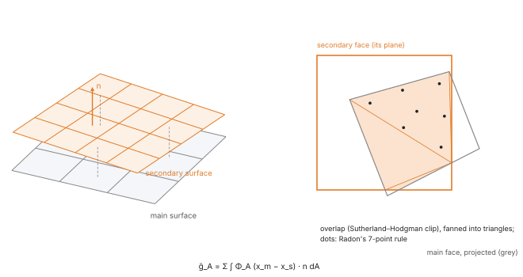
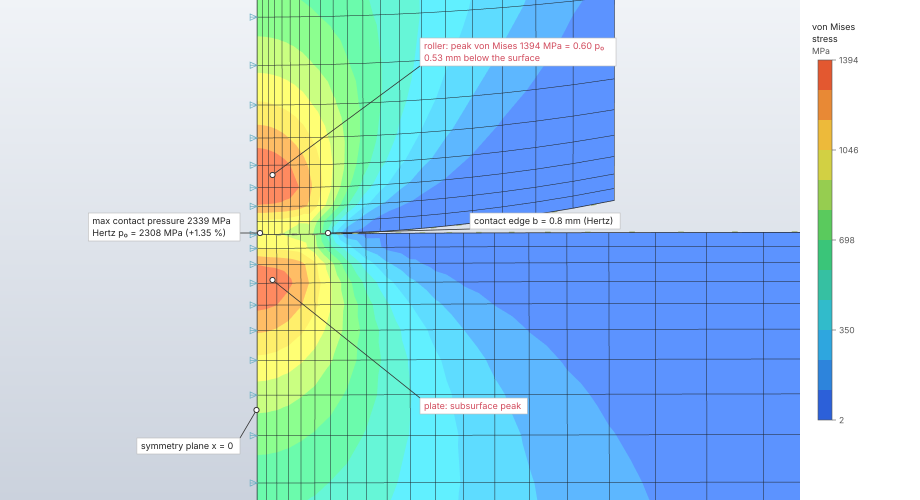
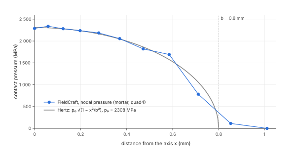

# Contact and friction

Contact keeps surfaces of a model from passing through each other and transmits pressure and
Coulomb friction across them. In explicit dynamics it is penalty contact integrated segment to
segment over the overlaps of facing element faces; in nonlinear static steps it is mortar contact
enforced by an augmented Lagrangian with its exact consistent tangent. Both pass the contact patch
test on non-matching meshes. Planar rigid walls stop a set's nodes in explicit dynamics.

| | |
|---|---|
| **Commands** | `interaction.contact.pair`, `interaction.contact.general`, `interaction.contact.edit`, `interaction.contact.delete`, `interaction.contact.find`, `interaction.rigid_wall`, `interaction.rigid_wall.delete` |
| **Step procedure** | `"explicit_dynamic"` (pairs, general contact, rigid walls), `"nonlinear_static"` (pairs, general contact) |
| **Solver** | `crates/explicit` (penalty), `crates/solver` (mortar, augmented Lagrangian); geometry in `crates/fem` (`contact`, `mortar`, `dual`); CPU, f64 |
| **Method** | Explicit: mortar segmentation with the penalty at the integration points (Puso & Laursen 2004; Fischer & Wriggers 2005). Static: mortar contact (Puso & Laursen 2004) by augmented Lagrangian (Simo & Laursen 1992; Alart & Curnier 1991) |
| **Verified by** | `crates/explicit/tests/contact.rs`, `crates/solver/tests/contact.rs`; oracle cases `explicit-bars-collision`, `explicit-contact-patch`, `explicit-sliding-block-*`, `bar-rigid-wall-impact`, `nl-contact-patch*`, `nl-hertz-cylinder*`, `nl-friction-sliding-blocks` |

## Synopsis

```json
[
  {"command": "interaction.contact.pair", "params": {
    "name": "press", "main": "plate", "secondary": "punch",
    "friction": {"static": 0.3, "kinetic": 0.2, "decay": 10},
    "penalty_scale": 1, "initial_penetration": "adjust"}},
  {"command": "interaction.contact.general", "params": {"name": "all"}},
  {"command": "interaction.rigid_wall", "params": {
    "step": "Impact", "set": "front", "point": [0, 0, 0], "normal": [1, 0, 0]}}
]
```

A contact is a model definition, active in every step that takes it. Its surfaces are sets of
element faces (element edges in a 2D model), so they survive remeshing like a pressure load.

## Parameters

`interaction.contact.pair` and `interaction.contact.general`:

| Field | Value | Default | Meaning |
|---|---|---|---|
| `name` | text | required | Unique; at most 1000 contacts per model. |
| `main`, `secondary` | face sets | required (pair) | Two different surfaces. In nonlinear static steps `secondary` is the non-mortar side. |
| `surface` | face set | every exterior face of the solids (2D: every exterior edge) | General contact: every face against every other face of the surface (self contact). |
| `friction.static` | 0 to 10 | 0 (frictionless) | Static coefficient μ_s. |
| `friction.kinetic` | 0 to 10 | the static one | Kinetic coefficient μ_k; a different value needs a decay. |
| `friction.decay` | 0 to 10¹⁵ s/m | 0 | Decay d of μ = μ_k + (μ_s − μ_k) e^{−d γ̇} with the slip rate γ̇. |
| `penalty_scale` | 10⁻⁶ to 1 | 1 | Factor on the solver's penalty: explicit, the stiffest that leaves the time increment alone; static, the augmented Lagrangian's. |
| `initial_penetration` | `"adjust"` \| `"refuse"` | `"adjust"` | Nodes that start inside the other surface. Explicit moves them onto it, strain-free; static takes the overlap out of their gap; both report them. `refuse` stops the analysis naming the first node, its depth and the face. |

`interaction.contact.edit` replaces a contact with the model's form: `{"name", "surfaces":
{"type": "pair", "main", "secondary"} | {"type": "general", "surface"}, "friction",
"penalty_scale", "initial_penetration"}`. `interaction.contact.delete` takes `{"name"}`.

`interaction.contact.find`:

| Field | Value | Default | Meaning |
|---|---|---|---|
| `tolerance` | length | a tenth of the mean exterior face size | Distance within which surfaces touch. |
| `create` | bool | `false` | Add two face sets and a contact pair per touching pair of parts, named `find-N-main`, `find-N-secondary` and `find-N`. |
| `friction`, `penalty_scale`, `initial_penetration` | as above | as above | Of the created pairs. |

The solid elements are split into connected parts (elements sharing a node belong to one part);
a node of one part's exterior faces within `tolerance` of an exterior face of another makes the
two parts touch there. Each touching pair is reported with the faces of each side that are close
to the other. At most 1000 pairs are reported and 2 · 10⁸ point–face checks made.

`interaction.rigid_wall` (explicit dynamic steps only; the same list as the step's
`rigid_walls`):

| Field | Value | Default | Meaning |
|---|---|---|---|
| `step` | name | the model's only explicit dynamic step | The step the wall belongs to. |
| `set` | node set | required | The nodes the wall stops. |
| `point` | [x, y, z] | required | A point on the plane. |
| `normal` | [nx, ny, nz], non-zero | required | Toward the side the nodes stay on. |
| `friction` | as above | frictionless | Coulomb friction. |

The reply gives the step and the wall's index; `interaction.rigid_wall.delete` takes
`{"step", "index"}`.

## Theory

### Friction law

Coulomb's law with a coefficient that falls from its static to its kinetic value with the slip
rate γ̇ (the exponential decay of Rabinowicz's observations):

```text
μ = μ_k + (μ_s − μ_k) e^{−d γ̇}
```

A static step has no slip rate: a node takes the static coefficient while it sticks and the
kinetic one once it slips.

### Shared geometry

`fieldcraft_fem::contact` gives the closest point of a triangle (exact region tests) or of a
bilinear quadrilateral (projected Newton with the exact Hessian, at most 30 iterations) to a
point, with the signed gap along the face's normal and the lateral offset, and a bucket grid of
face boxes whose cell is twice the mean box, grown until the grid (at most 2²⁴ cells) and its
entries (2²⁷) fit, queried by point or by box with the candidates in face order (Benson &
Hallquist 1990).

### Explicit dynamics: penalty, segment to segment

**Kinematics.** Each secondary face and each main face facing it (normals within 84° of
opposite, a dot product below −0.1) are projected onto the secondary face's plane, split into
triangles and clipped against each other (Sutherland–Hodgman). On each overlap triangle a
three-point rule takes the gap g = (x_s − x_m)·n_m between the faces' closest points. Where g < 0,
no deeper than half the main face's element, a penalty pressure p = ε(−g) acts on the secondary
face's nodes with weights N_i^s along n_m and on the main face's nodes with −N_j^m. For a uniform
pressure across flat faces both meshes receive exactly the consistent nodal forces ∫ p N dA, so
the contact patch test passes on non-matching meshes; node-to-segment contact fails it (Taylor &
Papadopoulos 1991). Every contact runs both ways at half the penalty each: a pair with each
surface as the secondary in turn, single-surface contact with every face against every other face
that shares no node with it.

**Penalty.** Per area, from the masses and the stable increment Δt:

```text
ε = s γ min_i (m_i / A_i) / Δt²,   γ = 0.3
```

over the contact's nodes, m_i the lumped mass and A_i = κ_i max_d Σ_f a_f |n_f,d| the area that
bounds node i's contact stiffness (a_f its share of face f, κ_i = max_f Σ_d |n_f,d| ∈ [1, √3]).
By Gershgorin's theorem the contact adds at most 2 s γ / Δt² to the square of any frequency
(Weyl's inequality adds it to the elements'). With the default increment scale 0.9 (ω Δt ≤ 1.8),
1.8² + 2γ ≤ 4 keeps the step under the stability limit ω Δt = 2: contact never shortens the
increment, and s ≤ 1 only softens it. The pressure stiffness is about a fifth of the smallest
element's M/h (M the constrained modulus), stiffer than the element-based penalty f K A²/V with
f = 0.1 (Hallquist, Goudreau & Benson 1985), and a uniform ε keeps a uniform pressure uniform.

**Friction** at the secondary nodes by a regularised return map (Wriggers 2006, §5.2 and §10.3;
Simo & Laursen 1992) against the main face that pressed each node most over the increment:

```text
t* = P t_n − k_t Δu_T,   k_t = ε A_i / 2
stick: |t*| ≤ μ f_n → t = t*
slip:  t = μ f_n t*/|t*|, dissipating μ f_n (|t*| − μ f_n)/k_t
```

f_n is the node's share of the pressure, Δu_T its tangential motion relative to the closest point
of the main face, and the reaction goes to the main face's nodes with −N_j. The slip rate is
γ̇ = |Δu_T|/Δt. A node that leaves contact forgets its tangential force.

**Rigid walls** are kinematic (Hughes et al. 1976): a node that would cross its wall in the
increment has its normal velocity set so it lands on it; friction is a tangential impulse at most μ
times the normal one (the tangential velocity stops, or loses μ Δv_n when it slides).

**Initial penetration.** Before the analysis each secondary node is projected onto the main
surface; a node behind a face it lies over (within a fiftieth of the face's size), within the
depth limit and with its own faces facing it, is moved onto it before the elements are built, or
the analysis is refused, as the contact says.

**Energy.** Contact forces enter the equations of motion like external forces; their work (the
penalty energy stored plus what friction dissipates) is integrated by the trapezoidal rule into
the energy balance, and friction dissipation in contact and on rigid walls is reported apart.

### Nonlinear static: mortar, augmented Lagrangian

**Discretisation** (`fieldcraft_solver::contact`): mortar contact, one pass, the pair's `secondary`
surface the non-mortar side. Each secondary node A carries a pressure p_A and the weighted gap

```text
g̃_A = Σ_segments ∫ Φ_A (x_m − x_s) · n dA,   ĝ_A = g̃_A / A_A,   A_A = ∫ Φ_A dA
```

over the overlaps of its faces with the main faces facing them, Φ_A the secondary face's own shape
functions. The pressure field is interpolated like the displacements, so a uniform pressure
crosses a non-matching interface as the consistent nodal forces of both meshes (McDevitt &
Laursen 2000).



**Segmentation** (`fieldcraft_fem::mortar`). Both faces are projected along the secondary face's
unit normal onto its plane, the main polygon is clipped by the secondary one (Sutherland–Hodgman;
a projected quadrilateral that is not convex goes as its two triangles), and the overlap's fan of
triangles is integrated with Radon's seven-point degree-5 rule. At each point both faces'
coordinates come from inverting their projected maps (linear, or bilinear by the root of its
quadratic), so the main point lies on the main surface along the normal, warped or not. A vertex
within 10⁻⁸ of a clip edge's length of its line is on it and never cut. The kernel is written over
a generic scalar: `f64` for values, forward-mode `Dual` for gradients and `Hyper` (gradient and
packed Hessian in the 24 corner coordinates) for the consistent tangent, the exact linearisation
of the segmentation, normal and projection (`fieldcraft_fem::dual`).

**2D models** (plane strain, plane stress, axisymmetric). Each edge is oriented with its normal
(t_y, −t_x) out of its element; the main edge is projected along the secondary edge's normal onto
its line, which maps main points to the secondary parameter linearly, so the overlap is an interval
integrated with three-point Gauss–Legendre (exact for the degree-3 Φ_a N_b r of the axisymmetric
patch test). The out-of-plane measure (the thickness, or 2πr at the secondary point) is in the
weights, so A_A, g̃_A and the forces are totals over the slab or the ring, as the 2D elements' are
(Yang, Laursen & Meng 2005). Points keep z = 0 and the same 24 variables as faces, and the
tangent blocks keep their in-plane rows. The element's thickness under an edge is its area over
the edge's length.

**General contact** uses one face list, a set's or every exterior face of the solids, as both
sides: each face against every other one facing it that shares no node with its element and that
it does not reach through more than half an element (the far side of a thin wall), paired both
ways, so the folds of one body press on each other symmetrically.

**Enforcement.** With the multipliers λ_A fixed, p_A = ⟨λ_A − ε_A ĝ_A⟩ (⟨x⟩ = max(x, 0)), the
derivative of

```text
Π = Σ_A A_A/(2 ε_A) ⟨λ_A − ε_A ĝ_A⟩²
```

giving internal forces −p_A ∂g̃_A/∂x and the tangent

```text
K_c = Σ_closed (ε_A/A_A) ∂g̃_A ⊗ ∂g̃_A − p_A ∂²g̃_A
```

(the second term the contact's geometric stiffness). Once Newton converges an increment,
λ_A ← p_A (Uzawa) and the increment is solved again from its solution, until every closed node's
gap is within 10⁻⁵ of the thickness of the element under it and no open node keeps a multiplier,
at most 25 augmentations (then a warning). The penalty per length is

```text
ε_A = s · 10 · 3Ḡ / h
```

Ḡ the mean shear modulus, h = V/A of the element under the face, s the `penalty_scale`: about ten
times the local element stiffness; 3Ḡ rather than the constrained modulus keeps it so for nearly
incompressible rubber.

**Small and finite sliding.** Without nonlinear geometry the face pairs (those within a main
element's thickness) and their mortar integrals D_ai = ∫ Φ_a N_i, M_aj = ∫ Φ_a N_j are fixed in the
reference configuration, so g̃_a = n · (Σ M_aj x_j − Σ D_ai x_i) is linear. With nonlinear geometry
the pairs are searched (a bucket grid of the main faces' boxes grown by their depth limit) and
integrated on the current configuration at every evaluation; a pair deeper than half the main
element's thickness has passed through and is left out.

**Friction** at the closed secondary nodes by a return map (Wriggers 2006, §5.2; Simo & Laursen
1992). The node's weighted tangential slip since the last converged increment is

```text
w_A = B_A Δx,   B_A = [∫ Φ_A N_i P, −∫ Φ_A N_j P],   P = I − n n,   ĝ_T = w_A / A_A
```

(the rate form of the mortar slip, McDevitt & Laursen 2000). The trial traction
t* = P t_n − ε_A ĝ_T sticks when |t*| ≤ μ p_A and otherwise returns to the cone,
t = μ p_A t*/|t*|, with the static coefficient for a node that stuck in the last increment and the
kinetic one for one that slipped. The traction does the virtual work t · B_A δx, so a slipping
interface carries exactly μ times its normal force. The tangent is symmetrised: it keeps
(ε_A/A_A) Bᵀ B in stick and (ε_A μ p_A/(A_A |t*|)) Bᵀ (I − t̂ t̂) B in slip and leaves out the
coupling to the pressure (μ t̂ ⊗ ∂p_A/∂x) and the change of B with the geometry. The residual is
exact, so only the rate of convergence suffers while nodes slip. Tractions and slip states are
committed when an increment converges.

**Initial overclosure.** Nodes whose gap starts negative are reported; `adjust` takes the overlap
out of their weighted gap (an offset: strain-free, the nodes are not moved), `refuse` stops naming
the node and the depth.

## Algorithm

**Explicit dynamics**, every increment ([explicit dynamics](explicit-dynamics.md)):

1. Put each surface's faces in a bucket grid with their boxes grown by their depth limit; each
   secondary face takes the main faces in the cells its box overlaps. Faces of eroded elements
   leave the contact.
2. Integrate every facing pair's overlap with the penalty from the current stable increment, both
   ways at half the penalty; apply friction at the secondary nodes.
3. Faces are integrated in parallel, each on its own, and their forces added face by face in a
   fixed order: the result does not depend on the thread count.
4. After the velocity update, rigid walls correct the velocities of crossing nodes, with friction.

**Nonlinear static**, inside each Newton iteration ([nonlinear static](nonlinear-static.md)):

1. Evaluate gaps, pressures and forces; the max() decides which nodes are closed at every
   evaluation (semismooth Newton). The tangent's pattern takes the blocks of the closed nodes'
   face pairs on top of the mesh's.
2. With contact, the force scale of the convergence test is that of the converged states, the
   loads and the current state, not the largest force of every trial.
3. An increment whose active set alternates between two states three times is cut back
   (chattering); for the rest of the step, nodes open by less than 10⁻³ of their element's
   thickness keep their penalty in the tangent (their pressure, and the residual, stay exact).
4. After convergence, update the multipliers and solve the increment again (augmentations),
   measured against the increment's start and its first correction, until the gaps are within
   tolerance or 25 augmentations. The next increment's size follows the increment's own
   iterations.
5. Commit tractions and slip states. Results do not depend on the thread count.

## Output

**Explicit dynamics** (`solve.explicit` reply, `contacts`): per contact the nodes adjusted at the
start (each reported in a warning with the deepest), the peak normal force and its time, the first
and last time it carried a force, the deepest penetration and the friction dissipated. The
histories (`solve.history`) give the normal force across each contact per sample; the energy
account carries `contact` (penalty energy plus friction) and `friction` (in contact and on rigid
walls).

**Nonlinear static**: per secondary node the pressure (its normal contact force over the area it
carries, ∫ Φ_A over the overlaps, which is smoother than the multipliers at the contact's edge), the
multiplier, the gap ĝ, the status (open, closed; with friction stick or slip), and with friction
the shear traction and the slip over the last increment; per contact the force on the secondary
surface, the normal force Σ p_A ∫Φ_A, the deepest penetration and the augmentations.
`solve.nonlinear` summarises each contact (`normal_force`, `force`, `max_pressure`,
`closed_nodes`, `slipping_nodes`, `penetration`, `augmentations`), `solve.probe` gives a secondary
node's `contact` entries, and the results display draws `contact_pressure`, `contact_gap`,
`contact_status`, `contact_shear` and `contact_slip`.

**Decks.** Abaqus writes `*SURFACE INTERACTION` with `*FRICTION` (exponential decay),
`*CONTACT PAIR` and general `*CONTACT`; LS-DYNA writes `*CONTACT_AUTOMATIC_SURFACE_TO_SURFACE` and
`_SINGLE_SURFACE` (`fs`, `fd`, `dc`, `sfsa`, `sfsb`). Nastran refuses contact by name.

A worked loading–unloading example is in [contact loading and
unloading](../../recipes/contact-load-unload.md).

## Worked example

A steel roller of radius 20 mm pressed onto a steel plate in plane strain: Hertz line contact by
mortar contact of the roller's round edge on the plate's flat edge, enforced by the augmented
Lagrangian in a nonlinear static step. The two meshes do not match across the contact.

| | |
|---|---|
| **Geometry** | half model, symmetric about x = 0: the roller's lower part, 4 mm wide and 6 mm high with its bottom edge the R20 arc; the plate 10 × 10 mm; unit thickness |
| **Mesh** | roller 20 × 12 quad4 graded towards the contact (`bias` 8, 8); plate 24 × 16 quad4 graded towards the contact (`bias` 10, 0.1); `merge` 0 keeps the bodies apart |
| **Material** | steel: E = 210 000 MPa, ν = 0.3; plane strain sections |
| **Contact** | pair `Line`: main `flat` (plate), secondary `round` (roller), frictionless |
| **Boundary conditions** | x held on the symmetry edges; y held on the plate's base; a soft spring (0.01 N/mm per node) holds the roller's top in y until the contact closes |
| **Load** | pressure 362.4915 MPa on the roller's top edge: 1 449.97 N on the half, P = 2 899.93 N/mm on the whole roller, chosen for b = 0.8 mm |
| **Step** | nonlinear static, `nonlinear_geometry` false, `max_iterations` 60 |
| **Units** | mm, t, s, N, MPa |

```json
[
  {"command": "model.units", "params": {"system": "mm-t-s-N-MPa"}},
  {"command": "mesh.block", "params": {"body": "Roller", "kind": "quad4",
    "corners": [[0, 0, 0], [4.0, 0.40408205773457695, 0], [4.0, 6.0, 0], [0, 6.0, 0]],
    "divisions": [20, 12], "bias": [8, 8],
    "edges": [{"corners": [1, 2], "arc": {"center": [0, 20.0, 0]}, "name": "round"},
              {"corners": [3, 4], "name": "top"}, {"corners": [4, 1], "name": "sym"}]}},
  {"command": "mesh.block", "params": {"body": "Plate", "kind": "quad4",
    "corners": [[0, -10, 0], [10, -10, 0], [10, 0, 0], [0, 0, 0]],
    "divisions": [24, 16], "bias": [10, 0.1],
    "edges": [{"corners": [1, 2], "name": "base"}, {"corners": [3, 4], "name": "flat"}, {"corners": [4, 1], "name": "sym"}],
    "merge": 0}},
  {"command": "model.set.create", "params": {"name": "roller", "geometry": [{"body": "Roller", "face": "area"}]}},
  {"command": "model.set.create", "params": {"name": "plate", "geometry": [{"body": "Plate", "face": "area"}]}},
  {"command": "model.set.create", "params": {"name": "round", "geometry": [{"body": "Roller", "edge": "round"}]}},
  {"command": "model.set.create", "params": {"name": "flat", "geometry": [{"body": "Plate", "edge": "flat"}]}},
  {"command": "model.set.create", "params": {"name": "top", "geometry": [{"body": "Roller", "edge": "top"}]}},
  {"command": "model.set.create", "params": {"name": "base", "geometry": [{"body": "Plate", "edge": "base"}]}},
  {"command": "model.set.create", "params": {"name": "sym", "geometry": [{"body": "Roller", "edge": "sym"}, {"body": "Plate", "edge": "sym"}]}},
  {"command": "model.material.create", "params": {"name": "Steel", "elastic": {"type": "isotropic", "young": 210000, "poisson": 0.3}}},
  {"command": "model.section.create", "params": {"name": "Roller", "set": "roller", "material": "Steel", "kind": {"type": "plane_strain", "thickness": 1}}},
  {"command": "model.section.create", "params": {"name": "Plate", "set": "plate", "material": "Steel", "kind": {"type": "plane_strain", "thickness": 1}}},
  {"command": "interaction.contact.pair", "params": {"name": "Line", "main": "flat", "secondary": "round"}},
  {"command": "model.boundary_condition.create", "params": {"name": "Sym", "type": "displacement", "target": {"set": "sym"}, "values": [0, null, null, null, null, null]}},
  {"command": "model.boundary_condition.create", "params": {"name": "Base", "type": "displacement", "target": {"set": "base"}, "values": [null, 0, null, null, null, null]}},
  {"command": "model.spring.create", "params": {"name": "Hold", "type": "spring", "first": {"set": "top"}, "direction": {"dof": 2}, "stiffness": 0.01}},
  {"command": "model.load.create", "params": {"name": "Press", "type": "pressure", "set": "top", "magnitude": 362.4915}},
  {"command": "model.step.create", "params": {"name": "Press",
    "procedure": {"type": "nonlinear_static", "nonlinear_geometry": false, "max_iterations": 60},
    "boundary_conditions": ["Sym", "Base"], "loads": ["Press"]}},
  {"command": "solve.nonlinear", "params": {"step": "Press"}},
  {"command": "solve.probe", "params": {"step": "Press", "nodes": [1, 2, 3, 4, 5, 6, 7, 8, 9, 10, 11, 12, 13, 14, 64]}},
  {"command": "results.contour", "params": {"step": "Press", "field": "von_mises"}},
  {"command": "results.deformed", "params": {"step": "Press", "show": true, "scale": 1}}
]
```

Hertz's line contact of two bodies of one material on a flat (Johnson 1985, §4.3):
1/E* = 2 (1 − ν²)/E, b = √(4 P R / (π E*)), p₀ = 2 P / (π b), p(x) = p₀ √(1 − x²/b²). Results from
the `solve.nonlinear` reply (seven increments, 46 Newton iterations, 1 341 equations, 0.2 s,
Apple M4 Max, CPU):

| Quantity | FieldCraft | Reference | Difference |
|---|---|---|---|
| `contacts[0].max_pressure` | 2 338.8 MPa (node 2, x = 0.059 mm) | p₀ = 2 307.7 MPa | +1.35 % |
| `contacts[0].normal_force` | 1 450.17 N | applied 1 449.97 N | +0.014 % |
| `closed_nodes` | 9 (x ≤ 0.711 mm) | b = 0.8 mm: the 9 roller nodes with x < b | — |
| `penetration` | 3.8 × 10⁻⁷ mm | 0 | — |
| `augmentations` | 18 | — | — |
| `slipping_nodes` | 0 | frictionless | — |
| `max_von_mises` | 1 393.9 MPa = 0.60 p₀ (node 64: on the axis, 0.53 mm inside the roller) | — | — |

The pressure at the roller's edge nodes (`solve.probe`, `contact[0].pressure`; x from the graded
mesh of the arc):

| Node | 1 | 2 | 3 | 4 | 5 | 6 | 7 | 8 | 9 | 10 | 11 |
|---|---|---|---|---|---|---|---|---|---|---|---|
| x (mm) | 0 | 0.059 | 0.124 | 0.198 | 0.279 | 0.370 | 0.472 | 0.585 | 0.711 | 0.852 | 1.010 |
| FieldCraft (MPa) | 2 287.7 | 2 338.8 | 2 281.0 | 2 236.6 | 2 185.0 | 2 054.6 | 1 819.7 | 1 690.7 | 782.8 | 112.7 | 0 |
| Hertz (MPa) | 2 307.7 | 2 301.5 | 2 279.6 | 2 236.3 | 2 162.7 | 2 045.8 | 1 863.9 | 1 574.2 | 1 055.9 | 0 | 0 |





**What to look at.** The stress is largest inside both bodies, below the contact on the axis of
symmetry, the subsurface maximum of Hertz contact; the contact edge carries little stress. The
nodal pressure follows the semi-ellipse within 1.7 % over the inner half of the contact width and
falls to zero between 0.71 and 1.01 mm, around b = 0.8 mm; at the edge each node's pressure
averages the distribution over the elements it carries, which flattens the steep fall there.
Contact carries the whole load: the normal force equals the applied force to 0.014 %.

## Verification

Explicit dynamics, oracle cases ([results](../../oracle.md)):

| Case | Reference | Quantity | Error | Tolerance |
|---|---|---|---|---|
| `explicit-bars-collision` | theory: 1D impact of equal bars | last contact against 2L/c; peak interface force against ρcAv₀/2; struck bar's far-end velocity; kinetic energy kept; contact energy after separation | 1.21 %; 2.94 %; 3.4 %; −0.0047 %; −7.7·10⁻⁵ | 2 %; 4 %; 5 %; 1 %; ± 10⁻³ |
| `explicit-contact-patch` | theory: contact patch test on non-matching meshes | σ_zz ratios across the interface; interface force over σ_zz A; σ_xx/σ_zz | ≤ 0.056 %; 0.26 %; −3.6·10⁻⁴ | 0.5 %; 1 %; ± 0.005 |
| `explicit-sliding-block-wall` | theory: v₀²/(2μg) on a rigid wall | distance; friction dissipation over ½mv₀² | −0.0053 %; 0.12 % | 1 % |
| `explicit-sliding-block-contact` | theory: decaying friction on a deformable plate, ∫ v dv / (g μ(v)) | distance | −0.17 % | 1 % |
| `bar-rigid-wall-impact` | theory: contact for 2L/c, rebound at v₀ | end displacements; kinetic energy | ≤ 0.51 %; −0.54 % | 3 %; 2 % |

Tests in `crates/explicit/tests/contact.rs`: colliding bars as a pair and as general contact
(contact for 2L/c, interface force ρcAv₀/2, velocities exchanged, kinetic energy kept to 0.01 %,
the contact energy back to 10⁻⁴ of it); a
free body untouched by general contact on all its faces; a block sliding to a stop under constant
and decaying friction on a rigid wall and on a deformable plate (distance and time to 0.1–0.5 %);
the contact patch test (σ_zz uniform to 0.1 %); two spheres colliding against Hertz on a graded
quarter-sphere mesh of 27 648 hex8 (`spheres_collide_as_hertz_says`: peak force +2.3 %, duration
−0.4 %); initial penetrations adjusted or refused, the face cap, tetrahedra; bit-for-bit results on
one and four threads.

Nonlinear static, oracle cases:

| Case | Reference | Quantity | Error | Tolerance |
|---|---|---|---|---|
| `nl-contact-patch` (hex8), `-plane-strain`, `-axisymmetric` (quad4) | theory: uniform σ, pressure equal to it, no lateral stress | stress ratios, pressure, integrated pressure over reaction | small sliding < 10⁻⁶; finite sliding ≤ 3.3·10⁻⁵ | 10⁻⁶ rel.; 0.02 % |
| `nl-hertz-cylinder`, `-plane-strain` | theory: Hertz line contact | peak pressure p₀; contact force; pressure at x = 0.296 and 0.367; σ_yy at depth 0.471 | 0.25 %; 0.022 %; −2.9 %, 6.1 %; 1.9 % | 2 %; 0.2 %; 5 %, 10 %; 4 % |
| `nl-friction-sliding-blocks` | theory: Coulomb slip | tangential over normal force (μ = 0.2); balance with the reaction; slipping nodes | −10⁻⁶; < 10⁻⁶; 9 of 9 | 0.1 %; 10⁻⁶ rel.; exact |

Tests in `crates/solver/tests/contact.rs`: the contact patch test on non-matching hex8, tet4 and
(plane strain, axisymmetric) quad4 meshes, to 10⁻⁹ with small sliding and 10⁻⁴ with finite sliding,
where the gaps the augmentation leaves enter through their geometric terms; Hertz's line contact
(the half-width bracketed);
Hertz's sphere on a flat, a quarter model (peak pressure within 4 %, contact radius bracketed;
heavy); Newton's quadratic rate near the solution with finite sliding; Coulomb friction between
pressed blocks (stick below the cone with the forces of glued blocks; slip carrying μ N to 0.1 %
with small sliding and 3 % with finite sliding, and μ_k N once slipping); initial overclosure
adjusted and refused; bit-for-bit results on one and four threads; the refusals. In 2D, Hertz's line
contact on quad4 edges matches the hex8 model to 10⁻⁵, and a hybrid Mooney–Rivlin C-ring closing on
itself in plane strain moves as the one-layer solid ring with z held, node for node to 10⁻⁵. Under
general (self) contact, a rubber ring's two ends meet and press on each other without passing
through, keeping the model's mirror symmetry; a quarter rubber bellows squeezed axially by 0.8
folds onto itself (heavy suite).

## Limitations

- Nonlinear static contact takes linear faces only (tri3, quad4: tet4, wedge6, hex8) and in 2D the
  linear edges of tri3 and quad4; quadratic faces and edges are refused by name.
- Arc-length steps refuse contact. The linear implicit analyses (static, frequency, buckling,
  heat) refuse contact by name.
- The static friction tangent is symmetrised: convergence slows while nodes slip. A static step
  has no slip rate, so the exponential decay is not used there.
- Explicit contact: faces exposed by eroded elements do not join the contact (eroding contact is
  not implemented).
- Rigid walls are fixed planes in explicit dynamic steps only.
- `interaction.contact.find` looks at solid elements only.
- Caps: 1000 contacts per model; 10⁷ contact faces in explicit (`max_contact_faces`), 2 · 10⁶ in
  nonlinear static steps.

## Implementation

- `crates/model/src/contact.rs`: `Contact`, `ContactSurfaces`, `Friction`, `InitialPenetration`,
  validation and caps.
- `crates/explicit/src/contact.rs`: penalty contact, search, friction, initial adjustment
  (`GAMMA`, `FACING`, `DEPTH_FRACTION`).
- `crates/explicit/src/integrate.rs`: rigid walls (`constrain`, `wall_friction`).
- `crates/solver/src/contact.rs`: mortar contact, augmented Lagrangian, friction, active set
  (`PENALTY_FACTOR`, `GAP_TOLERANCE`, `MAX_AUGMENTATIONS`, `CHATTER_LIMIT`, `ENGAGED_BAND`).
- `crates/fem/src/mortar.rs`: segmentation and integration; `crates/fem/src/dual.rs`: `Dual`,
  `Hyper`; `crates/fem/src/contact.rs`: closest point, bucket grid.
- `crates/engine/src/cmd/contact.rs`: the `interaction.contact.*` and `interaction.rigid_wall*`
  commands, `find`.

## References

- M. A. Puso, T. A. Laursen. *A mortar segment-to-segment contact method for large deformation solid mechanics.* CMAME 193:601–629, 2004.
- K. A. Fischer, P. Wriggers. *Frictionless 2D contact formulations for finite deformations based on the mortar method.* Comput. Mech. 36:226–244, 2005.
- T. W. McDevitt, T. A. Laursen. *A mortar-finite element formulation for frictional contact problems.* IJNME 48:1525–1547, 2000.
- J. C. Simo, T. A. Laursen. *An augmented Lagrangian treatment of contact problems involving friction.* Comput. Struct. 42(1):97–116, 1992.
- P. Alart, A. Curnier. *A mixed formulation for frictional contact problems prone to Newton like solution methods.* CMAME 92:353–375, 1991.
- B. Yang, T. A. Laursen, X. Meng. IJNME 62:1183–1225, 2005 (2D mortar contact).
- P. Wriggers. *Computational Contact Mechanics*, 2nd ed., Springer 2006.
- R. L. Taylor, P. Papadopoulos. *On a patch test for contact problems in two dimensions*, 1991.
- D. J. Benson, J. O. Hallquist. *A single surface contact algorithm for the post-buckling analysis of shell structures.* CMAME 78:141–163, 1990.
- J. O. Hallquist, G. L. Goudreau, D. J. Benson. *Sliding interfaces with contact-impact in large-scale Lagrangian computations.* CMAME 51:107–137, 1985.
- T. J. R. Hughes, R. L. Taylor, J. L. Sackman, A. Curnier, W. Kanoknukulchai. *A finite element method for a class of contact-impact problems.* CMAME 8(3):249–276, 1976.
- H. Hertz. J. reine angew. Math. 92:156–171, 1882; K. L. Johnson. *Contact Mechanics*, Cambridge 1985.
