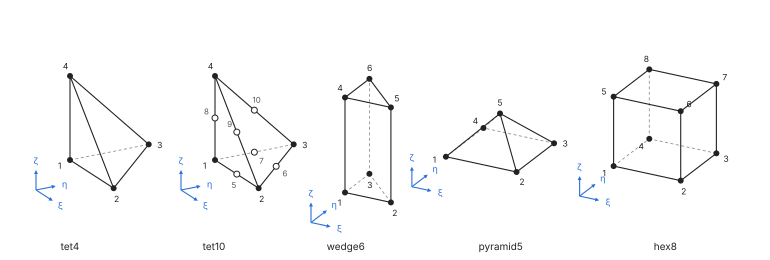
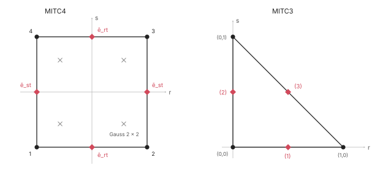
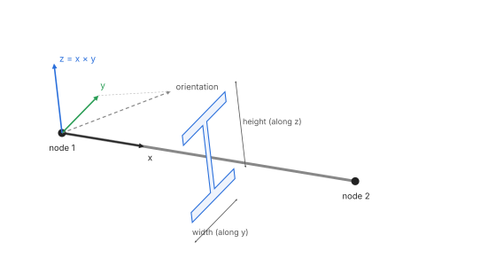
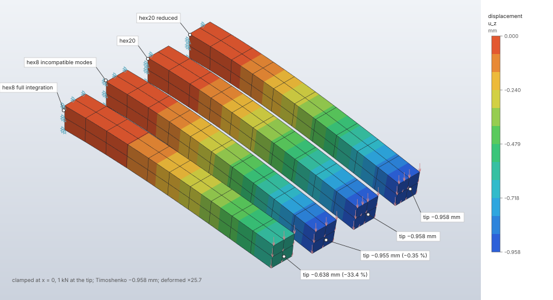

# Element library

The finite elements of `crates/fem` that the structural solvers assemble: continuum solids, 2D
continua (plane stress, plane strain, axisymmetric), flat shells, Timoshenko beams, trusses and
the discrete point masses, springs and dashpots. Every element is isoparametric over one shared
shape-function library and declares its nodal and condensed unknowns through one
degree-of-freedom layout, so solids, shells, beams and trusses share nodes in one mesh. A
section assigns the element kind's formulation (integration, incompatible modes, hybrid) to the
elements of a set. The library's scope is modelled on what a full CAE code offers (Abaqus's element
library is the reference for breadth); names, formulations and tests are FieldCraft's own, written
from the published literature, and the deck writers map each element to each solver's name
(`crates/decks`).

| | |
|---|---|
| **Commands** | `model.section.create`, `model.section.edit`; `model.mass.create`, `model.spring.create` (discrete elements) |
| **Step procedure** | every structural procedure; which elements each accepts is in [Availability by procedure](#availability-by-procedure) |
| **Solver** | `crates/fem` kernels, assembled by `crates/solver` (implicit, CPU, f64) and `crates/explicit` |
| **Method** | isoparametric displacement elements (Zienkiewicz, Taylor & Zhu 2013; Hughes 2000), incompatible modes (Wilson et al. 1973; Taylor, Beresford & Wilson 1976), mixed u–p (Hughes 2000 §4.3–4.5), MITC shells (Dvorkin & Bathe 1984; Lee & Bathe 2004), interdependent Timoshenko beam (Friedman & Kosmatka 1993) |
| **Verified by** | patch tests of every element and formulation, `patch-*`, `mh-solid-patch`, `cantilever-*`, `lame-cylinder*`, `kirsch-plate*`, `mh-thick-cylinder`, NAFEMS LE1–LE7, `scordelis-lo-roof-*`, `pinched-cylinder`; `crates/solver/tests/{verification,plane,structural,hybrid,one_d}.rs`, `crates/fem/src/basis.rs` tests |

## Synopsis

A solid section with incompatible-mode hexahedra, a hybrid section for rubber, a shell and a
beam:

```json
{"command": "model.section.create", "params": {"name": "body", "set": "all", "material": "Steel",
  "kind": {"type": "solid"}, "formulation": {"integration": "full", "incompatible_modes": true}}}
{"command": "model.section.create", "params": {"name": "seal", "set": "rubber", "material": "Rubber",
  "kind": {"type": "solid"}, "formulation": {"hybrid": true}}}
{"command": "model.section.create", "params": {"name": "skin", "set": "panel", "material": "Al",
  "kind": {"type": "shell", "thickness": 2, "offset": 0, "points": 5}}}
{"command": "model.section.create", "params": {"name": "frame", "set": "members", "material": "Steel",
  "kind": {"type": "beam", "profile": {"type": "i", "height": 100, "width": 50, "web": 5, "flange": 8},
           "orientation": [0, 0, 1]}}}
```

## Parameters

### Section kind (`kind`)

| Field | Value | Default | Meaning |
|---|---|---|---|
| `type` | `solid` | — | continuum solid elements (tet4, tet10, wedge6, pyramid5, hex8, hex20) |
| `type` | `plane_stress` | — | 2D continuum, σzz = 0; `thickness` required |
| `type` | `plane_strain` | — | 2D continuum, εzz = 0; `thickness` 1 mm by default |
| `type` | `axisymmetric` | — | 2D continuum in the half plane x ≥ 0, revolved about Y; forces, reactions and masses are totals over 2π |
| `type` | `shell` | — | flat MITC shells (tri3, quad4) |
| `thickness` | > 0 | — | shell or plane stress/strain thickness |
| `offset` | −0.5 to 0.5 | 0 | shell reference surface offset from the mid-surface, as a fraction of the thickness (0.5: on the side the normal points to) |
| `points` | 1 to 15 | 5 | shell integration points through the thickness |
| `type` | `beam` | — | two-node Timoshenko beam (beam2) |
| `profile` | `rectangle {width, height}`, `circle {radius}`, `pipe {radius, thickness}`, `i {height, width, web, flange}`, `box {width, height, thickness}` | — | the cross-section; `width` along local y, `height` along local z |
| `orientation` | `[x, y, z]`, nonzero, not along the beam | — | the profile's local y direction, projected normal to each beam's axis |
| `type` | `rod` | — | truss (rod2, rod3) |
| `area` | > 0 | — | truss cross-sectional area |

A 2D model is 2D as a whole: its elements lie in the XY plane, and 2D and solid sections are not
mixed in one model (trusses may join either).

### Formulation (`formulation`)

| Field | Value | Default | Meaning |
|---|---|---|---|
| `integration` | `full`, `reduced` | `full` | `reduced` exists for hex20 (2 × 2 × 2) and quad8 (2 × 2), and for hex8 in explicit dynamics (one point with hourglass control); elsewhere it is refused |
| `incompatible_modes` | `true`, `false` | `false` | enhanced bending modes: hex8 (solid sections) and quad4 (2D sections) only; needs full integration |
| `hybrid` | `true`, `false` | `false` | mixed displacement–pressure: solid, plane strain and axisymmetric sections only; isotropic materials only |

### Discrete elements

| Command | Fields | Meaning |
|---|---|---|
| `model.mass.create` | `target` (`{"set"}` or `{"reference_point"}`), `mass` (a number or `[mx, my, mz]`), `inertia` `[I11, I22, I33, I12, I13, I23]` | a point mass at every node of the target, each with the full value; rotary inertia needs rotations (a reference point) |
| `model.spring.create` | `type` `spring` (`stiffness`) or `dashpot` (`coefficient`); `first`, `second` (optional); `direction` `{"dof": 1..6}`, `{"vector": [x, y, z]}` or `"line"` | without `second` each node of `first` connects to the ground; `dof` 4–6 is torsional; `"line"` acts along the two ends (two-point only) |

## Theory

### Degrees of freedom

Every unknown is a pair (node, `DofKind`):

| `DofKind` | Meaning | Model / deck number |
|---|---|---|
| `Ux`, `Uy`, `Uz` | translations along X, Y, Z | 1, 2, 3 |
| `Rx`, `Ry`, `Rz` | rotations about X, Y, Z | 4, 5, 6 |
| `P` | pressure (mixed u–p elements) | 8 |
| `T` | temperature | 11 |

The enum order (Ux, Uy, Uz, Rx, Ry, Rz, T, P) is the numbering order within a node.
`DofKind::from_number` / `number` convert to the 1-based numbers boundary conditions use;
`from_direction` / `direction` to the structural directions 0–5.

An element declares its unknowns as `ElementDofs { node: DofSet, internal: Internal }`: the
kinds every node of the element carries (`DofSet::TRANSLATIONS` for solids, `PLANE` for 2D
elements, `STRUCTURAL` for shells and beams, `TEMPERATURE` for heat conduction, translations plus
`PRESSURE` for continuous-pressure mixed elements), and the internal unknowns it condenses out
itself (`incompatible_modes`, discontinuous `pressure`), which never reach the global system.
Element matrices are ordered node by node, the node's kinds in `DofKind` order (a shell's
24 × 24 stiffness: node 1 Ux Uy Uz Rx Ry Rz, node 2 …). Solid elements give theirs through
`Formulation::dofs()` / `Solid::dofs()`; trusses declare `fieldcraft_fem::truss::DOFS`
(translations on `Basis::Line2` / `Line3`).

**Numbering** (`DofLayout`). `DofLayout::builder()` collects what every node needs
(`element(labels, dofs)`; `node(label, kinds)` for constraints and boundary conditions that need
a kind no element gives; `point(label, kinds)` for reference points), then `build()`. A node
carries the union of what was asked for. Unknowns are numbered mesh nodes in label order, each
node's kinds in `DofKind` order, then the points in the order added; a slot's unknowns are
contiguous, so a node pair is one dense block in the assembled matrix, and the same model always
gives the same numbering. Lookups: `node(label)` / `slot(label)` (mesh nodes `0..nodes()`,
points `point_slot(k)`), `dof(slot, kind)`, `range(slot)`, `kinds(slot)`,
`locate(dof) -> (slot, kind)`, `element_dofs(slots, kinds)`, `describe(dof)`, `stride()`
(uniform layouts).

The implicit system (`fieldcraft_solver::system::Mesh::layout`) numbers the mesh nodes, then six
unknowns per coupled reference point. Assembly (`sparse::add_block(k, layout, slots, kinds,
data)`, `add_scalar`, `add_diagonal`) works for any mix of kinds per node, so a solid sharing
nodes with a shell adds its translation block into the shell nodes' six-unknown blocks. Boundary
conditions and loads address (node, kind): a boundary condition holds the kinds a node carries,
and a moment needs rotations. The explicit solver has solid and truss nodes only and checks that
its layout is the uniform node-major one (`NODE_DOFS = 3`).

### Shape functions

`Basis` is every family's interpolation:

| Family | Reference element | Nodes |
|---|---|---|
| `Line2`, `Line3` | ξ ∈ [−1, 1] | ends −1, 1; line3 adds the middle |
| `Tri3`, `Tri6` | ξ, η ≥ 0, ξ + η ≤ 1 | corners (0,0), (1,0), (0,1); mid-sides of 1-2, 2-3, 3-1 |
| `Quad4`, `Quad8`, `Quad9` | [−1, 1]² | corners counter-clockwise from (−1,−1); mid-sides of 1-2, 2-3, 3-4, 4-1; centre |
| `Tet4`, `Tet10` | unit tetrahedron | corners (0,0,0), (1,0,0), (0,1,0), (0,0,1); mid-sides of 1-2, 2-3, 3-1, 1-4, 2-4, 3-4 |
| `Wedge6`, `Wedge15` | triangle × ζ ∈ [−1, 1] | bottom 1-3, top 4-6; mid-sides of the bottom edges, top edges, vertical edges |
| `Pyramid5` | base [−1, 1]² at ζ = 0, apex (0, 0, 1) | base corners as quad4, then the apex |
| `Hex8`, `Hex20`, `Hex27` | [−1, 1]³ | corners 1-4 at ζ = −1, 5-8 above; hex20 mid-sides (bottom, top, vertical edges); hex27 face centres in `ElementKind::Hex8.faces()` order, then the centre |

Node orders are the model's (`ElementKind::edges()` / `faces()` are the single source): corners,
mid-side nodes in edge order, face nodes, body nodes. tri6 corners are N = L(2L − 1) and its
mid-sides N = 4 Lₐ L_b in area coordinates L₁ = 1 − ξ − η, L₂ = ξ, L₃ = η; quad8 and hex20 are
serendipity, quad9 and hex27 Lagrange. The pyramid's rational functions
N = ¼[(1 − ζ) + ξξᵢ + ηηᵢ + ξᵢηᵢ ξη / (1 − ζ)], N₅ = ζ are linearly complete and conform with
neighbouring tetrahedra and hexahedra (Bedrosian 1992); at the apex the rational term and its
derivatives take their limit along the axis, zero, and quadrature points never lie there. quad9,
hex27 and wedge15 exist as shape functions; no element uses them yet.

`Basis::of(ElementKind)` maps a model element; `nodes()` gives natural node coordinates; `dim()`,
`count()`, `corners()`, `degree()` (the complete polynomial degree reproduced: 1 for the linear
families including the rational pyramid, 2 for the quadratic ones). Evaluation at a natural point
`xi: [f64; 3]` (unused coordinates zero):

- `eval(xi) -> Shape`: values `n` and first derivatives `dn[i] = ∂Nᵢ/∂(ξ, η, ζ)`. tet4, tet10,
  wedge6, hex8 and hex20 use the hand-written functions of `shape.rs` (the solid kernels' path);
  the solid kernel's pyramid5 uses the library's.
- `eval2(xi) -> Shape2`: adds `d2n[i][a][b] = ∂²Nᵢ/∂ξₐ∂ξ_b`, from second-order forward-mode
  automatic differentiation of the same formulas (`jet::Jet`), exact to round-off.
- `gradients(&shape, xyz) -> Gradients`: physical `dx[i] = ∇ₓNᵢ = J⁻¹ ∇_ξNᵢ` and `det J`, with
  J_ab = ∂x_b/∂ξₐ; an inverted or collapsed element is `Error::Degenerate`.
- `hessians(&shape2, xyz) -> Hessians`: physical
  `d2x[i]` = J⁻¹ (H_ξ − Σ_b (∂N/∂x_b) X_b″) J⁻ᵀ with X_b″ = Σᵢ x_{i,b} H_ξ(Nᵢ), the map's second
  derivative (Hughes 2000, §3.9, §4.2), and `laplacian(i)`. Without the X″ term a field linear in
  x would have a nonzero Hessian on a curved element.

A family of dimension d maps onto the first d physical coordinates (plane elements in x–y, lines
along x). Elements embedded in a higher dimension (shells, beams, trusses in 3D) pass node
coordinates in their own local frame.



### Solid continuum elements

The isoparametric displacement formulation (Zienkiewicz, Taylor & Zhu 2013, ch. 6; Hughes 2000,
ch. 3): K = ∫ Bᵀ D B dV and M = ∫ ρ Nᵀ N dV, integrated by Gauss quadrature on the reference
element through the Jacobian of the map. Stress and strain are 6-vectors in the order xx, yy, zz,
xy, xz, yz with engineering shear strains.

| Element | Nodes | Full rule (stiffness) | Reduced | Mass rule | Incompatible modes | Hybrid pressures |
|---|---|---|---|---|---|---|
| tet4 | 4 | centroid (1 point) | — | symmetric 4-point (degree 2) | — | refused |
| tet10 | 10 | symmetric 4-point (degree 2) | — | conical product, 4 per direction (degree 5) | — | 1 (constant) |
| wedge6 | 6 | 3 triangle points × 2 Gauss points | — | the same | — | refused |
| pyramid5 | 5 | collapsed (Duffy) product, 2 × 2 × 2 | — | collapsed product, 3 × 3 × 3 | — | refused |
| hex8 | 8 | 2 × 2 × 2 | explicit dynamics only (one point, hourglass control) | 2 × 2 × 2 | 9 condensed modes | 1 (constant) |
| hex20 | 20 | 3 × 3 × 3 | 2 × 2 × 2 | 3 × 3 × 3 | — | 4 (1, x, y, z) |

- **Full integration** integrates the stiffness of an undistorted element exactly.
- **Reduced hex20** (2 × 2 × 2) avoids locking at the cost of one spurious mode that a mesh of
  more than one element restrains.
- **Incompatible modes** (hex8): nine internal displacement modes (1 − ξ²), (1 − η²), (1 − ζ²)
  per direction, condensed out of the element (Wilson, Taylor, Doherty & Ghaboussi 1973). Their
  derivatives use the Jacobian at the element centre scaled by det J₀ / det J (Taylor, Beresford
  & Wilson 1976), so the element passes the patch test when distorted. It bends correctly with
  one element through the thickness.
- **Quadrature.** Gauss–Legendre with 1 to 4 points (exact for degree 2n − 1) and its tensor
  products; on the tetrahedron the centroid rule, the symmetric four-point rule and Stroud's
  conical product (the collapsed map ξ = u, η = v(1 − u), ζ = w(1 − u)(1 − v), Jacobian
  (1 − u)²(1 − v), exact for degree 2n − 3 with positive weights; Stroud 1971, §2.7); on the
  wedge the symmetric three-point triangle rule (area coordinates (⅔, ⅙, ⅙) and permutations,
  degree 2) times two-point Gauss in ζ; on the pyramid the collapsed product ξ = u(1 − w),
  η = v(1 − w), ζ = w with weight (1 − w)², which makes the rational functions polynomials.
- **Lumped mass** is the diagonal scaling of Hinton, Rock & Zienkiewicz (1976): the consistent
  diagonal scaled to the element's mass, positive for quadratic elements too.
- **Nodal stresses** extrapolate the integration-point values with the element's linear corner
  functions fitted by least squares (Hinton & Campbell 1974); mid-side nodes take the mean of
  their edge's corners.

**Hybrid (mixed u–p) solids** (`crate::hybrid`). The isotropic elasticity splits as
D = D_dev + K m mᵀ, m = (1, 1, 1, 0, 0, 0), K = mᵀ D m / 9. The mean stress p = N_p · p̂ is an
independent field, discontinuous between elements, enforced weakly (the perturbed Lagrangian of
Hughes 2000, §4.3–4.4):

```text
K_dev = ∫ Bᵀ D_dev B dV,   G = ∫ Bᵀ m N_pᵀ dV,   M = ∫ N_p N_pᵀ dV
[K_dev  G; Gᵀ  −M/K] [u; p̂] = [f; 0]   ⇒   p̂ = K M⁻¹ Gᵀ u,   K_e = K_dev + K G M⁻¹ Gᵀ
```

The condensed stiffness is symmetric positive definite for any ν < ½ with a bounded volumetric
stiffness per element however close ν is to ½, so nothing global changes and Cholesky still
applies; `ElementDofs.internal.pressure` counts the condensed unknowns. Stresses are
D_dev ε + p m with the element's pressure field. With a constant pressure this is the B-bar /
mean dilatation element (Hughes 2000, §4.5; Nagtegaal, Parks & Rice 1974). The pressure spaces
follow the inf-sup analysis (Brezzi & Fortin 1991, ch. VI; Bathe 2014, §4.5): hex20 Q2–P1disc and
tet10 P2–P0 are stable; a single tet10 has three more zero-energy modes that neighbouring elements
restrain; hex8 Q1–P0 passes the patch test and does not lock; it is not inf-sup stable, so some
meshes and constraints show checkerboard element pressures while the displacements stay good;
tet4 and wedge6 lock even with one pressure per element and are refused. A thermal strain splits
the same way: ∫ Bᵀ D_dev ε_th on the nodes and, through the pressure, K G M⁻¹ ∫ N_p tr ε_th, so a
confined heated nearly incompressible solid carries its bulk stress −3KαΔT.

### 2D continuum elements

Plane stress, plane strain and axisymmetric elements (`crate::plane`) lie in the XY plane with
two displacements per node, u along X and v along Y. The strain is (εxx, εyy, εzz, γxy), the
third component out of plane:

- **plane strain**: εzz = 0; σzz = D₃₁εxx + D₃₂εyy + D₃₄γxy is reported;
- **plane stress**: σzz = 0, the elasticity condensed to D̃ᵢⱼ = Dᵢⱼ − Dᵢ₃D₃ⱼ/D₃₃, and
  εzz = −(D₃₁εxx + D₃₂εyy + D₃₄γxy)/D₃₃ is reported;
- **axisymmetric**: x is the radius r, y the axial coordinate, εzz the hoop strain u/r; volumes
  are 2πr dA, so forces, reactions and masses are totals over the circumference.

D is the leading 4 × 4 block of the 3D elasticity, so orthotropic materials with axes along the
global axes work as in solids. Results are reported as the solids' 6-vectors with xz = yz = 0
(axisymmetric: rr, axial, hoop, r-axial). Plane elements integrate over their thickness t.
Rules: tri3 one point, tri6 three points (degree 2), quad4 2 × 2, quad8 3 × 3 or 2 × 2 reduced;
reduced quad4 needs hourglass control and is refused. On the axis (r = 0) the hoop strain is
evaluated only at integration points, which lie inside the element for every element with a node
off the axis; the solver holds the radial displacement of nodes on the axis at zero.

**Quad4 incompatible modes** (QM6): the internal modes (1 − ξ²) and (1 − η²) in u and v, mapped
with the centre Jacobian and scaled by det J₀ / det J, condensed out. In an axisymmetric element
the modes also strain the hoop direction, and their strain operator is shifted by its volume mean
(Wilson & Ibrahimbegovic 1990), which leaves the plane case unchanged and makes the axisymmetric
element pass the patch test.

**Hybrid 2D** (plane strain and axisymmetric quad4, quad8 and tri6): one constant pressure per
element, the mean dilatation method (Nagtegaal, Parks & Rice 1974; Hughes 2000, §4.5 for the
axisymmetric B-bar): K = ∫ Bᵀ D_dev B dV + κ g gᵀ / V with g = ∫ Bᵀ m dV, m = (1, 1, 1, 0), the
hoop strain included in the volumetric part. The linear triangle locks and is refused; plane
stress has no volume constraint and is refused.

### Shells

Flat MITC4 quadrilaterals and MITC3 triangles (`crate::shell`) with six unknowns per node. Each
element is projected onto its mean plane, where membrane, Reissner–Mindlin plate and drilling
stiffness are superposed in local axes and rotated to the global ones (the facet approach;
Zienkiewicz, Taylor & Fox 2014, ch. 9–10). Quadrilaterals on a cylinder whose edges follow the
generators and the circumference are exactly flat.

- **Kinematics.** With z along the element normal, u = u₀ + z θ_y, v = v₀ − z θ_x, w = w₀:
  membrane strains (u₀,x, v₀,y, u₀,y + v₀,x), curvatures (θ_y,x, −θ_x,y, θ_y,y − θ_x,x),
  transverse shear (w,x + θ_y, w,y − θ_x).
- **Section.** Linear elastic and homogeneous through the thickness, integrated in closed form
  (any number of section points gives the same stiffness): with the mid-surface at
  z = e = −offset · t, N = A ε + B κ, M = B ε + D κ with A = Q t, B = Q t e,
  D = Q (t³/12 + t e²), Q the plane stress matrix, and Q_s = k G t γ with k = 5/6.
- **Transverse shear, MITC4.** The covariant shear strains are sampled at the mid-sides
  (ẽ_rt at (0, ±1), ẽ_st at (±1, 0)) and interpolated linearly (Dvorkin & Bathe 1984; Bathe &
  Dvorkin 1985). Membrane and bending use the bilinear fields, all with 2 × 2 Gauss points.
- **Transverse shear, MITC3.** Tied at the mid-sides (½, 0), (0, ½), (½, ½):
  ẽ_rt = e_rt⁽¹⁾ + c s, ẽ_st = e_st⁽²⁾ − c r, c = e_rt⁽³⁾ − e_rt⁽¹⁾ − e_st⁽³⁾ + e_st⁽²⁾, which keeps
  each edge's tangential shear constant (Lee & Bathe 2004). The membrane is the constant-strain
  triangle.
- **Drilling rotation.** Tied to the membrane's in-plane rotation ω = ½ (v,x − u,y) by the
  penalty ∫ γ t (θ_z − ω)² dA (Hughes & Brezzi 1989) with γ = G/100. On the bilinear membrane the
  in-plane rotation of a parallelogram is linear, which θ_z interpolates exactly, so the penalty
  does not lock; scaled with G t, it ties each node's normal rotation to the membrane as the mesh
  is refined. The Scordelis–Lo and pinched-cylinder results change by less than 0.5 % for γ from
  G/1000 to G.
- **Mass.** Consistent: ρ t on the translations, ρ (t³/12 + t e²) on the rotations, ρ t e
  coupling translations and bending rotations when the reference surface is offset; the drilling
  rotation takes the bending rotary inertia, which keeps the mass matrix positive definite.
  Lumped: the diagonal scaled to the element's mass, the rotary inertia isotropic about the node.
- **Stresses.** Section forces and the stresses at the bottom, middle and top of the section at
  the integration points, extrapolated bilinearly to the nodes (quadrilateral) or taken at the
  nodes (triangle). Transverse shear stress is reported at the mid-surface as 3/2 Q/t.



### Beams

The two-node Timoshenko beam (`crate::beam`), six unknowns per node, built in local axes and
rotated to the global ones (`crate::frame`, K_g = Tᵀ K_l T). Local x runs from node 1 to node 2;
y is the section's orientation vector made normal to x (the profile's `width` direction);
z = x × y (its `height` direction).

- Axial and torsional stiffness are the exact EA/L and GJ/L. Each bending plane uses the
  interdependent interpolation (cubic deflection, quadratic rotation, coupled through
  Φ = 12 EI / (G A_s L²)), so the shear strain is constant and the element is exact for end loads
  at any number of elements (Przemieniecki 1968, §5.6; Friedman & Kosmatka 1993). Stiffness
  K = ∫ (EI θ′ᵀ θ′ + G A_s (w′ − θ)ᵀ (w′ − θ)) dx and consistent mass
  M = ∫ (ρA N_wᵀ N_w + ρI N_θᵀ N_θ) dx are integrated exactly with four Gauss points; Φ → 0 is
  the Euler–Bernoulli (Hermite) element. The rotation about y is −dw/dx in the x–z plane.
- Lumped mass: half the mass on each node's translations, half the polar inertia on the twist,
  the consistent bending rotary diagonal scaled like the translations.
- End forces are K u minus the consistent loads of the element's body force: N, V_y, V_z, T,
  M_y, M_z on the cut whose outward normal is +x.
- Section properties: area, I_y = ∫ z² dA, I_z = ∫ y² dA, polar I_y + I_z, torsion constant J and
  shear areas. Rectangle: Saint-Venant's series J = a b³/3 (1 − 192 b/(π⁵ a)
  Σ_{n odd} tanh(nπa/2b)/n⁵), a ≥ b (Timoshenko & Goodier 1970, §109), shear coefficient
  10(1 + ν)/(12 + 11ν). Circle and pipe: J = I_y + I_z, shear coefficients 6(1 + ν)/(7 + 6ν) and,
  for radius ratio m, 6(1 + ν)(1 + m²)² / ((7 + 6ν)(1 + m²)² + (20 + 12ν) m²) (Cowper 1966). I and
  box (thin-walled): J = Σ b t³/3 (open I) and Bredt's 4 A_m² t / p (closed box); shear areas the
  walls parallel to the shear (the web for shear along z, 5/6 of the flanges along y) (Pilkey
  2002, ch. 6).



### Trusses

rod2 and rod3, straight or curved (`crate::truss`; Cook, Malkus, Plesha & Witt 2002, §3.6 and
§6.2; Hughes 2000, §1.10). On ξ ∈ [−1, 1], N = ((1 − ξ)/2, (1 + ξ)/2) for rod2 and
N = (ξ(ξ − 1)/2, ξ(ξ + 1)/2, 1 − ξ²) for rod3 (ends, then the middle). With ds = J dξ,
J = |x′(ξ)| and the tangent t = x′/J, the axial strain is ε = Σᵢ (Nᵢ′/J) t · uᵢ:
K = ∫ E A Bᵀ B ds, consistent mass ρ A ∫ Nᵢ Nⱼ ds per direction, HRZ lumped mass (ρAL/2 at each end
of rod2, ρAL·(1/6, 1/6, 2/3) on a straight rod3), body force A ∫ Nᵢ b ds, and the stress σ = E ε
reported in global axes as the uniaxial tensor σ t tᵀ, so the axial force is N = A tᵀ σ t. Rules:
two Gauss points for rod2, three for rod3. The material is the Young's modulus of an isotropic
material; an orthotropic material is refused. In a 2D model a truss carries the two in-plane
translations.

### Discrete elements

Point masses, rotary inertia, springs and dashpots (`fieldcraft_solver::discrete`) are not mesh
elements: the solver asks the layout for what each needs at its nodes (`discrete::needs`:
translations for a mass or a translational spring, rotations for an inertia or a torsional
spring; a reference point they use gets six) and finds its unknowns with `discrete::dof_of`.

- A point mass adds m_x, m_y, m_z on the node's translations and its inertia tensor (3 × 3,
  products included) on its rotations, the same in the consistent and the lumped mass matrix.
- A spring of stiffness k and unit direction coefficients c on each end's six unknowns adds
  k c cᵀ to each end and −k c cᵀ between them (Cook et al. 2002, §2.2): the elongation is
  cᵀ(u_second − u_first).
- A dashpot has the same form on velocities; static, frequency and buckling steps ignore it with
  a warning, explicit dynamics uses it.

### Thermal strain

ε_th = α (T − T_ref) along the material axes enters a solid as the load
`Solid::thermal_load(d, &ThermalStrain { alpha, delta })` = ∫ Bᵀ D ε_th dV and its stress as
`Solid::stresses_with(d, u, Some(&thermal))` = D (ε − ε_th), `delta` the nodal T − T_ref. 2D
elements have the same pair (`Plane::thermal_load`, `Plane::stresses_with`): plane stress leaves
εzz free (σzz = 0), plane strain holds it (σzz = −D₃·ε_th), axisymmetric elements strain the hoop
direction too. Trusses take the axial part Σ αₖ tₖ² ΔT along their tangent
(`Truss::thermal_load`, `Truss::stresses_with`). Springs, dashpots and point masses have no
thermal strain. Shells and beams take none yet: a static step with temperatures and shells or
beams warns that only solid, 2D and truss elements are strained ([Heat transfer](heat-transfer.md)).

### Availability by procedure

| Element | Linear static, frequency | Buckling | Heat transfer | Nonlinear static | Explicit dynamics |
|---|---|---|---|---|---|
| tet4, tet10, wedge6, pyramid5, hex8 (full, incompatible), hex20 (full, reduced) | yes | yes | yes (conduction on the element's full rule; the formulation does not apply) | yes (hex8 incompatible refused with nonlinear geometry or an inelastic material) | tet4 (nodal-pressure) and one-point hex8 only |
| hybrid hex8, hex20, tet10 | yes | yes | yes (as the displacement element) | yes (needs the neo-Hookean option or another hyperelastic or plastic model with a volumetric split) | refused |
| plane stress tri3, tri6, quad4, quad8 | yes | yes | refused | refused | refused |
| plane strain, axisymmetric tri3, tri6, quad4, quad8 (and hybrid quad4, quad8, tri6) | yes | yes | refused | yes | refused |
| shell tri3, quad4 | yes | refused | refused | refused | refused |
| beam2 | yes | refused | refused | refused | refused |
| rod2, rod3 | yes | refused | refused | refused | rod2; rod3 with `nonlinear_geometry: false` only; elastic only |
| point mass, spring, dashpot | yes (dashpots ignored) | yes (dashpots ignored) | — | springs, along their fixed directions | translational ones; rotary inertia and torsional springs refused |

Explicit dynamics uses its own kernels for the one-point hexahedron (uniform strain with
Flanagan–Belytschko hourglass control) and the nodal-pressure tetrahedron
([Explicit dynamics](explicit-dynamics.md)). The finite-strain forms of the solids and 2D
elements are described in [Nonlinear static](nonlinear-static.md).

### Decks

The deck writers (`crates/decks`) map each element and formulation to each format's names. The
mappings the element library records: point mass to Abaqus MASS, Nastran CONM1 and LS-DYNA
ELEMENT_MASS (per-direction masses: Nastran only); rotary inertia to ROTARYI, CONM1 and
ELEMENT_INERTIA; springs to SPRING1/2/A, CELAS2 and ELEMENT_DISCRETE (skew fixed directions:
LS-DYNA only); dashpots to DASHPOT1/2/A, CDAMP2 and ELEMENT_DISCRETE; rod2 to T3D2 / T2D2, CROD
and an LS-DYNA truss beam (3D models); rod3 to T3D3 / T2D3 (no Nastran or LS-DYNA counterpart);
pyramid5 to C3D5, CPYRAM and an LS-DYNA degenerate solid.

## Algorithm

What a solver does with a section's elements:

1. **Resolve.** `system::Mesh::new` reads each section: a solid or 2D section gives its elements
   the material's elasticity matrix D and the formulation from `Formulation::from_section` or
   `plane::formulation`, which refuses a formulation the element kind lacks (by name); a shell or
   beam section builds its `ShellSection` or `BeamSection` (isotropic constants only); a rod
   section takes the Young's modulus.
2. **Number.** The `DofLayout` collects every element's declared kinds and the discrete
   elements' needs; a model above `max_dofs` unknowns stops with
   "the model has N degrees of freedom; the limit is M".
3. **Element matrices.** Stiffness (and mass) are computed in parallel rounds of 4096 elements,
   16 per task, and added in label order, so the sums are those of a sequential loop.
   Incompatible modes and hybrid pressures are condensed inside each element.
4. **Recover.** After the solve, each element evaluates its stresses at its integration points;
   one extrapolation per element type and rule takes them to the nodes.

An element whose Jacobian is not admissible at an integration point is an error naming the
element (`fieldcraft_model::admissible_jacobian`, the same criterion the meshers' gate uses).

## Output

Per element, at the integration points: position, strain and stress (`PointStress`); extrapolated
to the element's nodes (`ElementStress::nodal`); shells: section forces (N, M, Q per length in
the element's axes) and bottom, middle and top stresses; beams: end forces (N, V_y, V_z, T, M_y,
M_z in the element's axes); trusses: the uniaxial stress tensor. `solve.probe` with `elements`
returns them; [Linear static](linear-static.md#output) describes the nodal averages.

## Worked example

Four steel cantilevers of the same size and mesh density, one per solid formulation, each
clamped at its root and loaded with 1 kN at its tip: hex8 with full integration, hex8 with
incompatible modes, hex20 with full and with reduced integration. Ten elements along a beam of
L/h = 10 show the shear locking of the fully integrated hex8 in bending and how the other
formulations remove it, against Timoshenko beam theory.

| | |
|---|---|
| **Geometry** | four beams 200 mm along x, 20 × 20 mm section, 20 mm apart in y; one block each (`mesh.block`), faces `root` at x = 0 and `tip` at x = 200 |
| **Mesh** | 10 × 2 × 2 elements per beam: `Hex8` hex8 full, `Hex8I` hex8 incompatible modes, `Hex20` hex20 full, `Hex20R` hex20 reduced (2 × 2 × 2) |
| **Material** | E = 210 000 MPa, ν = 0, ρ = 7.85 × 10⁻⁹ t/mm³ (ν = 0 so the clamped root face does not hold a Poisson contraction that beam theory leaves out) |
| **Boundary conditions** | each beam's `root` fixed |
| **Load** | force [0, 0, −1000] N, total, on each beam's `tip` face |
| **Step** | `Bend`, static, all four beams |
| **Units** | mm, t, s, N, MPa |

```json
[
  {"command": "model.units", "params": {"system": "mm-t-s-N-MPa"}},
  {"command": "model.material.create", "params": {"name": "Steel", "elastic": {"type": "isotropic", "young": 210000, "poisson": 0.0}, "density": 7.85e-9}},
  {"command": "mesh.block", "params": {"body": "Hex8", "kind": "hex8", "corners": [[0, 0, 0], [200, 0, 0], [200, 20, 0], [0, 20, 0], [0, 0, 20], [200, 0, 20], [200, 20, 20], [0, 20, 20]], "divisions": [10, 2, 2], "faces": {"6": "root", "4": "tip"}}},
  {"command": "model.set.create", "params": {"name": "Hex8", "geometry": [{"body": "Hex8"}]}},
  {"command": "model.set.create", "params": {"name": "Hex8-root", "geometry": [{"body": "Hex8", "face": "root"}]}},
  {"command": "model.set.create", "params": {"name": "Hex8-tip", "geometry": [{"body": "Hex8", "face": "tip"}]}},
  {"command": "model.section.create", "params": {"name": "Hex8", "set": "Hex8", "material": "Steel", "kind": {"type": "solid"}}},
  {"command": "model.boundary_condition.create", "params": {"name": "Hex8-clamp", "type": "fixed", "target": {"set": "Hex8-root"}}},
  {"command": "model.load.create", "params": {"name": "Hex8-P", "type": "force", "target": {"set": "Hex8-tip"}, "vector": [0, 0, -1000]}},
  {"command": "mesh.block", "params": {"body": "Hex8I", "kind": "hex8", "corners": [[0, 40, 0], [200, 40, 0], [200, 60, 0], [0, 60, 0], [0, 40, 20], [200, 40, 20], [200, 60, 20], [0, 60, 20]], "divisions": [10, 2, 2], "faces": {"6": "root", "4": "tip"}}},
  {"command": "model.set.create", "params": {"name": "Hex8I", "geometry": [{"body": "Hex8I"}]}},
  {"command": "model.set.create", "params": {"name": "Hex8I-root", "geometry": [{"body": "Hex8I", "face": "root"}]}},
  {"command": "model.set.create", "params": {"name": "Hex8I-tip", "geometry": [{"body": "Hex8I", "face": "tip"}]}},
  {"command": "model.section.create", "params": {"name": "Hex8I", "set": "Hex8I", "material": "Steel", "kind": {"type": "solid"}, "formulation": {"incompatible_modes": true}}},
  {"command": "model.boundary_condition.create", "params": {"name": "Hex8I-clamp", "type": "fixed", "target": {"set": "Hex8I-root"}}},
  {"command": "model.load.create", "params": {"name": "Hex8I-P", "type": "force", "target": {"set": "Hex8I-tip"}, "vector": [0, 0, -1000]}},
  {"command": "mesh.block", "params": {"body": "Hex20", "kind": "hex20", "corners": [[0, 80, 0], [200, 80, 0], [200, 100, 0], [0, 100, 0], [0, 80, 20], [200, 80, 20], [200, 100, 20], [0, 100, 20]], "divisions": [10, 2, 2], "faces": {"6": "root", "4": "tip"}}},
  {"command": "model.set.create", "params": {"name": "Hex20", "geometry": [{"body": "Hex20"}]}},
  {"command": "model.set.create", "params": {"name": "Hex20-root", "geometry": [{"body": "Hex20", "face": "root"}]}},
  {"command": "model.set.create", "params": {"name": "Hex20-tip", "geometry": [{"body": "Hex20", "face": "tip"}]}},
  {"command": "model.section.create", "params": {"name": "Hex20", "set": "Hex20", "material": "Steel", "kind": {"type": "solid"}}},
  {"command": "model.boundary_condition.create", "params": {"name": "Hex20-clamp", "type": "fixed", "target": {"set": "Hex20-root"}}},
  {"command": "model.load.create", "params": {"name": "Hex20-P", "type": "force", "target": {"set": "Hex20-tip"}, "vector": [0, 0, -1000]}},
  {"command": "mesh.block", "params": {"body": "Hex20R", "kind": "hex20", "corners": [[0, 120, 0], [200, 120, 0], [200, 140, 0], [0, 140, 0], [0, 120, 20], [200, 120, 20], [200, 140, 20], [0, 140, 20]], "divisions": [10, 2, 2], "faces": {"6": "root", "4": "tip"}}},
  {"command": "model.set.create", "params": {"name": "Hex20R", "geometry": [{"body": "Hex20R"}]}},
  {"command": "model.set.create", "params": {"name": "Hex20R-root", "geometry": [{"body": "Hex20R", "face": "root"}]}},
  {"command": "model.set.create", "params": {"name": "Hex20R-tip", "geometry": [{"body": "Hex20R", "face": "tip"}]}},
  {"command": "model.section.create", "params": {"name": "Hex20R", "set": "Hex20R", "material": "Steel", "kind": {"type": "solid"}, "formulation": {"integration": "reduced"}}},
  {"command": "model.boundary_condition.create", "params": {"name": "Hex20R-clamp", "type": "fixed", "target": {"set": "Hex20R-root"}}},
  {"command": "model.load.create", "params": {"name": "Hex20R-P", "type": "force", "target": {"set": "Hex20R-tip"}, "vector": [0, 0, -1000]}},
  {"command": "model.step.create", "params": {"name": "Bend", "procedure": {"type": "static"}, "boundary_conditions": ["Hex8-clamp", "Hex8I-clamp", "Hex20-clamp", "Hex20R-clamp"], "loads": ["Hex8-P", "Hex8I-P", "Hex20-P", "Hex20R-P"]}},
  {"command": "solve.static", "params": {"step": "Bend"}},
  {"command": "solve.probe", "params": {"step": "Bend", "at": [[200, 10, 10], [200, 50, 10], [200, 90, 10], [200, 130, 10]]}},
  {"command": "results.reactions", "params": {"step": "Bend", "sets": ["Hex8-root", "Hex8I-root", "Hex20-root", "Hex20R-root"]}},
  {"command": "results.deformed", "params": {"step": "Bend", "show": true, "scale": "auto"}},
  {"command": "results.contour", "params": {"step": "Bend", "field": "displacement_z"}}
]
```

Results from `solve.probe` at the centre of each tip face and the `solve.static` reply (2 520
unknowns, 2 340 free, 218 448 factor entries; under 0.1 s, Apple M4 Max, CPU). The reference is
Timoshenko's deflection δ = F L³/(3 E I) + F L/(κ G A) with I = h⁴/12, G = E/2 (ν = 0), κ = 5/6:
0.952 381 + 0.005 714 = 0.958 095 mm.

| Formulation | Tip u_z (mm) | Reference (mm) | Difference |
|---|---|---|---|
| hex8, full integration | −0.638 095 | −0.958 095 | −33.4 % |
| hex8, incompatible modes | −0.954 762 | −0.958 095 | −0.35 % |
| hex20, full integration | −0.957 770 | −0.958 095 | −0.034 % |
| hex20, reduced integration | −0.957 971 | −0.958 095 | −0.013 % |

| Quantity | FieldCraft | Reference | Difference |
|---|---|---|---|
| Reaction z, each `root` set (`results.reactions`) | 1 000.000 N | 1 000 N | < 10⁻¹⁰ |
| Reaction moment about y, each `root` set | −200 000.000 N·mm | −F L = −200 000 N·mm | < 10⁻¹⁰ |
| `max_von_mises`, all four beams | 150.17 MPa | M/Z = 6 F L / h³ = 150 MPa at the root | +0.12 % |

With ν = 0.3 (G = E/2.6) the same mesh gives −0.661 877, −0.937 099, −0.945 299 and
−0.948 947 mm against 0.959 810 mm (−31.0 %, −2.37 %, −1.51 %, −1.13 %): the fixed root face
then also holds the section's Poisson contraction, which the beam formula leaves out.



**What to look at.** The front beam, fully integrated hex8, deflects a third less than the
others: its trilinear displacement field cannot represent pure bending, and the parasitic
shear strain it carries instead stiffens it (shear locking). The incompatible modes add the
internal (1 − ξ²) modes that let the element bend, and the quadratic hex20 represents the bending
field with its mid-side nodes; with two elements through the depth both come within
0.35 % of beam theory, hex20 within 0.04 %. The reactions and the root moment are exact in all
four: equilibrium does not depend on the formulation.

## Verification

| Case | Reference | Result | Tolerance | Test |
|---|---|---|---|---|
| Patch test, every solid and formulation (tet4, tet10, wedge6, hex8, hex8 incompatible, hex20, hex20 reduced) on a distorted 2 × 2 × 2 patch | theory: linear field exact | displacement error < 10⁻¹², stress < 10⁻¹⁰ | exact | `patch_test_every_element`; `patch-hex8`, `patch-hex8-incompatible`, `patch-hex20`, `patch-hex20-reduced`, `patch-tet4`, `patch-tet10`, `patch-wedge6` (all quantities < 10⁻⁴ %) |
| hex8–pyramid5–tet4 transition patch and uniaxial tension | theory | displacement < 10⁻¹² (patch), < 10⁻¹¹ and stress < 10⁻⁹ (tension) | exact | `hex_pyramid_tet_transition_passes_the_patch_test` |
| MacNeal–Harder solid patch, hex8 incompatible | benchmark (MacNeal & Harder 1985, Table 2(c)) | σ, τ, u at inner node 7: < 10⁻⁴ % | 10⁻⁹ rel. | `mh-solid-patch` |
| 2D patch test, every element and theory | theory | displacement < 10⁻¹⁵, stress < 10⁻¹⁴ | exact | `patch_test_every_element_and_theory` |
| Cantilever tip deflection (Timoshenko, κ = 5/6) | theory | hex20 0.013 %, hex8 incompatible 0.16 %, tet10 0.018 % | 0.5 % | `cantilever-hex20`, `cantilever-hex8-incompatible`, `cantilever-tet10` |
| MacNeal–Harder straight cantilever, one hex8 incompatible through the depth | benchmark | extension −1.24 %; in-plane shear −2.18 %, out-of-plane shear −2.71 %, twist −10.8 % (known failures, MacNeal–Harder's own HEXA(8): 0.981, 0.981, 0.910 of theory) | 2 % | `mh-straight-cantilever` |
| MacNeal–Harder curved cantilever, hex8 | benchmark | −12 % in-plane, −20.2 % out-of-plane (known failures, grades C and D) | 2 % | `mh-curved-cantilever` |
| Nearly incompressible thick cylinder, plane strain, ν = 0.4999 | theory (Lamé) | hybrid hex8 < 1 %, hybrid hex20 < 10⁻⁴, hybrid tet10 < 0.5 %; displacement hex8 below 0.7 of Lamé (locks) | as stated | `nearly_incompressible_thick_cylinder_does_not_lock` |
| MacNeal–Harder thick cylinder, ν = 0.49, 0.499, 0.4999 | benchmark | −1.38 %, −1.40 %, −1.41 % | 2 % | `mh-thick-cylinder` |
| Hybrid block in uniaxial strain; confined heated block | theory | exact (10⁻⁹ displacement, 10⁻⁶ stress); σ = −3KαΔT to 10⁻⁶ | exact | `block_in_uniaxial_strain`, `heated_confined_block_carries_the_bulk_thermal_stress` |
| Shell membrane and bending patch tests (MITC4, MITC3, irregular patch in a tilted plane) | theory | < 10⁻⁹ (moments < 10⁻⁸) | exact | `shell_membrane_patch_test`, `shell_bending_patch_test` |
| Simply supported square plate, deflection and first frequency (Navier) | theory | < 1 % at 16 × 16 cells, quad4 and tri3 | 1 % | `simply_supported_plate_deflection_and_frequency` |
| NAFEMS LE2, LE3, LE6 (MITC4) | benchmark | −0.107 % / −0.161 %, −0.446 %, +2.21 % against the thin-plate target (known failure; −0.037 % against the converged thin-solid value) | 1–2 % | `nafems-le2`, `nafems-le3`, `nafems-le6` |
| Scordelis–Lo roof, pinched cylinder (MITC4) | benchmark | 1.12 %, 1.15 % | 2 % | `scordelis-lo-roof-shell`, `pinched-cylinder` |
| Timoshenko cantilever beam, deflection and end forces | theory | < 10⁻⁹ | exact | `cantilever_beam_deflection_is_exact` |
| Portal frame (slope-deflection with Timoshenko members) | theory | sway and base moment < 5·10⁻⁴, joint rotation < 3·10⁻³ | as stated | `portal_frame_matches_the_slope_deflection_solution` |
| Trusses by the method of joints (Pratt, tripod), three-bar truss, rod3 patch, hanging bar | theory | < 10⁻¹⁰ | exact | `crates/solver/tests/one_d.rs` |
| Kirsch plate, Lamé cylinder, rotating disc and cylinder in 2D | theory | see [Linear static](linear-static.md#verification) | | `crates/solver/tests/plane.rs` |
| Shape functions, every family | theory | Kronecker delta, partition of unity, monomial reproduction to `degree()` with gradients and Hessians, derivatives against central differences, physical Hessians on affine and curved maps | round-off | `basis::tests`, `dof::tests`, `jet::tests` |

The migration of the solvers to `DofLayout` was checked bit for bit: every result of the solver,
explicit, engine and io test suites hashed identically before and after.

## Limitations

- Shells: tri3 and quad4 only (tri6 and quad8 shells are refused); flat facets; isotropic,
  homogeneous sections; no initial-stress stiffness (refused in buckling), no large rotations
  (refused in nonlinear steps), no heat conduction, no thermal strain.
- Beams: two-node Timoshenko only; isotropic material; no warping of open sections; refused in
  buckling, nonlinear and heat transfer steps; no thermal strain.
- Trusses: isotropic Young's modulus only; refused in buckling and nonlinear steps.
- Reduced integration exists for hex20 and quad8 only in implicit analyses; reduced hex8 and quad4
  need hourglass control and are refused there.
- Hybrid elements need isotropic elasticity; hybrid tet4, wedge6, pyramid5 and tri3 are refused;
  continuous nodal-pressure (Taylor–Hood) elements are not implemented.
- quad9, hex27 and wedge15 have shape functions only; there are no wedge15 or pyramid13 elements.
- Material axes are the global axes: there are no material orientations.
- A 2D model takes no couplings, no shells or beams; an axisymmetric model takes no trusses,
  point masses, springs or dashpots.
- Not implemented: Euler–Bernoulli (cubic), three-node and planar 2D beams; pipe and elbow
  elements; open-section beams with warping; rebar and stringers; generalized plane strain,
  axisymmetric elements with twist and axisymmetric shells; quad8 and tri6 shells, continuum
  shells and composite ply layups; membranes and surface elements; a modified quadratic tet;
  cohesive, gasket, infinite, acoustic and rigid elements; heat conduction in 2D, shell and beam
  elements.

## Implementation

| File | Contents |
|---|---|
| `crates/fem/src/dof.rs` | `DofKind`, `DofSet`, `ElementDofs`, `DofLayout` |
| `crates/fem/src/basis.rs`, `jet.rs`, `shape.rs` | `Basis` (every family), second derivatives by forward-mode AD, the hand-written solid functions |
| `crates/fem/src/quadrature.rs` | `Rule`: Gauss–Legendre, tetrahedron, triangle, wedge and pyramid rules |
| `crates/fem/src/element.rs` | `ELEMENT_TYPES`, `Formulation::from_section`, `Solid` (stiffness, mass, lumped mass, body forces, `thermal_load`, `stresses_with`, `geometric_stiffness`), `extrapolation` |
| `crates/fem/src/hybrid.rs` | `pressures`, the deviatoric–volumetric split and the condensation |
| `crates/fem/src/plane.rs` | `plane_type`, `formulation`, `Plane` |
| `crates/fem/src/shell.rs` | `ShellSection`, `Shell` (MITC4, MITC3, drilling, mass, `stresses`) |
| `crates/fem/src/beam.rs`, `frame.rs` | `BeamSection`, `properties`, the beam kernel and `forces`; local frames |
| `crates/fem/src/truss.rs` | `Truss`, `young_modulus`, `DOFS` |
| `crates/solver/src/system.rs` | `Mesh::new` (sections to elements), `Elem::kernel`, `Structural` |
| `crates/solver/src/discrete.rs` | point masses, springs, dashpots: `needs`, `dof_of` |

## References

- O. C. Zienkiewicz, R. L. Taylor, J. Z. Zhu. *The Finite Element Method: Its Basis and Fundamentals*, 7th ed. Butterworth-Heinemann, 2013.
- O. C. Zienkiewicz, R. L. Taylor, D. Fox. *The Finite Element Method for Solid and Structural Mechanics*, 7th ed., 2014.
- T. J. R. Hughes. *The Finite Element Method: Linear Static and Dynamic Finite Element Analysis.* Dover, 2000.
- K.-J. Bathe. *Finite Element Procedures*, 2nd ed., 2014.
- R. D. Cook, D. S. Malkus, M. E. Plesha, R. J. Witt. *Concepts and Applications of Finite Element Analysis*, 4th ed. Wiley, 2002.
- E. L. Wilson, R. L. Taylor, W. P. Doherty, J. Ghaboussi. *Incompatible displacement models.* In Numerical and Computer Methods in Structural Mechanics, Academic Press, 43–57, 1973.
- R. L. Taylor, P. J. Beresford, E. L. Wilson. *A non-conforming element for stress analysis.* IJNME 10(6):1211–1219, 1976.
- E. L. Wilson, A. Ibrahimbegovic. *Use of incompatible displacement modes for the calculation of element stiffnesses or stresses.* Finite Elements in Analysis and Design 7(3):229–241, 1990.
- J. C. Nagtegaal, D. M. Parks, J. R. Rice. *On numerically accurate finite element solutions in the fully plastic range.* CMAME 4(2):153–177, 1974.
- F. Brezzi, M. Fortin. *Mixed and Hybrid Finite Element Methods.* Springer, 1991.
- L. Bedrosian. *Shape functions and integration formulas for three-dimensional finite element analysis.* IJNME 35(1):95–108, 1992.
- A. H. Stroud. *Approximate Calculation of Multiple Integrals.* Prentice-Hall, 1971.
- E. Hinton, T. Rock, O. C. Zienkiewicz. *A note on mass lumping and related processes in the finite element method.* Earthquake Eng. Struct. Dyn. 4(3):245–249, 1976.
- E. Hinton, J. S. Campbell. *Local and global smoothing of discontinuous finite element functions using a least squares method.* IJNME 8(3):461–480, 1974.
- E. N. Dvorkin, K.-J. Bathe. *A continuum mechanics based four-node shell element for general nonlinear analysis.* Engineering Computations 1(1):77–88, 1984.
- K.-J. Bathe, E. N. Dvorkin. *A four-node plate bending element based on Mindlin/Reissner plate theory and a mixed interpolation.* IJNME 21(2):367–383, 1985.
- P.-S. Lee, K.-J. Bathe. *Development of MITC isotropic triangular shell finite elements.* Computers & Structures 82(11–13):945–962, 2004.
- T. J. R. Hughes, F. Brezzi. *On drilling degrees of freedom.* CMAME 72(1):105–121, 1989.
- J. S. Przemieniecki. *Theory of Matrix Structural Analysis.* McGraw-Hill, 1968.
- Z. Friedman, J. B. Kosmatka. *An improved two-node Timoshenko beam finite element.* Computers & Structures 47(3):473–481, 1993.
- G. R. Cowper. *The shear coefficient in Timoshenko's beam theory.* J. Appl. Mech. 33(2):335–340, 1966.
- S. P. Timoshenko, J. N. Goodier. *Theory of Elasticity*, 3rd ed. McGraw-Hill, 1970.
- W. D. Pilkey. *Analysis and Design of Elastic Beams.* Wiley, 2002.
- R. H. MacNeal, R. L. Harder. *A proposed standard set of problems to test finite element accuracy.* Finite Elements in Analysis and Design 1(1):3–20, 1985.
- D. P. Flanagan, T. Belytschko. *A uniform strain hexahedron and quadrilateral with orthogonal hourglass control.* IJNME 17(5):679–706, 1981. doi:[10.1002/nme.1620170504](https://doi.org/10.1002/nme.1620170504)
