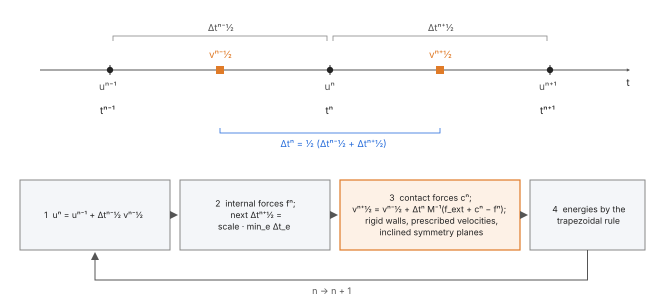
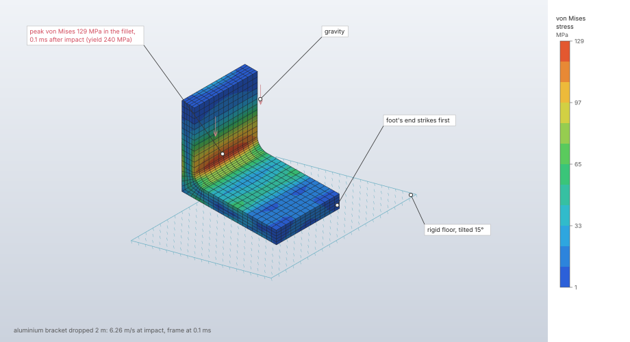
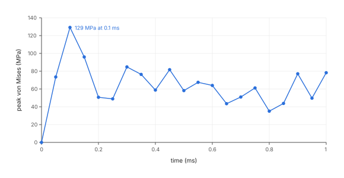

# Explicit dynamics

An explicit dynamic step computes the transient response of a solid model to impact, wave
propagation, short-duration loads and large, fast deformation. It integrates the equations of
motion with the central-difference scheme on a lumped mass matrix, so each time increment is one
pass over the elements, and the increment is bounded by the elements' highest frequencies. The
elements are updated Lagrangian with an objective stress rate; materials are hypoelastic, J2
plastic with Johnson–Cook damage and element erosion, or hyperelastic.

| | |
|---|---|
| **Commands** | `solve.explicit` (solve), `model.step.create` / `model.step.edit` (define), `interaction.rigid_wall`, `solve.history` (histories), `solve.probe` (frames) |
| **Step procedure** | `"explicit_dynamic"` |
| **Solver** | `crates/explicit` (CPU, f64) |
| **Method** | Central differences with variable increments (Belytschko, Liu, Moran & Elkhodary 2014, Box 6.1); Flanagan–Belytschko one-point hexahedron; Bonet–Burton average nodal pressure tetrahedron |
| **Verified by** | `crates/explicit/tests/*.rs`; oracle cases `bar-pressure-wave`, `bar-rigid-wall-impact`, `j2-uniaxial-explicit`, `explicit-neo-hookean-implicit`, `explicit-*` (contact) |

## Synopsis

```json
[
  {"command": "model.step.create", "params": {
    "name": "Impact",
    "procedure": {"type": "explicit_dynamic", "end_time": 0.001, "dt_scale": 0.9,
                  "history_nodes": "front",
                  "initial_velocities": [{"set": "bar", "velocity": [-190, 0, 0]}],
                  "rigid_walls": [{"set": "front", "point": [0, 0, 0], "normal": [1, 0, 0]}]},
    "output": ["displacement", "stress"]}},
  {"command": "solve.explicit", "params": {"step": "Impact"}}
]
```

## Parameters

Step procedure (`model.step.create`, `"type": "explicit_dynamic"`):

| Field | Value | Default | Meaning |
|---|---|---|---|
| `end_time` | > 0 | required | Duration of the step. |
| `dt_scale` | (0, 1] | 0.9 | Fraction of the stable time increment taken. |
| `max_increments` | 1 to 10⁹ | 10⁷ | Cap on the time increments; the run stops early and says so. |
| `output_interval` | > 0 | `end_time`/20 | Time between field frames; at most 10 000 frames over the step. |
| `history_interval` | > 0 | `end_time`/1000 | Time between history samples; at most 10⁶ samples. |
| `history_nodes` | set | none | Nodes whose displacement and velocity are recorded as histories (at most 1000 nodes). |
| `initial_velocities` | `[{"set", "velocity": [vx, vy, vz]}]` | none | Velocities at the start; a node in several sets takes the last one listed. |
| `rigid_walls` | `[{"set", "point", "normal", "friction"}]` | none | Fixed rigid planes the set's nodes cannot pass; the normal points to the side the nodes stay on ([contact](contact.md)). |
| `hourglass` | `{"type": "viscous" \| "stiffness", "coefficient"}` | viscous, 0.1 | Hourglass control of one-point hexahedra; coefficient 0 to 0.25. |
| `bulk_viscosity` | `{"linear", "quadratic"}` | 0.06, 1.5 | Artificial bulk viscosity coefficients, each 0 to 10. |
| `nonlinear_geometry` | bool | `true` | Updated Lagrangian kinematics; `false` keeps the gradients of the undeformed mesh. |
| `stress_rate` | `"jaumann"` \| `"green_naghdi"` | `"jaumann"` | The objective stress rate of large deformation. |
| `mass_scaling` | `{"target_increment", "set"}` | none | Opt-in mass scaling to a target increment (> 0, at most `end_time`), over a set or every element. |

The lists of initial velocities and of rigid walls hold at most 10 000 entries each. `output` defaults
to `["displacement", "stress"]`; `"strain"` adds the strain to the frames.

Command `solve.explicit`:

| Field | Value | Default | Meaning |
|---|---|---|---|
| `step` | name | the only explicit dynamic step | The step to solve. |
| `max_dofs` | integer | 6 000 000 | Cap on degrees of freedom; may only be lowered. |
| `max_increments` | integer | 10⁹ | Cap on increments; the step's own cap applies too. May only be lowered. |
| `max_output_values` | integer | 50 000 000 | Numbers kept in frames and histories together (8 bytes each); may only be lowered. |
| `max_contact_faces` | integer | 10 000 000 | Element faces of every contact surface together; may only be lowered. |
| `threads` | 1 to 256 | the session's | Changes the time, never the result. |

Material options (`model.material.create`): a `density` is required; `plastic` (bilinear
isotropic or kinematic, `table`, `johnson_cook` with `a`, `b`, `n`, `c`, `m`,
`reference_strain_rate`, `room_temperature`, `melt_temperature`, `specific_heat`,
`taylor_quinney` (default 0.9)); `damage: {"type": "johnson_cook", "d1", "d2", "d3", "d4", "d5"}`;
`erosion: {"plastic_strain"}`; `hyperelastic` as in [nonlinear static](nonlinear-static.md).

## Theory

### Central differences

With a diagonal (lumped, row-sum) mass M, Δtⁿ = ½(Δt^{n−½} + Δt^{n+½}):

```text
aⁿ       = M⁻¹ (f_ext + cⁿ − f_int(uⁿ, v^{n−½}))
v^{n+½}  = v^{n−½} + Δtⁿ aⁿ
u^{n+1}  = uⁿ + Δt^{n+½} v^{n+½}
```

cⁿ are the contact forces. The run starts from u = 0 and the initial velocities with the half
increment v^{½} = v⁰ + ½Δt^{½} a⁰. Loads act in full from the start of the step (forces,
tractions, pressure on the undeformed faces with consistent nodal forces, gravity and body forces
with the lumped weights, centrifugal loads); a displacement boundary condition with a value is
reached at constant velocity over the step (value / `end_time`), a zero value holds the node.

### Kinematics and stress update

With nonlinear geometry the elements are updated Lagrangian (Belytschko et al. 2014, ch. 4 and 6).
The strain and spin increments come from the displacement increment and the gradients of the
midpoint configuration x_{n−½} = X + uₙ − ½Δu,

```text
ΔG = (1/V) Σ_I Δu_I ⊗ b_I(x_{n−½})
```

which makes the update incrementally objective (Hughes & Winget 1980); the nodal forces use the
current configuration's gradients, f_iI = σ_ij b_jI(xₙ). The material state (stress, back stress,
accumulated strain, stiffness-form hourglass forces) is rotated with the increment's rotation (the
Cayley transform of the spin increment for the Jaumann rate, the increment of the polar rotation
for the Green–Naghdi rate, Flanagan & Taylor 1987), then the constitutive increment is added:
hypoelastic, or J2 radial return with Johnson–Cook damage. Orthotropic elasticity is updated in
the polar frame whichever rate the step names. Without nonlinear geometry both gradients are those
of the undeformed mesh: small-strain elasticity and plasticity.

### Elements

| Element | Formulation |
|---|---|
| hex8, reduced integration | One-point uniform-strain hexahedron with Flanagan–Belytschko hourglass control (1981) |
| tet4, full integration | Average nodal pressure tetrahedron (Bonet & Burton 1998), in rate form |
| rod2 | Elastic truss, lumped (HRZ) mass; corotational under nonlinear geometry: strain (l − L)/L, force along the current axis |
| rod3 | Elastic truss with small displacements (`K u`) |

**Hourglass control.** With the hourglass shape vectors γ_α of the current configuration and the
rates q̇_iα = Σ_I v_iI γ_αI, the generalized forces are Q_iα = C q̇_iα (viscous) or accumulate as
Q_iα += k Σ_I Δu_iI γ_αI (stiffness, rotated with the element), giving f_iI = Σ_α Q_iα γ_αI. The γ_α
are orthogonal to linear fields, so the forces do no work in a constant strain state. With the
dimensionless coefficient κ, the element size h = V / √(2 λ_max(Σ b bᵀ)), density ρ and wave
speed c:

```text
C = κ ρ c h² / 16     (damps a cube's hourglass modes at κ of critical at 2c/h)
k = κ ρ c² h / 16     (puts their frequency at √κ · 2c/h)
```

These normalisations are FieldCraft's; the paper leaves the scale to the user.

**Average nodal pressure.** Each node's volumetric strain increment is the volume-weighted mean of
its tetrahedra's; each tetrahedron takes the mean of its nodes' as its own, so its pressure
increment is K times that mean while the deviator is its own. It does not lock when the material
is nearly incompressible or flows plastically.

**Bulk viscosity** (von Neumann & Richtmyer 1950; Wilkins 1980). In compression (ε̇ᵥ < 0) the
pressure

```text
q = ρ L (C_q L ε̇ᵥ² − C_l c ε̇ᵥ)
```

spreads shocks over a few elements and damps ringing behind wave fronts.

### Stable time increment

Each element's stable length L = 2c/ω_max comes from the bound on its highest frequency in its
current shape (`fieldcraft_fem::uniform`, with the element's lumped masses, plus the hourglass
stiffness when it is used), so without bulk viscosity its critical increment is 2/ω_max
(Belytschko et al. 2014, §6.3). With bulk viscosity

```text
Δt = L / (Q + √(Q² + c²)),   Q = C_l c + C_q L |ε̇ᵥ|
```

The elastic moduli bound the tangent moduli of plastic flow, so the bound holds for the inelastic
materials. The increment taken is `dt_scale` times the smallest over the elements.

Springs and dashpots have their own bound per degree of freedom: with ω² ≤ Σⱼ |Kᵢⱼ| / √(mᵢ mⱼ)
(Gershgorin, exact for one spring on one mass) and the same row sum D of the damping, central
differences with lagged damping are stable for Δt ≤ (2/ω)(√(1 + ξ²) − ξ), ξ = D/(2ω), which is
2/D for a dashpot alone (Belytschko et al. 2014, §6.3). Penalty contact never shortens the
increment ([contact](contact.md)).

### Materials

| Material | Explicit update |
|---|---|
| Isotropic elastic | Hypoelastic |
| Orthotropic elastic (engineering constants) | Hypoelastic in the polar frame; hex8 only (nodal-pressure tet4 refused) |
| J2 plastic, bilinear isotropic or kinematic, table | Radial return (Simo & Hughes 1998, §3.3): linear hardening in closed form, a table segment by segment |
| Johnson–Cook | σ_y = (A + B ε_pⁿ)(1 + C ln ε̇*)(1 − T*ᵐ), ε̇* = ε̇_p/ε̇₀ taken as at least 1, T* = (T − T_room)/(T_melt − T_room) clamped to [0, 1]; scalar Newton with bisection, at most 100 iterations |
| Hyperelastic (neo-Hookean, Mooney–Rivlin, Yeoh) | Total form on the shared finite-strain material point |

**Adiabatic heating.** With a `specific_heat`, plastic work heats a Johnson–Cook material,
ΔT = χ q Δε_p / (ρ c_p), χ the Taylor–Quinney fraction; the temperature used is that at the start
of the increment. Mass scaling keeps the physical density for this.

**Johnson–Cook damage** (Johnson & Cook 1985). D ← D + Δε_p / ε_f with

```text
ε_f = (D1 + D2 e^{D3 σ*})(1 + D4 ln ε̇*)(1 + D5 T*)
```

σ* the mean stress over the von Mises stress after the increment. A fracture strain below 10⁻⁶
counts as 10⁻⁶. The point has failed at D ≥ 1.

**Erosion** (Johnson & Stryk 1987; Belytschko & Lin 1987). An element whose material point fails
(damage 1) or reaches its material's `erosion.plastic_strain` is removed: it carries no stress
from then on, its nodes keep their mass and momentum, its internal energy at that moment is
reported, and its faces leave contact.

**Hyperelastic materials** use the shared finite-strain material point (`fieldcraft_fem::constitutive`)
in total form, objective by construction (no stress rate). The one-point hexahedron takes
F = I + ∂u/∂X, its mean over the undeformed element, and the Cauchy stress τ/J. The tetrahedron
takes the isochoric stress of its own F and the average nodal pressure of a decoupled material
(each node's U′(J_a) from its tetrahedra's volume ratio, the element's the mean of its nodes':
Bonet & Burton 1998 at finite strain), which does not lock when the material is nearly
incompressible. (Averaging J into an F-bar was unstable on the Kuhn mesh of the tests.) The stable
increment follows the tangent: each element's frequency bound is scaled by the ratio of its
tangent's largest normal stiffness, plus the stress, to the small-strain one. Logarithmic strain is
the strain output.

**Thermal strain.** A step's temperature loads strain the solid elements: each element's mean nodal
temperature change from its material's reference is reached linearly over the step, so the thermal
strain α ΔT grows at the rate α ΔT / `end_time` (no thermal shock at the start). Trusses take no
thermal strain (a warning says so).

### Mass scaling

Opt-in per step: every solid element (of the set, or of the model) whose stable increment times
the step's scale is below `target_increment` has its density raised by (target / increment)²,
which brings its increment to the target. Its lumped masses, frequency bound and hourglass and
bulk-viscosity scales follow; adiabatic heating keeps the physical density. The kinetic energy of
the added mass is reported (`energy.added_kinetic`, part of the kinetic energy, so the balance
holds).

### Energy account

The works of the internal, contact and external forces are integrated by the trapezoidal rule,
W += ½ Δu · (f^{n−1} + fⁿ) (exactly the strain energy for a linear elastic material); the
constraints' work as Δtⁿ rⁿ · ½(v^{n−½} + v^{n+½}) (exactly the kinetic energy their impulses add
or remove); the kinetic energy from vⁿ = v^{n−½} + ½Δt^{n−½} aⁿ. The balance

```text
kinetic + internal + hourglass + viscous + contact − external − constraint − initial kinetic
```

is zero when energy is conserved; it is reported relative to the largest energy in the account.



## Algorithm

1. **Build the system.** Resolve the model; refuse what the solver cannot take (see
   Limitations). Contact interfaces first: nodes that start inside a surface are moved onto it
   before the elements are built (or the run is refused), as each contact's
   `initial_penetration` says. Lump the masses (row sum) with point masses, apply mass scaling,
   set prescribed velocities, rigid walls, initial velocities and the constant load vector.
2. **Check the size.** Find every element's critical increment and the springs' bound. Refuse the
   run when the estimated increments `end_time / (scale · smallest)` exceed the cap (naming the
   controlling element), or when the frames and histories would exceed `max_output_values`.
3. **Increment** (Belytschko et al. 2014, Box 6.1):
   1. uⁿ = u^{n−1} + Δt^{n−½} v^{n−½}; tⁿ = t^{n−1} + Δt^{n−½};
   2. internal forces fⁿ from uⁿ (stresses, hourglass stiffness) and v^{n−½} (hourglass and bulk
      viscosity), and the next increment Δt^{n+½} = `dt_scale` · min_e Δt_e;
   3. contact forces cⁿ at uⁿ with the stable increment Δt^{n+½};
      v^{n+½} = v^{n−½} + Δtⁿ M⁻¹(f_ext + cⁿ − fⁿ); then the constraints: rigid walls set the
      normal velocity of a node that would cross its wall so it lands on it (Hughes et al. 1976),
      with Coulomb friction as a tangential impulse at most μ times the normal one; prescribed
      degrees of freedom take their velocity; an inclined symmetry plane removes its nodes'
      velocity along its normal (the mass-weighted projection onto the constraint). The change a
      constraint makes is the impulse of its reaction, rⁿ = M Δv / Δtⁿ;
   4. energies; erosion of failed elements; history samples and field frames when due.
4. **Stop** at `end_time`, or at the increment cap with `completed: false` and a warning. A
   solution that stops being finite, or an element that turns inside out, is an error naming the
   time and increment or the element.
5. **Report.** Warn when the energy balance is off by more than 1 % of the largest energy, when
   hourglass energy exceeds 10 % of the largest internal energy of the run, when elements eroded,
   when mass scaling added mass, and when a spring or dashpot limits the increment.

Elements are updated on threads, each owning its state, and their nodal forces are added in label
order; contact forces are added face by face in a fixed order. The same model gives the same
numbers bit for bit on any number of threads.

## Output

The reply of `solve.explicit`:

| Field | Content |
|---|---|
| `step`, `dofs`, `elements` | The step and the system's size |
| `increments`, `time`, `completed` | Increments taken, time reached, whether the step ended at `end_time` |
| `initial_increment` | The first increment (the scale times the smallest critical increment) |
| `controlling_elements` | Up to ten elements with the smallest critical increments, at rest and before the scale |
| `total_mass` | Model mass (point masses with their mean over the three directions) |
| `energy` | `kinetic`, `internal`, `hourglass`, `viscous`, `external`, `constraint`, `contact`, `added_kinetic`, `friction`, `plastic`, `eroded`, `balance` |
| `energy_balance` | The balance relative to the largest energy |
| `frames`, `history_samples` | Counts of field frames and history samples |
| `eroded` | Per eroded element: `label`, `time`, `failure` (damage or plastic strain), `internal_energy` |
| `contacts` | Per contact: nodes adjusted at the start, `peak_force` and `peak_time`, `first_contact`, `last_contact`, `max_penetration`, `friction` |
| `mass_scaling` | `target_increment`, `elements`, `added_mass`, `fraction` of the model's mass, added mass per section |
| `warnings` | As listed under Algorithm |

Field frames (`solve.probe` with `frame`, `results.frame`): per node displacement and velocity;
per element (one value each) the stress and, with `"strain"` output, the accumulated strain
(small strain: the strain; large deformation: the integral of the rate of deformation, rotated
with the material; hyperelastic: logarithmic); with plasticity the equivalent plastic strain,
damage, temperature (NaN where the material has none) and whether the element has eroded.

Histories (`solve.history`): time, increment, the energy account, total momentum, the sum of the
forces of the boundary conditions and rigid walls, the normal force across each contact, and the
history nodes' displacement and velocity.

## Worked example

The `drop-test` sample: an aluminium L-bracket dropped 2 m onto a rigid floor tilted 15°, so the
end of its foot strikes first. One-point hex8 elements with stiffness hourglass control, bilinear
plasticity, a rigid wall, gravity, and the energy account that checks the integration.

| | |
|---|---|
| **Geometry** | L-bracket: 60 × 40 mm foot, 50 mm upright, 8 mm thick, R6 fillet (SolidCraft, volume 32 949.2 mm³) |
| **Mesh** | 2 405 hex8 swept at 3 mm (`mesh.hex.generate`, `"method": "extrude"`), reduced integration, 3 192 nodes |
| **Material** | aluminium: E = 70 GPa, ν = 0.33, ρ = 2 700 kg/m³; bilinear plasticity, yield 240 MPa, hardening modulus 700 MPa, isotropic |
| **Initial conditions** | every node at √(2 g h) = 6 264.2 mm/s along −z (h = 2 000 mm, g = 9.81 m/s²) |
| **Loads, contact** | gravity; rigid wall through (60, 0, −0.1) mm with normal (−sin 15°, 0, cos 15°) |
| **Step** | `Drop`: explicit dynamic, `end_time` 1 ms, `output_interval` 50 µs, `history_interval` 5 µs, `hourglass` stiffness 0.05; `dt_scale` and bulk viscosity at their defaults (0.9; 0.06, 1.5) |
| **Units** | mm, t, s, N, MPa |

```json
[
  {"command": "file.sample", "params": {"name": "drop-test"}},
  {"command": "solve.explicit", "params": {"step": "Drop"}},
  {"command": "results.frame", "params": {"step": "Drop", "frame": 2}},
  {"command": "results.contour", "params": {"step": "Drop", "field": "von_mises"}},
  {"command": "results.deformed", "params": {"step": "Drop", "show": true, "scale": 1}}
]
```

Results from the `solve.explicit` reply (7.7 s, Apple M4 Max, CPU) and `results.frame`:

| Quantity | FieldCraft | Reference | Difference |
|---|---|---|---|
| `increments` to 1 ms | 10 119 (mean 9.88 × 10⁻⁸ s) | — | — |
| Smallest critical increment at rest (`controlling_elements`, elements 1158, 1159, …) | 1.1646 × 10⁻⁷ s | — | — |
| `initial_increment` | 9.8717 × 10⁻⁸ s | 0.9 × 1.1646 × 10⁻⁷ / (0.06 + √(1 + 0.06²)) = 9.871 × 10⁻⁸ s | < 0.01 % |
| `total_mass` | 8.8975 × 10⁻⁵ t | ρ V = 8.8963 × 10⁻⁵ t | +0.013 % |
| Kinetic energy at impact | — | ½ m v² = 1 745.7 mJ | — |
| `energy` at 1 ms: kinetic, internal, hourglass, viscous | 1 572.9, 152.0, 2.71, 15.2 mJ | — | — |
| `energy`: external (gravity), constraint (wall), plastic | 3.07, −5.89, 0 mJ | — | — |
| `energy_balance` | 1.4 × 10⁻⁵ | conserved | — |
| Largest von Mises stress over the frames | 129.2 MPa at 0.1 ms (frame 2, node 1107) | below the 240 MPa yield | — |





**What to look at.** At 0.1 ms the compression wave has left the struck end of the foot and the
upright's inertia bends the fillet, where the von Mises stress peaks.
It stays below yield in every frame, so the plastic energy is zero and the drop leaves no
permanent set. The time increment is set by the elements with the highest frequency (`controlling_elements`):
the initial increment is 0.9 of their critical increment, reduced by the
linear bulk viscosity term, and the mean increment over the run stays within 0.1 % of it. The
energy account closes to 1.4 × 10⁻⁵ of the largest energy: most of the impact energy is still
kinetic at 1 ms (the bracket pivots onto its foot), 152 mJ is elastic vibration, and the bulk
viscosity and hourglass control take 15.2 and 2.7 mJ.

## Verification

Oracle cases ([results](../../oracle.md)):

| Case | Reference | Quantity | Error | Tolerance |
|---|---|---|---|---|
| `bar-pressure-wave` | theory: 1D wave, σ = ρ c v | loaded-end displacement; particle velocity behind the front; energy balance | 0.034 %; 1.45 %; 1.5·10⁻³ | 1 %; 2 %; ± 0.01 |
| `bar-rigid-wall-impact` | theory: contact for 2L/c, rebound at v₀ | struck-end and far-end displacement; kinetic energy after the rebound | −0.46 %, −0.51 %; −0.54 % | 3 %; 2 % |
| `j2-uniaxial-explicit` | theory: logarithmic strain 0.2 | axial Cauchy stress; plastic strain | 0.00017 %; < 10⁻⁶ | 1 % |
| `explicit-neo-hookean-implicit` | the implicit nonlinear solver, quasi-static pull | lateral corner displacement; σ_xx | −0.092 %; 0.026 % | 0.5 % |

Contact cases (`explicit-bars-collision`, `explicit-contact-patch`, `explicit-sliding-block-*`)
are on the [contact](contact.md) page.

Tests in `crates/explicit/tests/`:

| Test | Check | Tolerance |
|---|---|---|
| `verification.rs::pressure_wave_in_a_hex_bar` | front at L − c t, σ = −p, σ = ρ c v; work of the load | front within 2 elements; 1 %; 0.5 % |
| `verification.rs::velocity_wave_in_a_tet_bar` | nodal-pressure tet4: front at c t, σ = −ρ c v | 3 elements; 2 % |
| `verification.rs::bar_rebounds_from_a_rigid_wall` | hex8 and tet4: contact for 2L/c, rebound at v₀, kinetic energy kept, wall force | 1 %; 1 %; > 0.99; 3 % |
| `one_d.rs::spring_mass_oscillation` | period 2π/ω, second-order phase error, energy | 10⁻⁴; 2·10⁻³ of amplitude; 10⁻³ |
| `one_d.rs::damped_decay_rate` | dashpot decay rate ξω and period | 1 %; 10⁻³ |
| `one_d.rs::velocity_wave_in_a_truss_bar` | rod2 at its own increment L/c: σ = −ρ c v | 1 % |
| `one_d.rs::whirling_mass_on_a_corotational_rod` | corotational rod keeps its length, carries m v²/L | — |
| `one_d.rs::mass_scaling_slows_the_waves_as_the_added_density_says` | scaled to twice a bar's increment: added mass 3×, increment 2×, added kinetic share ¾ | 10⁻⁹ |
| `large_deformation.rs::dienes_simple_shear_with_both_rates` | Dienes' closed forms to γ = 6, Jaumann and Green–Naghdi | 2·10⁻³ |
| `large_deformation.rs::rigid_rotation_turns_the_stress_with_the_body` | stress turns exactly through 90° | 10⁻¹² |
| `large_deformation.rs::j2_uniaxial_stress_strain_curve_and_unloading_at_large_strain` | σ = σ_y + H ε_p to ln λ = 0.3, elastic unloading | 10⁻⁶ |
| `large_deformation.rs::taylor_bar_recovers_its_yield_stress` | Taylor's estimate from the computed shape; energy balance | 25 %; 1 % |
| `large_deformation.rs::johnson_cook_impact_erodes_elements` | erosion reported, heating, balance, bit-identical runs | balance 2 % |
| `large_deformation.rs::damage_fails_an_element_at_its_fracture_strain` | failure at ε_p = D1, no stress after | 10⁻¹² |
| `hyperelastic.rs::hyperelastic_uniaxial_strain_matches_the_material_point` | three laws, hex8 and tet4, λ = 1.5 | 1 % |
| `thermal.rs` | free bar expands without stress; clamped bar carries −EαΔT up to yield | 2 % |
| `inclined_symmetry.rs` | turned symmetry planes move as the axis-aligned ones and the whole | 10⁻¹² |
| `verification.rs::runs_are_bit_identical`, `caps_and_unsupported_models_are_errors` | determinism; caps and refusals | exact |

Pending: `taylor-bar` (copper, Wilkins & Guinan 1973) waits for the measured shapes to be
transcribed.

## Limitations

- Elements: one-point hex8 (reduced integration), full-integration tet4, rod2 and rod3. Fully
  integrated or incompatible-mode hex8, reduced tet4, hybrid sections, quadratic solids, 2D
  elements, shells and beams are refused. rod3 is small-displacement only.
- Orthotropic materials are refused on nodal-pressure tet4, and with plasticity, damage or
  erosion; orthotropic thermal expansion is refused.
- Hyperelastic materials need nonlinear geometry and take no thermal strain (both refused by
  name).
- Couplings, ties, boundary conditions and loads on reference points, moments, temperature
  boundary conditions and heat loads are refused. Rotary inertia and rotational springs need
  rotational degrees of freedom, which the solver does not have.
- Pressure loads act on the undeformed faces with constant magnitude.
- The faces exposed by eroded elements do not join contact.
- Every material needs a density.

## Implementation

- `crates/explicit/src/integrate.rs`: `solve_explicit`, the time loop, constraints, energy
  account, output schedule, warnings.
- `crates/explicit/src/elements.rs`: hexahedron and tetrahedron forces, stress update, hourglass,
  bulk viscosity, critical increments, erosion (`Failure`).
- `crates/explicit/src/system.rs`: the explicit system from the model, materials, refusals, mass
  scaling, loads, temperatures, prescribed velocities.
- `crates/explicit/src/discrete.rs`: trusses, point masses, springs and dashpots.
- `crates/explicit/src/contact.rs`: penalty contact ([contact](contact.md)).
- `crates/explicit/src/result.rs`: `ExplicitResult`, `Energies`, `Frame`, `History`.
- `crates/fem/src/plasticity.rs`: `J2::radial_return`, Johnson–Cook flow and damage.
- `crates/fem/src/rotation.rs`, `crates/fem/src/uniform.rs`: objective rotations, frequency
  bounds.
- `crates/model/src/steps.rs`: `ExplicitDynamic`, `Hourglass`, `BulkViscosity`, `MassScaling`,
  `StressRate`.

## References

- T. Belytschko, W. K. Liu, B. Moran, K. Elkhodary. *Nonlinear Finite Elements for Continua and Structures*, 2nd ed., Wiley 2014.
- D. P. Flanagan, T. Belytschko. IJNME 17(5):679–706, 1981 (uniform strain hexahedron and hourglass control).
- J. Bonet, A. J. Burton. *A simple average nodal pressure tetrahedral element for incompressible and nearly incompressible dynamic explicit applications.* Commun. Numer. Methods Eng. 14(5):437–449, 1998. doi:[10.1002/(SICI)1099-0887(199805)14:5<437::AID-CNM162>3.0.CO;2-W](https://doi.org/10.1002/(SICI)1099-0887(199805)14:5%3C437::AID-CNM162%3E3.0.CO;2-W)
- T. J. R. Hughes, J. Winget. IJNME 15(12):1862–1867, 1980 (incrementally objective integration).
- D. P. Flanagan, L. M. Taylor. CMAME 62(3):305–320, 1987 (Green–Naghdi rate).
- J. von Neumann, R. D. Richtmyer. J. Appl. Phys. 21(3):232–237, 1950.
- M. L. Wilkins. J. Comput. Phys. 36(3):281–303, 1980.
- T. J. R. Hughes, R. L. Taylor, J. L. Sackman, A. Curnier, W. Kanoknukulchai. *A finite element method for a class of contact-impact problems.* CMAME 8(3):249–276, 1976.
- J. C. Simo, T. J. R. Hughes. *Computational Inelasticity*, Springer 1998.
- G. R. Johnson, W. H. Cook. *A constitutive model and data for metals subjected to large strains, high strain rates and high temperatures.* Proc. 7th Int. Symp. on Ballistics, The Hague, 541–547, 1983.
- G. R. Johnson, W. H. Cook. *Fracture characteristics of three metals subjected to various strains, strain rates, temperatures and pressures.* Eng. Fract. Mech. 21(1):31–48, 1985. doi:[10.1016/0013-7944(85)90052-9](https://doi.org/10.1016/0013-7944(85)90052-9)
- G. R. Johnson, R. A. Stryk. *Eroding interface and improved tetrahedral element algorithms for high-velocity impact computations in three dimensions.* Int. J. Impact Eng. 5:411–421, 1987. doi:[10.1016/0734-743X(87)90057-1](https://doi.org/10.1016/0734-743X(87)90057-1)
- T. Belytschko, J. I. Lin. *A three-dimensional impact-penetration algorithm with erosion.* Int. J. Impact Eng. 5:111–127, 1987. doi:[10.1016/0734-743X(87)90033-9](https://doi.org/10.1016/0734-743X(87)90033-9)
