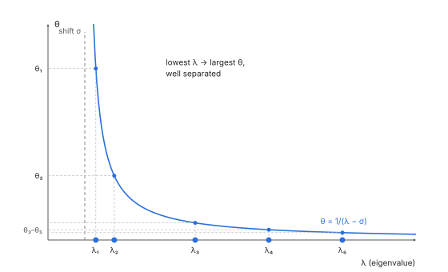
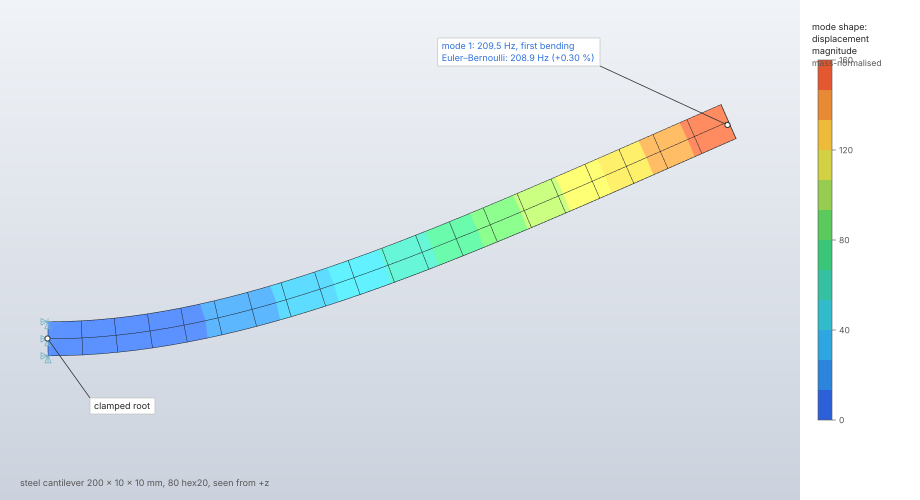
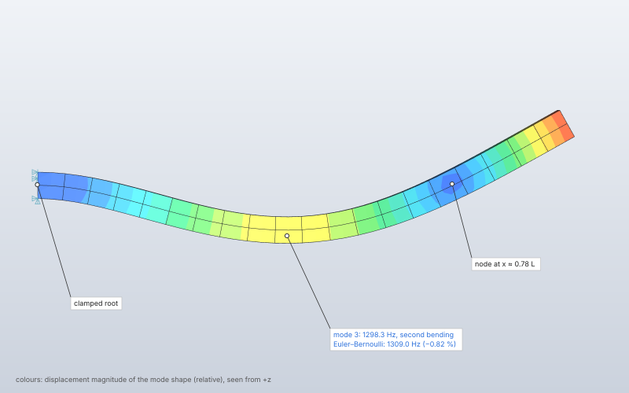
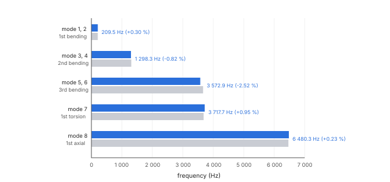

# Natural frequencies

`solve.frequency` computes the lowest natural frequencies and mode shapes of a structure,
K φ = ω² M φ, with every boundary condition of the step held at zero, together with each mode's
participation factors and effective masses. The eigenproblem is solved by the shifted block
Lanczos method on the spectral transformation (K − σM)⁻¹M, with full reorthogonalization, on the
sparse Cholesky factor of the shifted stiffness. A structure that is free (or partly free) gets a
small negative shift automatically, so its rigid-body modes come out at zero frequency.

| | |
|---|---|
| **Commands** | `solve.frequency` (and `solve.run`); `solve.probe` (`mode`), `results.modes`, `results.animate`, `results.export.vtu` |
| **Step procedure** | `{"type": "frequency", "modes", "min_hz", "max_hz"}` |
| **Solver** | `crates/solver` (CPU, f64) |
| **Method** | spectral transformation Lanczos (Ericsson & Ruhe 1980), shifted block Lanczos (Grimes, Lewis & Simon 1994), full reorthogonalization (Parlett 1998, ch. 13), dense tridiagonal QR (Golub & Van Loan 2013, §8.3) |
| **Verified by** | `cantilever-frequencies`, `free-beam-frequencies`, `nafems-fv32`; `cantilever_natural_frequencies`, `free_free_beam_has_six_rigid_body_modes`, `simply_supported_plate_deflection_and_frequency`, `cantilever_beam_frequencies`, `crates/solver/tests/one_d.rs`, `eigen::tests` |

## Synopsis

```json
[
  {"command": "model.step.create", "params": {"name": "Modes",
    "procedure": {"type": "frequency", "modes": 10, "max_hz": 500}, "boundary_conditions": ["clamp"]}},
  {"command": "solve.frequency", "params": {"step": "Modes", "mass": "consistent"}},
  {"command": "solve.probe", "params": {"step": "Modes", "mode": 1, "set": "tip"}}
]
```

## Parameters

### The step

| Field | Value | Default | Meaning |
|---|---|---|---|
| `modes` | 1 to 100 000 | — | the number of modes to extract (lowest first, within the range) |
| `min_hz` | ≥ 0 | none | lower bound of the range, cycles per time unit |
| `max_hz` | ≥ 0, above `min_hz` | none | upper bound of the range |
| `boundary_conditions` | names | none | held at zero in the eigenproblem; prescribed values are ignored |
| `loads` | names | none | no effect |

### `solve.frequency`

| Field | Value | Default | Meaning |
|---|---|---|---|
| `step` | step name | the only frequency step | |
| `mass` | `consistent`, `lumped` | `consistent` | the mass matrix |
| `shift` | finite, eigenvalue units (rad per time unit)² | 0 for a supported structure, −10⁻⁶ Σ K_ii / Σ M_ii for a free one | the spectral shift σ; it must lie below every eigenvalue of the free equations |
| `max_dofs` | 1 to 6 000 000 | 6 000 000 | may only be lowered |
| `max_factor_entries` | 1 to 2 000 000 000 | 400 000 000 | factor entries; also bounds the Lanczos basis ([Linear solvers](linear-solvers.md#memory-limits)) |
| `max_iterations` | 1 to 3000 | 3000 | cap on the Lanczos vectors (iterations × block size); may only be lowered |
| `threads` | 1 to 256 | the session's | changes the time, never the result |

Every element with mass needs a density in its material ("element N has no density" otherwise).

## Theory

The undamped free vibration of the discretised structure is the generalized symmetric
eigenproblem

```text
K φ = λ M φ,   λ = ω²,   f = √λ / 2π
```

with K the stiffness of the [element library](elements.md) and M its mass: **consistent**
(M = ∫ ρ Nᵀ N dV on each element's mass rule; shells and beams with their rotary inertia) or
**lumped** (the diagonal scaling of Hinton, Rock & Zienkiewicz 1976: each element's consistent
diagonal scaled to its mass). Point masses and rotary inertia add the same terms to both. Springs
add stiffness; dashpots are ignored with a warning.

**Spectral transformation** (Ericsson & Ruhe 1980). With a shift σ below the wanted eigenvalues,
the operator

```text
(K − σM)⁻¹ M,   θ = 1 / (λ − σ)
```

is symmetric in the M inner product, and the lowest λ become its largest, well separated θ.
**Block Lanczos** (Grimes, Lewis & Simon 1994) builds an M-orthonormal basis Q block by block,
W = (K − σM)⁻¹ M Q_j, A_j = Q_jᵀ M W, and projects the operator onto the block tridiagonal T with
diagonal blocks A_j and off-diagonal blocks B_j. A block of six vectors finds eigenvalues repeated
up to six times, such as the six rigid-body modes of a free body. Every new block is
orthogonalised against all earlier ones and itself, twice, by classical Gram–Schmidt in the M
inner product (full reorthogonalization; Parlett 1998, ch. 13), so no spurious copies appear. The
eigenpairs (θ, s) of T come from Householder reduction to tridiagonal form and the implicit
symmetric QR algorithm with Wilkinson shifts (Golub & Van Loan 2013, algorithms 8.3.1 and 8.3.3).
A Ritz pair has converged when its residual bound ‖B_{j+1} s_last‖ ≤ 10⁻⁹ θ, s_last the last block
of the Ritz vector.

**Participation.** For a mass-normalised mode (φᵀ M φ = 1) the participation factor along
direction d is Γ_d = φᵀ M r_d, r_d the unit translation along d on the free equations (mesh and
reference point translations), and the effective mass is Γ_d². The rigid translations of a free
body carry the whole mass as effective mass.



## Algorithm

1. **Select and check.** The step named, or the only frequency step; a non-finite `shift` is
   refused; a model with contact is refused.
2. **Mesh and reduction.** As for [linear static](linear-static.md#algorithm), with every
   prescribed value held at zero. Every unknown held: "every degree of freedom is held; there is
   nothing to vibrate". The reduction's memory is budgeted for two matrices.
3. **Assemble K and M** on the same node pattern; the total mass is the sum of the
   translation–translation mass entries divided by the number of translation directions (3, or
   2 in a 2D model); rotary inertia and translation–rotation coupling are left out of it.
4. **Factor.** With `shift` given, K − σM is factored by Cholesky. Without one, K is factored;
   if it is not positive definite, σ = −10⁻⁶ Σ diag K / Σ diag M is taken, K − σM factored, and
   the warning "the structure is not fully supported; rigid-body modes appear at (near) zero
   frequency" added.
5. **Lanczos.** The basis may hold at most min(`max_iterations`, `max_factor_entries` / (2 n))
   vectors (n the free equations), and at least min(6, n). The start block is pseudo-random from a
   fixed seed (xorshift64*), so results are reproducible. Each block's six solves run in parallel.
   A vector that vanishes under orthogonalization is replaced by a fresh random direction (up to
   four attempts).
6. **Convergence check** on a schedule, since the dense eigenproblem costs m³: first at
   max(modes + 6, 12) vectors, then every max(m/4, 6) more. Ritz values are taken in decreasing θ
   (increasing λ) until one has not converged; values below `min_hz` are skipped; the iteration
   stops when `modes` values have converged or one passes `max_hz`.
7. **Stop.** When the basis reaches its cap before that: "found k of N modes after m Lanczos
   vectors (the cap); raise the iteration limit or ask for fewer modes". When the basis spans every
   free equation, the converged modes are returned; fewer than `modes` without a `max_hz` gives
   the warning "found k of the N modes asked for".
8. **Modes.** Ritz vectors expanded to every node; frequency √max(λ, 0)/2π; participation and
   effective mass.

## Output

| Key | Meaning |
|---|---|
| `step`, `dofs`, `equations` | the step, its unknowns, the free ones |
| `lanczos_vectors` | the basis size used |
| `total_mass` | the model's mass |
| `modes` | per mode: `mode` (from 1), `frequency` (cycles per display time unit; 0 for a rigid-body mode), `eigenvalue` λ = ω², `effective_mass` [x, y, z] |
| `warnings` | free structure, modes not found, ignored dashpots |

The stored result has each mode's mass-normalised shape per node (translations, and rotations at
shell, beam and reference point nodes) and its participation factors. `solve.probe` with `mode`
gives the shape at nodes; `results.modes` shows a mode and lists every frequency;
`results.animate` swings it; `results.export.vtu` writes `mode_shape` with the mode, frequency and
eigenvalue.

## Worked example

A slender steel cantilever of square section, clamped at one end: its first eight modes against
Euler–Bernoulli beam theory. The square section gives every bending frequency twice (bending in
y and in z), and the block Lanczos iteration returns each pair together.

| | |
|---|---|
| **Geometry** | 200 mm along x, 10 × 10 mm section; one block (`mesh.block`), face `root` at x = 0 |
| **Mesh** | 80 hex20 (20 × 2 × 2), 621 nodes, 1 863 unknowns (1 800 free) |
| **Material** | steel: E = 210 000 MPa, ν = 0.3, ρ = 7.85 × 10⁻⁹ t/mm³ |
| **Boundary conditions** | `root` fixed |
| **Step** | frequency, `modes` 8; `solve.frequency` with the default consistent mass |
| **Units** | mm, t, s, N, MPa |

```json
[
  {"command": "model.units", "params": {"system": "mm-t-s-N-MPa"}},
  {"command": "mesh.block", "params": {"body": "Beam", "kind": "hex20",
    "corners": [[0,0,0],[200,0,0],[200,10,0],[0,10,0],[0,0,10],[200,0,10],[200,10,10],[0,10,10]],
    "divisions": [20, 2, 2], "faces": {"6": "root", "4": "tip"}}},
  {"command": "model.set.create", "params": {"name": "all", "geometry": [{"body": "Beam"}]}},
  {"command": "model.set.create", "params": {"name": "root", "geometry": [{"body": "Beam", "face": "root"}]}},
  {"command": "model.material.create", "params": {"name": "Steel",
    "elastic": {"type": "isotropic", "young": 210000, "poisson": 0.3}, "density": 7.85e-9}},
  {"command": "model.section.create", "params": {"name": "Beam", "set": "all", "material": "Steel", "kind": {"type": "solid"}}},
  {"command": "model.boundary_condition.create", "params": {"name": "Clamp", "type": "fixed", "target": {"set": "root"}}},
  {"command": "model.step.create", "params": {"name": "Modes",
    "procedure": {"type": "frequency", "modes": 8}, "boundary_conditions": ["Clamp"]}},
  {"command": "solve.frequency", "params": {"step": "Modes"}},
  {"command": "results.modes", "params": {"step": "Modes", "mode": 1}},
  {"command": "results.contour", "params": {"step": "Modes", "field": "displacement"}},
  {"command": "results.deformed", "params": {"step": "Modes", "show": true, "scale": 0.4}}
]
```

Results from the `solve.frequency` reply (54 Lanczos vectors, 0.1 s, Apple M4 Max, CPU). The
references: bending f = (βₙL)² / (2π L²) · √(E I / ρ A) with βₙL = 1.8751, 4.6941, 7.8548;
torsion f = (1/4L) · √(G J / ρ I_p) with J = 0.1406 a⁴ for the square (Timoshenko & Goodier 1970,
§109) and I_p = a⁴/6; axial f = (1/4L) · √(E/ρ).

| Mode | Shape | FieldCraft (Hz) | Reference (Hz) | Difference |
|---|---|---|---|---|
| 1, 2 | first bending, y and z | 209.515, 209.515 | 208.879 | +0.30 % |
| 3, 4 | second bending | 1 298.345, 1 298.345 | 1 309.023 | −0.82 % |
| 5, 6 | third bending | 3 572.927, 3 572.927 | 3 665.303 | −2.52 % |
| 7 | first torsion | 3 717.734 | 3 682.701 | +0.95 % |
| 8 | first axial | 6 480.322 | 6 465.243 | +0.23 % |

| Quantity | FieldCraft | Reference | Difference |
|---|---|---|---|
| `total_mass` | 1.570 × 10⁻⁴ t | ρ A L = 1.570 × 10⁻⁴ t | < 10⁻¹² |
| Effective mass, modes 1, 3, 5 (in their direction) / total mass | 0.611, 0.184, 0.065 | 0.613, 0.188, 0.065 (Euler–Bernoulli mode shapes) | −0.3 %, −2.4 %, −0.1 % |
| Effective mass, mode 8 (x) / total mass | 0.809 | 8/π² = 0.811 (axial bar) | −0.2 % |

With ν = 0 the same mesh gives f₁ = 208.549 Hz (−0.16 %, the value of the
`cantilever-frequencies` case): at ν = 0.3 the fixed root face also holds the section's Poisson
contraction, which stiffens the first mode by 0.46 %.







**What to look at.** The first two frequencies agree to nine digits, and their effective masses
lie along y and z: one bending pair, as K and M have the section's symmetry. The second bending
mode has its node at 0.78 L, where the beam crosses its undeformed axis. The bending frequencies
fall below Euler–Bernoulli as the mode number rises (−0.8 %, −2.5 %): at L/a = 20 shear
deformation and rotary inertia, which the solid elements carry and the Euler–Bernoulli beam
omits, lower the higher modes. The mode shapes are mass-normalised (φᵀ M φ = 1), so their
amplitude has no physical size; the pictures use deformation scales of 0.4 and 0.15.

## Verification

| Case | Reference | Error | Tolerance | Test |
|---|---|---|---|---|
| Cantilever, first and second bending frequencies, hex20 | theory (Euler–Bernoulli, Timoshenko, Young & Weaver 1974, §5.3) | −0.16 % (both first modes), −1.08 % (second) | 1 %, 2 % | `cantilever-frequencies` |
| Free–free beam: six rigid-body modes and the first bending mode; total mass | theory | rigid modes ≈ 0; −0.80 %; mass < 10⁻⁴ % | 1.5 %, 10⁻¹² | `free-beam-frequencies` |
| NAFEMS FV32 tapered membrane, six modes (hex20 layer) | benchmark | ≤ 0.0036 % | 1 % | `nafems-fv32` |
| Cantilever, hex20 consistent and lumped, tet10 | theory | first pair < 1 %, second pair < 3 %; mass exact | as stated | `cantilever_natural_frequencies` |
| Free–free beam | theory | rigid modes < 10⁻³ f₁; bending < 1.5 %; effective mass of the rigid translations = total mass to 10⁻⁶ | as stated | `free_free_beam_has_six_rigid_body_modes` |
| Simply supported plate (MITC4, MITC3), first frequency | theory (Navier) | < 1 % at 16 × 16 cells | 1 % | `simply_supported_plate_deflection_and_frequency` |
| Slender pipe cantilever, beam elements, three modes | theory (Euler–Bernoulli) | < 5·10⁻⁴ consistent, < 5·10⁻³ lumped; mass to 10⁻¹² | as stated | `cantilever_beam_frequencies` |
| Spring–mass, skew springs, two-mass chain, bar with a tip mass, torsional pendulum | theory | 10⁻¹² to 10⁻⁸ | as stated | `crates/solver/tests/one_d.rs` |
| 2D total mass (area × thickness, Pappus) and three in-plane rigid modes | theory | 10⁻¹² | exact | `masses_and_rigid_modes` |
| Repeated and zero eigenvalues; dense symmetric eigenproblem | theory | — | — | `eigen::tests::lanczos_finds_repeated_and_zero_eigenvalues`, `dense_symmetric_eigen` |
| Two runs of the same model | determinism | identical | exact | `results_are_deterministic` |

## Limitations

- Undamped, real modes only; no damping, no complex eigenvalues, no prestressed (stress-stiffened)
  frequencies.
- `shift` is factored by Cholesky: a shift above the lowest eigenvalue makes K − σM indefinite and
  the solve stops with the singular-matrix error naming a degree of freedom.
- Contact is refused; dashpots are ignored.
- Rotary inertia and translation–rotation mass coupling are not part of `total_mass`.

## Implementation

| File | Contents |
|---|---|
| `crates/engine/src/cmd/solve.rs` | `FREQUENCY` spec, `run_frequency` |
| `crates/solver/src/analysis.rs` | `solve_frequency`, `FrequencyOptions`, `MassKind`, `Mode`, `FrequencyResult`, `BLOCK`, `lanczos_basis`, `RIGID_SHIFT`, `TOLERANCE` |
| `crates/solver/src/eigen.rs` | `symmetric_eigen`, `lanczos`, `Operator`, `Wanted`, the xorshift64* generator |
| `crates/fem/src/element.rs`, `shell.rs`, `beam.rs`, `truss.rs` | consistent and lumped element masses |
| `crates/solver/src/discrete.rs` | point masses and rotary inertia |

## References

- T. Ericsson, A. Ruhe. *The spectral transformation Lanczos method for the numerical solution of large sparse generalized symmetric eigenvalue problems.* Math. Comp. 35(152):1251–1268, 1980.
- R. G. Grimes, J. G. Lewis, H. D. Simon. *A shifted block Lanczos algorithm for solving sparse symmetric generalized eigenproblems.* SIAM J. Matrix Anal. Appl. 15(1):228–272, 1994.
- B. N. Parlett. *The Symmetric Eigenvalue Problem.* SIAM, 1998.
- G. H. Golub, C. F. Van Loan. *Matrix Computations*, 4th ed. Johns Hopkins, 2013.
- S. Vigna. *An experimental exploration of Marsaglia's xorshift generators, scrambled.* ACM TOMS 42(4), 2016.
- E. Hinton, T. Rock, O. C. Zienkiewicz. *A note on mass lumping and related processes in the finite element method.* Earthquake Eng. Struct. Dyn. 4(3):245–249, 1976.
- S. Timoshenko, D. H. Young, W. Weaver. *Vibration Problems in Engineering*, 4th ed. Wiley, 1974.
- S. P. Timoshenko, J. N. Goodier. *Theory of Elasticity*, 3rd ed. McGraw-Hill, 1970.
- NAFEMS. *The Standard NAFEMS Benchmarks*, TNSB Rev. 3, October 1990.
