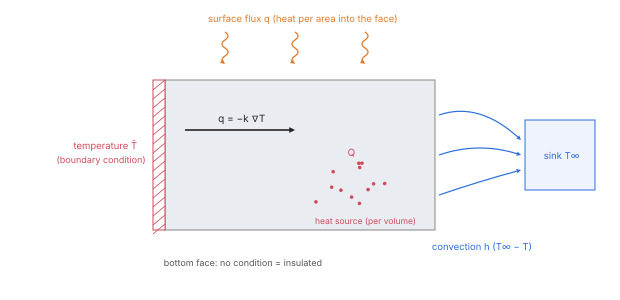
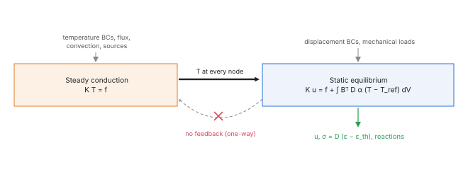
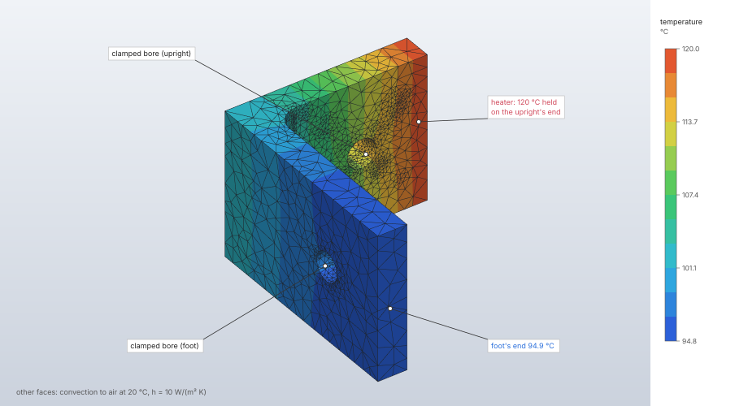
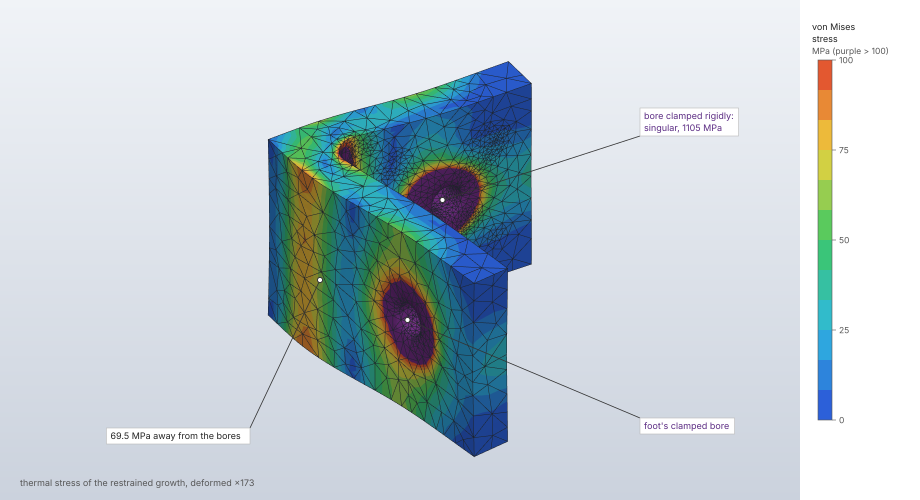

# Heat transfer and thermal stress

`solve.heat` computes steady or transient heat conduction in solid elements: temperatures, heat
flux and the heat flow at prescribed temperatures, under surface fluxes, convection and internal
heat sources. A coupled temperature–displacement step solves the steady conduction and then the
static equilibrium of the thermal strains it causes; a static step can also take temperatures
directly as loads. Conduction uses the Galerkin form with the solid elements' shape functions and
the generalized trapezoidal method in time; thermal strain enters every solid, 2D and truss
element as an equivalent load.

| | |
|---|---|
| **Commands** | `solve.heat` (heat transfer steps), `solve.static` (coupled steps and temperature loads), `solve.run`; `solve.probe`, `results.contour` (`temperature`), `results.frame`, `results.export.vtu` |
| **Step procedure** | `{"type": "heat_transfer", "transient"}`; `{"type": "coupled_temperature_displacement"}`; temperature loads in `static`, `buckle`, `nonlinear_static` and `explicit_dynamic` steps |
| **Solver** | `crates/solver` (CPU, f64), sparse Cholesky |
| **Method** | Galerkin conduction (Zienkiewicz, Taylor & Zhu 2013, §3.2 and ch. 7; Hughes 2000, ch. 1, §8.1); generalized trapezoidal integration (Hughes 2000, §8.2) |
| **Verified by** | `tie-heat-series`, `j2-heated-bar`, `nl-thermal-expansion`; `crates/solver/tests/thermal.rs`, `plane.rs` (thermal), `hybrid.rs` (thermal); `nafems-le11` pending |

## Synopsis

```json
[
  {"command": "model.material.create", "params": {"name": "Steel", "elastic": {"type": "isotropic", "young": 210000, "poisson": 0.3},
    "density": 7.85e-9, "thermal": {"conductivity": 45, "specific_heat": 4.6e8, "expansion": 1.2e-5, "reference_temperature": 20}}},
  {"command": "model.boundary_condition.create", "params": {"name": "hot", "type": "temperature", "target": {"set": "base"}, "value": 90}},
  {"command": "model.load.create", "params": {"name": "air", "type": "convection", "set": "fins", "film": 0.01, "sink": 20}},
  {"command": "model.step.create", "params": {"name": "Heat", "procedure": {"type": "heat_transfer",
    "transient": {"end_time": 600, "increment": 5, "theta": 1, "initial_temperature": 20}},
    "boundary_conditions": ["hot"], "loads": ["air"]}},
  {"command": "solve.heat", "params": {"step": "Heat"}}
]
```

Without `transient` the step is steady. For thermal stress, a `coupled_temperature_displacement`
step lists the thermal and the mechanical conditions together and is solved by `solve.static`.

## Parameters

### `solve.heat`

| Field | Value | Default | Meaning |
|---|---|---|---|
| `step` | step name | the only heat transfer step | |
| `max_dofs` | 1 to 6 000 000 | 6 000 000 | cap on the temperatures; may only be lowered |
| `max_factor_entries` | 1 to 2 000 000 000 | 400 000 000 | as for `solve.static` ([Linear solvers](linear-solvers.md#memory-limits)) |
| `threads` | 1 to 256 | the session's | changes the time, never the result |

### Transient integration (`procedure.transient`)

| Field | Value | Default | Meaning |
|---|---|---|---|
| `end_time` | > 0 | — | the step's duration |
| `increment` | > 0, at most 100 000 increments over the step | — | Δt; the step takes n = ⌈end_time / increment⌉ equal increments of end_time / n |
| `theta` | 0.5 to 1 | 1 | θ: 1 backward Euler, ½ Crank–Nicolson; unconditionally stable over the range |
| `initial_temperature` | finite | 0 °C | the uniform temperature at the start |

### Thermal conditions

| Definition | Form | Acts in |
|---|---|---|
| boundary condition `temperature` | `target` (`{"set"}`), `value` | heat transfer and coupled steps: a prescribed temperature |
| load `surface_flux` | `set` (faces), `flux` | heat per area into the faces (positive heats the body) |
| load `convection` | `set` (faces), `film` h, `sink` T∞ | heat flux h (T∞ − T) into the faces |
| load `heat_source` | `set` (elements), `power` | heat per volume |
| load `temperature` | `target`, `value` | stress steps: a temperature field that strains the material |

Material properties: `thermal.conductivity` (k, or [kx, ky, kz] along the global axes),
`thermal.specific_heat` with `density` (transient steps), `thermal.expansion` and
`thermal.reference_temperature` (thermal strain) ([Materials](materials.md#thermal-properties-thermal)).
Mechanical boundary conditions and loads are ignored by heat transfer steps.

## Theory

### Conduction

Transient conduction ρc Ṫ = ∇·(k∇T) + Q with flux and convection on the boundary gives, element
by element with one temperature per node (`heat::HEAT_DOFS`, kind `T`):

```text
K = ∫ ∇Nᵀ k ∇N dV  (+ h ∫ N Nᵀ dA on convection faces)
C = ∫ ρc N Nᵀ dV
f = ∫ N Q dV + ∫ N q dA + h T∞ ∫ N dA
C Ṫ + K T = f
```

k is the diagonal conductivity in the global axes. K uses the element's full rule, C its mass rule
(consistent). Faces (tri3, tri6, quad4, quad8) are integrated on their own geometry with the
model's face rule, the one pressures use, exact for N Nᵀ on flat faces (`heat::face_weights`,
`face_film`). The heat flux −k∇T is computed at the integration points, extrapolated and averaged
at the nodes like stresses.

**Steady**: K T = f. **Transient**, the generalized trapezoidal (θ) method with n equal
increments from a uniform initial temperature, prescribed temperatures held from the first
increment on:

```text
(C + θΔt K) Tₙ₊₁ = (C − (1 − θ)Δt K) Tₙ + Δt f
```

The left-hand matrix is factored once for the step.

**Constraints and reactions.** Prescribed temperatures and ties are eliminated by the
transformation of the structural solver (`constraints::Reduction`), T = T_f q + T_p T̄. A tie makes
each secondary node's temperature the mortar-weighted average of the main nodes under it,
T_A = Σ_J w_AJ T_J, with the displacement tie's weights: the interface has no resistance and the
heat leaving one side enters the other. The heat each prescribed node supplies is the reaction
T_pᵀ (K T + C Ṫ − f), Ṫ over the last increment in a transient step.



### Thermal strain and stress

ε_th = α (T − T_ref) along the material axes. A solid takes the load ∫ Bᵀ D ε_th dV and its
stress is D (ε − ε_th); 2D elements take the same pair, plane stress leaving εzz free (σzz = 0),
plane strain holding it (σzz = −D₃·ε_th), axisymmetric elements straining the hoop direction too;
trusses take the axial part Σ αₖ tₖ² ΔT along their tangent. Hybrid elements split it: ∫ Bᵀ D_dev
ε_th on the nodes and, through the pressure, K G M⁻¹ ∫ N_p tr ε_th, so a confined heated nearly
incompressible solid carries its bulk stress −3KαΔT. A node that no temperature reaches stays at
its material's reference temperature.

**Coupled temperature–displacement.** The steady temperatures of the step's thermal conditions
are solved first, then the equilibrium with their thermal strains. The coupling is one way
(temperature strains the solid; deformation does not heat it), which is the whole of linear
quasi-static thermoelasticity without thermoelastic dissipation, so solving the two in turn is the
monolithic solution.

**Nonlinear static steps** take temperature loads, or the steady conduction of their thermal
conditions solved first, ramped with the load factor from each material's reference temperature;
with nonlinear geometry the deformation gradient splits as F = F_m F_θ, F_θ = diag(1 + αᵢ ΔT)
(Lubarda 2004) ([Nonlinear static](nonlinear-static.md)).

**Explicit dynamics** takes a step's temperature loads as a thermal strain rate per element,
α ΔT / end time (the change reached linearly over the step), subtracted from each increment's
strain increment before the constitutive update, so it feeds J2 and Johnson–Cook plasticity
alike; isotropic expansion only ([Explicit dynamics](explicit-dynamics.md)).



## Algorithm

`solve.heat`:

1. **Select.** The step named, or the only heat transfer step.
2. **Mesh** (`HeatMesh::new`): every section must be a solid section ("heat transfer in kind
   sections (section `name`); it has solid elements so far"); each material needs a conductivity
   ("material `name` has no conductivity"); the temperatures are numbered by node label; more than
   `max_dofs`: "the model has N temperatures; the limit is M".
3. **Constraints.** Tie rows (linear faces of tet4, wedge6 and hex8 only), prescribed
   temperatures (a node held at two values is refused, naming both), the nested dissection order,
   the reduction checked against the factor budget. Every temperature prescribed: "every
   temperature is prescribed; there is nothing to solve".
4. **Assemble** K (with films), C for a transient step (an element without density and specific
   heat is refused, naming it), f; in element label order.
5. **Factor** the reduced K (steady) or C + θΔt K (transient) by Cholesky. A singular one is
   reported as "the temperature is undetermined at node N: no temperature boundary condition or
   convection reaches its part of the model".
6. **Solve.** Steady: once. Transient: n increments, each a right-hand side and a back
   substitution; the progress counts increments and the run checks for cancellation between them.
   Frames: the initial one and, to keep at most 50 000 000 temperature values (frames × nodes),
   every k-th increment, the last always kept. A non-finite temperature is refused as
   ill-conditioned.
7. **Recover.** Heat flux at the integration points and averaged at the nodes, at the end of the
   step; reactions; the heat each load carries in; for a steady step, a warning when the heat
   supplied and removed differ by more than 10⁻⁶ of the gross heat flows.

A coupled step runs steps 2–6 (steady) inside `solve.static` and then the
[linear static](linear-static.md#algorithm) solve with the thermal loads.

## Output

`solve.heat` reply (display units):

| Key | Meaning |
|---|---|
| `step`, `dofs`, `equations`, `factor_entries` | |
| `frames`, `end_time` | the stored frames and the last time (0 for a steady step) |
| `min_temperature`, `max_temperature` | `{node, value}` at the end of the step |
| `heat_supplied` | fluxes, sources and convection at the end temperatures (Σ f − K T) |
| `heat_removed` | the total reaction heat flow; in a steady state it cancels `heat_supplied` |
| `heat_flows` | `loads` (per heat load: `name`, `type`, `heat` into the body, negative out), `reactions`, `imbalance` |
| `warnings` | |

The stored result has per frame the nodal temperatures and times, and at the end the nodal and
integration-point heat flux and the nodal reactions. `solve.probe` gives `temperature`,
`heat_flux` and `reaction` (heat per time) at nodes, at the end or at `frame`, with the frame's
`time`; `results.contour` draws `temperature`; `results.export.vtu` writes the temperature per
frame and the heat flux on the last. A coupled step's static result adds the nodal temperatures
(`max_temperature` in the reply, `temperature` in probes).

## Worked example

The `heated-bracket` sample: the filleted steel L-bracket with both hole bores clamped, the end of
its upright held at 120 °C and the rest of its outside cooled by still air. One coupled
temperature–displacement step solves the steady conduction and then the thermal stress of the
growth the clamps hold back.

| | |
|---|---|
| **Geometry** | `tests/corpus/filleted-bracket`: 8 mm thick L-bracket, foot 60 mm along x, upright 50 mm along y, 40 mm along z, R6 fillet, an 8 mm hole through each leg |
| **Mesh** | `mesh.tet.generate`, tet10 of 4 mm: 20 899 elements, 35 468 nodes in this run (the count differs a little between platforms) |
| **Material** | steel: E = 210 GPa, ν = 0.3, ρ = 7 850 kg/m³, k = 50 W/(m K), c = 460 J/(kg K), α = 12 × 10⁻⁶/K, T_ref = 20 °C |
| **Boundary conditions** | `Clamp`: set `holes` (both bores) fixed; `Heater`: set `hot` (the upright's end face) at 120 °C |
| **Load** | `Air`: convection on set `skin` (every other outside face), h = 10 W/(m² K), T∞ = 20 °C |
| **Step** | `Heat`, coupled temperature–displacement (steady) |
| **Units** | mm, t, s, N, MPa; °C |

```json
[
  {"command": "file.sample", "params": {"name": "heated-bracket"}},
  {"command": "solve.static", "params": {"step": "Heat"}},
  {"command": "results.contour", "params": {"step": "Heat", "field": "temperature"}},
  {"command": "results.reactions", "params": {"step": "Heat", "sets": ["holes"]}},
  {"command": "solve.probe", "params": {"step": "Heat", "at": [[60, 4, 20], [4, 50, 20], [30, 4, 20]]}},
  {"command": "results.deformed", "params": {"step": "Heat", "show": true, "scale": "auto"}},
  {"command": "results.contour", "params": {"step": "Heat", "field": "von_mises", "range": {"max": 100}}}
]
```

Results from the `solve.static` reply, `results.contour`, `results.reactions` and `solve.probe`.
Opening the sample (meshing) took 8.7 to 14.0 s and the solve 7.8 to 14.1 s wall time in three
runs (Apple M4 Max, CPU, 14 threads, with other jobs running on the machine). The step has no
mechanical load, so the clamps' reactions must sum to zero, and a steady temperature without
heat sources lies between the air's and the heater's.

| Quantity | FieldCraft | Reference | Difference |
|---|---|---|---|
| `dofs`, `equations` | 106 404, 99 537 | | |
| `factor_entries` | 95 386 629 | | |
| Temperature range (`results.contour`) | 94.76 °C (node 35) to 120.0 °C (node 29) | within [20, 120] °C | — |
| Foot's end, node 339 at (60, 2.8, 19.5) | 94.90 °C; u = (0.0180, 0.0041, −0.0004) mm | | |
| Upright's end, node 10517 at (2.8, 50, 19.4) | 120.0 °C; u = (0.0039, 0.0203, −0.0006) mm | 120 °C (held) | 0 |
| Foot between the fillet and its hole, node 8211 at (29.5, 4.2, 19.6) | 97.78 °C; von Mises 69.5 MPa | | |
| `max_displacement` | 0.0506 mm, node 27 | | |
| `max_von_mises` | 1 105 MPa, node 35419 (edge of a clamped bore) | | |
| Reaction force on `holes` | (−6.4, −6.0, 7.7) × 10⁻¹⁰ N | 0 | |





**What to look at.** The temperature falls from the heater along the upright,
round the fillet and along the foot: conduction through the 8 mm section against convection from
its faces, a 25 K drop over the part. The bracket grows by α (T − T_ref), 0.9 to 1.2 × 10⁻³
strain, and the two clamped bores hold it back: the clamps' reactions balance each other to
10⁻⁹ N, as a self-equilibrated thermal load requires. Away from the bores the stress is tens of
MPa (69.5 MPa between the fillet and the foot's hole); at the bores a fully fixed face is a
stress singularity and its 1 105 MPa peak grows with mesh refinement, so the second picture
clamps the legend at 100 MPa (deformation scale 173).

## Verification

| Case | Reference | Error | Tolerance | Test |
|---|---|---|---|---|
| Steady conduction through a slab, every solid and formulation | theory: linear T, q = −k ΔT / L | T < 10⁻⁹, flux < 10⁻⁸, heat balance < 10⁻⁸ | exact | `slab_steady_conduction_is_linear_with_the_fourier_flux` |
| Slab with a uniform source and a convecting end (and with a surface flux), hex20 and tet10 | theory: quadratic T, exact at the nodes | 10⁻⁹ relative; heat balance 10⁻⁹ | exact | `slab_with_a_heat_source_and_convection` |
| Hollow cylinder, radial conduction | theory: T = T₁(1 − ln r / ln 2) and the heat flow | hex20 6 × 6: < 2·10⁻⁴ of ΔT; hex8 16 × 16: < 2·10⁻³; heat flow within 10 times that | as stated | `thick_cylinder_radial_conduction` |
| Semi-infinite solid with a step temperature, 100 hex8 | theory: erfc(x / 2√(κt)) (Carslaw & Jaeger 1959, §2.4) | < 5·10⁻³ for θ = ½ (200 increments) and θ = 1 (800) | as stated | `transient_conduction_into_a_semi_infinite_solid` |
| Two blocks of k = 10 and 40, non-matching meshes tied, ends at 20 and 100 | theory: series resistances (Incropera & DeWitt, §3.1) | interface 84, T and flux −640 to < 10⁻⁴ % | 10⁻⁹ rel. | `tie-heat-series` |
| Free thermal expansion, orthotropic α, every solid | theory: ΔL = α L ΔT, no stress | 10⁻¹²; stress < 10⁻⁶ | exact | `free_thermal_expansion_is_stress_free` |
| Bar held at both ends | theory: σ = −E α ΔT for any ν | 10⁻⁸ relative | exact | `constrained_bar_carries_minus_e_alpha_dt` |
| Bimetal strip, hex20 | theory: κ = 3 Δα ΔT / (2h) (Timoshenko 1925) | tip within 2 % | 2 % | `bimetal_strip_bends_as_timoshenko_says` |
| Coupled step against a heat step then a static step | consistency | temperatures identical; displacements to 10⁻¹² | exact | `coupled_step_matches_heat_then_static` |
| Thermal expansion in plane stress, plane strain, axisymmetric; plate held on every edge | theory: σzz = −EαΔT in plane strain; σ = −EαΔT/(1 − ν) biaxial | 10⁻⁹ displacement; 10⁻⁸ stress | exact | `thermal_expansion_in_every_theory`, `a_plate_held_on_every_edge_carries_the_biaxial_thermal_stress` |
| Trusses heated along their axis (rod2, rod3) | theory | 10⁻⁹ | exact | `trusses_take_thermal_strain_along_their_axis` |
| Confined heated hybrid block | theory: σ = −3KαΔT | 10⁻⁶ | exact | `heated_confined_block_carries_the_bulk_thermal_stress` |
| Bar held at its ends heated past yield (nonlinear) | theory | < 10⁻⁴ % | 10⁻⁸ rel. | `j2-heated-bar` |
| Free expansion and held block at a thermal stretch of 1.2 (nonlinear) | theory | < 10⁻⁴ % | 10⁻⁸ rel. | `nl-thermal-expansion` |
| Refusals and caps | undetermined temperature, missing conductivity, missing specific heat, caps with the byte estimate | located errors | — | `heat_steps_refuse_what_they_cannot_solve`, `heat_factor_cap_reports_value_bytes_before_allocation` |
| NAFEMS LE11, cylinder/taper/sphere under a temperature field | benchmark (target σ_zz = −105 MPa at A) | pending: no recipe yet | — | `nafems-le11` |

## Limitations

- Conduction in solid elements only: 2D, shell, beam and truss sections are refused in heat
  transfer and coupled steps.
- Shells and beams take no thermal strain (a warning says so in static steps).
- Coupled steps are steady and one way; transient coupled analysis is not implemented.
- Properties are constant in temperature; no radiation; no contact conductance (ties are
  perfect conductors); conductivity along the global axes only.
- Transient steps use fixed, equal increments (at most 100 000).
- Ties in heat transfer take linear faces only (tet4, wedge6, hex8).
- Explicit dynamics takes isotropic expansion only and no heat conduction; explicit trusses take
  no thermal strain (a warning says so).
- The deck writers refuse heat transfer and coupled temperature–displacement steps by name.

## Implementation

| File | Contents |
|---|---|
| `crates/engine/src/cmd/solve.rs` | `HEAT` spec, `run_heat`; `run_static` for coupled steps |
| `crates/solver/src/heat.rs` | `HeatMesh`, `solve_heat`, `run` (steady and θ-method), `temperatures_at`, `fluxes`, `load_flows`, `MAX_TEMPERATURE_VALUES` |
| `crates/fem/src/heat.rs` | `Conduction` (conductivity, capacity, source, flux), `face_weights`, `face_film`, `HEAT_DOFS` |
| `crates/solver/src/analysis.rs` | `static_on`: the coupled step's temperatures and thermal loads |
| `crates/solver/src/system.rs` | `temperature_loads`, `add_thermal_loads` |
| `crates/fem/src/element.rs`, `plane.rs`, `truss.rs`, `hybrid.rs` | `thermal_load`, `stresses_with` |
| `crates/model/src/steps.rs` | `Transient` and its validation, `MAX_HEAT_INCREMENTS` |
| `crates/engine/src/results.rs` | `heat_flows` |

## References

- O. C. Zienkiewicz, R. L. Taylor, J. Z. Zhu. *The Finite Element Method: Its Basis and Fundamentals*, 7th ed. Butterworth-Heinemann, 2013.
- T. J. R. Hughes. *The Finite Element Method.* Dover, 2000.
- V. A. Lubarda. *Constitutive theories based on the multiplicative decomposition of deformation gradient: thermoelasticity, elastoplasticity, and biomechanics.* Appl. Mech. Rev. 57(2):95–108, 2004.
- S. Timoshenko. *Analysis of bi-metal thermostats.* J. Opt. Soc. Am. 11(3):233–255, 1925.
- F. P. Incropera, D. P. DeWitt, T. L. Bergman, A. S. Lavine. *Fundamentals of Heat and Mass Transfer*, 7th ed. Wiley, 2011.
- H. S. Carslaw, J. C. Jaeger. *Conduction of Heat in Solids*, 2nd ed. Oxford, 1959.
- NAFEMS. *The Standard NAFEMS Benchmarks*, TNSB Rev. 3, October 1990.
