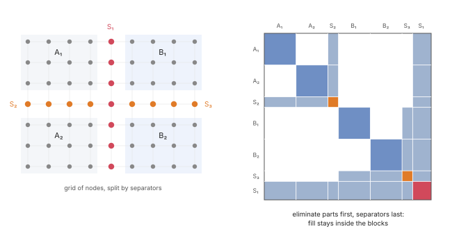
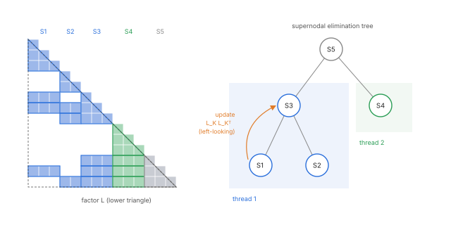
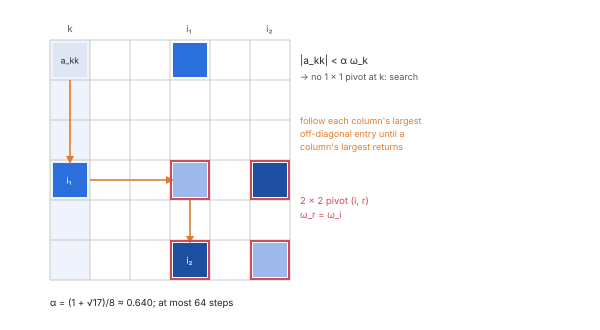
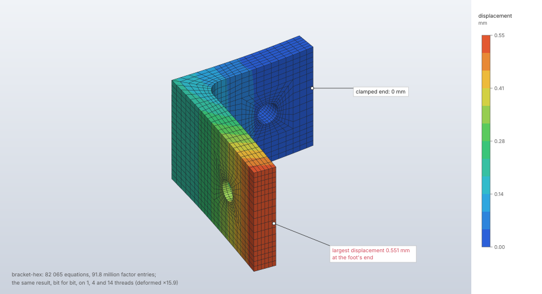

# Linear solvers

The sparse direct solvers behind every implicit analysis: a fill-reducing nested dissection
ordering of the mesh nodes, a supernodal left-looking Cholesky factorization A = L Lᵀ for symmetric
positive definite systems, and a symmetric indefinite factorization P A Pᵀ = L D Lᵀ with bounded
Bunch–Kaufman pivoting on the same symbolic structure, which also reports the matrix's inertia.
Both factor in parallel with a fixed operation order, so the factor is the same bit for bit on any
number of threads. The factor's size is computed and checked against a cap before any of its
memory is committed.

| | |
|---|---|
| **Commands** | the `max_factor_entries`, `max_dofs`, `max_iterations` and `threads` parameters of `solve.static`, `solve.heat`, `solve.frequency`, `solve.buckle`, `solve.nonlinear` |
| **Step procedure** | `static`, `coupled_temperature_displacement`, `heat_transfer`, `frequency`, `buckle`, `nonlinear_static` |
| **Solver** | `crates/solver` (CPU, f64): `ordering`, `cholesky`, `ldlt`, `constraints`, `sparse` |
| **Method** | nested dissection (George 1973; Simon 1991; George & Liu 1978); elimination tree and supernodes (Liu 1990; Liu, Ng & Peyton 1993); left-looking supernodal Cholesky (Ng & Peyton 1993; Rothberg & Gupta 1994); bounded Bunch–Kaufman pivoting (Ashcraft, Grimes & Lewis 1998) within supernodes (Schenk & Gärtner 2006) |
| **Verified by** | `cholesky::tests`, `ldlt::tests`, `ordering::tests`, `constraints::tests`, `sparse::tests`; every solver test and oracle case runs on them |

## Synopsis

```json
{"command": "solve.static", "params": {"step": "Load", "max_factor_entries": 500000000, "threads": 16}}
```

This raises the factor cap for this solve only (later solves keep the default) and runs on 16
threads with the same result as on one.

## Parameters

| Field | Value | Default | Meaning |
|---|---|---|---|
| `max_factor_entries` | 1 to 2 000 000 000 | 400 000 000 | cap on the entries of the factor L (8 bytes each); may be raised deliberately for one solve |
| `max_dofs` | 1 to 6 000 000 | 6 000 000 | cap on the model's unknowns; may only be lowered |
| `max_iterations` | 1 to 3000 | 3000 | frequency and buckling: cap on the Lanczos vectors; may only be lowered |
| `threads` | 1 to 256 | the session's (`FIELDCRAFT_THREADS` or the cores) | changes the time, never the result |

Internal constants (`crates/solver/src/cholesky.rs`, `ldlt.rs`, `ordering.rs`):

| Constant | Value | Role |
|---|---|---|
| `PIVOT_TOLERANCE` | 10⁻¹⁰ | relative pivot size below which a matrix is singular to working precision |
| `PANEL` | 64 | columns per panel of a supernode's dense factorization |
| `TILE` | 64 | rows per tile of the dense kernels |
| `PARALLEL_WORK` | 2²¹ multiply–adds | dense work from which a kernel's tiles run in parallel |
| `SUBTREE_SHARE` | 256 | subtrees are handed to threads in pieces of about 1/256 of the total work |
| `ALPHA` | (1 + √17)/8 | Bunch–Kaufman growth bound |
| `ROOK_STEPS` | 64 | most steps of one rook search |
| `LEAF` | 16 | parts this small are ordered as they come |
| `PERIPHERAL_SEARCHES` | 8 | searches for a pseudo-peripheral node per part |

## Theory

### Assembly and pattern

Matrices are stored in compressed rows with both triangles (`sparse::Csr`). The pattern is built
once from the element connectivity on the node graph: a node's row holds every node it shares an
element with, and each node pair is a dense block of their unknowns (a node's unknowns are
contiguous in the `DofLayout`), so stiffness and mass share it. Sums run in a fixed order
(elements by label, then the element's own node order).

### Ordering

Nested dissection (George 1973) orders a separator after the two parts it splits, so the factor
of a 3D mesh of n nodes fills O(n^{4/3}) instead of the O(n^{5/3}) of a band or envelope ordering.
Two separators are tried and the order whose factor has fewer entries is kept
(`fill_reducing_order`):

- **coordinate bisection** (`nested_dissection`): split at the median of the longest axis of the
  part's bounding box; the nodes of the smaller side that touch the other side are the separator
  (Simon 1991, with vertex separators);
- **graph dissection** (`graph_dissection`): the separator is a middle level of the breadth-first
  level structure rooted at a pseudo-peripheral node (George & Liu 1978; Gibbs, Poole &
  Stockmeyer 1976), which cuts a thin curved wall (a shell meshed with solids, a bellows, a
  revolved part) across its surface where a plane would cut it many times.

The symbolic count that compares them costs O(|L|) time and O(n + |A|) memory. Ties are broken by
node index, so the ordering is deterministic. The free unknowns are numbered node by node in this
order; reference point equations follow the mesh nodes.



### Sparse Cholesky

`fieldcraft_solver::cholesky` factors a symmetric positive definite A = L Lᵀ.

**Symbolic.** The elimination tree (Liu 1990) and the column counts of L come from the row
subtrees (Davis 2006, §4.1–4.4), so the factor's size is known and checked against
`max_factor_entries` before any memory is committed. The columns are renumbered in a postorder of
the tree (an equivalent ordering with the same fill), so every subtree is a contiguous range of
columns, and consecutive columns with nested structures merge into fundamental supernodes (Liu,
Ng & Peyton 1993): a supernode's columns share one row structure and are stored as one dense
lower trapezoid, so the factor holds exactly the entries of L.

**Numeric** (left-looking supernodal; Ng & Peyton 1993; Rothberg & Gupta 1994). A supernode
starts as its columns of A, receives the update L_K L_Kᵀ of every descendant supernode K whose
rows reach it (K in increasing order), and is factored densely by panels of 64 columns: a panel is
updated with the supernode's columns before it, its diagonal block is factored column by column,
and the rows below are solved against that block.

**Threads and determinism.** Each entry of L is computed by one task, by a sequence of operations
fixed by the matrix and the constants `TILE` and `PANEL`: sums over a supernode's columns run in
column order from zero, and updates are subtracted in supernode order. Disjoint subtrees of the
supernodal tree are factored concurrently (a supernode reads only its descendants), and the dense
work of a large supernode is split into row tiles; neither changes any entry's sequence of
operations, and multiplications and additions are never fused, so the factor is the same bit for
bit on any number of threads and on every platform.

**Singularity.** A pivot at or below 10⁻¹⁰ times the matrix's own diagonal entry means the matrix
is singular to working precision (an unconstrained rigid-body motion, a disconnected part, a
zero-stiffness direction): the factorization stops and names the column, the first such column
in the postorder whichever thread meets it.



### Symmetric indefinite LDLᵀ

`fieldcraft_solver::ldlt` factors P A Pᵀ = L D Lᵀ, L unit lower triangular and D block diagonal
with 1 × 1 and 2 × 2 pivots, on the Cholesky factor's symbolic factorization: the same ordering,
elimination tree, supernodes, fill, factor-size cap and parallel subtree tasks.

**Pivoting.** The bounded Bunch–Kaufman (rook) search (Bunch & Kaufman 1977; Ashcraft, Grimes &
Lewis 1998): with α = (1 + √17)/8 and ω_i the largest off-diagonal magnitude of column i, column k
is a 1 × 1 pivot when |a_kk| ≥ α ω_k; otherwise the search walks from column i to the row r of its
largest entry: r is a 1 × 1 pivot when |a_rr| ≥ α ω_r, (i, r) a 2 × 2 pivot when ω_r = ω_i, else
the search continues from r (at most 64 steps; each strictly raises ω, and at the cap the last two
columns are the 2 × 2 pivot). Every entry of L is then bounded by 1/(1 − α) ≈ 2.78 for 1 × 1
pivots. A 2 × 2 pivot has |a_ii a_rr| < α² a_ir², a negative determinant: one positive and one
negative eigenvalue.

**Pivots within supernodes** (Schenk & Gärtner 2006). The columns of a supernode are fully summed
once its descendants' updates are in, so any of them can be the next pivot: a symmetric
interchange inside the supernode leaves every row structure unchanged, so nothing is delayed and
the static symbolic factorization holds (multifrontal codes delay a failed column into the parent
instead, which changes the structure as it goes; Duff & Reid 1983; Liu 1992). The search looks at
the supernode's own rows only. Inside a panel each column is brought up to date with the panel's
columns before it when the search looks at it (the partial factorization of LAPACK's `dsytrf`,
Anderson et al. 1999); after the panel the rest of the supernode receives its update by the tiled,
parallel kernel of the Cholesky factor. Every pivot decision is made by one task, ties broken by
the lowest index, so the factor, its pivots and its inertia are the same on any number of threads.

**Inertia** (Sylvester's law): the counts of positive and negative eigenvalues of A are those of
D, a 1 × 1 pivot by its sign, a 2 × 2 one by its eigenvalues. A factor of K − σM counts the
eigenvalues below σ; a tangent's negative pivots count its unstable directions.

**Refinement.** `Symmetric::solve_refined` solves A x = b, then refines with the residual against
A while it shrinks, at most a given number of times (iterative refinement in working precision;
Higham 2002, §12.2). Cholesky solutions are returned as solved.

**Choice of factorization** (`Symmetric::new(a, cap, kind)`): `Definite` is Cholesky, refusing a
matrix that is not positive definite (the default wherever a matrix is, so linear results are
unchanged bit for bit); `Indefinite` is LDLᵀ; `Auto` is Cholesky and, when the matrix turns out
not to be positive definite, LDLᵀ on the same symbolic factorization.

| Analysis | Matrix | Factorization |
|---|---|---|
| Linear static, coupled step | K_ff | Cholesky |
| Heat transfer | K_ff (steady), C + θΔt K (transient) | Cholesky |
| Frequency | K − σM | Cholesky |
| Buckling without a shift | K | Cholesky (`Definite`) |
| Buckling with a shift | K + σ K_σ | LDLᵀ (`Indefinite`), refined twice per solve |
| Nonlinear static | the tangent | `Auto`: Cholesky, LDLᵀ when indefinite ([Nonlinear static](nonlinear-static.md)) |



### Memory limits

`solve.static`, `solve.nonlinear`, `solve.heat`, `solve.frequency` and `solve.buckle` accept
`max_factor_entries`: 400 000 000 by default, or an explicit whole number from 1 to
2 000 000 000. `{"step": "Load", "max_factor_entries": 500000000}` deliberately raises the cap
for that solve; it does not change the default of later solves. The other work and iteration caps
can only be lowered.

Each factor value is 8 bytes: the default allows 3.2 GB of values, and the ceiling 16 GB. These
are factor values alone, not total RAM: indices, assembled matrices, numeric workspace and other
solver storage need additional memory. Raising the cap neither reserves memory nor guarantees
that it is available. A factor over the cap is reported before its values are allocated, with the
required entry count and its byte estimate: "the factorization needs N entries (B bytes of factor
values alone; indices and workspace are additional); the limit is M entries (refine less or raise
max_factor_entries)". An allocation that fails is "not enough memory for the factorization (N
entries)". 32-bit builds remain limited by addressable allocation sizes. The ceiling is defined
once, as `FACTOR_ENTRY_CEILING` in `crates/engine/src/cmd/solve.rs`.

The same entry budget guards two more stores:

- **Constraint reduction** (`constraints::Budget`, 8 × `max_factor_entries` bytes over the matrices
  being reduced): a held distributing coupling makes every coupled node depend on every other, a
  dense (3N)² block, estimated from the rows and refused before anything is built ("distributing
  coupling `name` couples N nodes and its reference point is held …; split the surface into
  smaller couplings, hold the surface itself, or use a kinematic coupling"); every other reduction
  counts its entries and stops at the budget before allocating ("reduced matrices need more
  than …").
- **The Lanczos basis** (vectors and their mass products, 2 n × vectors): at most
  `max_factor_entries` / (2 n) vectors, within `max_iterations`. At 6 000 000 equations this is 33
  vectors with the default cap and 166 at the ceiling.

## Algorithm

1. **Pattern.** `NodeGraph::new` from the elements', trusses', shells', beams' and discrete
   elements' node lists.
2. **Order.** `fill_reducing_order` on the mesh nodes: coordinate and graph dissection, the one
   with the smaller symbolic fill kept.
3. **Reduce.** `constraints::Reduction` eliminates prescribed values and constraint rows in that
   order (free unknowns numbered by the node order), within its memory budget.
4. **Symbolic.** Elimination tree, postorder, column counts, supernodes; the entry count against
   `max_factor_entries` (refused before allocation).
5. **Allocate** the supernodes' values (`try_reserve_exact`; a failure is the out-of-memory
   error).
6. **Numeric.** Subtrees in parallel, supernodes left-looking, dense panels and tiles; the run is
   cancellable between supernodes. A non-positive pivot (Cholesky) or a supernode without an
   acceptable pivot (LDLᵀ) stops with the column, which the solver turns into the node and
   direction: "the stiffness is singular at node N in direction …" (Cholesky) or "the matrix is
   singular at …: no pivot of its supernode is more than round-off (a mechanism, or a shift or
   load at an eigenvalue)" (LDLᵀ).
7. **Solve.** Forward and back substitution over the supernodes, the permutation applied; LDLᵀ
   solves with D's 1 × 1 and 2 × 2 blocks, optionally refined.

There is no iteration in the factorization itself; the bounded loops are the rook search (64
steps), the refinement (a fixed count, stopping when the residual stops shrinking) and the
Lanczos basis (`max_iterations`).

## Output

The solve replies report `dofs` (all unknowns), `equations` (the free ones factored) and
`factor_entries` (entries of L); frequency and buckling replies add `lanczos_vectors`. Nonlinear
steps record each iteration's negative pivot count, and a shifted buckling step its
`below_shift` count, both from the LDLᵀ inertia.

## Worked example

The `bracket-hex` sample (5 778 hex20 elements, the model of the [Linear static](linear-static.md#worked-example)
example) solved on 1, 4 and 14 threads, its results written to CSV after each solve and compared
byte for byte, and solved once more with a factor cap below what its factor needs.

| | |
|---|---|
| **Model** | `file.sample` `bracket-hex`: filleted steel L-bracket, hex20 of 3 mm, 27 708 nodes; upright's end clamped, 1 kN on the foot's end; step `Load` (static) |
| **Solves** | `solve.static` with `threads` 1, 4 and 14; then with `max_factor_entries` 50 000 000 |
| **Compared** | `results.export.csv` after each solve: probe results of nodes 1 to 10 000 (coordinates, displacement, reaction, stress, principal and von Mises stress, 17 significant digits) and the reactions of set `top` |
| **Machine** | Apple M4 Max (14 cores), macOS 26, CPU |

```json
[
  {"command": "file.sample", "params": {"name": "bracket-hex"}},
  {"command": "solve.static", "params": {"step": "Load", "threads": 1}},
  {"command": "results.export.csv", "params": {"what": "probe", "step": "Load", "nodes": [1, 2, 3, "…", 10000], "path": "t1.csv"}},
  {"command": "results.export.csv", "params": {"what": "reactions", "step": "Load", "sets": ["top"], "path": "r1.csv"}},
  {"command": "solve.static", "params": {"step": "Load", "threads": 4}},
  {"command": "results.export.csv", "params": {"what": "probe", "step": "Load", "nodes": [1, 2, 3, "…", 10000], "path": "t4.csv"}},
  {"command": "results.export.csv", "params": {"what": "reactions", "step": "Load", "sets": ["top"], "path": "r4.csv"}},
  {"command": "solve.static", "params": {"step": "Load", "threads": 14}},
  {"command": "results.export.csv", "params": {"what": "probe", "step": "Load", "nodes": [1, 2, 3, "…", 10000], "path": "t14.csv"}},
  {"command": "results.export.csv", "params": {"what": "reactions", "step": "Load", "sets": ["top"], "path": "r14.csv"}},
  {"command": "solve.static", "params": {"step": "Load", "max_factor_entries": 50000000}}
]
```

(`"…"` stands for the node labels 4 to 9 999, written out in the run; a probe takes at most
10 000 nodes.) Results from the `solve.static` replies and the files. Wall times are of
`solve.static` (assembly, ordering, factorization, solve and stress recovery) in two runs, with
other jobs running on the machine (load average about 18).

| Quantity | 1 thread | 4 threads | 14 threads |
|---|---|---|---|
| `dofs` | 83 124 | 83 124 | 83 124 |
| `equations` | 82 065 | 82 065 | 82 065 |
| `factor_entries` | 91 826 205 | 91 826 205 | 91 826 205 |
| `max_displacement` | 0.5511123143618812 mm | the same | the same |
| `max_von_mises` | 295.0983647905056 MPa | the same | the same |
| `reaction_total` y | 999.999999981553 N | the same | the same |
| Probe CSV, 10 000 nodes (3 481 210 bytes) | — | identical to 1 thread | identical to 1 thread |
| Reaction CSV, set `top` | — | identical to 1 thread | identical to 1 thread |
| Wall time, two runs | 11.2 s, 11.8 s | 3.9 s, 3.6 s | 3.8 s, 2.5 s |

The solve under a cap of 50 000 000 entries is refused in 0.7 s, before the numeric
factorization, with:

```text
limit reached: the factorization needs 91826205 entries (734609640 bytes of factor values alone;
indices and workspace are additional); the limit is 50000000 entries (refine less or raise
max_factor_entries)
```



**What to look at.** The factor holds 91.8 million entries, 0.73 GB of values, for 82 065
equations, about 1 120 entries per equation. Every entry of L comes from one task with a fixed sequence of operations,
so the three solves write the same files to the last digit while the time falls about threefold
from one thread to four. The refused solve names the entries the factor needs and their bytes,
computed from the symbolic factorization alone; `max_factor_entries` of at least 91 826 205
lets it through.

## Verification

| Case | Check | Test |
|---|---|---|
| Sparse SPD factor and solve; cap refused before allocation; singular matrix located; cancellation; empty and 1 × 1 matrices | exact solution, located errors | `cholesky::tests::factor_and_solve_a_sparse_spd_matrix` |
| Supernodes wider than two panels, 1, 2 and 7 threads | residual < 10⁻¹², factor bit-identical on every thread count | `supernodes_panels_and_threads` |
| Indefinite shifted systems | inertia equals the eigenvalue count below σ; residual < 10⁻¹⁰; on an SPD matrix the same fill as Cholesky and no negative pivot | `ldlt::tests::indefinite_systems_solve_with_their_inertia` |
| Saddle points with zero diagonals | 2 × 2 pivots; inertia (K's size, the constraints') | `two_by_two_pivots_for_zero_diagonals` |
| Singular Laplacian, NaN, caps | located `Singular` errors; cap before the numeric factorization | `singular_and_hostile_matrices_are_located_errors` |
| LDLᵀ on 1 and several threads | values and pivot order bit-identical | `same_factor_on_any_number_of_threads` |
| `Auto` selection and refinement | Cholesky for SPD, LDLᵀ otherwise with the right inertia; refined solutions | `auto_selection_and_refinement` |
| LDLᵀ cost on a hex8 stiffness pattern of 140 000 equations (1.5 · 10⁸ entries) | 1.1 times the Cholesky factor; 1.2 times on a shift with 10 600 negative eigenvalues and 7 700 2 × 2 pivots | `speed_against_cholesky` (heavy) |
| Orderings | a permutation with separators last; graph dissection deterministic; less fill than planes on a thin curved wall; a block keeps the better ordering | `ordering::tests` |
| Constraint budget | a held distributing coupling of 12 321 nodes refused with its size before allocating; byte counts that overflow refused | `oversized_reductions_are_refused_before_allocating`, `reduced_matrix_budget_refuses_byte_counts_that_overflow` |
| Lanczos basis under a raised cap | 33 and 166 vectors at 6 000 000 equations | `raised_factor_budget_keeps_the_lanczos_vector_limit` |
| Cap error text | entry count and byte estimate before allocation | `factor_limit_estimates_bytes_without_allocating_the_factor`, `heat_factor_cap_reports_value_bytes_before_allocation` |

Every implicit solver test and oracle case runs on these factorizations; the oracle fixtures fail
CI on any change of a frozen result beyond its band (10⁻⁹ of the value).

## Limitations

- Direct solvers only: memory grows with the factor (O(n^{4/3}) entries for a 3D mesh under
  nested dissection); there is no iterative solver and no out-of-core factorization.
- LDLᵀ keeps a static structure: L's entries below a supernode are not bounded by the search
  (refinement covers accuracy where it matters), and a nonsingular saddle point whose zero
  diagonal couples only to rows of a later supernode would stop as singular. No FieldCraft system
  has one: hybrid pressures are condensed per element.
- A zero eigenvalue is never counted in the inertia: a zero pivot is a located error.
- Unsymmetric matrices are not factored: the skew part of a follower pressure's load stiffness and
  of friction is left out of the tangent ([Nonlinear static](nonlinear-static.md)).

## Implementation

| File | Contents |
|---|---|
| `crates/solver/src/sparse.rs` | `Csr`, `NodeGraph`, `add_block`, `add_scalar`, `add_diagonal` |
| `crates/solver/src/ordering.rs` | `nested_dissection`, `graph_dissection`, `fill_reducing_order`, `fill` |
| `crates/solver/src/cholesky.rs` | `UpperColumns`, `Symbolic`, `Factor`, `FactorError`, `PIVOT_TOLERANCE`, `PANEL`, `TILE` |
| `crates/solver/src/ldlt.rs` | `LdltFactor`, `Inertia`, `Kind`, `Symmetric` (`new`, `solve`, `solve_refined`, `inertia`) |
| `crates/solver/src/constraints.rs` | `Reduction`, `Budget` |
| `crates/solver/src/analysis.rs` | `pattern`, `factor_raw`, `factor_symmetric`, `factor_error`, `budget`, `lanczos_basis` |
| `crates/solver/src/lib.rs` | `Limits`, `Error::factor_limit` |
| `crates/engine/src/cmd/solve.rs` | `limits`, `FACTOR_ENTRY_CEILING`, `threads` |

## References

- A. George. *Nested dissection of a regular finite element mesh.* SIAM J. Numer. Anal. 10(2):345–363, 1973.
- A. George, J. W. H. Liu. *An automatic nested dissection algorithm for irregular finite element problems.* SIAM J. Numer. Anal. 15(5):1053–1069, 1978.
- N. E. Gibbs, W. G. Poole, P. K. Stockmeyer. *An algorithm for reducing the bandwidth and profile of a sparse matrix.* SIAM J. Numer. Anal. 13(2):236–250, 1976.
- H. D. Simon. *Partitioning of unstructured problems for parallel processing.* Computing Systems in Engineering 2:135–148, 1991.
- J. W. H. Liu. *The role of elimination trees in sparse factorization.* SIAM J. Matrix Anal. Appl. 11(1):134–172, 1990.
- J. W. H. Liu, E. G. Ng, B. W. Peyton. *On finding supernodes for sparse matrix computations.* SIAM J. Matrix Anal. Appl. 14(1):242–252, 1993.
- T. A. Davis. *Direct Methods for Sparse Linear Systems.* SIAM, 2006.
- E. Ng, B. W. Peyton. *Block sparse Cholesky algorithms on advanced uniprocessor computers.* SIAM J. Sci. Comput. 14(5):1034–1056, 1993.
- E. Rothberg, A. Gupta. *An efficient block-oriented approach to parallel sparse Cholesky factorization.* SIAM J. Sci. Comput. 15(6):1413–1439, 1994.
- J. R. Bunch, L. Kaufman. *Some stable methods for calculating inertia and solving symmetric linear systems.* Math. Comp. 31(137):163–179, 1977.
- C. Ashcraft, R. G. Grimes, J. G. Lewis. *Accurate symmetric indefinite linear equation solvers.* SIAM J. Matrix Anal. Appl. 20(2):513–561, 1998.
- O. Schenk, K. Gärtner. *On fast factorization pivoting methods for sparse symmetric indefinite systems.* Electron. Trans. Numer. Anal. 23:158–179, 2006.
- I. S. Duff, J. K. Reid. *The multifrontal solution of indefinite sparse symmetric linear equations.* ACM TOMS 9(3):302–325, 1983.
- J. W. H. Liu. *The multifrontal method for sparse matrix solution: theory and practice.* SIAM Review 34(1):82–109, 1992.
- E. Anderson et al. *LAPACK Users' Guide.* SIAM, 1999.
- N. J. Higham. *Accuracy and Stability of Numerical Algorithms*, 2nd ed. SIAM, 2002.
