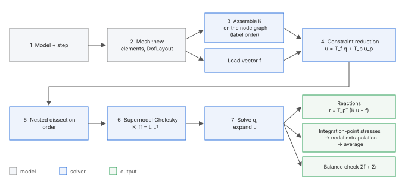
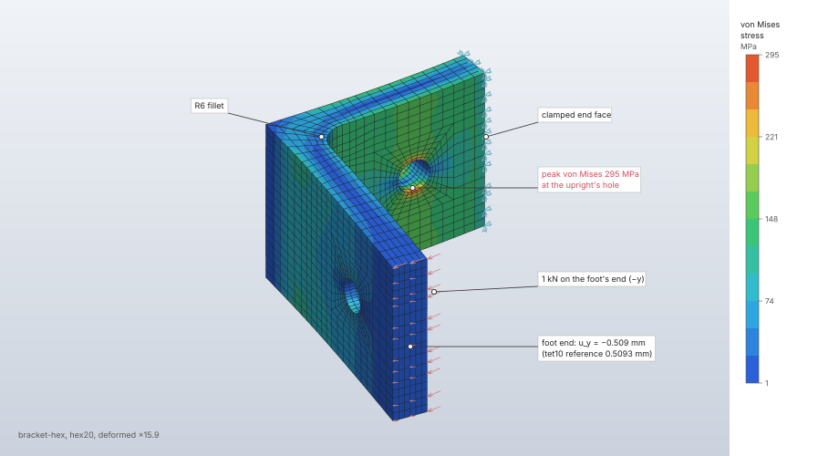

# Linear static analysis

`solve.static` computes the small-displacement equilibrium K u = f of a static step: the
displacements and rotations, the reactions at the prescribed degrees of freedom and coupled
reference points, and the stresses at the integration points and averaged at the nodes. It
serves solids, 2D continua, shells, beams, trusses and discrete elements in one mesh. Constraints
and prescribed values are eliminated by transformation, the reduced system is ordered by nested
dissection and solved by a supernodal sparse Cholesky factorization, deterministic on any number
of threads.

| | |
|---|---|
| **Commands** | `solve.static` (and `solve.run`); `solve.probe`, `results.contour`, `results.reactions`, `results.export.vtu`, `results.export.csv` |
| **Step procedure** | `{"type": "static"}`; `{"type": "coupled_temperature_displacement"}` is solved by the same command ([Heat transfer](heat-transfer.md)) |
| **Solver** | `crates/solver` (CPU, f64) |
| **Method** | isoparametric displacement elements (Zienkiewicz, Taylor & Zhu 2013; Hughes 2000); master–slave elimination of constraints (Cook et al. 2002, §9.2); nested dissection (George 1973); supernodal Cholesky (Ng & Peyton 1993) |
| **Verified by** | patch tests, `cantilever-*`, `lame-cylinder*`, `kirsch-plate*`, `rotating-*`, NAFEMS LE1, LE2, LE3, LE5, LE6, LE7, LE10, `scordelis-lo-roof-*`, `pinched-cylinder`, `tie-patch`, `tube-torsion-coupling`, `pure-bending-coupling`; `crates/solver/tests/{verification,plane,structural,one_d,couplings,inclined_symmetry}.rs` |

## Synopsis

```json
[
  {"command": "model.boundary_condition.create", "params": {"name": "clamp", "type": "fixed", "target": {"set": "root"}}},
  {"command": "model.load.create", "params": {"name": "push", "type": "pressure", "set": "top", "magnitude": 2}},
  {"command": "model.step.create", "params": {"name": "Load", "procedure": {"type": "static"},
    "boundary_conditions": ["clamp"], "loads": ["push"]}},
  {"command": "solve.static", "params": {"step": "Load"}},
  {"command": "solve.probe", "params": {"step": "Load", "set": "top"}}
]
```

## Parameters

### `solve.static`

| Field | Value | Default | Meaning |
|---|---|---|---|
| `step` | step name | the only static or coupled step | the step to solve; with several such steps and none named: "name the step: the model has … steps …" |
| `max_dofs` | 1 to 6 000 000 | 6 000 000 | cap on the model's unknowns; may only be lowered |
| `max_factor_entries` | 1 to 2 000 000 000 | 400 000 000 | cap on the factor's entries (8 bytes each); may be raised for one solve ([Linear solvers](linear-solvers.md#memory-limits)) |
| `threads` | 1 to 256 | the session's (`FIELDCRAFT_THREADS` or the cores) | changes the time, never the result |

### The step

| Field | Value | Default | Meaning |
|---|---|---|---|
| `procedure` | `{"type": "static"}` | — | |
| `boundary_conditions` | names | none | active in this step; nothing carries over between steps |
| `loads` | names | none | active in this step |
| `output` | `displacement`, `reaction_force`, `stress`, `strain` | all | what the step requests |

### Boundary conditions and loads that act

| Definition | Form | Acts as |
|---|---|---|
| `fixed` | `target` | every degree of freedom of the target held at zero |
| `displacement` | `target`, `values` [u1, u2, u3, ur1, ur2, ur3] (`null` free) | prescribed values; rotations of solid nodes do not exist and are ignored |
| `symmetry` | `target`, `plane` `x`, `y`, `z` or `{"normal"}` | an axis plane holds global degrees of freedom; an inclined plane is the linear constraint n · u = 0 (and the rotations about its in-plane axes at nodes with rotations) |
| `force`, `moment` | `target`, `vector`, `distribution` `total` (default) or `per_node` | `total`: split by the faces' consistent nodal weights (area-weighted) over a set with faces, equally over a set of nodes; a reference point takes it whole. A moment needs rotations: shell or beam nodes, or a coupled reference point |
| `traction` | `set`, `vector` | force per area on the set's faces, consistent nodal forces |
| `pressure` | `set`, `magnitude` | uniform, positive pushing in, consistent nodal forces on the faces (2D models: on element edges) |
| `gravity` | `acceleration`, `set` (optional) | ρ a on the set's elements (or the whole model, point masses included) |
| `body_force` | `set`, `vector` | force per volume |
| `centrifugal` | `angular_velocity`, `point`, `axis`, `set` (optional) | ρ ω² r away from the axis; solid and 2D elements only |
| `temperature` | `target`, `value` | thermal strain α (T − T_ref) of the target's nodes ([Heat transfer](heat-transfer.md)) |

In a 2D model loads lie in the XY plane: surface loads act on element edges, forces are totals
over the thickness (or the circumference, axisymmetric), and a vector with a Z component is an
error. Heat loads (`surface_flux`, `convection`, `heat_source`) have no effect in a static step.

## Theory

The principle of virtual work with the isoparametric elements of the [Element
library](elements.md) gives K u = f, K = Σₑ ∫ Bᵀ D B dV assembled over the elements, f the
consistent loads (∫ Nᵀ t dA for tractions and pressures, ∫ Nᵀ b dV for body forces and gravity,
∫ Bᵀ D ε_th dV for thermal strain).

**Constraints.** Every degree of freedom is free, prescribed (a boundary condition), dependent
(a coupling, tie or inclined symmetry plane), or inactive (a reference point direction no
coupling ties). The constraint rows are eliminated one at a time in a fixed order (boundary
conditions, then couplings by name, nodes by label), each dependent unknown chosen as the row's
intended one or else the largest coefficient (Abel & Shephard 1979), until every unknown is a
combination of the free ones q and the prescribed values u_p:

```text
u = T_f q + T_p u_p
(T_fᵀ K T_f) q = T_fᵀ (f − K T_p u_p)
r = T_pᵀ (K u − f)
```

No penalty numbers and no Lagrange multipliers enter, so the reduced matrix stays symmetric
positive definite; without couplings T_f is the identity on the free unknowns. A redundant row is
dropped when the prescribed values satisfy it and refused as contradictory otherwise. The
coupling, tie and spring formulations are in [Constraints and
connectors](constraints-and-connectors.md).

**Stress recovery.** Each element evaluates σ = D (ε − ε_th) at its integration points and
extrapolates to its nodes with its linear corner functions fitted by least squares (mid-side
nodes take the mean of their edge's corners; Hinton & Campbell 1974). The nodal stress is the
plain average over the elements sharing the node; a shell contributes its top surface (the side
its normal points to). The von Mises stress is that of the averaged tensor.



## Algorithm

1. **Select and check.** The step named, or the only static or coupled step. A model with
   contact is refused: "contact (`name`) in linear static steps: a model's contacts apply to all
   its steps, so solve its nonlinear static or explicit dynamic steps, or remove the contacts to
   solve this one".
2. **Mesh** (`system::Mesh::new`): sections to elements with their D and formulation, trusses,
   shells, beams, point masses, springs; refused section kinds and formulations are named. More
   than `max_dofs` unknowns: "the model has N degrees of freedom; the limit is M".
3. **Temperatures.** A coupled step solves its steady heat conduction first; a static step takes
   its temperature loads (nodes they do not reach stay at their material's reference
   temperature).
4. **Pattern and order.** The node graph of all elements; the nested dissection order of its
   nodes ([Linear solvers](linear-solvers.md)); reference point equations follow the mesh nodes.
5. **Reduction.** Symmetry, coupling and tie rows and the prescribed values build the
   transformation; its memory is checked against the factor budget before it is allocated. Every
   unknown prescribed: "every degree of freedom is prescribed; there is nothing to solve".
6. **Loads and assembly.** f from the step's loads (and the thermal loads); K assembled in
   rounds of 4096 elements in parallel, added in label order.
7. **Factor and solve.** K_ff = T_fᵀ K T_f is factored by Cholesky against
   `max_factor_entries`; a pivot at or below 10⁻¹⁰ of its diagonal is reported as
   "the stiffness is singular at node N in direction: the model can move without straining
   (missing or insufficient boundary conditions, a part not connected to the rest, or a reference
   point direction nothing holds)". A non-finite solution is refused as ill-conditioned.
8. **Recover.** Reactions, element stresses (in parallel, collected in label order), shell
   section forces and stresses, beam end forces with their body-force loads, nodal averages.
9. **Balance.** The applied and reaction totals per direction (the forces of springs to the ground
   included); a difference above 10⁻⁶ of the largest load or reaction is a warning naming it.

Every step is bounded: the work is fixed by the model size, and the only caps are `max_dofs` and
`max_factor_entries`.

## Output

The reply (in the display units):

| Key | Meaning |
|---|---|
| `step`, `dofs`, `equations`, `factor_entries` | the step, its unknowns, the free ones solved for, the factor's entries |
| `max_displacement` | `{node, value}`: the largest displacement magnitude |
| `max_von_mises` | `{node, value}`: the largest nodal von Mises stress |
| `applied_total`, `reaction_total` | force sums along X, Y, Z (moments excluded); a component below 10⁻⁹ of the sum of the terms' magnitudes is set to 0 |
| `reference_points` | per coupled reference point: `name`, `label`, `displacement` (3 translations, 3 rotations), `reaction` (forces, moments) |
| `max_temperature` | coupled steps: `{node, value}` |
| `warnings` | what was ignored or left out (dashpots, plasticity, shells under temperature, balance) |

The stored result has per node (label order) the displacement, rotation (zero at solid and truss
nodes), reaction, reaction moment, averaged stress (xx, yy, zz, xy, xz, yz) and von Mises stress;
per element the integration-point and nodal stresses; per shell section forces and surface
stresses; per beam end forces. `solve.probe` reads them at nodes (`nodes`, `set` or the nearest
nodes to points `at`) with the principal stresses, and with `elements` per element.
`results.contour` draws `displacement`, `displacement_x/y/z`, `von_mises`,
`max/mid/min_principal` and `stress_xx` … `stress_yz`; `results.reactions` sums reaction forces
and moments over sets about a point; `results.export.vtu` writes displacement, rotation, reaction,
stress and von Mises for ParaView.

## Worked example

The `bracket-hex` sample: the filleted steel L-bracket meshed all-hex in 30 mapped blocks,
clamped at the end of its upright and loaded with 1 kN at the end of its foot. It shows a linear
static solve with its reply, a probe at the loaded end, the stress peak and the balance of loads
and reactions.

| | |
|---|---|
| **Geometry** | `tests/corpus/filleted-bracket-blocks`: 8 mm thick L-bracket, foot 60 mm along x, upright 50 mm along y, 40 mm along z, R6 fillet, an 8 mm hole through each leg; 30 cells |
| **Mesh** | `mesh.hex.blocks`, hex20 of 3 mm: 5 778 elements, 27 708 nodes, all valid, scaled Jacobian min 0.705, mean 0.940 (`mesh.quality`) |
| **Material** | steel: E = 210 GPa, ν = 0.3, ρ = 7 850 kg/m³ |
| **Boundary conditions** | `Clamp`: set `top` (the upright's end face in every cell that has it) fixed |
| **Load** | `Push`: force [0, −1000, 0] N, total, on set `tip` (the foot's end face) |
| **Step** | `Load`, static |
| **Units** | mm, t, s, N, MPa |

```json
[
  {"command": "file.sample", "params": {"name": "bracket-hex"}},
  {"command": "solve.static", "params": {"step": "Load"}},
  {"command": "solve.probe", "params": {"step": "Load", "at": [[60, 4, 20]]}},
  {"command": "solve.probe", "params": {"step": "Load", "nodes": [428]}},
  {"command": "results.reactions", "params": {"step": "Load"}},
  {"command": "results.deformed", "params": {"step": "Load", "show": true, "scale": "auto"}},
  {"command": "results.contour", "params": {"step": "Load", "field": "von_mises"}}
]
```

Results from the `solve.static` reply, `solve.probe` and `results.reactions`. The solve took
6.1 to 11.3 s wall time on 14 threads in separate runs (Apple M4 Max, CPU, with other jobs
running on the machine). The reference deflection is the 48 016-element tet10 solution of the
unpartitioned part held by `the_hex_bracket_bends_like_the_fine_tet_solution`
(`crates/engine/src/sample.rs`, from `crates/testkit/tests/bracket_blocks.rs`).

| Quantity | FieldCraft | Reference | Difference |
|---|---|---|---|
| `dofs`, `equations` | 83 124, 82 065 | | |
| `factor_entries` | 91 826 205 | | |
| u_y at the foot's end, node 27196 at (60, 4, 20) | −0.5086 mm (u_x −0.1698 mm) | −0.5093 mm | −0.13 % |
| `max_displacement` | 0.5511 mm, node 27053 | | |
| `max_von_mises` | 295.10 MPa, node 428 (σ_yy 290.7 MPa, σ₁ 296.1 MPa) | | |
| `applied_total` y | −999.999999999999 N | | |
| `reaction_total` y | 999.999999981553 N | 1 000 N | 1.8 × 10⁻¹¹ |
| Reaction moment about the origin, set `top` | (−20 000.0, 0.0, 60 000.0) N·mm | −(r × F) of the load at x = 60, z = 20: (−20 000, 0, 60 000) N·mm | < 10⁻¹⁰ |



**What to look at.** The deformed shape (scale 15.9) bends both legs about the fillet. The stress
runs round the fillet and peaks at the edge of the upright's hole, 295 MPa, where the hole
interrupts the upright's bending stress; the peak is a nodal average of the elements' stresses
extrapolated from their integration points. The reactions at the clamp carry the whole 1 kN and
its moment about the origin to rounding, the balance check of step 9 of the algorithm, and the
probe at the foot's end lies within 0.13 % of the fine tet10 solution.

## Verification

| Case | Reference | Error | Tolerance | Test |
|---|---|---|---|---|
| Patch test, every solid and 2D element | theory | < 10⁻¹² (3D), < 10⁻¹⁵ (2D) | exact | `patch-*`, `patch_test_every_element`, `patch_test_every_element_and_theory` |
| Uniaxial tension by pressure, distorted block, every solid | theory | σxx = p, balance to 10⁻⁹ | exact | `uniaxial_tension_by_pressure` |
| Gravity and body force totals | theory: ρ g V | 10⁻⁹ | exact | `gravity_and_body_force_totals` |
| Cantilever, Timoshenko deflection | theory | hex20 0.013 %, hex8 incompatible 0.16 %, tet10 0.018 %; reactions < 10⁻⁴ % | 0.5 % | `cantilever-hex20`, `cantilever-hex8-incompatible`, `cantilever-tet10` |
| Cantilever convergence: hex8, tet4, wedge6 | theory | monotone, rate > 1.5; < 4 %, 12 %, 4 % at 40 × 8 × 8 | as stated | `cantilever_tip_deflection_and_convergence` (heavy) |
| Lamé thick cylinder, plane strain (3D quarter, 2D plane strain, axisymmetric) | theory | u_r ≤ 0.00042 %, σ_θ −0.18 % to −0.41 %, σ_z +0.42 % | 0.1 %, 1 % | `lame-cylinder`, `lame-cylinder-plane-strain`, `lame-cylinder-axisymmetric` |
| Kirsch plate, K_t = 3 at the hole | theory | +0.40 % (3D), +0.096 % (plane stress) | 2 % | `kirsch-plate`, `kirsch-plate-plane-stress` |
| Rotating disc (plane stress) and cylinder (axisymmetric) | theory | ≤ 0.2 % | 1 % | `rotating-disc-plane-stress`, `rotating-cylinder-axisymmetric` |
| NAFEMS LE1 elliptic membrane | benchmark | +0.18 % (hex20 layer), −0.056 % (plane stress) | 1 % | `nafems-le1`, `nafems-le1-plane-stress` |
| NAFEMS LE10 thick plate | benchmark | +0.86 % | 2 % | `nafems-le10` |
| NAFEMS LE5 Z-section cantilever | benchmark | −1.35 % | 2 % | `nafems-le5` |
| NAFEMS LE7 axisymmetric cylinder/sphere | benchmark | −2.23 % against the thin-shell target (known failure: no axisymmetric shell); +0.05 % against the converged solid | 1 % | `nafems-le7` |
| NAFEMS LE2, LE3, LE6; Scordelis–Lo; pinched cylinder (shells) | benchmark | see [Element library](elements.md#verification) | | |
| Scordelis–Lo roof with solids | benchmark | 0.33 % | 2 % | `scordelis-lo-roof-solid` |
| Tie patch test, non-matching meshes | theory | < 10⁻⁴ % | 10⁻⁹ rel. | `tie-patch` |
| Tube torsion through a kinematic coupling | theory | rotation 0.0006 %, shear stress 0.29 % | 0.5 %, 1 % | `tube-torsion-coupling` |
| Pure bending through a distributing coupling | theory | stress < 10⁻⁴ %; rotation +1.18 % (known failure: equal weights at corner and mid-side nodes of hex20) | 0.5 %, 1 % | `pure-bending-coupling` |
| Inclined symmetry plane against the axis-aligned image and the whole part | theory (frame indifference) | displacements < 10⁻⁹, stresses < 10⁻⁸; balance < 10⁻⁸ | as stated | `crates/solver/tests/inclined_symmetry.rs` |
| Filleted bracket, peak fillet stress (mesh-converged reference) | theory (convergence study) | within 3 % (fine), 5 % (coarse); reaction exact | 3 %, 5 % | `filleted-bracket-fillet-stress`, `-coarse` |
| A buckling preload equals the static solution, 1 and 3 threads | determinism | bit for bit | exact | `buckling_preloads_match_static_with_loads_motion_and_temperature` |
| Errors and caps | singular model names a node; `max_dofs`, `max_factor_entries` refuse with the byte estimate | — | — | `errors_name_the_problem` |

## Limitations

- Small displacements and linear elasticity: plasticity, damage and erosion are left out with a
  warning; hyperelastic materials take their small-strain linear limit. For large deformation,
  plasticity or contact use [Nonlinear static](nonlinear-static.md).
- Contact is refused; ties are linear constraints.
- Shells and beams take no thermal strain (a warning says so); centrifugal loads on trusses,
  shells, beams and point masses are refused.
- Dashpots are ignored with a warning.
- A rotation boundary condition on a solid node has no effect (solid nodes have no rotations).
- Couplings are refused in 2D models.

## Implementation

| File | Contents |
|---|---|
| `crates/engine/src/cmd/solve.rs` | `STATIC` spec, `run_static`, `limits`, `FACTOR_ENTRY_CEILING`, `solve.probe` |
| `crates/solver/src/analysis.rs` | `solve_static`, `static_on`, `assemble`, `pattern`, `reduction`, `factor_error`, `StaticResult` |
| `crates/solver/src/system.rs` | `Mesh::new`, `loads`, `prescribed`, `temperature_loads`, `add_thermal_loads`, `inelastic_warnings`, `BALANCE_TOLERANCE` |
| `crates/solver/src/constraints.rs` | `Reduction`, `coupling_rows`, `symmetry_rows` |
| `crates/solver/src/tie.rs`, `discrete.rs` | tie rows; point masses, springs |
| `crates/solver/src/sparse.rs`, `ordering.rs`, `cholesky.rs` | assembly, ordering, factorization ([Linear solvers](linear-solvers.md)) |
| `crates/fem/src/element.rs`, `face.rs` | element kernels, stress extrapolation, pressure loads |

## References

- O. C. Zienkiewicz, R. L. Taylor, J. Z. Zhu. *The Finite Element Method: Its Basis and Fundamentals*, 7th ed. Butterworth-Heinemann, 2013.
- T. J. R. Hughes. *The Finite Element Method.* Dover, 2000.
- R. D. Cook, D. S. Malkus, M. E. Plesha, R. J. Witt. *Concepts and Applications of Finite Element Analysis*, 4th ed. Wiley, 2002.
- J. F. Abel, M. S. Shephard. *An algorithm for multipoint constraints in finite element analysis.* IJNME 14(3):464–467, 1979.
- E. Hinton, J. S. Campbell. *Local and global smoothing of discontinuous finite element functions using a least squares method.* IJNME 8(3):461–480, 1974.
- A. George. *Nested dissection of a regular finite element mesh.* SIAM J. Numer. Anal. 10(2):345–363, 1973.
- E. Ng, B. W. Peyton. *Block sparse Cholesky algorithms on advanced uniprocessor computers.* SIAM J. Sci. Comput. 14(5):1034–1056, 1993.
- NAFEMS. *The Standard NAFEMS Benchmarks*, TNSB Rev. 3, October 1990.
- R. H. MacNeal, R. L. Harder. *A proposed standard set of problems to test finite element accuracy.* Finite Elements in Analysis and Design 1(1):3–20, 1985.
- S. P. Timoshenko, J. N. Goodier. *Theory of Elasticity*, 3rd ed. McGraw-Hill, 1970.
