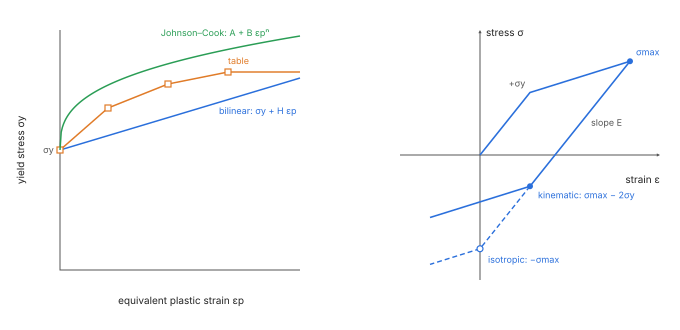
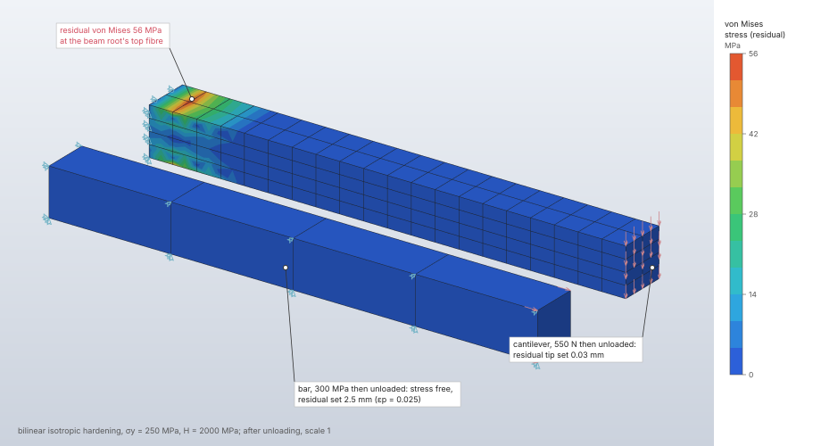

# Materials

The constitutive models a material can carry and the procedures each acts in: linear elasticity
(isotropic, or orthotropic by engineering constants), mass density, thermal properties, von
Mises (J2) plasticity with bilinear, tabulated or Johnson–Cook hardening, Johnson–Cook damage
with element erosion, hyperelasticity (neo-Hookean, Mooney–Rivlin, Yeoh), and the
specific volume of a polymer against temperature and pressure (two-domain Tait PVT). One material
record serves every solver: each takes the parts it can use, warns about the parts it leaves out,
and refuses by name what it cannot represent. The J2 return map is one implementation shared by
the implicit and explicit solvers.
Nine structural metals can be added from a small [cited library](material-library.md) of
constant room-temperature properties, each value with its source.

| | |
|---|---|
| **Commands** | `model.material.create`, `model.material.edit`, `model.material.plasticity`, `model.material.damage`, `model.material.pvt`, `model.material.specific_volume`, `model.material.delete`; `model.material.library.list` and `model.material.library.add` for the [cited material library](material-library.md) |
| **Step procedure** | all structural and heat transfer procedures; see [Procedures](#procedures) |
| **Solver** | `crates/fem` material kernels, used by `crates/solver` (CPU, f64) and `crates/explicit` |
| **Method** | orthotropic compliance (Jones 1999); radial return (Simo & Hughes 1998, §3.3); multiplicative finite-strain plasticity (Simo 1992); Lagrangian logarithmic kinematic plasticity (Miehe, Apel & Lambrecht 2002); Johnson–Cook flow and fracture (Johnson & Cook 1983, 1985); decoupled hyperelasticity (Holzapfel 2000, §6.6); two-domain Tait PVT (Chang et al. 1996; Willerer et al. 2024, eqs. 1–9) |
| **Verified by** | `nl-j2-uniaxial`, `nl-j2-bauschinger`, `nl-j2-simple-shear`, `j2-uniaxial-explicit`, `j2-bauschinger`, `j2-heated-bar`, `plastic-thick-cylinder`, `plastic-hinge-cantilever`, `nl-neo-hookean-uniaxial`, `nl-mooney-rivlin-*`, `nl-yeoh-uniaxial`, `nl-hybrid-incompressible`, `explicit-neo-hookean-implicit`; `crates/fem/src/{material,plasticity,elastoplastic,constitutive}.rs` tests; `crates/model/src/pvt.rs` tests |

## Synopsis

```json
{"command": "model.material.create", "params": {"name": "Steel",
  "elastic": {"type": "isotropic", "young": 210000, "poisson": 0.3}, "density": 7.85e-9,
  "thermal": {"conductivity": 0.05, "specific_heat": 4.6e8, "expansion": 1.2e-5, "reference_temperature": 20}}}
{"command": "model.material.plasticity", "params": {"name": "Steel",
  "plastic": {"type": "bilinear", "yield_stress": 250, "hardening_modulus": 1000, "hardening": "isotropic"}}}
{"command": "model.material.damage", "params": {"name": "Steel",
  "damage": {"type": "johnson_cook", "d1": 0.05, "d2": 3.44, "d3": -2.12}, "erosion": {"plastic_strain": 1.0}}}
{"command": "model.material.create", "params": {"name": "Rubber",
  "elastic": {"type": "isotropic", "young": 6, "poisson": 0.4995}, "hyperelastic": {"type": "mooney_rivlin", "c01": 0.1}}}
{"command": "model.material.pvt", "params": {"name": "PP", "pvt": {"type": "tait",
  "melt": {"b1": "1.23e-3 m³/kg", "b2": 9.0e5, "b3": 80, "b4": 4.5e-3},
  "solid": {"b1": "1.14e-3 m³/kg", "b2": 4.0e5, "b3": 150, "b4": 3.5e-3},
  "b5": 126.85, "b6": 0.25, "b7": "5.0e-5 m³/kg", "b8": 0.1, "b9": 0.04}}}
{"command": "model.material.specific_volume", "params": {"name": "PP", "temperature": 200, "pressure": 50}}
```

Numbers are in the model's display units (`model.units`; mm-t-s-N-MPa by default) or carry their
own unit (`"210 GPa"`); the model stores SI ([Units](../../units.md)).

## Parameters

A material needs at least one of elastic constants, a density, fluid behaviour or thermal
properties.

### Elasticity and density

| Field | Value | Default | Meaning |
|---|---|---|---|
| `elastic.type` | `isotropic` | — | `young` E > 0, `poisson` −1 < ν < 0.5 |
| `elastic.type` | `engineering_constants` | — | orthotropic: `young` [E1, E2, E3] > 0, `poisson` [ν12, ν13, ν23], `shear` [G12, G13, G23] > 0; ν_ij is the contraction in j under stress in i |
| `density` | > 0 | none | mass per volume: needed by frequency steps, gravity, centrifugal loads, transient heat transfer and explicit dynamics |
| `fluid` | `{"type": "newtonian", "viscosity"}` | none | dynamic viscosity, for fluid domains (needs a density; [Lattice Boltzmann flow](../fluid/lattice-boltzmann.md)) |

### Thermal properties (`thermal`)

| Field | Value | Default | Meaning |
|---|---|---|---|
| `conductivity` | k > 0, or [kx, ky, kz] | none | q = −k ∇T |
| `specific_heat` | c > 0 | none | with the density, the capacity ρc of transient heat transfer |
| `expansion` | α, or [αx, αy, αz] | none | ε_th = α (T − T_ref) |
| `reference_temperature` | finite | 0 °C | the temperature of zero thermal strain |

At least one of `conductivity`, `specific_heat`, `expansion` is required.

### Plasticity (`plastic`, set by `model.material.plasticity`; `null` removes it)

| Field | Value | Default | Meaning |
|---|---|---|---|
| `type` | `bilinear` | — | `yield_stress` σ_y > 0; `hardening_modulus` H ≥ 0 (0: perfectly plastic), the slope of uniaxial stress against plastic strain; `hardening` `isotropic` (the surface grows) or `kinematic` (it translates, Prager) |
| `hardening` | `isotropic`, `kinematic` | `isotropic` | |
| `type` | `table` | — | `points` [{`strain`, `stress`}]: 1 to 1000 points, the first at plastic strain 0, strains increasing, stresses > 0; linear between points, constant after the last; isotropic hardening |
| `type` | `johnson_cook` | — | σ_y = (A + B ε_pⁿ)(1 + C ln ε̇*)(1 − T*ᵐ): `a` > 0, `b` ≥ 0, `n` ≥ 0 |
| `c` | ≥ 0 | 0 | strain-rate sensitivity |
| `m` | > 0 | 1 | thermal softening exponent |
| `reference_strain_rate` | > 0 | 1 | ε̇₀ |
| `room_temperature`, `melt_temperature` | finite, melt > room | — | the range of T* |
| `specific_heat` | > 0 | none | with it, plastic work heats the material adiabatically; without it the temperature stays at room temperature |
| `taylor_quinney` | 0 to 1 | 0.9 | the fraction χ of plastic work turned into heat |

Plasticity needs isotropic elastic constants and cannot be combined with a hyperelastic option.

### Damage and erosion (`model.material.damage`; each key optional, `null` removes it)

| Field | Value | Default | Meaning |
|---|---|---|---|
| `damage.type` | `johnson_cook` | — | ε_f = (D1 + D2 e^{D3 σ*})(1 + D4 ln ε̇*)(1 + D5 T*); `d1`, `d2`, `d3` finite |
| `d4`, `d5` | finite | 0 | nonzero values need Johnson–Cook plasticity (its reference rate and temperatures) |
| `erosion.plastic_strain` | > 0 | — | the equivalent plastic strain at which an element erodes |

Damage and erosion need plasticity.

### Hyperelasticity (`hyperelastic`)

| Field | Value | Default | Meaning |
|---|---|---|---|
| `type` | `neo_hookean` | — | W = μ/2 (Ī₁ − 3) + κ/2 (J − 1)² |
| `type` | `mooney_rivlin` | — | `c01` in [0, μ/2]; C₁₀ = μ/2 − C₀₁ |
| `type` | `yeoh` | — | `c20`, `c30` finite; C₁₀ = μ/2 |

μ = E/(2(1 + ν)) and κ = E/(3(1 − 2ν)) come from the isotropic elastic constants, which a
hyperelastic material needs.

### PVT behaviour (`pvt`, set by `model.material.pvt`; `null` removes it)

The specific volume v of a polymer, and so its density ρ = 1/v, as a function of temperature
and pressure: the modified two-domain Tait equation ([Theory](#pvt-the-two-domain-tait-equation)).
`model.material.specific_volume {name, temperature, pressure}` evaluates it and replies the
specific volume, the density, the transition temperature at that pressure and the domain; a
material without PVT behaviour replies its constant density.

| Field | Value | Default | Meaning |
|---|---|---|---|
| `type` | `tait` | — | the only model |
| `melt`, `solid` | `{b1, b2, b3, b4}` | — | each domain's zero-pressure volume v0 = b1 + b2 (T − b5) (b1 > 0 specific volume, b2 ≥ 0 per degree) and pressure sensitivity B = b3 exp(−b4 (T − b5)) (b3 > 0 pressure, b4 ≥ 0 per degree) |
| `b5` | above 0 K | — | the transition temperature at zero pressure (glass transition or crystallisation); may be below 0 °C |
| `b6` | ≥ 0 | — | its rise with pressure, T_t = b5 + b6 p (temperature per pressure) |
| `b7` | ≥ 0 | 0 | the solid's extra volume at the transition (specific volume); 0 for an amorphous polymer |
| `b8` | ≥ 0 | 0 | the temperature rate of that term (per degree) |
| `b9` | ≥ 0 | 0 | its pressure rate (per pressure) |

Specific volume shows in the display system's volume per mass (mm³/t in mm-t-s-N-MPa); per
degree and per pressure follow the system's temperature step and pressure. Coefficients
published in m³/kg, K and Pa can be typed with their unit (`"1.23e-3 m³/kg"`).

## Theory

### Linear elasticity

Stress and strain are 6-vectors (xx, yy, zz, xy, xz, yz) with engineering shear strains, σ = D ε.
The orthotropic stiffness is the inverse of the compliance written with engineering constants
(Jones 1999, §2.4): S₁₁ = 1/E₁, S₁₂ = −ν₁₂/E₁, S₁₃ = −ν₁₃/E₁, S₂₃ = −ν₂₃/E₂ (ν_ji/E_j = ν_ij/E_i),
1/G on the shear diagonal, which holds G₁₂, G₁₃, G₂₃ in the order the model lists them. The
constants are checked for a stable material: |ν_ij| < √(E_i/E_j) for each pair and
1 − ν₁₂ν₂₁ − ν₂₃ν₃₂ − ν₃₁ν₁₃ − 2ν₂₁ν₃₂ν₁₃ > 0. Material axes are the global X, Y, Z.

### Von Mises plasticity: the radial return

The update of `fieldcraft_fem::plasticity::J2` (Simo & Hughes 1998, §3.3, Boxes 3.1–3.2; Krieg &
Krieg 1977 for its accuracy). With shear modulus G and bulk modulus K, the pressure takes the
volumetric increment elastically, p ← p + K Δθ, and the deviator the elastic trial
s* = s + 2G Δe. With the back stress α, ξ* = s* − α and q* = √(3/2)‖ξ*‖. If q* exceeds the
current yield stress, Δε_p solves

```text
q* − 3G Δε_p − H_k Δε_p = σ_y(ε_p + Δε_p, Δε_p/Δt, T)
s = s* − 2G √(3/2) Δε_p n,   α ← α + √(2/3) H_k Δε_p n,   n = ξ*/‖ξ*‖
```

(Prager's linear kinematic rule; H_k the kinematic modulus, so the uniaxial stress rises by
H_k Δε_p either way).

- **Bilinear**: Δε_p = (q* − σ_y)/(3G + H) in closed form.
- **Table**: piecewise linear, solved exactly segment by segment.
- **Johnson–Cook**: a bracketed scalar Newton iteration with a bisection safeguard on
  [0, (q* − σ_y)/(3G)], at most 100 iterations. ε̇* = ε̇_p/ε̇₀ is taken as at least 1 (the
  logarithm stays ≥ 0), T* = (T − T_room)/(T_melt − T_room) is clamped to [0, 1], and the
  temperature is the one at the start of the increment. Adiabatic heating:
  ΔT = χ q Δε_p / (ρ c_p).

The strain increment the update takes is the mechanical one: thermal strain increments are
subtracted first.



### Plasticity in implicit analysis

`fieldcraft_fem::elastoplastic` wraps the same return with consistent tangents
([Nonlinear static](nonlinear-static.md) has the full treatment):

- **Finite strain, isotropic hardening** (Simo 1992; Simo & Hughes 1998, ch. 9): F = Fₑ Fₚ, bₑ = F Cₚ⁻¹ Fᵀ, a Hencky
  energy τ = K ln J I + 2G dev εₑ with εₑ = ½ ln bₑ; the return of the infinitesimal theory on the
  principal logarithmic strains (the exponential map), which keeps det Cₚ = 1. History: Cₚ⁻¹ − I,
  the back stress and the equivalent plastic strain (13 values per integration point).
- **Finite strain, linear kinematic hardening**: the full tensor return acts on the Lagrangian
  logarithmic strain E = ½ log(FᵀF) (Miehe, Apel and Lambrecht 2002). The logarithm’s first and
  second derivatives map the conjugate stress and consistent tangent to the spatial interface
  ([Nonlinear static](nonlinear-static.md#material-point)). History: additive plastic logarithmic
  strain (engineering shears), reference-frame back stress and equivalent plastic strain (13 values).
- **Small strain**: ε = εₑ + εₚ, the trial εₑ = ε − εₚ,ₙ through the same return.
- **Tangent**: 𝔻ᵉᵖ = K I⊗I + 2Gθ ℙ − 2Gθ̄ n⊗n (Simo & Hughes 1998, Box 3.2), with the
  Daleckii–Krein divided differences θ_AB = artanh(r)/r, r = (λ²_A − λ²_B)/(λ²_A + λ²_B), for the
  derivative of the logarithm at finite strain; symmetric for isotropic hardening.
- **Hybrid elements** take the deviatoric return and the volume K/2 (ln J)² (finite strain) or
  K/2 (J − 1)² with J = 1 + tr ε (small strain); J2 flow is isochoric, so the split is exact.

### Johnson–Cook damage and erosion

D ← D + Δε_p / ε_f with ε_f = (D1 + D2 e^{D3 σ*})(1 + D4 ln ε̇*)(1 + D5 T*), σ* the mean stress
over the von Mises stress after the increment (Johnson & Cook 1985). A fracture strain below 10⁻⁶
counts as 10⁻⁶ (published sets can give negative values at high triaxiality, where the point fails
at once). A point has failed at D ≥ 1. In explicit dynamics an element whose material point has
failed, or whose equivalent plastic strain reaches the erosion criterion, is eroded: removed
from the analysis, carrying no stress from then on, reported with its time, cause and internal
energy ([Explicit dynamics](explicit-dynamics.md)).

### Hyperelasticity

`fieldcraft_fem::constitutive` returns the Kirchhoff stress τ = Jσ and the spatial tangent c of
its Lie derivative from the deformation gradient. With the isochoric–volumetric split (Flory
1961), Ī₁ = J^(−2/3) tr b, b̄ = J^(−2/3) b and U(J) = κ/2 (J − 1)²:

- **Neo-Hookean**: W = μ/2 (Ī₁ − 3) + U(J), τ = μ dev b̄ + J U′ I, with the tangent of Holzapfel
  (2000, eqs. 6.165–6.169, 6.193) in Kirchhoff form (C₁₀ = μ/2, D₁ = 2/κ).
- **Mooney–Rivlin and Yeoh**: W̄ = C₁₀ (Ī₁ − 3) + C₀₁ (Ī₂ − 3) + C₂₀ (Ī₁ − 3)² + C₃₀ (Ī₁ − 3)³ with
  the same volume (Mooney 1940; Rivlin 1948; Yeoh 1993); stress and tangent from the fictitious
  τ̄ and c̄ (Holzapfel 2000, eqs. 6.168, 6.193). 2(C₁₀ + C₀₁) is the elastic μ.

Every hyperelastic law's small-strain limit is the linear isotropic material, which the linear
procedures use. Without a hyperelastic option an elastic material in a nonlinear step is
St Venant–Kirchhoff, S = D E with E = ½(FᵀF − I), right for large rotations with small strains
and softening without bound in large compression.

### Hybrid formulations and the material

A hybrid (mixed u–p) section needs isotropic elasticity: the condensation splits
D = D_dev + K m mᵀ, which an orthotropic material does not have. In nonlinear steps the hybrid
solids take the material's isochoric part and its volumetric energy separately, so they need a
law with that split: a hyperelastic option or plasticity (St Venant–Kirchhoff is refused). The
elements are described in [Element library](elements.md#solid-continuum-elements).

### PVT: the two-domain Tait equation

```text
v(T, p) = v0(T) · [1 − C ln(1 + p / B(T))] + vt(T, p),   C = 0.0894
v0(T)   = b1 + b2 (T − b5),   B(T) = b3 exp(−b4 (T − b5))
T_t(p)  = b5 + b6 p
vt      = b7 exp(b8 (T − b5) − b9 p)   in the solid (T ≤ T_t(p)), 0 in the melt
```

The melt coefficients apply above T_t(p), the solid ones at and below it. C is Tait's universal
constant for polymers. The form is Chang, Chen and Su's (1996), written out with the role of
each coefficient by Willerer, Brinkmann and Drechsler (2024, eqs. 1–9). Temperatures are
absolute. A state where the equation gives no positive, finite volume (a pressure far beyond the
fitted range, where the bracket turns negative) is refused, as are a negative pressure and a
temperature at or below 0 K.

## Procedures

| Material part | Linear static, frequency, buckling | Heat transfer | Nonlinear static | Explicit dynamics |
|---|---|---|---|---|
| Isotropic elastic | yes | — | St Venant–Kirchhoff (or the hyperelastic option) | hypoelastic, objective stress rate |
| Orthotropic elastic | solids, 2D | — | St Venant–Kirchhoff | one-point hex8; nodal-pressure tet4, trusses refused |
| Shells, beams, trusses | isotropic only | — | refused (elements) | trusses: isotropic, elastic |
| Density | mass, gravity, centrifugal | capacity (transient) | gravity | required |
| Conductivity, specific heat | — | yes (coupled steps: steady) | steady conduction of the step's thermal conditions | — |
| Expansion | temperature loads, coupled steps; solids, 2D, trusses | — | yes (multiplicative at finite strain) | isotropic only, as a strain rate |
| Plasticity | elastic constants only, with a warning | — | J2 with consistent tangent; refused: the Johnson–Cook rate term (C ≠ 0) | J2 radial return; trusses refused |
| Johnson–Cook adiabatic heating | — | — | warning, not applied | yes |
| Damage, erosion | warning, not applied | — | warning, not applied | yes |
| Hyperelastic | the small-strain linear material | — | yes | yes, with nonlinear geometry and no thermal strain |

The linear solvers' warning reads: "material `name`: the linear solver uses its elastic
constants only (its plasticity acts in nonlinear static steps and explicit dynamics, its damage
and erosion in explicit dynamics)". The solution of a plastic material in a linear step is the
elastic one, bit for bit.

## Algorithm

1. **Validate on entry.** `Material::validate` runs at every create and edit; a bad constant is
   refused naming it (Poisson's ratio range, orthotropic stability, a hardening table that does
   not start at 0 or does not increase, melt temperature not above room temperature, a
   Taylor–Quinney fraction outside [0, 1], damage without plasticity, plasticity or a
   hyperelastic option on an orthotropic material, plasticity with a hyperelastic option).
2. **Resolve per solver.** Each solver builds its material from the record:
   `fieldcraft_fem::elasticity` gives D; `J2::from_model` the plastic model (refused for an
   orthotropic material); `MaterialModel::from_model` the finite-strain law.
3. **Update per integration point.** Implicit: the committed history is read, the updated one
   written to a separate slice, committed when the increment converges. Explicit: the J2 update
   runs every increment on the hypoelastic stress.

## Output

Stresses and strains as the elements report them ([Element library](elements.md#output)); in
nonlinear steps the equivalent plastic strain at the integration points of plastic elements
(`solve.probe` with `elements`, the largest in the `solve.nonlinear` summary); in explicit
dynamics each element's equivalent plastic strain, damage, temperature and whether it has eroded.

## Worked example

Von Mises plasticity with bilinear isotropic hardening, loaded past yield and unloaded to zero in
one nonlinear static step. A bar under uniform tension (one-eighth model on three symmetry planes)
has a closed-form answer at every load; a cantilever bent past its first yield in the same step
shows the residual stress that plastic bending leaves behind.

| | |
|---|---|
| **Geometry** | `Bar`: 100 mm along x, 10 × 10 mm; `Beam`: 100 mm along x, 10 × 10 mm, 20 mm beside it in y; one block each (`mesh.block`) |
| **Mesh** | `Bar`: 4 hex8 (4 × 1 × 1, full integration); `Beam`: 160 hex20 (20 × 2 × 4) |
| **Material** | steel: E = 200 000 MPa, ν = 0.3; `plastic` bilinear, σ_y = 250 MPa, H = 2 000 MPa, isotropic hardening |
| **Boundary conditions** | `Bar`: symmetry on its x = 0, y = 0 and z = 0 faces; `Beam`: `root` fixed |
| **Loads** | `pull`: 30 000 N along x on the bar's end face (σ = 300 MPa); `bend`: 550 N along −z on the beam's tip face (1.32 times the load of first yield, σ_y b h²/(6 L) = 416.7 N) |
| **Step** | `Cycle`, nonlinear static, `nonlinear_geometry` false (small strain), load path [[0, 0], [0.5, 1], [1, 0]], increments of at most 0.05 of the step |
| **Units** | mm, t, s, N, MPa |

```json
[
  {"command": "model.units", "params": {"system": "mm-t-s-N-MPa"}},
  {"command": "mesh.block", "params": {"body": "Bar", "kind": "hex8", "corners": [[0, 0, 0], [100, 0, 0], [100, 10, 0], [0, 10, 0], [0, 0, 10], [100, 0, 10], [100, 10, 10], [0, 10, 10]], "divisions": [4, 1, 1], "faces": {"6": "x0", "3": "y0", "1": "z0", "4": "x1"}}},
  {"command": "mesh.block", "params": {"body": "Beam", "kind": "hex20", "corners": [[0, 30, 0], [100, 30, 0], [100, 40, 0], [0, 40, 0], [0, 30, 10], [100, 30, 10], [100, 40, 10], [0, 40, 10]], "divisions": [20, 2, 4], "faces": {"6": "root", "4": "tip"}}},
  {"command": "model.set.create", "params": {"name": "bar", "geometry": [{"body": "Bar"}]}},
  {"command": "model.set.create", "params": {"name": "x0", "geometry": [{"body": "Bar", "face": "x0"}]}},
  {"command": "model.set.create", "params": {"name": "y0", "geometry": [{"body": "Bar", "face": "y0"}]}},
  {"command": "model.set.create", "params": {"name": "z0", "geometry": [{"body": "Bar", "face": "z0"}]}},
  {"command": "model.set.create", "params": {"name": "x1", "geometry": [{"body": "Bar", "face": "x1"}]}},
  {"command": "model.set.create", "params": {"name": "beam", "geometry": [{"body": "Beam"}]}},
  {"command": "model.set.create", "params": {"name": "root", "geometry": [{"body": "Beam", "face": "root"}]}},
  {"command": "model.set.create", "params": {"name": "tip", "geometry": [{"body": "Beam", "face": "tip"}]}},
  {"command": "model.material.create", "params": {"name": "Steel", "elastic": {"type": "isotropic", "young": 200000, "poisson": 0.3}, "plastic": {"type": "bilinear", "yield_stress": 250, "hardening_modulus": 2000, "hardening": "isotropic"}}},
  {"command": "model.section.create", "params": {"name": "bar", "set": "bar", "material": "Steel", "kind": {"type": "solid"}}},
  {"command": "model.section.create", "params": {"name": "beam", "set": "beam", "material": "Steel", "kind": {"type": "solid"}}},
  {"command": "model.boundary_condition.create", "params": {"name": "sx", "type": "symmetry", "target": {"set": "x0"}, "plane": "x"}},
  {"command": "model.boundary_condition.create", "params": {"name": "sy", "type": "symmetry", "target": {"set": "y0"}, "plane": "y"}},
  {"command": "model.boundary_condition.create", "params": {"name": "sz", "type": "symmetry", "target": {"set": "z0"}, "plane": "z"}},
  {"command": "model.boundary_condition.create", "params": {"name": "clamp", "type": "fixed", "target": {"set": "root"}}},
  {"command": "model.load.create", "params": {"name": "pull", "type": "force", "target": {"set": "x1"}, "vector": [30000, 0, 0]}},
  {"command": "model.load.create", "params": {"name": "bend", "type": "force", "target": {"set": "tip"}, "vector": [0, 0, -550]}},
  {"command": "model.step.create", "params": {"name": "Cycle", "procedure": {"type": "nonlinear_static", "nonlinear_geometry": false, "initial_increment": 0.05, "max_increment": 0.05, "load_path": [[0, 0], [0.5, 1], [1, 0]]}, "boundary_conditions": ["sx", "sy", "sz", "clamp"], "loads": ["pull", "bend"]}},
  {"command": "solve.nonlinear", "params": {"step": "Cycle"}},
  {"command": "solve.history", "params": {"step": "Cycle", "sets": ["x1", "tip"], "node": 20}},
  {"command": "solve.probe", "params": {"step": "Cycle", "elements": [1]}},
  {"command": "results.deformed", "params": {"step": "Cycle", "show": true, "scale": 1}},
  {"command": "results.contour", "params": {"step": "Cycle", "field": "von_mises"}}
]
```

Results from the `solve.nonlinear` reply, `solve.history` (the frame histories: load factor,
the mean displacement of each set and node 20 at the bar's free corner (100, 10, 10)) and
`solve.probe` with `elements`. The solve took 1.1 to 1.4 s (Apple M4 Max, CPU). The bar's closed
form, uniaxial stress σ = λ · 300 MPa: elastic ε = σ/E below σ_y; ε_p = (σ − σ_y)/H above it;
unloading elastic, leaving ε = ε_p; lateral strain −ν σ/E − ½ ε_p (plastic flow is isochoric).

| Quantity | FieldCraft | Closed form | Difference |
|---|---|---|---|
| Bar elongation, λ = 0.8 (σ = 240 MPa, elastic) | 0.120 000 mm | 0.12 mm | < 10⁻¹² |
| Bar elongation, λ = 0.9 (σ = 270 MPa) | 1.135 000 mm | 100 · (270/E + 20/H) = 1.135 mm | < 10⁻¹² |
| Bar elongation, λ = 1 (σ = 300 MPa) | 2.650 000 mm | 100 · (300/E + 50/H) = 2.65 mm | < 10⁻¹² |
| Bar corner, lateral displacement at λ = 1 | −0.129 500 mm | 10 · (−0.3 · 300/E − ½ · 0.025) = −0.1295 mm | < 10⁻¹¹ |
| Bar elongation after unloading | 2.500 000 mm | 100 · ε_p = 2.5 mm | < 10⁻¹² |
| Bar corner, lateral displacement after unloading | −0.125 000 mm | −10 · ½ ε_p = −0.125 mm | < 10⁻¹¹ |
| Equivalent plastic strain, bar element 1, every integration point | 0.025 000 | (300 − 250)/2 000 = 0.025 | < 10⁻¹³ |
| Bar stress after unloading, element 1 | < 1.2 × 10⁻⁸ MPa | 0 | |
| Beam tip deflection at λ = 1 (mean of `tip`) | −1.1273 mm | elastic Timoshenko: −1.1086 mm | +1.7 % |
| Beam tip deflection after unloading | −0.0295 mm | | |
| `max_von_mises` after unloading (residual stress in the beam's root) | 56.3 MPa, node 85 | | |
| `max_plastic_strain` | 0.025, node 3 (the bar) | | |
| `applied_total`, `reaction_total` after unloading | 0; 4.6 × 10⁻⁷ N | 0 | |

The step took 28 increments. Up to λ = 0.8 every increment is elastic; increments 9 and 10 yield
the bar (3 and 4 iterations). The first unloading increment from the peak failed to converge in
16 iterations and the next one stopped when its residual grew; after two cutbacks to a size of
0.003 125 the unloading continued elastically, the size growing back to 0.05.



**What to look at.** The bar follows the bilinear curve to round-off: elastic to 250 MPa, the
slope E H/(E + H) above 250 MPa, and back along the elastic slope E to a permanent strain of
0.025 with no stress, its section contracting by half the plastic strain. The beam yields only in
the outer fibres near its root, where the moment exceeds σ_y b h²/6; on unloading the elastic
core springs back against the yielded fibres, so the beam keeps a set of 0.03 mm and a
self-equilibrated residual stress up to 56 MPa at the root (the coloured patches at the top and bottom
fibres next to the clamp), while the bar, yielded uniformly, unloads to zero stress.

## Verification

| Case | Reference | Error | Tolerance | Test |
|---|---|---|---|---|
| J2 uniaxial tension to a logarithmic strain of 0.2, implicit | theory | < 10⁻⁴ % (stress and plastic strain) | 10⁻⁶ rel. | `nl-j2-uniaxial` |
| The same, explicit | theory | 0.00017 % (stress), < 10⁻⁴ % (plastic strain) | 1 % | `j2-uniaxial-explicit` |
| Bauschinger effect, kinematic hardening, back to zero strain | theory | < 10⁻⁴ % | 10⁻⁶ rel. | `j2-bauschinger` |
| Bar held at its ends, heated past yield | theory | < 10⁻⁴ % | 10⁻⁸ / 10⁻⁷ rel. | `j2-heated-bar` |
| Hill's thick cylinder: bore displacement at a plastic radius 1.5a; collapse pressure | theory | 0.0089 %; < 10⁻⁴ % | 0.2 %; 0.1 % | `plastic-thick-cylinder` |
| Cantilever plastic collapse | theory (beam hinge) | −3.23 % | 5 % | `plastic-hinge-cantilever` |
| Neo-Hookean uniaxial stretch λ = 2 | theory | < 10⁻⁴ % | 10⁻⁶ rel. | `nl-neo-hookean-uniaxial` |
| Mooney–Rivlin uniaxial, equibiaxial, pure shear | theory | < 10⁻⁴ % | 10⁻⁶ rel. | `nl-mooney-rivlin-modes` |
| Mooney–Rivlin tube inflated and stretched to λ_z = 1.5 (Rivlin's incompressible solution, ν = 0.4995) | theory | 0.62 % (3D), 0.66 % (axisymmetric) | 1 % | `nl-mooney-rivlin-tube`, `nl-mooney-rivlin-tube-axisymmetric` |
| Yeoh uniaxial stretch λ = 2 | theory | < 10⁻⁴ % | 10⁻⁶ rel. | `nl-yeoh-uniaxial` |
| Hybrid nearly incompressible stretch, ν = 0.4999 | theory | < 10⁻⁴ % | 10⁻⁶ rel. | `nl-hybrid-incompressible` |
| Explicit quasi-static neo-Hookean pull against the implicit solver | theory (cross-check) | −0.092 %, 0.026 % | 0.5 % | `explicit-neo-hookean-implicit` |
| Free thermal expansion with orthotropic α, every solid | theory | displacement < 10⁻¹², stress < 10⁻⁶ | exact | `free_thermal_expansion_is_stress_free` |
| Plastic material in a linear step | elastic solution bit for bit, with the warning | — | exact | `plastic_materials_solve_elastically_with_a_warning` |
| Damage with constant fracture strain D1 | theory | fails as ε_p reaches D1, then no stress | exact | `damage_fails_an_element_at_its_fracture_strain` |
| Johnson–Cook impact: heating, damage, erosion | consistency | eroded elements reported, energy balance < 2 %, bit-identical runs | as stated | `johnson_cook_impact_erodes_elements` |
| Material point | theory | consistent tangents against central differences (finite and small strain, from a plastic history); bilinear, table and Johnson–Cook flow curves; heating and damage; hostile increments stay finite | round-off | `crates/fem/src/{plasticity,elastoplastic,constitutive}.rs` tests |
| Orthotropic elasticity | theory | isotropic constants give the isotropic D; uniaxial response | round-off | `orthotropic_with_isotropic_constants_is_isotropic`, `orthotropic_uniaxial_response` |
| Two-domain Tait PVT | theory only, on a constructed coefficient set (the equation written out term by term; zero-pressure limit; monotonic in T and p within a domain; branches meeting at the transition; densities in the handbook range of unfilled PP); not checked against measured PVT data (see [Limitations](#limitations)) | round-off | 10⁻¹⁴ rel. | `crates/model/src/pvt.rs` tests |

## Limitations

- Material axes are the global axes; there are no material orientations.
- Plasticity is von Mises with isotropic, linear kinematic or Johnson–Cook hardening, on
  isotropic materials only; kinematic hardening is linear (Prager) and bilinear only.
- The Johnson–Cook rate term is refused in nonlinear
  static steps; damage, erosion and adiabatic heating act in explicit dynamics only.
- No hyperelastic plasticity; no hyperelastic thermal strain in explicit dynamics.
- Thermal properties are constant in temperature.
- Shells and beams take isotropic, linear elastic, homogeneous sections only.
- Orthotropic thermal expansion is refused in explicit dynamics.
- PVT behaviour is stored and evaluated (`model.material.specific_volume`) but no solver uses
  it yet: the solvers take the constant `density`. There is no cooling-rate dependence (the
  coefficients describe one cooling rate).
- The Tait implementation is not yet checked against measured PVT data: its tests check it
  against the equation itself. The case against measured volumes is added in the PR that first
  uses PVT in a solver.

## Implementation

| File | Contents |
|---|---|
| `crates/model/src/materials.rs` | `Material`, `Elastic`, `Plastic`, `Hardening`, `Damage`, `Erosion`, `Hyperelastic`, `Thermal`, their validation |
| `crates/model/src/pvt.rs` | `Pvt` (the two-domain Tait equation), `TaitDomain`, `Pvt::evaluate` |
| `crates/engine/src/cmd/define.rs` | `model.material.create/edit/delete`, `model.material.plasticity`, `model.material.damage`, `model.material.pvt`, `model.material.specific_volume` |
| `crates/fem/src/material.rs` | `elasticity` (isotropic, orthotropic), `von_mises`, `principal` |
| `crates/fem/src/plasticity.rs` | `J2::from_model`, `J2::radial_return`, `J2::update`, `J2::tangent`, Johnson–Cook flow and damage |
| `crates/fem/src/elastoplastic.rs` | finite- and small-strain J2 material points with consistent tangents |
| `crates/fem/src/constitutive.rs` | `MaterialModel`: St Venant–Kirchhoff, neo-Hookean, polynomial (Mooney–Rivlin, Yeoh), J2 |
| `crates/solver/src/system.rs` | `inelastic_warnings`; materials resolved per section |
| `crates/explicit/src/system.rs` | the explicit solver's material and its refusals |

## References

- C. Miehe, N. Apel, M. Lambrecht. *Anisotropic additive plasticity in the logarithmic strain space: modular kinematic formulation and implementation based on incremental minimization principles for standard materials.* CMAME 191:5383–5425, 2002. doi:10.1016/S0045-7825(02)00438-3.
- R. M. Jones. *Mechanics of Composite Materials*, 2nd ed. Taylor & Francis, 1999.
- J. C. Simo, T. J. R. Hughes. *Computational Inelasticity.* Springer, 1998.
- R. D. Krieg, D. B. Krieg. J. Press. Vessel Technol. 99(4):510–515, 1977. doi:[10.1115/1.3454568](https://doi.org/10.1115/1.3454568)
- J. C. Simo. *Algorithms for static and dynamic multiplicative plasticity that preserve the classical return mapping schemes of the infinitesimal theory.* CMAME 99:61–112, 1992.
- G. R. Johnson, W. H. Cook. *A constitutive model and data for metals subjected to large strains, high strain rates and high temperatures.* Proc. 7th Int. Symp. on Ballistics, The Hague, 541–547, 1983.
- G. R. Johnson, W. H. Cook. *Fracture characteristics of three metals subjected to various strains, strain rates, temperatures and pressures.* Eng. Fract. Mech. 21(1):31–48, 1985. doi:[10.1016/0013-7944(85)90052-9](https://doi.org/10.1016/0013-7944(85)90052-9)
- G. A. Holzapfel. *Nonlinear Solid Mechanics.* Wiley, 2000.
- P. J. Flory. *Thermodynamic relations for high elastic materials.* Trans. Faraday Soc. 57:829–838, 1961.
- M. Mooney. J. Appl. Phys. 11:582–592, 1940.
- R. S. Rivlin. Phil. Trans. R. Soc. A 241:379–397, 1948.
- O. H. Yeoh. Rubber Chem. Technol. 66(5):754–771, 1993.
- R. Y. Chang, C. H. Chen, K. S. Su. *Modifying the Tait equation with cooling-rate effects to predict the pressure–volume–temperature behaviors of amorphous polymers: modeling and experiments.* Polym. Eng. Sci. 36(13):1789–1795, 1996. doi:[10.1002/pen.10574](https://doi.org/10.1002/pen.10574)
- T. Willerer, T. Brinkmann, K. Drechsler. *Development and Application of a Cooling Rate Dependent PVT Model for Injection Molding Simulation of Semi Crystalline Thermoplastics.* Polymers 16(22):3194, 2024. doi:[10.3390/polym16223194](https://doi.org/10.3390/polym16223194) (open access)
