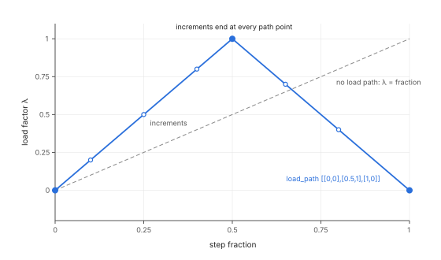
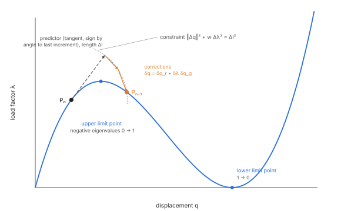
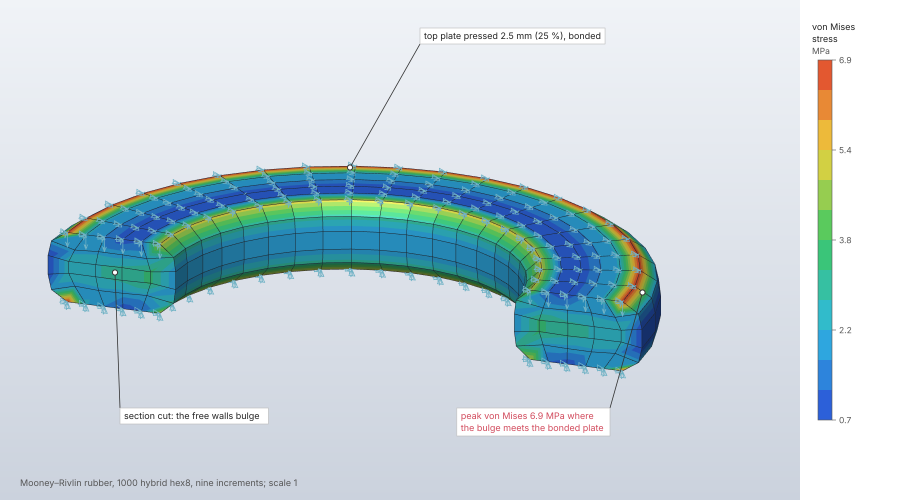
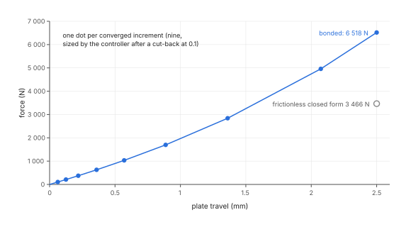

# Nonlinear static analysis

A nonlinear static step follows equilibrium under loads and prescribed displacements that grow
with a load factor, through large displacements, rotations and strains, hyperelastic and plastic
materials, follower pressures and contact. The solver advances in automatically sized load
increments, each solved by Newton–Raphson iterations with the consistent tangent, and can switch
to arc-length control to pass limit points. Hybrid (mixed u–p) elements keep nearly incompressible
materials from locking.

| | |
|---|---|
| **Commands** | `solve.nonlinear` (solve), `model.step.create` / `model.step.edit` (define), `solve.history` (frames), `solve.probe` (values) |
| **Step procedure** | `"nonlinear_static"` |
| **Solver** | `crates/solver` (CPU, f64): `fieldcraft_solver::nonlinear`, `fieldcraft_solver::contact`; element and material kernels in `crates/fem` |
| **Method** | Total Lagrangian finite strain, Newton–Raphson with the consistent tangent (Bathe 2014 §8.4; Crisfield 1991 ch. 9); J2 plasticity by Simo's exponential return map (Simo 1992); arc length after Riks (1979) and Crisfield (1981) |
| **Verified by** | `crates/solver/tests/{nonlinear,plasticity,hybrid,nonlinear_thermal,arc_length}.rs`; oracle cases `nl-*`, `j2-bauschinger`, `j2-heated-bar`, `plastic-thick-cylinder`, `plastic-hinge-cantilever`, `arc-shallow-arch` |

## Synopsis

```json
[
  {"command": "model.step.create", "params": {
    "name": "Inflate",
    "procedure": {"type": "nonlinear_static", "nonlinear_geometry": true,
                  "initial_increment": 0.1, "min_increment": 1e-5, "max_increment": 1.0,
                  "max_increments": 100, "max_iterations": 16,
                  "tolerances": {"force": 1e-6, "displacement": 1e-5, "energy": 1e-10}},
    "boundary_conditions": ["ends"], "loads": ["bore pressure"]}},
  {"command": "solve.nonlinear", "params": {"step": "Inflate"}}
]
```

## Parameters

Step procedure (`model.step.create`, `"type": "nonlinear_static"`). Increments are fractions of
the step.

| Field | Value | Default | Meaning |
|---|---|---|---|
| `nonlinear_geometry` | bool | `true` | Large displacements, rotations and strains (total Lagrangian elements, follower pressure). `false` keeps small-displacement kinematics; only the materials are nonlinear. |
| `initial_increment` | (0, 1] | 0.1 | The first increment. With arc length, the first increment's load factor change, which sets the arc. |
| `min_increment` | (0, 1] | 1e-5 | The smallest increment a cutback may reach; below it the step fails. |
| `max_increment` | (0, 1] | 1.0 | The largest increment. `min_increment ≤ initial_increment ≤ max_increment` is required. |
| `max_increments` | 1 to 100 000 | 100 | Cap on the increments, cutbacks included. |
| `max_iterations` | 1 to 1000 | 16 | Cap on the Newton iterations of one increment. |
| `tolerances.force` | (0, 1) | 1e-6 | Largest residual force over the force scale, and largest residual moment over the moment scale. |
| `tolerances.displacement` | (0, 1) | 1e-5 | Largest translation of the correction over the increment's, and largest rotation over the increment's. |
| `tolerances.energy` | (0, 1) | 1e-10 | Work of the correction against the residual over that of the first iteration. |
| `line_search` | bool | `false` | A line search along each Newton correction. Off by default: on large elastic rotations the full step converges in fewer iterations. |
| `load_path` | `[[fraction, factor], …]`, 2 to 1000 points | none (factor = fraction) | Piecewise linear load factor against the step fraction, from `[0, 0]` to fraction 1, fractions increasing. Increments end at its points, and the extrapolated predictor scales with the change of the load factor, so it turns with the path. |
| `arc_length` | `{"constraint": "cylindrical" \| "spherical", "max_load_factor": 1, "displacement_limit": {"node", "direction": 1–3, "displacement"}}` | none (load control) | Arc-length control: the load factor becomes an unknown. `max_load_factor` > 0; a displacement limit is non-zero. Takes no load path. |
| `imperfection` | `{"step", "mode", "scale"}` | none | Mode `mode` (from 1) of buckling step `step`, scaled so its largest component is `scale` (a length), added to the node coordinates before the step is solved. |

Command `solve.nonlinear`:

| Field | Value | Default | Meaning |
|---|---|---|---|
| `step` | name | the only nonlinear static step | The step to solve. |
| `max_dofs` | integer | 6 000 000 | Cap on degrees of freedom; may only be lowered. |
| `max_factor_entries` | integer | 400 000 000 | Cap on factor entries; may be raised up to 2 000 000 000 (8 bytes per value). |
| `max_newton_iterations` | integer | 100 000 | Cap on the Newton iterations of the whole step; may only be lowered. |
| `threads` | 1 to 256 | the session's | Changes the time, never the result. |

Material options that act in nonlinear steps (`model.material.create`): `"hyperelastic":
{"type": "neo_hookean"}`, `{"type": "mooney_rivlin", "c01"}`, `{"type": "yeoh", "c20", "c30"}`
on an isotropic elastic material, and `"plastic"` (bilinear isotropic or kinematic, `table`,
`johnson_cook`). Sections take `"formulation": {"hybrid": true}`. See
[materials](materials.md) and [elements](elements.md).

## Theory

### Load factor

The step's load factor λ runs from 0 to 1. Dead loads (forces, tractions, gravity, body forces,
and pressure without nonlinear geometry) are λ times their values, a pressure follows the
deformed faces with λ times its magnitude, and every prescribed displacement is λ times its value:
u = T_f q + λ T_p u_p, the constraint elimination of the linear solver. With a `load_path` the
load factor is piecewise linear in the step fraction, so loads and prescribed displacements can
come down or reverse within a step (cyclic loading).



### Material point

Given the deformation gradient F and the history committed at the end of the last converged
increment, a material returns the Kirchhoff stress τ = J σ and the spatial tangent c of its Lie
derivative (L_v τ = c : d), in Voigt order with engineering-shear columns, so c = D at F = I.
This is the push-forward of the second Piola–Kirchhoff stress and its tangent:

```text
τ = F S Fᵀ,   c_ijkl = F_iI F_jJ F_kK F_lL C_IJKL
```

History variables (`MaterialModel::history_len` per integration point) are read from the
committed slice and written to a separate one, which the solver commits when the increment
converges, so a cut-back increment leaves no trace.

| Material in a nonlinear step | Model |
|---|---|
| Elastic (isotropic or orthotropic), no option | St Venant–Kirchhoff: S = D E, E = ½(FᵀF − I). Right for large rotations with small strains; it softens without bound in large compression. |
| Isotropic elastic with `"hyperelastic": {"type": "neo_hookean"}` | Compressible neo-Hookean with the isochoric–volumetric split, W = μ/2 (Ī₁ − 3) + κ/2 (J − 1)², μ and κ from E and ν (C₁₀ = μ/2, D₁ = 2/κ). Its small-strain limit is the linear material, which linear steps use. |
| Isotropic elastic with `{"type": "mooney_rivlin", "c01"}` or `{"type": "yeoh", "c20", "c30"}` | Decoupled polynomials W̄ = C₁₀ (Ī₁ − 3) + C₀₁ (Ī₂ − 3) + C₂₀ (Ī₁ − 3)² + C₃₀ (Ī₁ − 3)³ with the same volume term κ/2 (J − 1)²: Mooney–Rivlin with C₁₀ = μ/2 − C₀₁ (0 ≤ C₀₁ ≤ μ/2), Yeoh with C₁₀ = μ/2, so 2(C₁₀ + C₀₁) is the elastic μ and the small-strain material stays the elastic one. Stress and tangent from the fictitious τ̄ and c̄ (Holzapfel 2000, eqs. 6.168, 6.193). |
| Isotropic elastic with `"plastic"` (bilinear isotropic or kinematic, table, Johnson–Cook) | J2 plasticity (`fieldcraft_fem::elastoplastic`). At finite strain, Simo's multiplicative model with a Hencky elastic energy, τ = K ln J I + 2G dev ½ ln bₑ, history Cₚ⁻¹ and the equivalent plastic strain, integrated by the exponential return map on the principal logarithmic strains. At small strain, the additive radial return with the back stress. Both call `J2::radial_return`, the update explicit dynamics uses, and its consistent tangent `J2::tangent`. |

"Isotropic elastic" means the same thing everywhere: the neo-Hookean model is chosen only by the
explicit option.

**Plasticity's tangent.** With Cₚ⁻¹ frozen over an iteration,

```text
L_v τ = 𝔻ᵉᵖ : ½ (∂ ln b/∂b) : (d b + b d) − (d τ + τ d)
```

with 𝔻ᵉᵖ the algorithmic tangent of the return, K I⊗I + 2Gθ ℙ − 2Gθ̄ n⊗n (Simo & Hughes 1998,
Box 3.2), and the derivative of the logarithm by the Daleckii–Krein divided differences
θ_AB = artanh(r)/r, r = (λ²_A − λ²_B)/(λ²_A + λ²_B), in the principal frame of the trial bₑ. It is
smooth through equal stretches, so uniaxial and undeformed states need no special case. The
tangent is symmetric (isotropic hardening) and is checked against central differences of the
stress and of every element's forces from a plastic history. Hybrid elements take the deviatoric
return and the volume term K/2 (ln J)². A hardening slope below −3G leaves the point without a
tangent: the increment cuts back and the step stops at the minimum increment, naming the element.

### Elements

Total Lagrangian over the reference element with its own quadrature (`fieldcraft_fem::finite`):

```text
f_a  = ∫ Bₓ,aᵀ τ dV₀
K_ab = ∫ (Bₓ,aᵀ c Bₓ,b + ∇ₓN_a · τ ∇ₓN_b I) dV₀,   ∇ₓN = F⁻ᵀ ∇₀N
```

the material plus geometric stiffness with the current gradients, identical term by term to
∫ B₀ᵀ S dV₀ and its linearisation. Every element's tangent is checked against central differences
of its forces.

| Element | Nonlinear steps |
|---|---|
| tet4, tet10, wedge6, hex8, hex20 (full), hex20 (reduced) | total Lagrangian |
| hybrid quad4, quad8, tri6 (plane strain, axisymmetric) | mean dilatation: θ = ∫ J dV₀ / V₀ with the hoop stretch, p = U′(θ), stiffness U″ g gᵀ / V₀ |
| hybrid hex8, hex20, tet10 | Simo–Taylor–Pister three-field form on the linear hybrid elements' pressure fields (θ the projection of J, p the projection of U′(θ)); needs the neo-Hookean option (St Venant–Kirchhoff has no volumetric split) |
| plane strain, axisymmetric (tri3, tri6, quad4, quad8) | total Lagrangian with F₃₃ = 1 or r/R (hoop column N/r, geometric term τ_θθ N_a N_b/r²) |
| hex8 and quad4 incompatible modes | refused (see Limitations) |
| plane stress | refused |
| trusses, shells, beams | refused |

Without nonlinear geometry (`"nonlinear_geometry": false`) an elastic element is the linear one
(K u), and an element of a plastic material runs the same loops with small strain
(`Kinematics::Small`: ε = sym ∇u on the reference gradients, f = ∫ Bᵀσ dV, K = ∫ Bᵀ𝔻B dV with the
consistent tangent, no geometric stiffness; hybrid elements project 1 + tr ε and K tr ε). An
elastic model is then the linear solution reached by Newton.

### Hybrid (mixed u–p) solids

A section with `"formulation": {"hybrid": true}` gives `Formulation::Hybrid { pressures }`
(`fieldcraft_fem::hybrid`), in linear and nonlinear steps. The isotropic elasticity splits as
D = D_dev + K m mᵀ (m = (1, 1, 1, 0, 0, 0)); the mean stress is an independent field,
discontinuous between elements, enforced by the perturbed Lagrangian (Hughes 2000, §4.3–4.4):

```text
K_dev = ∫ Bᵀ D_dev B dV,   G = ∫ Bᵀ m N_pᵀ dV,   M = ∫ N_p N_pᵀ dV
[K_dev  G; Gᵀ  −M/K] [u; p̂] = [f; 0]
```

The pressure is condensed element by element, p̂ = K M⁻¹ Gᵀ u, leaving the element stiffness
K_dev + K G M⁻¹ Gᵀ: symmetric positive definite for any ν < ½. `ElementDofs.internal.pressure`
counts the condensed unknowns; nothing global changes. Stresses are D_dev ε + p m with the
element's pressure field. With a constant pressure this is the B-bar / mean dilatation element
(Nagtegaal, Parks & Rice 1974).

| Element | Pressure field | Stability (inf-sup) |
|---|---|---|
| hex20 | 1, x, y, z (Q2–P1disc) | stable |
| tet10 | constant (P2–P0) | stable; a single element has three more zero-energy modes that neighbouring elements restrain |
| hex8 | constant (Q1–P0) | does not lock and passes the patch test; element pressures may show a checkerboard on some meshes |
| plane strain, axisymmetric quad4, quad8, tri6 | one constant pressure, the mean dilatation with the hoop strain in the divergence: K_dev + κ g gᵀ / V, g = ∫ Bᵀ m dV (`fieldcraft_fem::plane`) | as above |
| tet4, wedge6, tri3, plane stress | refused | the linear triangle locks even with one pressure; plane stress has no volume constraint |

A thermal strain splits the same way: ∫ Bᵀ D_dev ε_th on the nodes and, through the pressure,
K G M⁻¹ ∫ N_p tr ε_th, so a confined heated nearly incompressible solid takes its bulk stress
−3KαΔT.

### Follower pressure

On the current face (`fieldcraft_fem::face::follower_pressure`, `follower_edge_pressure`):

```text
fᵢ = −p ∫ Nᵢ (x,ξ × x,η) dξ dη
K  =  p ∫ N_a (N_b,η [x,ξ]× − N_b,ξ [x,η]×)
```

The load stiffness is not symmetric. The solver keeps its symmetric part and leaves the skew part
out, so the tangent stays symmetric. The residual is exact, so the converged answer does not
change. Over a closed surface, or one whose boundary is held, the skew parts of neighbouring faces
cancel (Schweizerhof & Ramm 1984) and nothing is lost; elsewhere Newton may converge linearly
instead of quadratically, and the result reports the skew part's size relative to the load
stiffness when it exceeds 10⁻⁶. An LU factorization of the full tangent would double the
factor's memory and give up the symmetric solver for a gain only in the rate of convergence on open
loaded surfaces. Without nonlinear geometry a pressure is a dead load.

### Thermal strain

A step's temperatures are its temperature loads, or the steady conduction of its temperature
boundary conditions and heat loads solved first (one-way, as the linear coupled
temperature–displacement step). They ramp with the load factor from each material's reference
temperature, ΔT(λ) = λ (T − T_ref). With nonlinear geometry the deformation gradient splits
multiplicatively (Lubarda 2004):

```text
F = F_m F_θ,   F_θ = diag(1 + αᵢ ΔT)
```

The material sees F_m, the loops run on the expanded volume J_θ dV₀ (mixed elements project
det F_m), and the reported strain is the total logarithmic one. The linear stretch 1 + α ΔT keeps
α the engineering coefficient, so a free body grows by exactly α ΔT. Without nonlinear geometry
the split is additive, ε_m = ε − α ΔT, and elastic elements on their linear stiffness take the
equivalent nodal forces as a dead load. A Johnson–Cook material softens at the point's
temperature. The expansion coefficient is constant in temperature.

### Arc length

`arc_length` makes the load factor an unknown (Riks 1979, Crisfield 1981). Each increment keeps

```text
‖Δq‖² + w Δλ² = Δl²
```

with w = 0 for the cylindrical arc and w the first tangent displacement's ‖q_f‖² for the
spherical arc. The norm weighs a rotation by L² (the model's size squared), so the arc is a
length² in any unit system and at any part size. The predictor follows the tangent with the sign
of its angle to the last increment (Feng, Perić & Owen 1996); the corrector is
δq = δq_r + δλ δq_g, δλ the root of the constraint's quadratic whose increment turns least
(Crisfield's angle criterion). The first increment's load factor change, `initial_increment`,
sets the arc; arcs grow, shrink and cut back as increments do, within the minimum and maximum
increments' arcs. Prescribed motions scale with λ (∂r/∂λ includes −K T_p u_p) and follower
pressures with their current faces.



## Algorithm

1. **Set up.** Resolve the model, apply an `imperfection` if one is given, build the constraint
   elimination (boundary conditions, couplings, inclined symmetry planes, ties) and the contact
   interfaces. Without a `load_path` the load factor equals the step fraction.
2. **Predict.** An increment starts from the linear extrapolation of the last converged one (the
   free motion scaled by the ratio of their sizes), or from the last converged state when the
   extrapolation inverts an element. With path-dependent materials an increment without a
   previous one to extrapolate (the first, or after a turn of the path to zero change) starts
   from the tangent predictor: one solve with the converged state's tangent for the change of
   the loads and prescribed displacements, so a prescribed motion spreads into the interior
   before the material sees it (started from the boundary's jump alone, the elements next to it
   would flow plastically far beyond the solution). Its work is then the energy criterion's reference. A first
   tangent that is not positive definite is a cutback when the undeformed model's tangent is.
   The tangent predictor uses Cholesky and is skipped when the tangent is indefinite.
3. **Iterate.** Newton–Raphson with the full consistent tangent refactored every iteration:
   K_T δq = r, r = T_fᵀ (λ f_ext(u) − f_int(u)). An indefinite tangent (a strained nearly
   incompressible mixed element, an unstable material, a state past a limit or bifurcation point)
   is factored by LDLᵀ ([linear solvers](linear-solvers.md)) and Newton goes on; each iteration
   records the tangent's negative eigenvalues. Hybrid elements near ν = ½ under prescribed
   displacement therefore converge without cutbacks (at ν = 0.4999 every increment used to be cut
   back to the cap before LDLᵀ). With `line_search`, s = 1 is taken when
   |G(1)| ≤ 0.8 |G(0)|, G(s) = δq · r(q + s δq); otherwise s moves to the root of the secant
   through (0, G(0)) and (s, G(s)), within [0.1, 1], at most five times (Crisfield 1991, §9.3).
4. **Converge.** An increment has converged when all three checks hold, or when the force
   residual is a thousandth of its tolerance (round-off):

   | Check | Measured | Against |
   |---|---|---|
   | force | largest residual force | the largest force seen (applied, internal, reaction), at least 10⁻⁸ of the mean diagonal stiffness times L |
   | moment | largest residual moment | the largest moment seen, at least the force scale times L |
   | translation | largest translation of the correction | the increment's largest translation (or prescribed one), at least 10⁻¹² L |
   | rotation | largest rotation of the correction, in radians | the increment's largest rotation (or prescribed one), at least the translation reference over L |
   | energy | work of the correction against the residual, s δq · r (N·m for both kinds) | that of the first iteration (Bathe & Cimento 1980) |

   L is the diagonal of the model's bounding box. Force and moment share the `force` tolerance,
   translation and rotation the `displacement` tolerance; each iteration records the larger
   measure of each pair. In the round-off floor of the force scale a rotation's diagonal
   stiffness counts over L². Only coupled reference points carry rotations in a nonlinear step,
   so a model without them converges exactly as with one norm. With path-dependent materials an
   increment that starts within the force tolerance waives the energy criterion. With contact,
   the force scale is that of the converged states, the loads and the current state.
5. **Adapt.** Two increments in a row that converge in at most four iterations let the next grow
   by half (up to `max_increment`); one that needs more than eight shrinks the next to three
   quarters. An increment is cut back to a quarter of its size when an element inverts, the
   residual is not finite, the residual grows in two successive iterations, the tangent is
   singular, the contact active set chatters, or it does not converge in `max_iterations`.
6. **Commit.** A converged increment commits the material history, contact tractions and slip
   states, stores a displacement frame and, with contact, runs the augmentations
   ([contact](contact.md)). With arc length, the tangent at the converged state is factored for
   the next predictor (LDLᵀ when indefinite), its negative eigenvalues are recorded
   (`negative_pivots`), and a change in their count is reported as a critical point: a limit
   point where the load factor turns, a bifurcation otherwise.
7. **Stop.** The step ends at load factor 1 (arc length: at `max_load_factor`, at the
   displacement limit, or at the increment cap with a warning). It fails cleanly, naming the
   load factor and the last reason, when an increment falls below `min_increment`, when it has
   taken `max_increments`, or when the Newton iterations of the step reach
   `max_newton_iterations`. Only the first tangent of a model that can move freely is an error;
   the undeformed model's Cholesky factor names where.

Element forces and tangents are computed in parallel and added in label order, so results are
the same bit for bit on any number of threads.

## Output

The reply of `solve.nonlinear`:

| Field | Content |
|---|---|
| `step`, `dofs`, `equations`, `factor_entries` | The step and the system's size |
| `increments` | Every increment, converged or cut back: `number`, `load_factor`, `size`, `iterations` (each with `force`, `displacement`, `energy` relative to their scales, `line_search`, `negative_pivots`, `augmentation`), `converged`, `cutback` (the reason), `negative_pivots`, `augmentations` |
| `iterations` | Newton iterations over the step |
| `frames`, `load_factor` | The load factor of every frame (from 0) and the last one |
| `critical_points` | Arc length: `kind` (limit or bifurcation), `increment`, `load_factor`, `negative_before`, `negative_after` |
| `contacts` | Per contact: `normal_force`, `force`, `max_pressure`, `closed_nodes`, `slipping_nodes`, `penetration`, `augmentations` |
| `max_displacement`, `max_von_mises`, `max_plastic_strain` | The largest values and where |
| `applied_total`, `reaction_total` | Load and reaction resultants |
| `reference_points` | Each coupled point's six displacements and reactions |
| `warnings` | Including an unstable equilibrium kept by a converged state (negative eigenvalues), the follower-pressure skew part, couplings as small-rotation constraints, and what acts in explicit dynamics only |

Stored results: the final displacements and reactions, the Cauchy stress and the logarithmic
strain (ln V, engineering shears; the small strain without nonlinear geometry) at the
integration points and averaged at the nodes, the equivalent plastic strain at the integration
points of plastic elements (`solve.probe` with `elements`), and a displacement frame per
converged increment with its sparse reactions (`results.frame`, the slider in the results panel),
kept while the frames hold at most 3 · 10⁷ values. `solve.history` returns, per frame, the load
factor and per set the mean displacement of its nodes and the sum of their reactions (a
force–travel curve).

Decks: Abaqus `*STEP, NLGEOM=YES|NO, INC=` with `*STATIC` (initial, period 1, minimum, maximum)
and `*CONTROLS, PARAMETERS=LINE SEARCH`; the neo-Hookean option as `*HYPERELASTIC, NEO HOOKE`,
Mooney–Rivlin and Yeoh as `*HYPERELASTIC, MOONEY-RIVLIN` / `YEOH`; plasticity as `*PLASTIC`;
arc length as `*STATIC, RIKS` (cylindrical only). Abaqus refuses a load path (it would be an
amplitude on every load and boundary condition) and a plastic deck of several general steps
(Abaqus carries the plastic state from one to the next; every FieldCraft step starts undeformed).
LS-DYNA writes the ramped implicit run with full Newton (`ilimit` 1,
`maxref`) and `*CONTROL_IMPLICIT_AUTO`, a load path as the step's curve; it refuses hyperelastic
materials in nonlinear steps, steps without nonlinear geometry and arc-length steps. Nastran
refuses nonlinear steps. Iteration caps and tolerances are left to each solver's own controls.

## Worked example

The `rubber-seal` sample: a rubber gasket ring squeezed 25 % between two plates bonded to it.
Large strain of a nearly incompressible Mooney–Rivlin solid on hybrid (u–p) hex8 elements,
Newton–Raphson in automatically sized increments, and the force–travel curve the frames keep.

| | |
|---|---|
| **Geometry** | ring, inside radius 20 mm, outside 30 mm, 10 mm high (four mapped quarter blocks with arc edges) |
| **Mesh** | 1 000 hex8, hybrid (`"formulation": {"hybrid": true}`), 1 440 nodes |
| **Material** | rubber: E = 6 MPa, ν = 0.49, Mooney–Rivlin with C01 = 0.2 MPa (C10 = μ/2 − C01 = 0.807 MPa) |
| **Boundary conditions** | `bottom` fixed; `top` moved 2.5 mm down (−z) with its in-plane motion held |
| **Step** | `Squeeze`: nonlinear static, `nonlinear_geometry` true (default), `initial_increment` 0.1, other controls at their defaults |
| **Units** | mm, t, s, N, MPa |

```json
[
  {"command": "file.sample", "params": {"name": "rubber-seal"}},
  {"command": "solve.nonlinear", "params": {"step": "Squeeze"}},
  {"command": "results.reactions", "params": {"step": "Squeeze", "sets": ["top", "bottom"]}},
  {"command": "solve.history", "params": {"step": "Squeeze", "sets": ["top"]}},
  {"command": "results.contour", "params": {"step": "Squeeze", "field": "von_mises"}},
  {"command": "results.deformed", "params": {"step": "Squeeze", "show": true, "scale": 1}}
]
```

The increments, from the `solve.nonlinear` reply (2 880 equations, 0.6 s, Apple M4 Max, CPU).
The first try at the initial increment, 0.1, inverts element 201 at an integration point
(J = det F = −0.4375) and is cut back to 0.025; the size is kept once, then grows by a factor of
1.5 per increment, and the last is shortened to end the step at 1.

| Increment | Load factor | Size | Newton iterations | Force residual at convergence |
|---|---|---|---|---|
| 1 | 0.1 | 0.1 | 2, cut back (inverted element) | — |
| 2 | 0.025 | 0.025 | 3 | 5.3 × 10⁻¹⁰ |
| 3 | 0.05 | 0.025 | 2 | 1.3 × 10⁻¹⁴ |
| 4 | 0.0875 | 0.0375 | 2 | 1.7 × 10⁻¹³ |
| 5 | 0.144 | 0.0563 | 2 | 4.7 × 10⁻¹² |
| 6 | 0.228 | 0.0844 | 2 | 1.3 × 10⁻¹⁰ |
| 7 | 0.355 | 0.127 | 3 | 8.3 × 10⁻¹⁶ |
| 8 | 0.545 | 0.190 | 3 | 5.2 × 10⁻¹³ |
| 9 | 0.829 | 0.285 | 3 | 8.0 × 10⁻¹⁰ |
| 10 | 1.0 | 0.171 | 3 | 1.8 × 10⁻¹⁰ |

The force–travel curve, from `solve.history` on `top` (mean travel of its nodes, sum of their
reactions):

| Load factor | 0.025 | 0.05 | 0.0875 | 0.144 | 0.228 | 0.355 | 0.545 | 0.829 | 1.0 |
|---|---|---|---|---|---|---|---|---|---|
| Travel (mm) | 0.0625 | 0.125 | 0.219 | 0.359 | 0.570 | 0.887 | 1.361 | 2.073 | 2.500 |
| Force (N) | 104.0 | 210.2 | 373.6 | 628.2 | 1 033.3 | 1 697.6 | 2 840.5 | 4 959.1 | 6 518.4 |

| Quantity | FieldCraft | Reference | Difference |
|---|---|---|---|
| Newton iterations over the step (`iterations`) | 26 | — | — |
| Force on `top` (`results.reactions`) | −6 518.4 N; `bottom` +6 518.4 N | — | balance to 10⁻¹⁵ |
| Force against the frictionless closed form | 6 518.4 N | incompressible Mooney–Rivlin in uniaxial compression, P = 2 (λ − λ⁻²)(C10 + C01/λ) A at λ = 0.75: 3 465.8 N | ratio 1.88 |
| Largest von Mises stress (`max_von_mises`) | 6.94 MPa (node 1404) | — | — |
| Largest displacement (`max_displacement`) | 2.595 mm (node 305) | — | — |





**What to look at.** The cut faces show the free inner and outer walls bulging outwards between
the bonded plates, and the von Mises stress peaking at the corners where the bulge meets them.
Bonding stops the faces from spreading, so the ring needs 1.88 times the force of the closed form
for frictionless plates (the sample's test holds the ratio against its own frictionless run
between 1.05 and 2.5; [Examples](../../examples.md#rubber-seal-rubber-seal) gives 3 430 N for that
run). The curve stiffens as the rubber is squeezed, the secant stiffness rising from 1 665 N/mm
to 2 607 N/mm. Each converged increment takes two or three iterations with the residual falling
by orders of magnitude per iteration, the signature of Newton's method with the consistent
tangent.

## Verification

Oracle cases ([results](../../oracle.md)):

| Case | Reference | Quantity | Error | Tolerance |
|---|---|---|---|---|
| `nl-neo-hookean-uniaxial` | theory: closed form, stretch λ = 2 | axial Cauchy stress, lateral displacement | < 10⁻⁶ | 10⁻⁶ rel. |
| `nl-mooney-rivlin-modes` | theory: Treloar's uniaxial, equibiaxial, pure-shear modes, compressible closed form | five stresses and displacements | < 10⁻⁶ | 10⁻⁶ rel. |
| `nl-yeoh-uniaxial` | theory: closed form, λ = 2 | axial stress, lateral displacement | < 10⁻⁶ | 10⁻⁶ rel. |
| `nl-hybrid-incompressible` | theory: λ = 2, ν = 0.4999 | axial stress, lateral displacement | < 10⁻⁶ | 10⁻⁶ rel. |
| `nl-patch-hex8` | theory: nonlinear patch test on a distorted mesh | displacements, Cauchy stresses at an inner node | < 10⁻⁶ | 10⁻⁸ / 10⁻⁷ rel. |
| `nl-rigid-rotation` | theory: rigid rotation | displacements; von Mises 0 | < 10⁻⁷ | ± 10⁻⁹ |
| `nl-elastica-cantilever` | theory: elastica (Bisshopp–Drucker), P L²/(E I) = 1, 2, 5, 10, hex20 | tip deflection; tip shortening | 0.18–0.44 %; 0.35–0.54 % | 1 %; 2 % |
| `nl-cylinder-inflation` | theory: Rivlin's thick neo-Hookean tube, follower pressure | bore; outer wall | 0.079 %; 0.15 % | 0.5 % |
| `nl-mooney-rivlin-tube` | theory: Rivlin's incompressible solution, λ_z = 1.5, ν = 0.4995 | bore; outer wall | 0.62 %; 0.028 abs. | 1 %; ± 0.04 |
| `nl-mooney-rivlin-tube-axisymmetric` | as above, axisymmetric | bore; outer wall | 0.66 %; 0.029 abs. | 1 %; ± 0.04 |
| `nl-j2-uniaxial` | theory: logarithmic strain 0.2 | axial Cauchy stress, plastic strain | < 10⁻⁶ | 10⁻⁶ rel. |
| `j2-bauschinger` | theory: load path back to zero strain | stress, plastic strain | < 10⁻⁶ | 10⁻⁶ rel. |
| `plastic-thick-cylinder` | theory: Hill's thick cylinder | bore displacement at plastic radius 1.5a; collapse force | 0.0089 %; < 10⁻⁶ | 0.2 %; 0.1 % |
| `plastic-hinge-cantilever` | theory: beam theory's plastic hinge | tip force at 4.5 times first-yield deflection | −3.2 % | 5 % |
| `nl-thermal-expansion` | theory: free and fully held block, α ΔT = 0.2 | displacement; stresses | < 10⁻⁶ | 10⁻⁸ rel. |
| `j2-heated-bar` | theory: bar held at its ends heated past yield | stress, plastic strain | < 10⁻⁶ | 10⁻⁸ / 10⁻⁷ rel. |
| `arc-shallow-arch` | theory: one-mode closed form of a shallow sinusoidal arch (hex20) | upper limit load factor; lower; inertia past the upper limit | −0.82 %; 0.0079 abs.; exact | 2 %; ± 0.02; exact |

Tests:

- `crates/solver/tests/nonlinear.rs` and `crates/fem/src/{constitutive,finite,face}.rs`:
  consistent tangents of every material and element against central differences; uniaxial
  stretch to λ = 2 of a neo-Hookean block in every element kind, plane strain and axisymmetric;
  St Venant–Kirchhoff uniaxial stretch; the nonlinear patch test on a distorted mesh (hybrid
  elements included); a 90° rigid rotation; Newton's quadratic convergence; the linear limit;
  hybrids near ν = ½ under prescribed displacement; the failures (an element inverted by crushing
  stops at the minimum increment, naming it; the caps; what is refused); determinism; coupled
  reference points that converge the same in any units and at any size.
- `crates/solver/tests/plasticity.rs`, `crates/fem/src/elastoplastic.rs`: consistent tangents
  from a plastic history (material point and every element, finite and small strain, full and
  hybrid); uniaxial tension to a logarithmic strain of 0.2 in every element kind (Kirchhoff
  stress exact to 10⁻⁷, and 0.13 % from explicit dynamics' hypoelastic Cauchy stress, the elastic
  volume change between the two laws); Newton's order with the consistent tangent 1.9 (small
  strain) and 2.3 (finite strain) in a plastic cantilever; a cantilever's collapse 3.1 % above
  the hinge load, converged under refinement; the refusals and the softening material that stops
  at the minimum increment.
- `crates/solver/tests/hybrid.rs`: a block in uniaxial strain at ν = 0.4999 for hybrid hex8,
  hex20 and tet10 (displacements to 10⁻⁹, stresses to 10⁻⁶ of the closed form); Lamé's thick cylinder in plane strain at ν = 0.4999, the bore
  displacement within 1 % (hex8 hybrid), 10⁻⁴ (hex20 hybrid) and 0.5 % (tet10 hybrid), while the
  displacement hex8 locks below 70 % of it; a confined heated block carries −3KαΔT; the refusals.
- `crates/solver/tests/nonlinear_thermal.rs`: free and fully held expansion at a thermal stretch
  of 1.2 (full and hybrid), a bar held at its ends heated past yield, the linear limit against
  the linear and coupled solvers, tangents with a temperature field.
- `crates/solver/tests/arc_length.rs`: the shallow arch's snap-through (path within 1.9 % of the
  closed form, both limit points, inertia 0 → 1 → 0) and the refusals.

Pending: `nl-cook-membrane` (Cook's membrane, nearly incompressible neo-Hookean, plane strain)
waits for its reference value to be transcribed.

## Limitations

- Trusses, shells and beams are refused (large rotations of structural elements are not
  implemented).
- Plane stress is refused (σ_zz = 0 needs a local iteration for the thickness).
- Incompatible-mode hex8 and quad4 are refused with nonlinear geometry or an inelastic material:
  their finite-strain form (enhanced assumed strain, Simo–Armero 1992) needs the modes as
  unknowns carried between iterations and hourglasses in large compression. Use full integration,
  hybrid or quadratic elements.
- Hybrid tet4, wedge6 and tri3 are refused; nonlinear hybrid hex8, hex20 and tet10 need the
  neo-Hookean (or another hyperelastic) option. A continuous nodal pressure (Taylor–Hood) is not
  implemented.
- Refused in nonlinear steps: kinematic hardening at finite strain (a back stress is not coaxial
  with bₑ), the Johnson–Cook strain-rate term (C ≠ 0; a static step has no time), centrifugal
  loads. Damage, erosion and adiabatic heating act in explicit dynamics only (a warning says so).
- Couplings stay the linear constraints of the linear solver (small rotations of the reference
  point), with a warning; ties are small-displacement constraints; springs act along their fixed
  directions; dashpots are ignored with a warning.
- The follower-pressure tangent omits the skew part: convergence may be linear on open loaded
  surfaces.
- Arc-length steps refuse a load path, temperatures and contact.
- The thermal expansion coefficient is constant in temperature.

## Implementation

- `crates/solver/src/nonlinear.rs`: `solve_nonlinear`, the increment loop, convergence norms,
  automatic incrementation, line search, arc length, `History`, `Increment`, `Iteration`,
  `CriticalPoint`, `Frame`.
- `crates/fem/src/constitutive.rs`: `MaterialModel` (St Venant–Kirchhoff, neo-Hookean,
  Mooney–Rivlin, Yeoh), Kirchhoff stress and spatial tangent.
- `crates/fem/src/elastoplastic.rs`: finite- and small-strain J2 with consistent tangents;
  `crates/fem/src/plasticity.rs`: `J2::radial_return`, `J2::tangent`.
- `crates/fem/src/finite.rs`: total Lagrangian element loops, `Kinematics`, `Temperature`.
- `crates/fem/src/hybrid.rs`, `crates/fem/src/plane.rs`: hybrid pressure fields and mean
  dilatation.
- `crates/fem/src/face.rs`: `follower_pressure`, `follower_edge_pressure`.
- `crates/solver/src/ldlt.rs`: the indefinite factorization and inertia.
- `crates/model/src/steps.rs`: `NonlinearStatic`, `Tolerances`, `ArcLength`, `Imperfection`,
  validation and `load_factor`.
- `crates/engine/src/cmd/solve.rs`: `solve.nonlinear` (`run_nonlinear`), `solve.history`
  (`nonlinear_history`).

## References

- K.-J. Bathe. *Finite Element Procedures*, 2nd ed., 2014 (§8.4).
- K.-J. Bathe, A. P. Cimento. *Some practical procedures for the solution of nonlinear finite element equations.* CMAME 22:59–85, 1980.
- M. A. Crisfield. *Non-linear Finite Element Analysis of Solids and Structures*, vol. 1, Wiley 1991 (ch. 9).
- M. A. Crisfield. *A fast incremental/iterative solution procedure that handles "snap-through".* Comput. Struct. 13:55–62, 1981.
- M. Feng, D. Perić, D. R. J. Owen. *A new criterion for determination of initial loading parameter in arc-length methods.* Comput. Struct. 58(3):479–485, 1996.
- J. C. Simo. CMAME 99:61–112, 1992 (the exponential return map of finite-strain plasticity).
- J. C. Simo, T. J. R. Hughes. *Computational Inelasticity*, Springer 1998 (Box 3.2).
- J. C. Simo, F. Armero. *Geometrically non-linear enhanced strain mixed methods and the method of incompatible modes.* IJNME 33:1413–1449, 1992.
- G. A. Holzapfel. *Nonlinear Solid Mechanics*, Wiley 2000 (eqs. 6.168, 6.193).
- T. J. R. Hughes. *The Finite Element Method*, Dover 2000 (§4.3–4.5).
- J. C. Nagtegaal, D. M. Parks, J. R. Rice. *On numerically accurate finite element solutions in the fully plastic range.* CMAME 4(2):153–177, 1974.
- F. Brezzi, M. Fortin. *Mixed and Hybrid Finite Element Methods*, Springer 1991 (ch. VI).
- K. Schweizerhof, E. Ramm. *Displacement dependent pressure loads in nonlinear finite element analyses.* Comput. Struct. 18(6):1099–1114, 1984.
- V. A. Lubarda. *Constitutive theories based on the multiplicative decomposition of deformation gradient: thermoelasticity, elastoplasticity, and biomechanics.* Appl. Mech. Rev. 57(2):95–108, 2004.
- M. Mooney. J. Appl. Phys. 11:582–592, 1940; R. S. Rivlin. Phil. Trans. R. Soc. A 241:379–397, 1948; O. H. Yeoh. Rubber Chem. Technol. 66(5):754–771, 1993.
