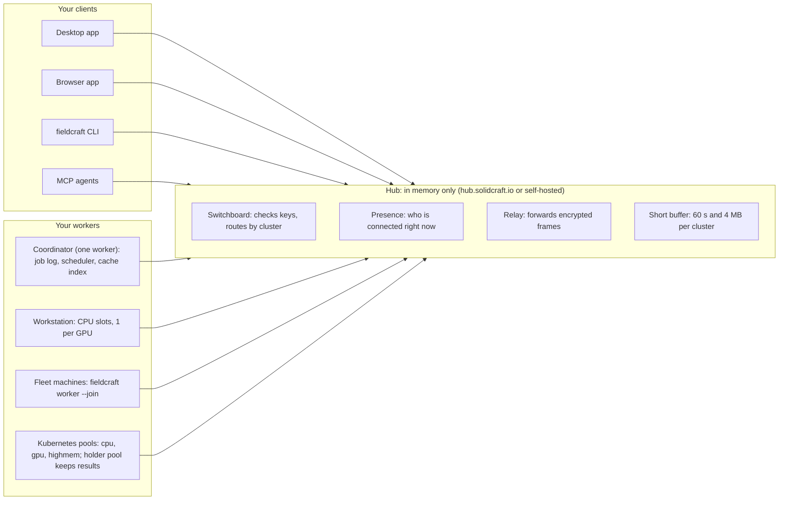
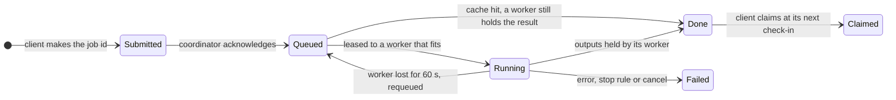
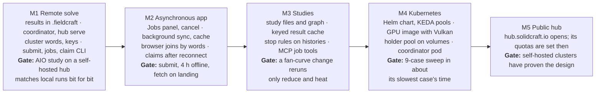

# FieldCraft Remote: a distributed, asynchronous simulation backend

**Status:** design proposal, October 2026, open for feedback. Try the flow in the [clickable prototype](https://claude.ai/code/artifact/ee7dfa05-ce8f-49a3-95a4-05ca7616e0f5#page-dcb81aee8d83).

## Summary

FieldCraft Remote lets you submit a solve from the desktop app, the browser, the CLI or an AI agent, disconnect, and collect the results later from any device. A stateless switchboard, the **hub**, connects your clients to your **workers**: the same headless FieldCraft engine the CLI already runs. One worker also acts as the cluster's coordinator and keeps the job log. Results stay on the worker that made them, and the client claims them through the hub whenever it next connects.

The hub is a service we host at `hub.solidcraft.io`, and the same binary is self-hostable. There are no accounts: a **cluster** is a secret seed passphrase. Every machine and client given the passphrase joins the same cluster and sees its jobs, and everything that passes through the hub is encrypted with a key derived from it, so the hosted hub never sees your models or results. The hub stores nothing at all, not even a database: it keeps only live connections in memory, and a restart costs no work. Jobs live on your coordinator, and results stay on your workers until a client claims them.

The compute is always your own. What changes between setups is only how many workers join:

- **One workstation.** Run `fieldcraft worker --join "<passphrase>"` on a machine with a GPU. Submit from the laptop or the browser anywhere; the workstation picks the jobs up.
- **A fleet.** Run the same command on every spare machine. Each advertises its cores, memory and GPUs and takes the jobs that fit.
- **Kubernetes.** A Helm chart runs worker pods per node pool (CPU, GPU, high memory), with the passphrase as a Kubernetes Secret, scaled on the cluster's queue depth.

Self-hosting means running `fieldcraft hub serve` on your own server and pointing clients at it with `--hub <url>`; nothing else changes.

Asynchronous work is the design centre: jobs outlive the client session, every state change is recorded, and clients sync results rather than stream them. You can check in whenever you reconnect, from any device, and it fetches what finished while you were away.

## Why: what the AIO cooler study showed

A realistic study is a few hours of independent solves stuck in a serial queue on one laptop. On 17 October we modelled a 240 mm AIO cooler: a lattice Boltzmann (LBM) sweep of the radiator, then a steady heat solve per cold plate for each fan setup, on a Core Ultra 7 155H with its integrated Arc GPU.

| Stage | Size | Wall time | Where it ran |
| --- | --- | --- | --- |
| Tet mesh, skived cold plate | 796k tets, single-threaded | 214 s | CPU, 1 core |
| Tet mesh, pin-fin cold plate | 579k tets around 261 pins | 15 min | CPU, 1 core |
| Steady heat solve, one step | 184k dofs, 133M factor entries | 60 s | CPU, 16 threads |
| LBM radiator cell, 1.6 m/s | 4.4M cells, 17k steps | 1086 s | Arc iGPU |
| LBM radiator cell, 0.4 m/s | 4.4M cells, 33k steps | 1732 s | Arc iGPU |
| LBM runs lost to instability or a wrong time step | 5 runs | about 1.5 h | Arc iGPU |

What hurt:

- **Independent work ran serially.** The LBM velocities and the 3 cold plates × 3 fan setups depend on nothing but their inputs, yet they ran one after another on one GPU and one CPU.
- **The laptop had to stay up.** Every solve lived inside a local MCP session; closing the lid would have lost hours.
- **Orphans and hand-made caches.** Stopping a run left a headless `fieldcraft-cli` still holding the GPU, unnoticed for 48 minutes. Each script cached its own results in JSON next to the models.
- **Feedback came only at the end.** A bad LBM time step showed up as an energy-balance failure after 33 minutes, not as a trend in the first few.

A cluster node with a discrete GPU runs these LBM cells many times faster than an iGPU. Ten workers would finish the 9-case sweep in about the time of its slowest case.

## Goals and non-goals

**Goals**

1. **Run anywhere, same API.** One hub binary serves a single workstation, a fleet, or a Kubernetes cluster. Clients cannot tell which.
2. **Asynchronous by default.** Submitting returns a job id at once. Jobs survive client disconnects, hub restarts and worker loss. Results wait on the workers until a client claims them.
3. **Every client.** The desktop app, the browser app, `fieldcraft-cli` and MCP agents submit, watch, cancel and fetch through the same calls.
4. **Bit-for-bit results.** A remote solve gives the same numbers as a local one, because the worker is the same engine and the solvers do not depend on thread count.
5. **Studies, not just solves.** Parameter sweeps and chained stages (radiator → coolant temperature → cold plate) are first-class, run in parallel, and reuse finished work by content hash.
6. **Right hardware per stage.** A mesh job goes to a CPU worker, an LBM job to a GPU worker, and a big factorisation to a high-memory node.
7. **Visible progress, early failure.** Live progress, convergence histories and engine warnings stream to the hub. A study can stop a job that is diverging.

**Non-goals**

- Distributing one solve across nodes (MPI, domain decomposition). Each job runs on one machine; the speed-up comes from running many jobs at once.
- A general HPC scheduler. On a cluster the hub hands scheduling to Kubernetes; on a workstation it runs a simple local queue.
- Selling compute. The hosted hub only relays encrypted bytes; solves run, and results stay, on machines the cluster's owner joined.

## What FieldCraft already gives us

Most of the hard parts exist; this proposal adds a transport and a queue, not a new engine.

| Existing piece | Where | What the remote backend uses it for |
| --- | --- | --- |
| Command engine: every capability is a command with a JSON Schema and declared `requires` | `crates/engine`, `fieldcraft-cli commands --json` | The job payload is a list of commands, validated before it is queued |
| `.fieldcraft` package: model, mesh, journal, SHA-256 per part, design referenced by hash | `docs/formats/fieldcraft.md` | The job's input bundle, content-addressed and deduplicated |
| Same bytes for the same model on every platform | `fieldcraft-io` | Content hashes are stable, so the cache key is reliable |
| Results independent of thread count (`fieldcraft-parallel`) | `docs/adr/0001` | A remote solve matches a local one |
| Jobs with progress and cancellation (`job.status`, `job.wait`, `job.cancel`) | `docs/control-protocol.md` | Progress for the hub, cancellation that stops at the next increment |
| Solver caps: `max_dofs`, `max_cells`, `max_cell_updates`, `max_factor_entries`, `threads` | `solve.*` commands | Resource estimates for scheduling, and hard limits per worker |
| GPU LBM backend (`backend: "gpu"`, `FIELDCRAFT_GPU`) | `fieldcraft-lbm-gpu` | GPU jobs land on GPU nodes; the CPU backend is the deterministic fallback |
| VTU/PVD export, CSV probes, heat and force histories | `results.export.*`, `solve.probe` | The result artefacts clients fetch and plot |
| MCP server with path confinement (`--automation-read-root`, `--automation-write-root`) | `fieldcraft-cli mcp` | The worker's sandbox: a job reads only its inputs and writes only its outputs |
| Browser build with the same engine (wasm, WebGPU) | `apps/fieldcraft-web` | A browser client for small solves and for viewing results; large ones go to the hub |

What is missing: a result format the app can open without re-solving, since a saved `.fieldcraft` holds the model but not its results. Today a remote result would have to come back as VTU, or be solved again. The first milestone adds a results part to the package (see Rollout).

## Architecture

There are three parts: clients that submit and claim, a hub that only switches, and your workers, one of which coordinates. The hub never runs a solve, never holds a key and never writes to disk.



Every arrow is an outbound connection to the hub; the hub writes nothing to disk and forgets all on restart. Jobs, logs and results live on your machines, encrypted with k\_data; the hub only forwards them.

- **Hub, a switchboard.** In memory it holds only who is connected in each cluster, plus a buffer of at most 60 s and 4 MB per cluster for a member that is reconnecting. It checks each connection's signature against the cluster key it presents, forwards encrypted frames between members, and forgets everything when it restarts. Members reconnect within seconds and nothing is lost, because nothing lived there.
- **Coordinator.** A role only a worker can take, never an interactive session (the desktop app, the browser, the CLI or an MCP agent). By default it is the worker joined with `--coordinator`: usually the always-on workstation, or a pod in the Kubernetes cluster. It keeps the job log in SQLite, encrypted at rest. It also schedules leases by needs, resolves study dependencies, tracks which worker holds which result, sends notifications and serves the queue metric for KEDA.
- **Replicas and failover.** Every worker keeps a copy of the job log, streamed from the coordinator. If the coordinator is gone for 60 s, the online worker with the lowest device id takes over from its copy and announces a new term. Log entries carry the term, so a returning old coordinator steps down instead of writing.
- **Worker.** `fieldcraft worker` is the headless engine plus a loop: ask the coordinator for a lease that fits its slots, fetch and decrypt the inputs, run the commands, stream progress, keep the encrypted outputs on its disk, report done. The heartbeat runs on its own thread; a worker silent for 60 s loses its lease and the job is requeued.
- **Results on workers.** Each job's outputs stay on its worker's disk, encrypted and named by their keyed ids. A result is a set of ids, so a client claims only the files it lacks.

**Claiming results.** Result files never rest at the hub; it only relays them.

- **Live claim.** If a cluster client is connected when a job finishes, the worker streams the outputs to it through the hub. The client checks each keyed id and acknowledges.
- **Later claim.** A client that connects later asks the coordinator for the job's results, and the holding worker streams them through the hub.
- **After a claim.** Once a cluster client has acknowledged every output, the worker may drop them. It keeps claimed results in a local cache, oldest out first under a disk quota, for re-delivery and study cache hits. Unclaimed results are kept 7 days.
- **Small records in the job log.** Specs, inputs up to 64 MB, the summary, the log and progress histories live in the coordinator's job log and its replicas. Every device sees a job's outcome even while its worker is offline.
- **Studies.** A job that consumes another job's outputs runs on that job's worker when it fits there; otherwise the outputs go from worker to worker through the hub.
- **A worker goes away.** Results on an offline worker wait until it returns. If a worker's disk is lost, its unclaimed jobs run again, with the same result bit for bit.

**What this costs.** A submit is complete once the coordinator acknowledges it, and from then on the client can disconnect. If no coordinator is online, the client keeps the job and submits it as soon as one appears; it never takes the role itself. A cluster with a workstation that is always on never notices; a cluster of laptops only would. The hub needs no disk and no database, only memory for its connections and bandwidth: every result byte crosses it once per claim.

**Hub restarts.** A restart, a redeploy or a crash of the hub is an ordinary event that costs no work. Every part is built so that "the hub does not know this" means "not yet", never "gone".

- **Workers keep running.** A job in progress carries on with the hub down. Its progress events, heartbeats and finished outputs queue on the worker's disk, numbered, and are replayed in order when it reconnects.
- **Leases freeze, not expire.** The coordinator counts a worker's silence only while the coordinator itself is connected, and gives every worker a 120 s grace period after any reconnect of its own. A hub outage therefore never requeues a running job.
- **The hub says it just restarted.** For its first 120 s the hub answers a request for a cluster it has not seen with `warming` and its uptime, not `unknown`. Clients and workers back off and retry; reconnects are spread with random jitter so a restart does not bring a stampede.
- **Clients own their submissions.** A client generates each job's id itself and keeps a local record of every job it sent: id, spec, cache key, last known state. When the coordinator cannot be reached, the app shows those jobs as "waiting for the cluster" with their last known state, not as failed.
- **Resubmitting is always safe.** Submit is idempotent by job id. If the coordinator, once back, reports a job id as never seen (for example, it was lost with a disk before it replicated), the client resubmits the same id. A worker that already holds a finished result for that id or its cache key answers at once.
- **Nothing waits on the hub's memory.** The 60 s buffer only smooths brief reconnects. Anything that must survive lives on a member and is resent from there.

## Job lifecycle

Submitting returns a job id at once; from then on the coordinator owns the job, and the client only checks in.



Your laptop can be offline anywhere between Submitted and Claimed; the job carries on.

1. **Submit.** The client validates the commands against the engine's schemas and `requires`, gives the job its own id, encrypts the spec and sends it with its inputs to the coordinator. The coordinator writes it to the job log and acknowledges; from then on the client can disconnect.
2. **Queue.** The job waits until its inputs exist (a study's earlier jobs), then checks the cache. A cache hit goes straight to Done.
3. **Lease and run.** The coordinator leases the job to a worker whose free slots fit its needs; the worker heartbeats every 10 s. It runs the commands and streams the engine's progress line, warnings and chosen histories (heat, force, residuals) as small encrypted events.
4. **Finish.** Outputs stay on the worker's disk, and stream straight to any connected client, and the job is Done, or Failed with the engine's error, or Cancelled. A lease that misses heartbeats for 60 s, counted only while the coordinator is itself connected, is revoked and the job requeued. Solvers restart from the beginning, since only the transient solvers have frames to resume from.
5. **Fetch.** On its next check-in a client asks the coordinator for everything changed since its last sync cursor and claims the outputs it wants. A worker holds unclaimed results for 7 days, or until you delete them.

## Protocol and engine changes

The hub speaks one protocol: a WebSocket per member at `wss://hub.solidcraft.io/v1/connect`. Everything else is a message between members, inside encrypted frames the hub forwards.

**Connecting.** The hub sends a random challenge. The member answers with the cluster's public key, its device key and a k\_sign signature over the challenge and the device key. The hub then puts the connection in the room for that cluster id. Nothing is stored, and a reconnect repeats the handshake.

| Frame the hub reads | From | What the hub does |
| --- | --- | --- |
| `hello` | Any member | Checks the signature and joins the member to its cluster's room |
| `announce {role, term}` (signed) | Coordinator | Routes `to: coordinator` to the highest term announced since the hub started |
| `send {to, seq, ciphertext}` | Any member | Forwards to a device id, `coordinator` or `clients`; buffers up to 60 s and 4 MB while the target reconnects, else answers `absent` |
| `stream.open`, `stream.chunk`, `stream.close` | Worker or client | Relays a result or input transfer with flow control; a broken stream resumes from its byte offset |
| `presence` | Hub | Tells members who joined or left |
| `warming {uptime}` | Hub | Its answer, for the first 120 s after a start, about any cluster with no members yet |

Inside `send`, encrypted end to end with k\_data, members speak their own protocol. Each message carries its sender's device id and a per-device sequence number, so receivers drop replays and duplicates.

| Message | From → to | Purpose |
| --- | --- | --- |
| `submit {job id, spec, inputs, needs, deps, cache key}` | Client → coordinator | Idempotent by the client's job id; acknowledged once in the log |
| `study {jobs}` | Client → coordinator | A graph of jobs in one message |
| `changes {since}` | Client → coordinator | Every job change since the client's sync cursor |
| `cancel`, `delete {job id}` | Client → coordinator | Stops a job; tells its holder to drop the results |
| `claim {job id, have}` | Client → coordinator | The coordinator asks the holding worker to stream the outputs the client lacks |
| `lease {slots, capabilities}` | Worker → coordinator | Returns a lease that fits, or waits |
| `heartbeat`, `events`, `done` | Worker → coordinator | Numbered and kept on the worker's disk until acknowledged, so a hub restart replays them |
| `log.append {term, entries}` | Coordinator → workers | Replicates the job log |
| `handoff {ids}` | Worker → holder | Moves results off a pod before it scales down |

The cache key is computed by the client, as HMAC(k\_id) over the normalised command list, the input ids and the engine version. The coordinator only compares opaque keys.

**Engine changes (M1).**

- **Results part in `.fieldcraft`.** A fifth package part holds the solved steps' fields, so a fetched result opens without solving again.
- **`fieldcraft-cli worker`.** Runs each job in a fresh in-process engine session, without MCP, and claims one GPU slot per adapter `FIELDCRAFT_GPU` can open.
- **Progress events.** Every solver and mesher reports through one callback: increments, time steps, residuals and the heat and force histories `solve.probe` already exposes. The worker forwards them.
- **`solve.estimate`.** A dry run that reports dofs, factor entries, lattice cells, cell updates and peak memory from the existing caps' arithmetic, so the client can declare needs and the scheduler can pick a pool.
- **Python steps.** A step `{"python": "reduce.py", "inputs": [...]}` runs with the job's inputs in a folder and writes its outputs to another. The worker image ships Python with numpy, and `uv` for anything else a step declares.

## Deployment: the hub and your workers

The hub coordinates and relays; your machines compute and keep the results. Workers and clients only make outbound HTTPS calls to the hub, so a worker behind NAT, a home connection or a cluster with no ingress just works.

|  | Hosted hub | Self-hosted hub |
| --- | --- | --- |
| Address | `https://hub.solidcraft.io` (the default once it opens, in M5) | Your own URL; clients take `--hub <url>` or the `FIELDCRAFT_HUB` variable |
| State on the hub | None: live connections in memory only; the job log is on your coordinator | None, the same |
| Result files | None: results stay on your workers | None, the same |
| What the hub can read | Who is connected and the sizes and timing of frames, in memory only; never jobs or content | The same (it is the same software) |
| Limits | Per-cluster quotas, decided when the public hub opens (M5) | Whatever you configure |
| Setup | Nothing | `fieldcraft hub serve`, or the Helm chart's hub |

| Workers | How they join | Notes |
| --- | --- | --- |
| One workstation | `fieldcraft worker --join "<passphrase>"` | One slot per GPU adapter, CPU slots by core count; installs as a system service and keeps results on its own disk |
| A fleet | The same command on each machine | Each worker advertises cores, memory and GPU adapters and leases only jobs that fit |
| Kubernetes | Helm chart: a worker StatefulSet per node pool, each pod with a persistent volume, the passphrase in a Secret | KEDA scales each pool on its queue depth; a pod hands its unclaimed results to the holder pool before it scales down, so the GPU pool still reaches zero |

**Kubernetes.** Workers are StatefulSets, one per node pool, because a worker's disk is where results live. Each pod has a persistent volume, runs one job at a time, and requests resources to fit its pool: `cpu` (many cores, 64–256 GB), `gpu` (one GPU per pod) and `highmem` for large direct factorisations. A small `holder` pool of cheap CPU pods with large volumes runs no solves; it only keeps results. When KEDA scales a GPU or CPU pod down, the pod first relays its unclaimed and cached results to a holder through the hub, then exits. The GPU pool can then still scale to zero without losing anything. The queue depth KEDA reads is a metrics endpoint on the coordinator pod, inside the cluster; it never goes through the hub.

GPU pods need a Vulkan driver inside the image, because wgpu compute runs on Vulkan on Linux. On NVIDIA that means the container toolkit with the `graphics` driver capability, which we need to verify on our nodes. The image also carries Mesa for Intel and AMD nodes.

## Studies, sweeps and caching

A **study** is a small graph of jobs whose inputs can be outputs of earlier jobs. The coordinator runs every job whose inputs are ready, so independent branches run side by side. The AIO study as a graph:

1. `mesh` × 3 (one per cold plate, CPU) and `lbm` × 3 (one per velocity, GPU) start together.
2. A `reduce` step reads the LBM rows (pressure loss, heat per wall) and computes the fan operating points and coolant temperatures. It is a small script job on any CPU worker.
3. `heat` × 9 (3 plates × 3 fan setups) start as each mesh and the reduce step finish.
4. `render` × 9 write the cutaways; a `report` job gathers the table.

With workers to spare, the wall time is the slowest LBM run plus one heat solve. On the laptop it was every run in sequence.

**Study definition.** A study is a JSON file next to the model: named parameters with their values, and jobs with `inputs` (artefact hashes, or `{"from": "<job>", "output": "<name>"}`), the commands to run, and declared needs (`gpu`, cores, memory). A sweep is a parameter with a list of values. `fieldcraft study run aio.study.json` submits it; the app gets a Studies panel that does the same.

**Caching by content hash.** A job's key is the SHA-256 of its command list, its input artefacts' hashes and the engine version. A job whose key matches a result some worker still holds is answered from that worker without running. Rerunning the AIO study after changing only the fan curve would then redo only `reduce`, `heat` and `render`. The LBM and mesh jobs, the 2 hours of compute, come straight back, as long as their workers still hold them.

**Early stopping.** A job can declare a stop rule over a streamed quantity, for example "cancel if the heat history's late-window mean breaks the m·cₚ bound". The worker evaluates it every progress tick and cancels through the engine's `job.cancel`, so a bad time step costs minutes, not half an hour.

## Security: the passphrase is the cluster

There are no accounts or logins. A cluster is created by `fieldcraft cluster new`, which prints a seed passphrase of 12 random words (132 bits). Anyone holding those words is a full member: they can join workers, submit and cancel jobs, read every result and run code on every worker. There is one passphrase per cluster, with no lesser roles. The hub holds none of the keys.

**What the words become.** Every client derives the same keys locally:

```latex
\begin{aligned}
m &= \mathrm{Argon2id}(\text{words},\ \text{salt} = \texttt{fieldcraft-cluster-v1}) \\
(k_{\mathrm{sign}},\ k_{\mathrm{data}},\ k_{\mathrm{id}}) &= \mathrm{HKDF}(m) \\
\text{cluster id} &= \mathrm{SHA256}(\mathrm{pub}(k_{\mathrm{sign}}))
\end{aligned}
```

- **k\_sign** (Ed25519) signs every request to the hub: a timestamp, a nonce and the body hash. The hub stores nothing: each connection presents the public key and proves it holds k\_sign by signing the hub's challenge.
- **k\_data** encrypts every job spec, input bundle, result, log and progress line (XChaCha20-Poly1305) before it leaves the machine. The hub cannot read or alter them undetected.
- **k\_id** keys the artefact ids: an artefact's id is HMAC(k\_id, plaintext). Deduplication and the result cache work inside a cluster, but the hub cannot tell whether two clusters hold the same model.

**What the hub sees.** It sees, in memory and only while they last: the cluster id, which devices are connected, who sends frames to whom, and their sizes and timing. It never sees a job, a need, a state, a file name or a number, because job records and scheduling live on the coordinator, inside encrypted frames. Nothing it sees is written down.

**Words must be random.** A cluster id is public to the hub, so a human-chosen passphrase could be guessed offline. The CLI and app only accept words they generated. The 132 bits plus Argon2id put guessing out of reach.

**Devices and revocation.** Each worker and client also makes its own device key and registers it, signed with k\_sign, so the cluster's device list shows what joined and when. A lost laptop is removed from the list, but its copy of the words still works. A real revocation is a rotation: `fieldcraft cluster rotate` makes new words, re-encrypts what you keep under the new keys, and leaves a signed forwarding record so other devices can follow with the new words.

**Lost words cannot be recovered.** We cannot reset them, and nobody can read the cluster's data without them. Clients keep the derived keys in the OS keychain (in the browser, a non-extractable WebCrypto key in IndexedDB), so the words are typed once per device.

**What a worker will run.** A job is a list of FieldCraft engine commands, plus optional Python steps such as `reduce` and `report`. Joining a cluster means accepting its code: there is no opt-in flag, and anyone with the words can run Python on every worker. So the passphrase is a root credential for those machines. A worker runs as its own unprivileged user (on Kubernetes, a non-root pod with no service-account token), each job in a fresh scratch folder that is wiped afterwards. The engine commands also keep the MCP server's path confinement, which bounds what a mistyped path can touch.

**The hosted hub's own exposure.** There is nothing to register, so anyone with a fresh passphrase has a cluster. `hub.solidcraft.io` limits each cluster's connections, buffer memory and relay bandwidth, and refuses frames over a set size. A compromised hub could drop, delay or reorder frames and watch traffic patterns. It could not read or forge a job or a result, and it could not lose work, since none is kept there.

## Client experience

Every client does the same five things: join, submit, watch, cancel and fetch. The difference is only where you sit.

| Client | Join | Submit and watch | Results |
| --- | --- | --- | --- |
| Desktop app | Settings › Cluster: paste the words once | Solve runs on **This computer** or **Cluster**; a Jobs panel shows each job's progress line, warnings and convergence plot, with Cancel | Synced in the background into a local cache; a finished result opens like a local one |
| Browser, `hub.solidcraft.io/app` | Paste the words; the keys stay in the browser | Small models solve in the page (wasm, one thread); larger ones go to the cluster | Downloaded into the browser's private file storage (OPFS), viewed in the page, saved as a file on request |
| `fieldcraft` CLI | `fieldcraft cluster join` | `fieldcraft submit model.fieldcraft --step heat`, `fieldcraft study run aio.study.json`, `fieldcraft jobs`, `fieldcraft cancel <job>` | `fieldcraft fetch <job> --out results/` |
| MCP agents | The server is started with the cluster joined | Tools `submit_job`, `job_status`, `cancel_job` beside today's `execute` and `batch` | `fetch_results`, then the usual `solve.probe` and `results.*` on the fetched model |

**Checking in later.** You schedule a study and disconnect. Workers keep going; nothing depends on the device you scheduled from. When you next open the app, on that device or another, it asks the coordinator what changed since its last sync. It shows something like "AIO study: 15 of 16 jobs done, 1 failed", and starts fetching in the background. Results under a size limit you set (say 2 GB) download automatically; bigger ones wait until you open them. Everything fetched stays in the local cache for offline viewing and saving.

**What comes back.** Each solved job returns a `.fieldcraft` with a results part, which the app opens without solving again. It also returns the exports the job asked for (VTU or PVD for ParaView, CSV probes), its log and its progress history. These are the same files the AIO study's scripts collected by hand.

**Notifications (optional).** A cluster can name a webhook or an ntfy topic. The coordinator posts only a job id and state there, so the message carries nothing that needs the key; the phone app shows "study finished" and the details open in the client.

## Prototype: schedule a study, check in later

A clickable mockup of the desktop journey is in the [FieldCraft Remote CUJ prototype](https://claude.ai/code/artifact/ee7dfa05-ce8f-49a3-95a4-05ca7616e0f5#page-dcb81aee8d83). It uses the compact Craft shell from SolidCraft's ribbon redesign (tangency-labs/solidcraft#1439) with FieldCraft's own workspaces, commands and icons. Press Play on the artboard; the step bar above the window jumps between steps.

1. **Join cluster.** Analysis › Solve › Remote › Join Cluster opens a dense panel for the 12 words, the hub and the device. The app-bar chip turns from "No cluster" to "harbor-velvet · 3 workers".
2. **Schedule study.** Schedule Study shows aio.study.json with a This computer / Cluster switch, its six stages and the stop rule. Once the coordinator acknowledges, the device can disconnect, and View progress opens the cluster view.
3. **Running.** The cluster view shows slots fill and load change while the scheduling device is offline; a simulated-time control in the prototype advances the clock. A phone notification arrives when the study finishes.
4. **Check in.** The hub-warming banner ("waiting for the cluster, not failed") gives way to the sync. The Browser becomes the job tree, the panel shows the selected job's residuals and warnings, and the failed heat job offers "Rerun with dt × 0.5". Results under 2 GB fetch in the background.
5. **Open result.** The Results workspace opens the fetched .fieldcraft from the local cache with contours, without solving again.

**Joining a cluster.** The Join Cluster panel in Analysis › Solve, words pasted, before Join. The chip in the app bar still reads "No cluster".

*Screenshot in the [prototype](https://claude.ai/code/artifact/ee7dfa05-ce8f-49a3-95a4-05ca7616e0f5#page-dcb81aee8d83): the Join Cluster panel in the Analysis workspace.*

**Jobs in progress.** Three hours after scheduling, with the scheduling device offline. The heat stage holds all 9 CPU slots at 100% while the GPU slots sit free, and every worker keeps its finished results on its own disk.

*Screenshot in the [prototype](https://claude.ai/code/artifact/ee7dfa05-ce8f-49a3-95a4-05ca7616e0f5#page-dcb81aee8d83): the cluster view during the heat stage, with the scheduling device offline.*

**Downloading results.** Checked in later: 24 of 26 jobs done. Results under 2 GB download on their own; the 6.2 GB of LBM fields were fetched by hand. The failed heat job shows why the stop rule cancelled it.

*Screenshot in the [prototype](https://claude.ai/code/artifact/ee7dfa05-ce8f-49a3-95a4-05ca7616e0f5#page-dcb81aee8d83): the Jobs tab after the sync, with the background fetch card.*

| Surface | Where it lives in the app | What it shows |
| --- | --- | --- |
| Cluster chip | App bar, where SolidCraft shows the agent status | Cluster name and workers, running jobs, or hub warming; opens the cluster view |
| Remote section | Analysis › Solve ribbon | Join Cluster, Schedule Study, Jobs |
| Cluster view | Full-page view, like the Start page | Free GPU and CPU slots, memory and held results; client → hub → workers; one card per worker with its slot tiles, CPU, memory and disk; the queue by need |
| Jobs tab | Analysis workspace, in place of Solve | Job tree by stage in the Browser, job detail with convergence in the panel, background fetch |

The hardware and load figures in the prototype are illustrative, and its cluster and job icons are sketches in the icon palette, not final artwork.

## Rollout and decisions

Ship and prove the self-hosted path first, using the AIO study as the acceptance test at every step; the public hub comes last.



M1 also covers the engine changes the backend needs: a results part in `.fieldcraft`, progress events from every solver, and a `worker` mode in `fieldcraft-cli`. The public hub at hub.solidcraft.io is the last deliverable (M5). It opens only once self-hosted clusters have proven the design, and its per-cluster quotas (connections, buffer memory, relay bandwidth) are decided then.

**Decisions**

| Question | Decision |
| --- | --- |
| How long a worker keeps unclaimed results | Workers hold unclaimed results 7 days; copies a client claimed stay on that client |
| More than one passphrase per cluster | No: one passphrase, full access |
| Relay results straight to a client | Yes, and further: the hub stores no result files at all. Workers hold results until a client claims them, relayed through the hub |
| Lease timeout | 60 s of missed heartbeats; the heartbeat runs on its own worker thread, so a factorisation silent for minutes keeps its lease |
| Script steps | Python, with no opt-in flag: joining a cluster means accepting its code |
| State on the hub | None: no database, no disk. The hub is an in-memory switchboard; the job log lives on a coordinator worker, replicated to the other workers |
| Hub restarts | Cost no work: workers keep running and replay, leases freeze, and clients treat a job the hub doesn't know as "not reconnected yet" |
| Who can coordinate | Only a worker (`fieldcraft worker`), never an interactive session: the desktop app, the browser, the CLI or an MCP agent. With no worker online, clients hold their jobs until one appears |

**Still open**

- [ ] Which NVIDIA driver capabilities do wgpu compute pods need on our nodes, and does the Intel or AMD path need anything beyond Mesa?
