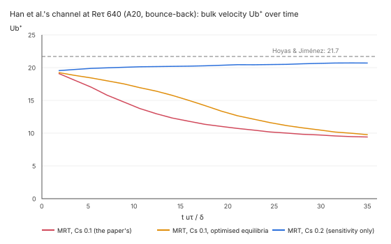
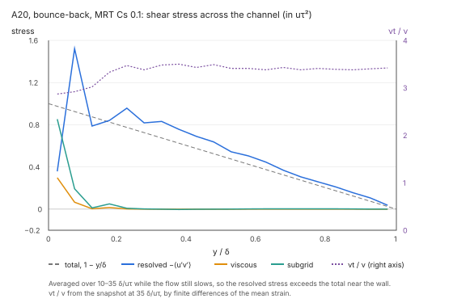

# Verification and validation

Every solver capability is checked against three kinds of reference, and every accepted result is
frozen so it cannot drift.

| Kind | What it checks | Sources |
|---|---|---|
| Theory | The code solves the equations right | Closed-form solutions (beams, plates, Lamé, Kirsch, waves, shocks, Poiseuille…), patch tests, convergence rates, mesh invariants |
| Experiment | The model predicts reality | Measurements published in papers and reports (Taylor bar, cavity and cylinder flows, FSI experiments…) |
| Published benchmarks | Agreement with established codes on standard problems | NAFEMS benchmarks, vendor benchmark and verification manuals (e.g. Abaqus Benchmarks and Verification manuals), other published reference solutions |

Rules:
- Each case is **our own model** of the problem, built from the published description (geometry,
  material, loads, boundary conditions). We never run a commercial product and never copy its
  input files, manual text or figures; only the published numbers are used, with a citation.
- Each case lives in `tests/oracle/<case>/`:
  - `recipe.json` — the model as FieldCraft commands (or a SolidCraft recipe for geometry);
  - `expected.json` — the reference values with `kind` (theory | experiment | benchmark),
    `source` (citation: document, table or figure, page), `quantity`, `value`, `tolerance` and
    the reason for that tolerance (mesh, measurement scatter, model differences);
  - `fixture.json` — FieldCraft's accepted result, written by `cargo xtask oracle --bless <case>`
    only after the case passes against `expected.json`.
- `cargo xtask oracle` runs every case, compares with `expected.json` (pass/fail with error) and
  with `fixture.json` (any change beyond the fixture tolerance fails CI, even if the reference
  still passes), and writes `docs/oracle.md` with the table of cases, sources, errors and status.
- A fixture is updated only deliberately (`--bless`), in a PR that says why the result moved
  (a better element, a finer default mesh), never to hide a regression.
- The theory suite is the gate for every merge; experiment and benchmark cases run in CI too, with
  their cited tolerances.

## The case format

`cargo xtask oracle` builds `fieldcraft-testkit`'s `oracle` binary (release) once and runs every
case through the command engine; the results are in [oracle.md](oracle.md).

```
cargo xtask oracle                      # every case; writes docs/oracle.md
cargo xtask oracle --case nafems-le1    # one case (repeatable); docs untouched
cargo xtask oracle --bless nafems-le1   # freeze a passing case's results (or --bless all)
cargo xtask oracle --quick              # skip cases marked "slow" (and "nightly")
cargo xtask oracle --nightly            # also run the cases marked "nightly"
```

- `recipe.json` is a script `fieldcraft-cli run` also accepts: a JSON array of
  `{"command", "params"}`; a step may carry an `"id"` so a quantity can read its output. Meshes
  come from `mesh.block` (mapped hex, tet or wedge blocks with arcs and elliptical edges, named
  faces, edges and vertices that sets select), `mesh.tet.generate`, or nodes and elements written
  one by one; once structured and automatic meshers land, cases may use them.
- `design.json` (optional) is a SolidCraft script that builds the geometry, opened before the
  recipe (the test corpus's recipe form).
- `expected.json`:
  ```json
  {"title": "…", "kind": "theory|benchmark|experiment",
   "source": "document, section/table/figure, page",
   "status": "active|pending", "requires": "the capability a pending case waits for",
   "slow": false, "nightly": false,
   "quantities": [{"id": "syy_D", "quantity": "σ_yy at D (2, 0)",
     "measure": {"command": "solve.probe", "params": {"step": "Load", "at": [[2, 0, 0]]}, "pointer": "/nodes/0/stress/1"},
     "value": 92.7, "tolerance": {"relative": 0.01}, "reason": "why this tolerance",
     "known_failure": "optional: why FieldCraft misses the reference today"}]}
  ```
  A measure reads a JSON pointer either from a recipe step's output (`"from": "<id>"`) or from a
  command run after the recipe (`"command"`, `"params"`); an optional `"scale"` multiplies it, and
  an optional `"over"` (a measure of its own) divides it by another number of the same run, for
  ratios such as the stress in one element over the stress in another.
  A case too long for every change (minutes) is marked `"nightly": true`: it runs in the nightly,
  manual and release runs (`--nightly`), or when named with `--case` or `--bless`; any other run
  checks it by its fixture (a fixture that misses an edited reference fails), and docs/oracle.md
  always shows its fixture, so the page is the same either way. `"slow"` cases run on every
  change and only `--quick` skips them.
  A tolerance is `relative` (of the reference), `absolute`, both, or `"exact": true`. A pending
  case cites its reference values (or `null` until transcribed) and has no recipe yet.
- `fixture.json` holds each passing quantity's accepted `value` and its `band`
  (10⁻⁹ of the larger of value and reference, plus 10⁻³ of an absolute tolerance; a quantity whose
  reference is zero, which is rounding noise, keeps its absolute tolerance as its band; an
  ill-conditioned quantity may set a wider `fixture_relative` with a `fixture_reason`; a quantity
  that depends on a mesh generated from geometry, which is not bit-identical across platforms, sets
  `"fixture": false` with a `fixture_reason` and is gated by its reference tolerance alone): the result is
  deterministic, the band only absorbs last-digit differences of the system maths library.

The run fails when a quantity misses its reference (unless it is a `known_failure`, which is
listed in oracle.md with its reason), when a known failure starts passing (remove the mark),
when a result leaves its fixture band, when a passing quantity has no fixture, or when a case
cannot run.

## Adding cases for a new capability

Every capability that lands brings its oracle cases in the same pull request:

1. Turn the pending cases that waited for it into active ones (write `recipe.json`, drop
   `status`/`requires`, add `measure` and `tolerance` with its reason to each quantity), and add
   theory cases for its closed-form solutions (patch test and convergence for an element; the
   analytic problem for a load, constraint or procedure).
2. Choose meshes that are converged well inside the tolerance (show the refinement in the case's
   README), or the mesh a benchmark prescribes.
3. Run `cargo xtask oracle --case <name>`; when it passes, `--bless <name>`; commit the case, its
   fixture and the regenerated docs/oracle.md.
4. A case that misses its reference stays honest: keep the tolerance its reason supports and add
   `known_failure` with what is missing. Never widen a tolerance to make a case pass.

## Long studies

Some studies take hours and run in no CI job; the heavy job (`cargo xtask test --heavy`, 60
minutes) runs a bounded regression of each instead, and each study is run by hand when the
physics under it changes. The study's test stays `#[ignore]`d and returns at once unless its
environment variable is set, so `--heavy` passes over it.

### Re_τ 180 channel against Moser, Kim & Mansour (#663, #664)

Smagorinsky's model (C = 0.1, regularised collision), the channel 2πδ × 2δ × πδ driven by
u_τ²/δ, 10 δ/u_τ of start-up discarded and 15 averaged. Reference: R. D. Moser, J. Kim,
N. N. Mansour, *Direct numerical simulation of turbulent channel flow up to Re_τ = 590*, Phys.
Fluids 11:943–945, 1999 (Re_τ = 178): U_b/u_τ ≈ 15.7, U_c/u_τ ≈ 18.3, C_f ≈ 8.18 × 10⁻³.

```
FIELDCRAFT_CHANNEL_STUDY=1 cargo test --release -p fieldcraft-lbm --test turbulence -- --ignored --nocapture study
```

About 1.8 h on 32 threads. Recorded on Windows x86_64 (PR #668):

| cells per δ | y⁺ per cell | U_b/u_τ | U_c/u_τ | C_f |
|---|---|---|---|---|
| 12 | 15.0 | 9.95 (−36.6 %) | 13.07 (−28.6 %) | 2.02e-2 |
| 18 | 10.0 | 11.55 (−26.4 %) | 14.42 (−21.2 %) | 1.50e-2 |
| 24 | 7.5 | 12.81 (−18.4 %) | 15.60 (−14.8 %) | 1.22e-2 |
| 32 | 5.6 | 14.17 (−9.8 %) | 17.00 (−7.1 %) | 9.96e-3 |

The heavy job runs the 12-cell grid alone with the same protocol
(`a_coarse_channel_at_re_tau_180_stays_turbulent_with_the_study_s_means`, about a minute and a
half on 14 cores): turbulent, and within 3 % of the 12-cell means above. The flow is chaotic, so
its means move with the platform (9.90 and 12.95 on macOS aarch64); the band is three times that
scatter.

**With Van Driest damping** (`van_driest`: 26, literature C5.3; probes, not validation). At
Re_τ 180 a grid of N cells per δ has Δy⁺ = 180 / N, so none of these grids resolves the wall:
damping is meant for a wall resolved down to y⁺ ≈ 1–2 at the first cell (about 90 cells per δ).
The probes are short (5 δ/u_τ of start-up discarded, 1 averaged) and the bulk speed was still
falling at their end. Recorded on Linux aarch64 (NVIDIA GB10, 20 cores, shared):

| cells per δ | Δy⁺ | damped, short run: U_b/u_τ | U_c/u_τ | undamped, full protocol: U_b/u_τ |
|---|---|---|---|---|
| 12 | 15.0 | unstable at 2.2 δ/u_τ | — | 9.95 |
| 18 | 10.0 | 12.42 (−20.9 %) | 15.63 (−14.6 %) | 11.55 |
| 24 | 7.5 | 14.00 (−10.8 %) | 17.26 (−5.7 %) | 12.81 |

All three are **not wall-resolving**. On the 12-cell grid the damping takes away the eddy
viscosity that held τ₀ = 0.5013 stable at a wall the grid cannot resolve; the run now says so
(the first cells' y⁺ in the instability's message, and a warning past y⁺ 5 when a run ends).
A wall-resolving study in a minimal flow unit (πδ × 2δ × 0.3πδ at 90 cells per δ, 4.3 M cells,
about 6 × 10¹⁰ cell updates per δ/u_τ) would take a day or more on the CPU and is not run.

What it does not establish yet:
- **No converged reference.** The bulk speed approaches MKM's monotonically as the first cell
  moves into the viscous sublayer, but no grid is within its tolerance of it: without wall
  damping the eddy viscosity is too large in the first cells off the wall, so the friction is too
  high, and the grids above are too coarse for damping to model the wall. A wall model
  (literature C5.2) or a wall-resolving grid is the next step.
- **The finest grid had not settled.** At 32 cells per δ the bulk speed was still falling slowly
  at the end of the averaging, so its mean is an upper bound of that run's, and the observed
  trend is not a convergence order.
- **One realisation per grid.** The means carry the sampling scatter of a single 15 δ/u_τ
  average (about 1 % at 12 cells per δ, from the two platforms above); no confidence interval is
  stated.

### Wall-modelled LES, method one, reproduced at Re_τ 950

Malaspinas & Sagaut's channel run exactly as their paper sets it up (Re_τ 950, Re_m 37 042, N 10,
20 and 30, Smagorinsky C 0.08, MRT, their forcing), against the paper's own measures and Hoyas &
Jiménez's DNS. Set-up, the readings where the paper is silent, and figures:
[the wall-model page](lbm-wall-model.md#reproduction-of-the-paper-at-re_τ-950). Recorded on Linux
aarch64 (NVIDIA GB10), GPU, f32. Pass criteria fixed before the runs: E within 15 % of the paper's
Table 1 and C_f by the model's u_τ within its 4.22 % of Dean.

| N | E (paper) | C_f by the model's u_τ vs Dean | C_f by the carried drag vs Dean |
|---|---|---|---|
| 10 | 2.08 (2.11) | +1.8 % | −16.8 % |
| 20 | 0.99 (1.07) | +0.8 % | −13.7 % |
| 30 | 0.87 (0.83) | +3.5 % | −14.1 % |

**Passes** on the paper's measures. The drag the flow carries is 14–17 % low on every grid, a
property of the published method that its C_f (from the model's u_τ) does not show.

### Wall-function bounce, method two: Han et al. not reproduced at C_s 0.1

Han, Ooka & Kikumoto's channel (Fluid Dyn. Res. 53:045506, 2021) run as their paper sets it up:
2πD × 2D × πD, periodic in x and z, MRT (d'Humières et al. 2002's rates), Smagorinsky C_s 0.1
with Van Driest's damping (A⁺ 26), driven by the constant pressure gradient of u_τ = 1, their
Mach numbers, with `spalding_bounce_halfway` (WFB) or plain bounce-back (BB). Pass criteria fixed before
the runs: ε_u⁺ over the whole channel and the log-law intercept b within 15 % of their Tables 2
and 3, for both walls. Recorded on Linux aarch64 (NVIDIA GB10), GPU, f32 unless stated.

**Correction: the WFB rows below did not run Han et al.'s scheme.** The wall model these runs
used (then named `spalding_bounce`, now `spalding_bounce_halfway`) is a halfway variant of our own:
- the wall lies halfway along the link, so the first fluid cell is at Δy/2;
- each wall cell's Spalding stress is taken off that same cell's post-streaming inward diagonals.

Han et al.'s eq. 14 is on-node:
- a boundary node lies on the wall, so the first interior node is at Δy (their y⁺ 32 at A20 is Δx⁺);
- the node's collision is replaced by bouncing back the axis populations and reflecting the
  inward diagonals specularly, plus or minus (Δt/2Δy) τ_w, with τ_w from Spalding at the node above it;
- so a node's stress is deposited into the interior neighbours at x ± 1.

The BB rows, the MRT diagnosis (the pile-up band, the ruled-out causes, the Taylor–Green control
and the cause) and the conclusion for MRT at C_s 0.1 are unaffected. The WFB rows record our
variant, not a reproduction attempt of the paper's wall-function bounce. That reproduction (eq.
14 as written, on MRT and on the hybrid recursive regularised collision) is the next step of
method two.

```
FIELDCRAFT_HAN=A20,A40 cargo test --release -p fieldcraft-lbm-gpu --test verification study_han -- --ignored --nocapture
```

| run | ε whole (paper) | b (paper) | U_b⁺ | C_f vs Dean | walls carry |
|---|---|---|---|---|---|
| A20 WFB | 0.499 (0.057) | −2.64 (6.4) | 9.56 | +215 % | 1.03 |
| A20 WFB, CPU f64 | 0.500 (0.057) | −2.66 (6.4) | 9.54 | +217 % | 1.03 |
| A20 BB | 0.511 (0.056) | −2.55 (5.6) | 9.24 | +235 % | 1.01 |
| A40 WFB | unstable at 93 δ/u_τ (a local lattice speed of 0.647); U_b⁺ ≈ 6.9 throughout | | | | |
| A40 BB | stopped at 52.5 δ/u_τ, U_b⁺ 7.88 and falling | | | | |

Hoyas & Jiménez's U_b⁺ is about 21.7. **Not reproduced**, on both walls and both grids; the finer
grid is worse. CPU and GPU agree, and the walls carry the body force, so neither the port nor
the momentum budget is the cause.



**What the flow does.** In A20 BB (snapshot at 35 δ/u_τ) the resolved stress −⟨u′v′⟩ carries
the whole momentum flux and the eddy viscosity is small (⟨ν_t⟩/ν ≈ 3 across the channel, by the
finite-difference strain); u′rms⁺ ≈ v′rms⁺ ≈ 5 from y⁺ 48 to the centreline (about 1 in the
DNS core), with 35–55 % of u′'s streamwise spectrum in the upper half of the wavenumbers and no
checkerboard; the mean profile is flat from y⁺ 48 to the centre. The streamwise spectrum is not
a smooth pile-up at the grid cutoff but a distinct band at k_x δ ≈ 31–41 (a wavelength of 3–4
cells): at y⁺ 48 it rises above the largest scale's energy, and it falls by 10³ past k_x δ ≈ 43
(the cutoff is 63). That band mixes the channel into a plug, which raises the drag.




**Ruled out.** Hou et al.'s ν_t applies C² with Δ = Δx (the simple-shear test gives ν₀ + C²γ);
Van Driest's y is measured from the wall point halfway along the link; the energy mode's rate is
1.19, not near 2; forcing and units are covered by the MRT Poiseuille tests.

**Short runs** (A20, 10–35 δ/u_τ averaged, diagnostic switches not merged):

| A20, 10–35 δ/u_τ | U_b⁺ | ε whole | b | C_f vs Dean |
|---|---|---|---|---|
| BB, MRT, C_s 0.1, damped (the paper's) | 10.9 | 0.426 | −0.99 | +150 % |
| BB, without damping | 6.8 | 0.637 | −5.19 | +466 % |
| BB, C_s 0.05 | unstable | | | |
| BB, regularised collision, C_s 0.1 | 8.6 | 0.537 | −4.69 | +280 % (checkerboard at y⁺ 16–80) |
| BB, TRT, C_s 0.1 | unstable at 0.4 δ/u_τ | | | |
| BB, MRT with d'Humières et al.'s optimised equilibria (w_ε 0, w_εj −475/63, w_xx 0) | 12.9 | 0.325 | 0.70 | +88 % (same state, reached later) |
| BB, C_s 0.15 | 19.2 | 0.066 | 6.46 | −7 % (v′ > u′ in the core) |
| BB, C_s 0.2 | 20.4 | 0.129 | 7.41 | −16 % |
| WFB, C_s 0.2 | 15.0 | 0.207 | 1.36 | +44 % |

The C_s rows are a sensitivity table, not a calibration: tuning the model's constant until the
bulk fits is not a reproduction, and none of them passes on both measures.

**Without walls the scheme dissipates as it should** (`study_taylor_green_vortex_dissipation`,
64³, lattice speed 0.05): MRT with C_s 0.1 peaks at −dk/dt 0.0121 (t 8.4) at Re 1600 and 0.0122
(t 8.1) at Re 12000 (τ 0.500127, below the channel's 0.50015), against the spectral DNS's 0.0127
near t 9; the energy above k 16 at t 10 is 3.3 % and 7.6 %. The pile-up is driven at the walls.

**Cause.** The documented failure of this MRT in under-resolved channels: P. Nathen, D. Gaudlitz,
M. J. Krause, N. A. Adams, *On the stability and accuracy of the BGK, MRT and RLB Boltzmann
schemes for the simulation of turbulent flows*, Commun. Comput. Phys. 23:846–876, 2018 (DOI
[10.4208/cicp.OA-2016-0229](https://doi.org/10.4208/cicp.OA-2016-0229)), with the same rates, find an
unphysical state in channels at Re_τ 395 and 590 (spurious oscillations in the bulk and, at the
higher Re, near the wall, energy moving to high wavenumbers, no mesh convergence) where BGK is
fine, and cite Gehrke, Janßen & Rung for the same with other boundary conditions. Han et al.'s
clean MRT result at C_s 0.1 is not explained by anything they publish (the 2021 paper and their
2019 LBM-LES paper, IJHMT 130:700, read). Proposed next (owner's decision): validate the
wall-function bounce on the hybrid recursive regularised collision (Jacob, Malaspinas & Sagaut
2018), as a labelled change of collision.

### Wall-function bounce: the odd–even mode of the wall rows (stationary toy)

The runs above used our halfway variant (`spalding_bounce_halfway`). In channels at τ̄ ≈ 0.50015
it grew a streamwise odd–even (k_x = π) mode of u_x in its wall rows, about 3e-5 per step, until
the run broke. Han et al.'s own scheme, on-node (`spalding_bounce`, their eq. 14,
`crates/lbm/src/bounce.rs`), was then checked against the halfway one by a numerical linear
analysis of that mode (`crates/lbm/tests/wall_stability.rs`).

The set-up is a periodic box 16 × (2N + 1) × 2 cells on-node, 16 × 2N × 2 halfway, N = 4, with
both walls under the wall model and no subgrid model. A body force holds the laminar base steady:
g × (fluid rows) = 2 u_τ², with the first node's speed Spalding's at u_τ. The first node's u⁺ is
aimed at 5 and 11, lowered until the centreline stays under lattice speed 0.1. A checkerboard of
1e-6 in u_x is added to the first fluid row at each wall. The growth rate per step is the
least-squares slope of ½ ln E of the mode's energy over the second half of 20 000 steps, or of the
time before the mode fell to round-off.

The growth rate per step is shown as the range over the regularised, hybrid (σ 0.99), MRT and TRT
collisions and both aimed u⁺. The first node's u⁺ is in brackets.

| τ̄ | on-node (eq. 14) | halfway |
|---|---|---|
| 0.50015 | −5.2e-5 to −1.9e-5 (5, 11) | +5.6e-5 to +1.4e-4 (5, 10.8) |
| 0.5015 | −2.9e-4 to −8.8e-5 (5, 8.1) | +5.5e-4 to +7.1e-4 (4.8; MRT broke at step 18 368) |
| 0.505 | −7.1e-4 to −3.3e-4 (5) | +1.8e-3 to +2.3e-3 (2.7; broke by step 7 500) |
| 0.55 | −4.4e-3 to −2.6e-3 (1.6) | +2.1e-2 to +2.4e-2 (0.85; broke by step 640) |
| 0.8 | −1.6e-2 to −1.5e-2 (0.65) | +0.13 (0.35; broke by step 107) |

**Result:** Han et al.'s on-node form damps the mode with every collision and τ̄, down to
0.50015. Our halfway variant amplifies it with every collision and τ̄, faster as τ̄ rises. At τ̄
0.50015 its rate is of the order the channel showed.

The trunk keeps one case: on-node, regularised, τ̄ 0.5015, u⁺ 5, rate ≤ 0 (−1.2e-4 over 4000
steps). The sweep is a heavy test, `the_odd_even_mode_of_the_wall_rows_across_forms_collisions_and_tau`.

### Wall-function bounce, method two, on the hybrid collision (how to run)

The same channel, cases and walls on the hybrid recursive regularised collision (J. Jacob,
O. Malaspinas, P. Sagaut, J. Turbul. 19:1051, 2018), a labelled change of collision.
`FIELDCRAFT_HAN_SETUP` picks the configurations, comma-separated or `all` (`paper` when unset,
the run above):

| set-up | collision | subgrid model |
|---|---|---|
| `paper` | MRT | Smagorinsky C_s 0.1, Van Driest A⁺ 26 |
| `hrr-vreman` | hrr, σ 0.99 | Vreman C_s 0.18 (Jacob et al.'s explicit LES, case 3) |
| `hrr-dynamic` | hrr, dynamic σ | Vreman C_s 0.18, which only sets σ (their case 4) |
| `hrr-smagorinsky` | hrr, σ 0.99 | Smagorinsky C_s 0.1, Van Driest A⁺ 26 (Han's model on the hybrid collision, an extra row) |

WFB is the model's `wall_model: spalding_bounce_halfway`, BB no wall model. Gate (fixed in review):
ε_u⁺ over the whole channel and b within 15 % of Han et al.'s Tables 2 and 3, on the WFB runs;
the BB runs are reported (`paper` keeps its gate on both walls).

```
FIELDCRAFT_HAN=A20,A40 FIELDCRAFT_HAN_SETUP=hrr-vreman,hrr-dynamic,hrr-smagorinsky \
FIELDCRAFT_STUDY_RECORDS=<dir> \
  cargo test --release -p fieldcraft-lbm-gpu --test verification study_han -- --ignored --nocapture
```

Every run prints and records (`<dir>/han-<setup>-<case>-<wall>.json`), beside ε_u⁺, b, U_b⁺,
C_f and the walls' share of the body force, from a velocity readback every 0.05 δ/u_τ of the
window:

- per row of the folded half channel: U⁺, u′, v′, w′ rms⁺, the shear budget −⟨u′v′⟩⁺ +
  viscous + subgrid against the total 1 − y/δ, ⟨ν_t⟩/ν, the molecular ⟨2ν S:S⟩⁺ and subgrid
  ⟨2ν_t S:S⟩⁺ dissipation, and with dynamic σ its row mean and minimum. Gradients are the
  library's own finite differences (`fieldcraft_lbm::hrr::gradient`, the device's stencil).
  Vreman's ν_t is the model's own formula (`fieldcraft_lbm::vreman::eddy_viscosity`) on the
  readback; Smagorinsky's is an **estimate**, (C D Δx)² √(2 S:S) with Van Driest's D at the
  nominal y⁺ (the device takes Hou's from each cell's flux, which no readback carries). Dynamic
  σ is `fieldcraft_lbm::hrr::dynamic_sigma` on the readback (the device keeps no per-cell σ);
  with it the subgrid terms are the model's, not applied to τ, and left out of the budget;
- u′'s streamwise spectrum E_uu⁺(k_x) at the row nearest y⁺ 48 (both rows at a tie: y⁺ 40 and
  56 at A40) and at the centreline, averaged over z, both halves and every snapshot, with the
  premultiplied peak and the share above k_x Δx = π/2;
- on the hybrid collision, the scheme's own viscosity ν_s/ν at k_x Δx 1.5, 1.8 and 2.1 (the
  MRT run's band) and at the spectrum's premultiplied peak, at the row's τ̄ and σ and at σ = 1:
  the exact decay of a transverse shear wave under the collision (the 2 × 2 map of
  `crates/lbm/tests/common/mod.rs`, `exact_rate`) less ν̄ k², beside the subgrid ⟨ν_t⟩/ν, so a
  pass is not credited to the subgrid model when the collision's filter did the work.

`FIELDCRAFT_HAN_START` and `FIELDCRAFT_HAN_END` (δ/u_τ, default 20 and 150) shorten the discarded
start and the run for a smoke test; a shortened run is not a result. Results: to be recorded here.

### Wall-modelled channel against Lee & Moser and Dean (#664, #749)

Malaspinas & Sagaut's wall model with Musker's profile and the multiple-relaxation-time collision
(docs/lbm-wall-model.md), on the GPU in f32. Periodic channel, half-height δ, with the flow rate
held at the bulk velocity of Dean's correlation by a body force updated every step; 20 δ/u_τ of
start-up discarded and at least 50 averaged; Smagorinsky's C 0.08 at Re_τ 1000 and 0.1 at
Re_τ 2000. References: M. Lee, R. D. Moser, *Direct numerical simulation of turbulent channel flow
up to Re_τ ≈ 5200*, J. Fluid Mech. 774:395–415, 2015 (doi:10.1017/jfm.2015.268), and R. B. Dean's
correlation (J. Fluids Eng. 100(2):215–223, 1978, doi:10.1115/1.3448633). Acceptance, fixed before
the runs: C_f and the log layer's mean velocity within 5 % of Lee & Moser.

```
FIELDCRAFT_PAPER_CHANNEL=1 cargo test --release -p fieldcraft-lbm-gpu --test verification \
  -- --ignored study_malaspinas_and_sagaut_s_channel_against_lee_and_moser --nocapture
```

Two minutes to an hour per grid. Recorded on Linux aarch64 (NVIDIA GB10), PR #749. C_f by the
force balance is the drag the flow carries, which equals the body force at steady state and is
what `solve.fluid` reports as the wall force; C_f by the wall model's u_τ is the one the model
infers at the second cell, Malaspinas & Sagaut's measure. E is their profile error measure (their
values with Musker's profile in brackets: Re_τ 950 and 2000).

| Re_τ | cells per δ | first cell y⁺ | C_f, force balance: vs Lee & Moser / vs Dean | C_f, wall-model u_τ: vs Dean | E (paper) | log layer vs Lee & Moser |
|---|---|---|---|---|---|---|
| 1000 | 10 | 46 | −11.4 % / −14.5 % | +1.3 % | 2.65 (2.11) | 7.6 % |
| 1000 | 20 | 23 | −8.9 % / −12.1 % | −0.9 % | 1.21 (1.07) | 6.7 % |
| 1000 | 30 | 16 | −8.7 % / −11.9 % | +1.4 % | 0.99 (0.83) | 8.3 % |
| 2000 | 10 | 100 | refused: τ 0.50007 is below the 0.5001 floor | — | — | — |
| 2000 | 20 | 52 | +10.2 % / +8.9 % | −3.1 % | 1.01 (1.15) | 9.0 % |
| 2000 | 30 | 33 | **−0.7 % / −1.8 %** | −1.8 % | 0.29 (0.88) | **3.3 %** |

- **C_f by the wall model's u_τ** is within the paper's 0.3–4.2 % of Dean on every grid. The E
  values here took x₁'s velocity before its rebuild and are superseded by the Re_τ 950
  reproduction above. A CPU run in f64 of Re_τ 1000 at
  10 cells per δ gives −14.8 % against Dean, against the GPU's −14.5 %.
- **The drag the flow carries meets the acceptance only at Re_τ 2000 with 30 cells per δ.** On
  the other grids it is 9–15 % off, the log-layer mismatch of S. Kawai, J. Larsson, *Wall-modeling
  in large eddy simulation: length scales, grid resolution, and accuracy*, Phys. Fluids 24:015105,
  2012 (doi:10.1063/1.3678331). Recorded as it is, not counted as a pass (owner decision
  2026-10-26); the next step is sampling the wall model's input several cells off the wall, as
  Kawai & Larsson do, on the same grids.
- At Re_τ 1000 the 20- and 30-cell grids put the first cell below y⁺ 30, outside the range the
  method is meant for; they are listed for completeness.

**Re_τ 550: out of range.** Re_τ 550 was in the original protocol, but its grids put the first cell
centre at y⁺ 13–24, below the method's range. This was found after the runs, so it is recorded here
as out of range, with its results, rather than counted. The protocol chose those grids by cell size
(Δy⁺ 54, 39 and 30) where the method's range is for the first cell's centre, half a cell off the
wall, at y⁺ 30 or more: that was our protocol's error, recognised on 2026-10-25 after the results
below. Malaspinas & Sagaut validate only at Re_τ 950 and above, so 550 is outside the paper's
tested range too; the y⁺ placement decides it. Owner decision 2026-10-26: keep its numbers, not in
the acceptance.

These runs used the study as it stood on 2026-10-25, before it followed the paper exactly:
2πδ × 2δ × 2πδ, MRT, C 0.08, the wall model with **Spalding's** profile (not Musker's), the flow
rate held at **Lee & Moser's** bulk velocity and updated every 0.05 δ/U_m (not every step), and the
running-mean stop rule on the force. Recorded on Linux aarch64 (NVIDIA GB10), GPU, f32. The current
study lists Re_τ 550 at 10, 14 and 18 cells per δ outside the acceptance (`FIELDCRAFT_PAPER_CHANNEL=550`);
that version has not been run at 550. The C_f by the wall model's u_τ, E and C_f against Dean were
not measured for these runs.

| cells per δ | measured Re_τ | first cell y⁺ | U_b⁺ (Lee & Moser 18.40) | C_f, force balance vs Lee & Moser | log layer vs Lee & Moser | cells | GPU time |
|---|---|---|---|---|---|---|---|
| 10 | 470 | ≈ 23 | 21.30 | −25.3 % | 17.9 % | 79 k | 10 s |
| 14 | 461 | ≈ 16 | 21.72 | −28.3 % | 23.2 % | 217 k | 37 s |
| 18 | 475 | ≈ 13 | 21.08 | −23.8 % | 19.0 % | 460 k | 121 s |

The first cell's y⁺ is the measured Re_τ × 0.5 / N.

### What #664's acceptance still lacks

- **Developing pipe flow against Shah & London (1978)**: not built.
- **The graphics-card cooling case (#642) to statistically steady state**: not run.
- **The stop rule on a turbulent flow.** It is shown on a physically fluctuating laminar one:
  vortex shedding behind the Schäfer–Turek cylinder at Re 100
  (`vortex_shedding_stops_on_its_running_mean_with_the_long_run_s_mean_drag` in
  `crates/lbm/tests/steady.rs`, heavy job). The rule on the instantaneous force runs all 16 s;
  on the running mean from 4 s it stops at 9 s with the mean drag 0.24 % from the long run's
  (tolerance 1 %) and the lift's RMS 0.8 % from it. A turbulent case (the channel, or #642's
  card) stopping on its running mean is not run.

Done for #664: the averaged statistics in the solve reply (`stop.averages`), the stop rule above,
model-off results unchanged, and Poiseuille and Taylor–Green converging like Δ² with the model on
(`crates/lbm/tests/turbulence.rs`).
